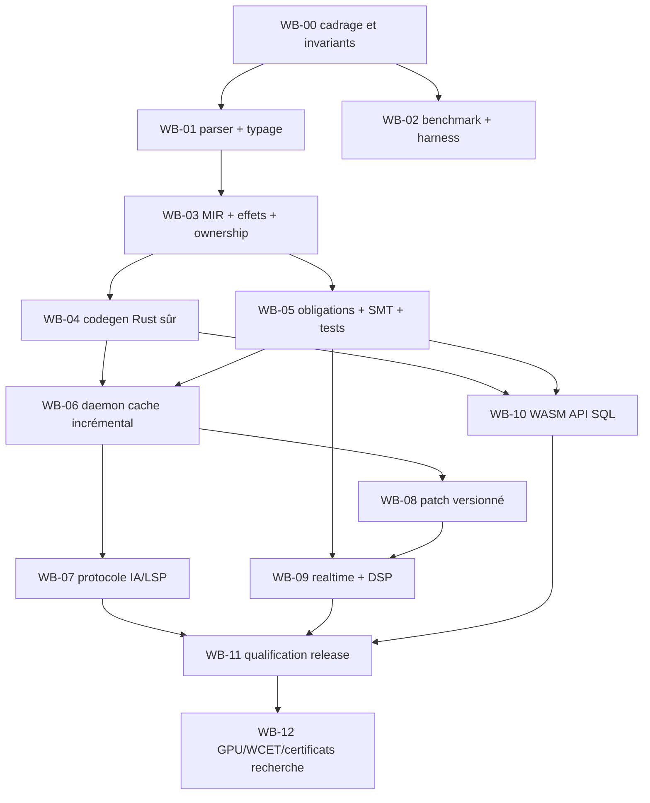

# Backlog d'exécution — lots cohérents, dépendances et livrables

Chaque lot crée **un artefact testable, avec tests négatifs**. Les tickets et PR mentionnés sont des **identifiants proposés**, pas de vraies issues GitHub. Aucun délai ni production-ready implicite.

## Ordre de dépendance

## Lots par tranche et preuves de sortie

| Lot | Livrable | Tests RED→GREEN exigés | Dépendance |
|---|---|---|---|
| WB-00 | Repo, RFC/ADR, threat model, fixtures, outillage | validations doc/policy, SHA | aucune |
| WB-01 | Parser CST incrémental + diagnostic span | corpus syntaxe malformée, fuzz, edits incomplètes | WB-00 |
| WB-02 | Harness bench + oracles, plateforme de réf | test de reproductibilité et mesure variance | WB-00 |
| WB-03 | HIR/MIR, types, emprunts, capacité | compile-fail, aliasing, droits interdits | WB-01 |
| WB-04 | Backend Rust sûr et exécutable référence | differential et conformance, compile flags | WB-03 |
| WB-05 | Vérification contracts/solveur/contre-ex | faux invariants, vacuité, timeout/unsupported | WB-03 |
| WB-06 | Daemon, overlays, cache, quotas | invalidation mutants, cold/warm, cancel | WB-04/05 |
| WB-07 | CLI/LSP/agent API structurée | schema, permissions, stale revision, redaction | WB-06 |
| WB-08 | Module patch, ABI check, migration | UAF adversarial, concurrent in-flight, rollback | WB-06 |
| WB-09 | Effets realtime + instrument audio + swap | malloc/mutex/panic interdits, device E2E | WB-03/08 |
| WB-10 | Frontend WASM, API, SQL + migrations | authz, migration N/N-1, browser E2E | WB-04/05/07 |
| WB-11 | Audit compilateur/ports/supply-chain | corpus fuzz, CI exact SHA, release reproducible | WB-07/09/10 |
| WB-12 | Research hard-RT, GPU, certificats | programmes expérimentaux séparés | WB-11 |

## Exemple de partition d'une fonctionnalité en PR de taille revue

WB-05 « contrats » :
1. PR A : syntaxe `requires/ensures` + AST + tests parse invalid.
2. PR B : représentation typée + démonstrateur obligations + tests sans solveur.
3. PR C : encodeur SMT minimal + tests contradictoires + check vacuité.
4. PR D : backend solveur + timeouts + statuts inconnus + fixtures.
5. PR E : cache proof id + mutants d'invalidation + differential cold/warm.
6. PR F : contre-exemple et schéma JSON + replay.

**Chaque PR** est petite (cible ≤400 LOC *code* hors tests/docs si réaliste), non fusionnée sans ses contrôles au SHA exact. Ne pas fragmenter une invariant de sécurité en PR indépendamment mergeables si cela introduit une fenêtre dangereuse : utiliser feature flags inactifs ou PR empilées.

## Définition de terminé (DoD) pour chaque ticket

- Spécification et hypothèses écrites ; lien ADR/requirements.
- Tests RED démontrant le défaut/absence initiale ; GREEN ensuite, sans affaiblissement.
- Build et suites pertinents réalisés au commit SHA exact sur cibles définies.
- Pas de warning sécurité critique, aucune régression P0/P1, format/lint.
- Diagnostic de limitations explicite ; benchmark si performance affectée.
- Revue indépendante sur compilateur/proofs/unsafe/patcher.
- Code, résultats et preuve de CI référencés ; jamais déclarer prod par simple réussite unitaire.

## Actions concrètes de lancement (première itération)

- [ ] Choisir nom/code, licence et gouvernance du dépôt (sans créer de dépôt avant instruction).
- [ ] Nommer responsables architecture/sécurité/validation (peuvent être cumulés temporairement, revue externe nécessaire sur noyau de confiance).
- [ ] Approuver ou amender ADR-000, ADR-001, ADR-002, ADR-010, ADR-012, ADR-014, ADR-017, ADR-019, ADR-031, ADR-032.
- [ ] Créer fixture de 20 programmes (10 positifs, 10 négatifs) comme oracle initial.
- [ ] Exécuter S1, S2 et S3 indépendamment ; comparer les résultats à froid et à chaud.
- [ ] Décider l'option de compilation et le modèle de cache de preuves avant d'empiler du code full-stack.
