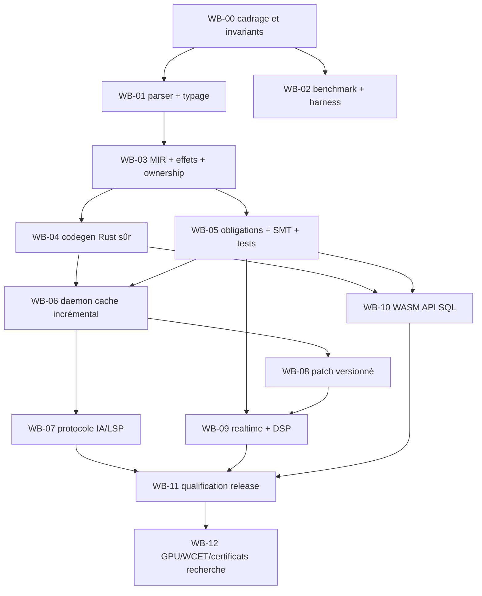

# RAVUM — CONSOLIDATION DU DEUXIÈME TOUR MULTI-IA, DÉCISIONS OUVERTES ET MVP PRÊT À CHALLENGER

> **Version documentaire : `0.3-review-candidate` — 8 novembre 2026.**  
> **Statut : travail de synthèse, NON ratifié.** Aucun ADR n'est `ACCEPTED`. Aucun prototype Ravum, test de performance ou preuve originale n'a été exécuté lors de cette consolidation.  
> **Usage :** un seul fichier autonome pour poursuivre une revue technique contradictoire, conserver tous les textes initiaux et lancer un MVP sans dette architecturale délibérée.  
> **Langue :** français. **Projet :** Ravum, langage universel et environnement de développement continu.

## Mode de lecture et ordre des autorités

1. **La vision et les exigences exprimées par le responsable du projet, P0-A à P0-I, ne sont pas modifiées.** Elles se trouvent au §3 du dossier intégral en annexe A.
2. **Les ADR-000 à ADR-041 originaux restent des propositions.** Leurs textes complets sont inclus en annexe A ; des amendements proposés ci-dessous ne modifient pas silencieusement ces textes.
3. **La présente partie 0.3 est une consolidation proposée**, qui rend visibles les décisions, conflits et preuves manquantes. Elle prime comme ordre de revue, non comme spécification déjà ratifiée.
4. **Les rapports du deuxième tour sont des avis externes**, reproduits en annexe B. Ils ne constituent ni des tests ni des votes indépendants lorsqu'ils reproduisent le même texte.
5. **Les affirmations externes** sont distinguées des résultats expérimentaux Ravum. Les quelques confirmations de sources primaires réalisées ici sont recensées à la fin de la consolidation.

# I — Résumé exécutif et lecture des nouveaux retours

## I.1 Ce que le deuxième tour établit réellement

Le retour transmis comprend six rubriques attribuées à Claude, DeepSeek, Mistral, Gemini, ChatGPT et GLM 5.3 Flash. Les rubriques détaillées **Mistral et Gemini sont identiques ligne pour ligne sur 600 lignes après leur en-tête** ; il faut les compter comme **une seule contribution textuelle** tant que leur provenance indépendante n'a pas été établie. La rubrique ChatGPT ne contient qu'un résumé et une annonce de document non présent en tant que contenu complet dans ce collage ; on ne peut pas prétendre auditer le rapport absent. Les audits détaillés distincts et vérifiables dans le collage sont donc principalement Claude, DeepSeek, Mistral/Gemini et GLM.

Tous les audits détaillés déclarent avoir relu les 42 ADR réels, contrairement à plusieurs revues de premier tour limitées aux intitulés. Ils corrigent explicitement des faux « nouveaux besoins » qui étaient déjà écrits : classes `rt_safe/rt_bounded/hard_rt`, gestion de la vacuité des preuves, cache de preuves contextualisé, autorité humaine sur les contrats, repli de hot swap, absence de runtime imposé et budgets du daemon.

**Consensus robuste (qualitatif, pas preuve) :** (a) garder P0-A…P0-I ; (b) bâtir d'abord un témoin Rust et une plateforme minimale ; (c) ne décider du frontend Ravum autonome qu'après des expériences comparatives ; (d) séparer analyse/preview rapide et preuve approfondie ; (e) protéger l'identité et l'état des preuves ; (f) refuser les swaps non qualifiés ; (g) mesurer la productivité agent de bout en bout et non le seul codegen.

**Ne pas convertir les chiffres de tierces parties en résultats Ravum :** p95 <50/150/500 ms sont des hypothèses/SLO exploratoires ; zéro faux `PROVED` observé sur un corpus est un test nécessaire mais non une preuve formelle universelle ; zéro XRUN observé ne vaut pas certification hard-RT ; « 6–8× Cranelift » ou « 60–70 % de valeur Rust » ne sont pas des mesures transférables.

## I.2 Synthèse attribuée par contributeur — sans faux vote

| Origine | Apport spécifique | Réserve / désaccord | À intégrer |
|---|---|---|---|
| **Claude** | Révèle dépendance problématique ADR-018→017 ; Rust n'est pas l'oracle universel d'un ownership plus permissif ; distingue S1-R/S1-T ; précise frontière C-ABI et lacune Windows RT. | Faut calibrer le coût d'un interprète Core IR indépendant et ne pas le rendre obligatoire dans M0. | Réviser dépendances, protocoles S1-T, INV d'indépendance ; qualifier RT selon preuves réellement disponibles. |
| **DeepSeek** | Classification normative des changements de patch, preuve relative à TCB, vigilance sur la complexité et les résultats non mesurés. | Quelques affirmations chiffrées de performance externes sont à valider ; propose parfois des décisions backend avant S3. | Modèle d'activation strict, protocole ABI fail-closed, trajectoire conditionnelle. |
| **Mistral/Gemini — même texte** | Met l'accent sur linking mesuré, parité dev/release, 6 composants au lieu de 10, revue sur ADR originaux. | Ne pas compter deux avis indépendants ; « linker dominant » reste une hypothèse dépendante du corpus. | Étendre S1/S3, budget complexité, parité comportementale. |
| **ChatGPT, résumé uniquement** | Rappelle la distinction cache de requêtes/cache de preuves, limites de Subsecond et compatibilité WASI variable. | Rapport complet simplement annoncé dans le collage ; impossible de vérifier ses 42 verdicts individuels sur ce seul matériau. | Maintenir les restrictions de preuve et les sources primaire, sans supposer un audit invisible. |
| **GLM 5.3 Flash** | H9 : handicap de langage hors corpus IA ; pré-enregistrement du gate M5 et S8 pilote ; dépendance sémantique au bridge Rust ; test de parité dev/prod. | Certains nouveaux ADR proposés par GLM recoupent des ADR existants ; l'hypothèse H9 reste non mesurée. | S8 tôt, traçabilité des reviews, trajectoire sous gate, pas d'API liée à rustc. |

## I.3 Conflits à trancher par tests, pas par addition de votes

| Question | Position A | Position B | Protocole recommandé |
|---|---|---|---|
| **Nouveau langage** | F → D conditionnelle | Rust seul peut suffire | Gate M5 sur baselines A/B/C, S1-T, S8-B, garanties réellement imposées, maintenance et coût total. |
| **Linker incrémental** | Nouvel ADR indépendant | Extension ADR-012/018 | Mesurer d'abord le linking ; créer un ADR autonome seulement si une vraie politique technique indépendante reste à décider. |
| **Risque LLM hors corpus** | Nouvel ADR | Hypothèse S8, pas décision | Lancer S8-B en vague 0 ; amender ADR-027/032 ; nouvel ADR seulement si la politique d'adoption/langage impose un arbitrage autonome. |
| **Budget de complexité** | Nouvel ADR | Règle de gouvernance existante | Inscrire comme gate de code review à ADR-041 ; ADR indépendant si un choix de structure non couvert survient. |
| **Bridge Rust** | Première chaîne obligatoire | Adaptateur optionnel, parallèle à Cranelift | Supprimer la dépendance ADR-018→ADR-017 ; expérimenter les alternatives à corpus égal. |
| **Oracle modèle mémoire** | Comparaison à Rust | Oracle Core IR indépendant | Rust oracle uniquement sur sous-ensemble commun ; mini-interprète dans un spike isolé lorsque la sémantique Ravum existe. |
| **Preuve Windows RT** | Étiquette `rt_safe` par inférence | Statut non qualifié sans instrumentation | `UNKNOWN` par défaut, ou `ASSUMED` si hypothèses explicites et acceptées ; ne pas revendiquer `PROVED` sans justification qualifiée. |
| **ABI patch** | Développement appuyé sur mécanismes Rust internes | C ABI / composant versionné | MVP : C ABI à types FFI sûrs + manifeste complet ; comparer WASM en S4, ne pas publier l'ABI avant validation. |

# II — Recommandation stratégique candidate

## II.1 Garder l'ambition Ravum et protéger la possibilité d'y parvenir

**F = stratégie de construction**, pas renoncement au langage : outils immédiatement utiles sur un dépôt Rust et de vraies applications de référence. **D = architecture Ravum autonome possible**, avec sémantique propre, vérification et backends spécialisés, activée uniquement si les mesures montrent un gain non réplicable raisonnablement par Rust outillé.

Deux erreurs symétriques sont à éviter : (1) écrire dès maintenant un compilateur, cinq IR, deux backends, un linker et un framework sans données ; (2) développer un orchestrateur collé aux API privées de rustc au point que la trajectoire vers Ravum devienne impossible. Un petit **protocole portable** dès le MVP offre une troisième voie.

**Interprétation du gate M5 :** un résultat négatif à la comparaison du langage est un résultat scientifique valide et la plateforme Rust reste un produit exploitable. Ce résultat ne doit pas être transformé en interdiction idéologique de créer Ravum plus tard ; les hypothèses peuvent changer.

## II.2 Les garanties ne sont pas interchangeables

- `TESTED` : propriétés vérifiées sur des cas exécutés, jamais universellement prouvées.
- `PROVED` : résultat démontré *relativement aux hypothèses et à la base de confiance déclarées* ; préciser `solver-trusted` ou `certificate-checked` selon mécanisme réel. Un certificat n'est pas inventé lorsque l'outil n'en fournit pas.
- `ASSUMED` : propriété dépendante d'une hypothèse explicite examinée ; pas un euphémisme pour outil absent.
- `UNKNOWN`, `UNSUPPORTED`, `TIMEOUT`, `PENDING`, `STALE` : ne valent jamais succès.
- `DISPROVED` : contre-exemple ou violation vérifiée pour le modèle considéré ; bien distinguer échec de preuve et comportement réel lorsque le modèle est incomplet.

La version active d'une preview doit afficher **son propre `snapshot_id`/artefact et son état de validation**, et non se faire passer pour la version correspondant au buffer de l'éditeur lorsqu'une nouvelle version échoue. Le runtime peut conserver la dernière version valide ; l'interface doit signaler sa différence avec la dernière source.

## II.3 Identités distinctes : correction proposée à plusieurs esquisses de MVP

Éviter de définir `SnapshotId = hash(source + toolchain + profil)` : une modification de compilateur ne modifie pas le contenu du source. Séparer les identités pour une invalidation exacte et un diagnostic intelligible :

1. `SourceSnapshotId` = empreinte canonique des couples *(chemin relatif normalisé, bytes, overlays, fichiers générés déclarés, manifests pertinents)* ; ne dépend pas de rustc.
2. `BuildContextId` = empreinte du snapshot + dépendances verrouillées, outils/version, flags/features, cible, variables d'environnement déclarées et inputs du build ; couvre sources de non-reproductibilité.
3. `VerificationKey` = empreinte de la propriété/VC canonique + contexte, contrats, axiomes, solveur/version/configuration, modèle FFI et hypothèses transitives.
4. `ArtifactId` = empreinte des **bytes de l'artefact** et manifeste liant `BuildContextId` + éventuelles preuves. L'égalité de sources n'est pas la preuve d'égalité des binaires.
5. `ActiveVersionId` = artefact chargé + manifeste ABI, version d'état et événement d'activation ; utile à la gestion du rollback.

Les schémas doivent avoir une **version** et permettre `UNKNOWN/UNSUPPORTED` sans jeter les données. Le MVP ne doit pas prétendre que ces empreintes prouvent, à elles seules, la correction du compilateur ou du cache.

## II.4 Hot swap : C ABI est une frontière, pas une garantie magique

La recommandation du MVP est d'utiliser un chargeur local de bibliothèques dynamiques à **C ABI explicite** (`extern "C"`, types FFI-sûrs, représentation contrôlée, ownership transmis explicitement). Un manifeste doit décrire au minimum la version ABI, les signatures exportées, les layouts récursifs effectivement traversant la frontière, les alignements, la gestion des handles, les conventions d'appel, le format de l'état et les contraintes de plateforme.

**Un simple `layout_hash` identique ne prouve pas que le module peut être remplacé sans UAF.** Il faut aussi définir : quiescence des appels actifs, conservation du code et des données vivantes, cas des function pointers/TLS/vtables, politique d'unload, absence d'exécution de destructeurs sur thread RT et reprise après erreur.

En développement, garder l'ancien module chargé tant que des appels s'y réfèrent. Sur Windows, prévoir des noms de fichier versionnés pour permettre la coexistence des DLL et éviter de réécrire un binaire verrouillé. La politique MVP est : `PATCHABLE`, `MIGRATION_REQUIRED`, `RELOAD_REQUIRED`, `REJECTED`; seul le premier passe automatiquement dans la tranche initiale.

Le hot swap est transactionnel **pour le processus contrôlé**, pas pour les effets externes (réseau, email, DB, paiements). Ne pas promettre de rollback de ces effets.

## II.5 Temps réel : état de preuve lié à la plateforme

- **MVP** : test de traitement DSP état simple, préparation des patches hors thread audio, publication à frontière de bloc, retrait différé et tests négatifs d'allocation, lock et destructor transitifs.
- **Windows** : ne pas présenter RealtimeSanitizer comme disponible pour Rust sur cette plateforme ; garder `UNKNOWN` ou `ASSUMED` selon les contrôles effectivement qualifiés, avec Linux en CI RTSan.
- **Linux** : RTSan est une détection dynamique utile, pas une preuve d'absence universelle de défaut ; préciser les plateformes et configurations testées.
- **Hard-RT** : hors MVP, dépend de la cible CPU/OS/ordonnanceur et de l'analyse WCET spécifique.

# III — Registre de consolidation ADR : propositions, pas décisions

## III.1 Ce que nous gardons explicitement

**Ne réécrire aucun ADR déjà correct.** Les textes originaux en annexe A couvrent déjà le noyau de vision, l'ownership et régions optionnelles, les types et contrats, anti-vacuité, classes RT, graphe de requêtes, cache d'hypothèses de preuve, statuts de confiance, budgets et annulation du daemon, parsing incomplet, hot swap versionné, migration/fail-closed, profils runtime, SQL typé et expand/contract, autorité IA, gates CI et certificats futurs.

## III.2 Amendements recommandés avec identifiants stables

| ADR existant | Amendement proposé pour nouvelle revue | Condition d'acceptation |
|---|---|---|
| **000** | Ajouter l'alternative « plateforme Rust sans langage neuf » dans le registre des alternatives. | Contre-expertise A/B/C complète. |
| **001** | Rust = langue d'implémentation initiale, jamais source normative de la sémantique Ravum ; adaptateurs externes publics uniquement. | Test de substitution d'adaptateur. |
| **002** | Rust n'est oracle différentiel que du sous-ensemble commun ; oracle indépendant du modèle mémoire propre ; mesurer l'ergonomie humaine/IA. | Corpus positif/négatif + S8-B. |
| **004** | Lier les exigences normatives au ledger d'autorité dès leur création. | Mutants et tests anti-affaissement des contrats. |
| **005** | Fermer l'ensemble d'effets minimum `{alloc,block,io,panic,unsafe,nondet}` ; traiter Drop/RAII et appels indirects transitivement, défaut = inconnu/refus ; ne pas supposer que `drop` est une catégorie orthogonale sans le tester. | Cas négatifs d'alloc indirecte, dyn/FFI, destructeurs. |
| **006** | Rapporter les garanties RT par plateforme et outil ; distinguer tests de traces, analyses statiques et WCET. | Harness Linux dynamique + tests Windows + limitations documentées. |
| **010** | Réviser le nombre d'IR suivant mesures ; expliciter les relations de raffinement, sans instancier les cinq IR dans MVP-0a. | Spike S1-T et oracle comportemental. |
| **012** | Étendre le pipeline mesuré à l'édition de liens et au patch ; S1-R témoin et S1-T langage jouet séparé. | Oracle froid/chaud incluant artefact final. |
| **013** | Lier chaque preuve au contexte, snapshot et outil ; `STALE` explicite ; cache non autoritatif avant S2. | Mutations des clés et Fresh-vs-cached. |
| **014** | Rendre normative la politique d'activation dev/strict/release ; préciser `PENDING`, `STALE` et niveau de confiance associé à `PROVED`. | Tests de schéma + transitions de statut. |
| **017** | Bridge Rust = bootstrap, audit/interop, candidat mesuré ; pas dépendance obligatoire du chemin interactif ni oracle unique. | S3 à corpus identique. |
| **018** | Supprimer la dépendance unidirectionnelle à ADR-017 ; alternatives bridge Rust/codegen direct indépendantes, linking mesuré, parité dev/release. | S3, différentiels et gate M5. |
| **019** | Contrat de scheduling : annulation observable, rejet de résultats périmés, éviction bornée, reprise après crash. | Tests kill/restart, OOM, cancel storms. |
| **021** | Classification normative `PATCHABLE/MIGRATION_REQUIRED/RELOAD_REQUIRED/REJECTED` ; C ABI explicite pour le MVP, pas ABI publique définitive. | S4 UAF, layout, appels en vol. |
| **024** | Ajouter Drop de l'ancien code/état hors RT, mesure séparée des discontinuités audio, test FFI. | S5 avec traces de thread et erreurs injectées. |
| **025** | Épingler la compatibilité WASI/WIT/runtime/toolchain par cible ; ne pas assimiler WASI 0.3 à un support uniforme partout. | S7 sur runtime choisi. |
| **027** | S8-A diagnostics texte vs structuré et S8-B langue hors corpus ; inclure temps humain de revue. | Protocole S8 pré-enregistré. |
| **032** | Mesurer P0-I : temps total humain+agent→livrable vérifié, et RAM simultanée IDE+daemon+solver+preview. Nommer la machine de référence. | Suite de benchmarks reproductibles. |
| **038** | Priorité Windows/Linux confirmée ou modifiée selon cibles audio ; CI Linux RTSan même si usage principal Windows. | Décision propriétaire de cible, puis S5. |
| **039** | Même comportement observable entre tiers sur un corpus défini ; exceptions versionnées et approuvées, pas promesse d'équivalence universelle non démontrée. | Differential testing dev/release. |
| **041** | Règle de revue ADR basée sur le **texte réel** et citation de paragraphe ; budget de complexité guidé par consommateurs, pas plafond arbitraire de LOC. | CI documentation, revue adversariale. |

**Note sur le statut de `ADR-035` :** déjà consacré aux certificats et à la TCB. Le renforcer par des liens à ADR-013/014 plutôt que créer un nouveau système parallèle.

## III.3 RFC-MULTIA-001…016 — recommandation de traitement

| RFC | Traitement proposé | Pourquoi |
|---|---|---|
| 001 Trajectoire F→D | **Candidat à un nouvel ADR**, identifiant non attribué | Décision indépendante sur le gate M5 et son critère de création du langage. |
| 002 Profils de preuve | AMEND 014 | Politique d'activation, pas nouveau système de preuves. |
| 003 Snapshots/artefacts | AMEND 013/030 | Identités distinctes et traçabilité. |
| 004 ABI/layout | AMEND 021/022 | Classes de swap. |
| 005 Tiering et parité | AMEND 018/039 | Conditionné à S3, pas d'interprète prod décidé. |
| 006 Daemon scheduler | AMEND 019 | Limites et annulation déjà prévues. |
| 007 Autorité/vacuité | AMEND 004/028 | Contenu initial largement suffisant. |
| 008 Langage hors corpus | **S8-B d'abord**, puis réexamen de l'indépendance ADR | Expérience mesurable, pas prématurément une décision. |
| 009 Linking | **AMEND 012/018 d'abord** | Ne créer un ADR de linker que si S1/S3 dévoile un choix architectural autonome. |
| 010 Simulation | AMEND 016 | Déjà spécifiée. |
| 011 Full-stack | AMEND 025/026 | Contrat cible, versionné. |
| 012 Macros/build | Couvert 029/037 ; tester | Pas de doublon. |
| 013 Drop/RT | AMEND 005/006/024 | Tests transitifs et FFI. |
| 014 Temps total IA | AMEND 027/032 | S8. |
| 015 Certificats | Couvert 035 | Pas de nouveau checker au MVP. |
| 016 Budget noyau | AMEND 010/041 | Suppression des abstractions sans usager réel. |

**Règle d'identifiants** : ne pas utiliser les numéros ADR-042+ attribués séparément par les modèles. Tout candidat nouveau reste une RFC jusqu'à la validation du responsable du projet ; les textes originaux 000–041 sont préservés en annexe A.

## III.4 Proposition de nouveau RFC de trajectoire (non ratifiée)

**ID provisoire : `RFC-MULTIA-001`**. **Statut : PROPOSED**.  
**Contexte** : P0-A et P0-I exigent un gain de développement mesurable ; un nouveau langage ajoute un coût d'écosystème et de vérification de sémantique.  
**Options** : A = Rust + outils existants ; B = nouveau frontend Ravum → Rust ; C = frontend Ravum → IR → Cranelift ; D = plateforme expérimentale F construite en premier puis décision du langage, avec choix B/C conditionnel.  
**Recommandation** : F comme trajectoire réversible, frontend Ravum autorisé seulement après gate M5 pré-enregistré sur S1-T, S3 et S8-B.  
**Conséquences** : valeur exploitable avant le langage ; risque de retard de syntaxe, mitigé par un prototype syntaxique isolé et un oracle de sémantique.  
**Preuves** : comparer les mêmes programmes et tâches IA sur les mêmes plateformes et budgets, en séparant parse/typecheck/codegen/link/activation/preview et analyse de garanties.  
**Échec / repli** : si le frontend neuf n'apporte pas d'amélioration suffisante au regard de sa maintenance, continuer la plateforme Rust sans prétendre que Ravum a livré un nouveau langage. Réexaminer ultérieurement avec nouvelles preuves.  
**Action interdite avant décision** : figer une syntaxe publique, une ABI publique ou des dépendances à des types internes rustc.

# IV — MVP-0a rapide, testable et scalable sans dette volontaire

## IV.1 Frontières fonctionnelles minimales

**Six composants logiques au maximum**, séparés en crates uniquement lorsque deux consommateurs/une exigence d'isolation le justifient. Ne pas imposer six packages vides dès le premier commit :

| Composant | Responsabilité | Frontière stable | Ce qui n'y entre pas |
|---|---|---|---|
| `ravum-protocol` | Diagnostiques, statuts, version de schéma, messages d'agent | JSON/SARIF versionnés, types propres | Types internes rustc, objets LSP exposés directement, UI, solver |
| `ravum-snapshot` | Overlays, fichiers sources, identité des contenus immuables | `SourceSnapshotId` | Tools de compilation, politiques de preuve |
| `ravum-coordinator` | Priorités, annulation, workers, publication de versions, ledger local initial | Snapshot/job/status/events | Moteur de compilateur maison, sémantique rustc encodée |
| `ravum-rust-adapter` | rust-analyzer via LSP ; cargo/rustc en sous-processus | `AnalyzerPort` et `BuilderPort` | Import `rustc_private`, API publiques Ravum dépendantes de cargo |
| `ravum-patch-host` | Code chargé par modules, classification ABI, swap/retrait de versions | `PatchPort` + manifeste versionné | Frontend, solver, codegen, ORM |
| `ravum-cli` | `check`, `watch`, `patch`, `status`, `bench` | CLI et JSON | Métier applicatif, IDE intégré |

**L'évidence formelle** peut être initialement un journal append-only dans le coordinator ; extraire un composant `ravum-evidence` quand le premier vérificateur indépendant en a besoin (M2), sans rétrochanger les messages déjà versionnés. L'extraction n'est pas une dette : c'est un seuil explicite de création.

MVP-0a **n'implémente pas** : nouveau parseur, syntaxe, ownership, solver, IR complète, compileur natif autonome, linker, framework UI, réseau distribué, migration de struct, support GPU ou mobile, certificat hard-RT. Les contract tests pour full-stack et audio sont créés tôt, mais la verticale complète vient en M3/M4.

## IV.2 Contrats de protocole à définir dès M0

**Événements** `SnapshotCreated`, `AnalysisStarted`, `DiagnosticsPublished`, `BuildStarted`, `ArtifactPrepared`, `PatchClassified`, `PatchActivated`, `PatchRejected`, `ResultStale`. Chacun inclut `schema_version`, `run_id`, `snapshot_id`, ordre monotone, version d'outil, durée et motif d'échec quand approprié.

**Statuts** : séparer `VerificationStatus` de `JobStatus`, et de `PatchClass`. Un `PROVED` sans niveau de confiance valide ne passe pas la validation du schéma ; un résultat sur ancien snapshot doit être explicitement `STALE` ou rejeté, jamais réétiqueté.

**Autorité** : les contrats normatifs possèdent un owner humain et une empreinte ; un agent ne peut pas rendre un test ou un contrat plus permissif pour faire passer une PR sans validation autorisée. Pour projet solo, approbation explicite par le propriétaire du dépôt (pas besoin d'inventer un comité).

## IV.3 Le parcours produit à démontrer en M1

1. L'éditeur ou agent écrit des buffers de code (éventuellement incomplets) ; analyse incrémentale des changements non sauvegardés possible via LSP.
2. Pour compiler une source non sauvegardée, créer une **copie isolée atomique** du snapshot lorsque la chaîne Rust ne sait pas compiler directement l'overlay ; ne jamais écrire dans l'arbre utilisateur sans demande.
3. Le coordinator lance analyse puis build du **snapshot cohérent** ; annule ou ignore les résultats obsolètes.
4. Le PatchHost prépare un module candidat, valide son manifeste et classe la modification ; aucune activation d'une source invalide.
5. Un patch compatible devient actif dans une application témoin ; l'ancienne version reste chargée jusqu'à quiescence.
6. Un patch incompatible, une erreur de compilation ou une rupture de contrat laisse **l'ancienne version active**, avec statut et trace compréhensibles par l'agent.
7. Une vue CLI et preview minimale montre simultanément snapshot courant, version active et résultat des vérifications.
8. La CI démontre toutes les branches négatives, y compris layout modifié, job annulé, résultat STALE, crash worker, app concurrente et erreur RT simulée.

## IV.4 Tests de MVP non négociables

- `schema_rejects_proved_without_trust` : interdit statut de preuve sans base de confiance.
- `stale_results_never_activate` : un job ancien ne peut remplacer la version active d'un snapshot plus récent.
- `invalid_source_keeps_last_good` : syntaxe cassée, preview ancienne toujours identifiée comme telle.
- `incompatible_abi_rejected` : changement de champs/signature provoque `REJECTED` ou `RELOAD_REQUIRED`, jamais patch optimiste.
- `inflight_calls_safe` : ancienne librairie non déchargée pendant appels actifs.
- `patch_host_crash_isolated` : échec worker ne détruit pas le registre de résultats.
- `no_runtime_dev_in_release` : infrastructure patch/daemon absente du binaire prod quand profil release l'exige.
- `agent_cannot_weaken_contract` : tentative de suppression/affaiblissement d'un test normatif provoque un refus vérifié.
- `rt_drop_not_on_callback` : destruction d'un module retiré sur thread autre que le callback (M3).
- `fullstack_contract_fixture_exists` : contrat produit/API/SQL minimal écrit et versionné dès M0, E2E exécuté en M4.
- `impacted_ci_is_conservative` : tests touchés exécutés ; si doute, plus de tests, jamais masquer les échecs.

## IV.5 Chaîne CI pragmatique

- **PR — T0** : format/schéma, graphes de dépendances autorisées, sûreté des messages, tests rapides.
- **PR — T1** : compile/test modules directement impactés + contrats obligatoires, avec fermeture conservative sur le graphe de dépendances.
- **PR — T2** : tests de versions, race, hot swap, cas négatifs et sanitizer sur environnements couverts.
- **Nightly — T3** : régression intégrale, E2E complets (aucun test en échec caché ou transformé en avertissement), benchmarks de tendance, mutations d'impact.
- **Release — T4** : preuve/confiance réellement requise par profil + binaire reproduit/testé sur cible + provenance exacte, sans accepter un `UNKNOWN` non autorisé.

Les tests en échec doivent rester des informations de diagnostic, jamais être supprimés du périmètre par une heuristique d'impact. Une défaillance du graphe d'impact est un bug à corriger, pas une raison de cacher des tests.

# V — Expériences, ordre de réalisation et gates

## V.1 Matrice de phases

| Phase | Livrables minimum | Go/No-Go | Dépendances |
|---|---|---|---|
| **M0** Cadrage et mesures | P0/INV, corpus gelé, baselines Rust, S8 pilote pré-enregistré, schéma de messages, ABI expérimentale, machine 16 Go nommée, protocoles de tests, contrat full-stack minimal | Données traçables, aucun contrat abandonné | Aucune |
| **M1** Boucle continue MVP-0a | 6 composants max, source overlay, diagnostics, compilation depuis snapshot isolé, patch compatible/refus, preview CLI, logs/bench | Aucune activation stale/invalide, patch ABI non optimiste, mesures p95 publiées | M0 |
| **M2** ProofBroker expérimental et S1-T | Kani via processus externe, cache preuve non autoritatif, tests mutants S2, frontend jouet séparé avec requêtes par définition et petit codegen, S8 A/B | Jamais de `PROVED` fabriqué, S1-T comparé au témoin sans différence de périmètre | M1 ; S1-T peut démarrer en parallèle dès M0 si isolé |
| **M3** DSP RT + S4/S5 | État gain/IIR, patch à frontière de bloc, RTSan Linux, Windows explicitement limité, tests de Drop, stress concurrents et mesures réelles | Pas de défaut critique détecté ; rejet sûr des cas non supportés ; aucun label hard-RT non justifié | M1, preuves M2 pour labels de preuve |
| **M4** Verticale full-stack + S7 | petite API Rust, client preview, SQLite, contrat N/N-1, E2E réel, authz serveur et changement de schéma | E2E et contrats effectifs, pas de sécurité simulée | M1 |
| **M5** Décision du langage | A Rust+outil vs B mini-Ravum→Rust vs C mini-Ravum→Cranelift, même corpus, S8-B, S3, statuts de preuve et coûts cumulés | Décision argumentée, pas un « vote de modèles » | Rapports M0–M4, S1-T, S8 |
| **M6+** Suivant le gate | Ravum autonome et backends si bénéfice, ou plateforme Rust durable si meilleur produit | ADR révisés selon preuves | M5 |

**Attention à l'ordre** : la preuve de pertinence du langage doit démarrer **avant M5** : S1-T et S8 pilote sont les expériences peu coûteuses à préparer dès la vague 0/M2. M5 est la **décision** basée sur données, pas le début des prototypes Ravum.

## V.2 S1-R / S1-T et coût complet

- **S1-R** : baseline Rust standard, codegen Cranelift pour Rust si disponible sur toolchain épinglée, Subsecond ou autre approche hot patch, mêmes fixtures et états de cache explicités.
- **S1-T** : mini-frontend expérimental contrôlé par le projet (fonctions simples/types de base), requêtes par définition, codegen direct Cranelift, aucune API publique à maintenir.
- **Même corpus comportemental**, traduction et tests figés *avant* tuning, pour ne pas avantager le mini-langage en supprimant des fonctionnalités difficiles.
- Phases mesurées : changement → parse → types/effets pris en charge → codegen → linking/chargement → activation → visible ; si une phase est absente d'un candidat, ne pas comparer comme si elle existait.
- Mutations : corps privé ; signature publique ; layout de type partagé ; dépendance ; contrat ; modification qui ne change rien ; macro ou générique très utilisé, lorsque comparable.

## V.3 S2 preuves et cache : la borne de sécurité

Ne jamais rendre le cache de preuves autoritatif sur le simple résultat « zéro erreur dans 10 000 essais ». L'expérience doit inclure : mutations source, contrat, axiomes, toolchain, solveur, options, FFI, cible, imports, fichiers générés, features et chemins de dépendance ; tests `fresh vs cached`, crash/rétablissement et conflit de snapshots.

Le gate S2 autorise uniquement une **politique de réutilisation circonscrite**, explicitant la TCB et les préconditions du cache. Une obligation nécessitant un checker indépendant demeure `solver-trusted` tant qu'un certificat proprement validé n'est pas disponible.

## V.4 S4/S5 et plateforme

S4 : fonctions avec et sans état, appels en vol, threads simultanés, TLS, closures, handles FFI, changement de layout, DLL versionnées, rollback. Un refus correct est une issue attendue, pas un échec d'outil.

S5 : DSP en simulation puis hôte réel, sample rates 44,1/48/96 kHz, buffers 32/64/128/256/512, CPU contraint ; suivre RMS/peak/continuité sonore, allocations/lock, latence callbacks, XRUN ; ne jamais dériver certification WCET d'une trace.

## V.5 S8 productivité IA — expérimentation prioritaire

**Pré-enregistrer** : 20–30 tâches de correction (défauts fonctionnels, types, mémoire, contrats, concurrence, DSP, API), mêmes modèles, contexte, budget tokens et critères de réussite, ordre randomisé. Au minimum trois bras :

- A : Rust standard, diagnostics textuels.
- B : Rust + protocole structuré et contre-exemple réel lorsqu'il existe.
- C : mini-syntaxe Ravum hors corpus, avec documentation injectée dans le contexte et diagnostics structurés équivalents.

Séparer un test B vs A (valeur de l'outillage) et un test C vs B (coût/bénéfice d'un langage nouveau). Ne pas mesurer le seul taux de compilation : rapporter taux de tâches **correctement résolues** selon tests indépendants, durée totale, itérations, tokens, coûts et temps humain de revue. Échecs de résolution, contrats affaiblis et changements de tests doivent être enregistrés comme tels. Les seuils (par exemple ≤20 points de handicap) sont des hypothèses **à pré-enregistrer**, pas une frontière de vérité.

## V.6 Définition de DONE et dette technique

Une PR ne peut être déclarée terminée que si : (1) elle référence REQ/ADR/test ; (2) elle inclut test positif **et négatif** ; (3) elle cite son snapshot/commit exact ; (4) elle conserve les contraintes de sûreté, ou explicite un statut `UNKNOWN/ASSUMED` ; (5) ses dépendances sont limitées ; (6) aucun nouveau composant abstrait n'est créé sans consommateur ; (7) aucun benchmark ne compare des workloads différents ; (8) ses échecs E2E restent visibles ; (9) les cas non supportés sont refusés explicitement ; (10) un autre agent/humain peut reproduire la preuve.

# VI — Décisions réservées au responsable et défauts proposés

| ID | Décision humaine nécessaire | Valeur recommandée en attendant validation | Effet |
|---|---|---|---|
| D1 | Trajectoire du projet | **F maintenant, D conditionnel**, sous RFC-MULTIA-001 | Ne pas figer frontend/IR/langage. |
| D2 | Machine de référence | **Machine principale 16 Go RAM** et un deuxième profil 32 Go lorsque possible | Mesure P0-H, jamais sans fiche matériel/OS. |
| D3 | Frontière de patch du MVP | **C ABI + manifeste complet** en expérimentation, WASM comme comparatif | Éviter ABI Rust instable. |
| D4 | Audio de référence | **Harness simulé M1**, host réel M3 | Démonstrateur rapide mais vérification réelle ultérieure. |
| D5 | Autorité des contrats en solo | **Owner humain + approbation explicite horodatée**, ledger de contrats | Préserve INV-02 sans comité artificiel. |
| D6 | Nouveaux invariants | **Indépendance sémantique, oracle indépendant, parité, revue sur texte original, identités distinctes** | Amendements proposés, pas ACCEPTED. |
| D7 | Nombre de crates et IR | **6 composants logiques max en 0a**, IR propre seulement spike isolé | Éviter suringénierie. |
| D8 | Gate M5 | **Pré-enregistrer S1/S3/S8**, seuils et coûts de maintenance | Empêcher confirmation a posteriori. |
| D9 | Licence et gouvernance | **À choisir avant publication**, pas bloquant pour lecture/spikes locaux | Pas de choix juridique inventé. |
| D10 | Priorité OS | **Windows + Linux** pendant MVP ; macOS comparé plus tard selon audio | Séparer RTSan Linux du fonctionnement Windows. |

## VI.1 Invariants supplémentaires proposés (tous PENDING_OWNER_APPROVAL)

- **INV-11 — Indépendance sémantique** : aucune API/norme Ravum n'est définie par un type privé rustc, cargo, solveur ou framework ; adaptateurs remplaçables. Cette définition est distincte de l'INV-11 cité par certains modèles, qui utilise le même numéro pour la parité : **numérotation finale à arbitrer**.
- **INV-12 — Oracle indépendant** : une propriété propre à Ravum ne peut être prouvée uniquement par l'égalité avec un programme Rust de sémantique différente.
- **INV-13 — Parité observable dev/release** : tout artefact de release qualifié est testé sur un corpus identique avec oracle commun, exceptions documentées. Ne signifie pas preuve mathématique générale d'équivalence.
- **INV-14 — Revue de texte réel** : tout verdict d'ADR cite la clause consultée ; sinon `NOT_REVIEWED`.
- **INV-15 — Origine et identité** : séparation `SourceSnapshotId/BuildContextId/VerificationKey/ArtifactId/ActiveVersionId` et détection des résultats périmés.
- **INV-16 — Revues non duplicatives** : une sortie textuellement identique ne constitue pas une deuxième confirmation indépendante, quelle que soit l'étiquette modèle.

La numérotation proposée est propre à ce dossier `0.3-review-candidate`, volontairement non fusionnée avec les propositions concurrentes de 0.2.

# VII — Mandat à transmettre aux modèles pour la prochaine revue ciblée

**Ne recommencez pas une veille générale de 100 pages.** Les textes originaux, la nouvelle consolidation et les réponses intégrales de tour 2 sont reproduits plus bas. Travail attendu : correction chirurgicale fondée sur des extraits et expériences.

### Sortie obligatoire de chaque relecteur

1. **Validation des sources** : déclarer quels paragraphes des 42 ADR ont été effectivement lus ; signaler la duplication Mistral/Gemini et tout autre matériau non indépendant.
2. **`ADR_DIFFS.md` conceptuel** : fournir un diff précis sur ADR-002, 005, 012, 013, 014, 017, 018, 021, 027, 032, 039, 041, plus les autres réellement nécessaires ; citer une phrase originale et identifier le scénario test négatif.
3. **Analyse du MVP 6 composants** : détecter toute dépendance cachée à rustc, ABI instable ou statut de preuve fabriqué. Proposer l'interface minimale sans package inutile.
4. **Contre-expertise des cinq identités** : dire si la séparation snapshot/build/verification/artifact/active est suffisante, trop coûteuse ou inexacte ; proposer un oracle de mutation.
5. **Risques du C ABI PatchHost** : chercher au moins un scénario UAF, TLS, vtable, Drop, FFI ou composant état qui échappe au manifeste et préciser le test qui l'attrape.
6. **Protocole S1-R/S1-T** : montrer comment faire une comparaison équitable sans supprimer les fonctionnalités difficiles d'un des candidats.
7. **Protocole S8-A/B/C** : signaler tout biais lié aux tokens, au savoir préalable des modèles, au coût d'outillage et à l'accès aux tests.
8. **Choix ERC/F→D** : répondre si les preuves S1/S3/S8 sont suffisantes pour décider de construire Ravum autonome, ou si un test de garanties sémantiques supplémentaires est indispensable.
9. **Corrections des affirmations externes** : fournir URLs primaires, dates et caveats ; aucune métrique non reproduite n'est `MESURÉ-RAVUM`.
10. **`DECISIONS_TO_OWNER`** : au maximum huit décisions prioritaires, avec défaut prudent et raison de reporter les autres.

**Interdictions :** attribuer un numéro ADR-042+ ; déclarer un ADR `ACCEPTED` ; modifier les contrats pour faire passer les tests ; présenter une simulation comme preuve hard-RT ; inventer des chiffres Ravum ; éliminer/masquer des tests E2E en échec ; démarrer l'implémentation du langage sans validation du gate.

**Sortie formatée :** `VERDICT`, `ERRORS_FOUND`, `ADR_DIFFS`, `S1/S8_PROTOCOL_REVISIONS`, `MVP_MINIMALITY`, `RISKS`, `OPEN_DECISIONS`. Chaque conclusion doit être liée à P0, ADR, invariant et expérience. Les modèles peuvent contester le présent addendum et doivent conserver les désaccords, non chercher à approuver la majorité.

# VIII — Sources primaires revérifiées pour cette consolidation

- RTSan Rust : https://github.com/realtime-sanitizer/rtsan-standalone-rs — support Linux/macOS/iOS, Windows non pris en charge dans le README observé le 8 novembre 2026.
- RealtimeSanitizer général : https://github.com/realtime-sanitizer/rtsan — indique également l'absence de support Windows.
- Subsecond : https://docs.rs/subsecond/latest/subsecond/ — limitations de patch « tip crate », changements de struct/layout, statics, TLS et plateforme ; les déclarations de performance ThinLink restent des claims du projet, pas des mesures Ravum.
- WASI 0.3 : https://wasi.dev/releases/wasi-p3 — 0.3.0 le 11 juin 2026 ; 0.3.1 le 11 août 2026 ; prise en charge par runtime variable.
- Zig 0.17.1 : https://ziglang.org/news/0.17.1-released/ — publication primaire du 3 novembre 2026 ; **l'indication « aucune source primaire Zig 0.17 » des rapports n'est plus correcte**. Cela ne vérifie pas à lui seul les chiffres de benchmark Zig cités.
- Rust cg_clif : https://goals.rust-lang.org/2026/improve-cg_clif-performance.html — objectifs et résultats propres à leur corpus, à ne pas généraliser.

Toutes les autres références de l'annexe A demeurent des sources et hypothèses du dossier précédent, pas des vérifications indépendantes réalisées dans ce tour.

---

# ANNEXE A — DOSSIER INTÉGRAL PRÉCÉDENT (`0.2-review-candidate`) — CONSERVÉ SANS MODIFICATION

> Cette annexe reproduit le document de transmission précédent, qui inclut **les 42 ADR complets (ADR-000…041)**, les spécifications et les retours du premier tour. Son statut historique est préservé ; elle ne constitue pas une validation des propositions.

# RAVUM — DOSSIER UNIQUE DE TRANSMISSION, CONTRE-EXPERTISE ET PLAN MVP

**Version documentaire :** 0.2-review-candidate · **Date :** 7 novembre 2026  
**Statut :** DRAFT / À CHALLENGER — **aucun ADR `ACCEPTED`**, aucun logiciel Ravum déclaré opérationnel.  
**Destinataires :** Claude, DeepSeek, Mistral, Qwen, Kimi, Gemini, GLM 5.3 Flash et tout reviewer humain ou agent indépendant.  
**Nom de travail :** Ravum (provisoire ; le nom ne constitue pas une décision de marque).  
**Mode d'emploi :** **Ce fichier suffit à lui seul.** Il contient la charte, la chronologie, les synthèses attribuées des sept revues, les divergences, une proposition de MVP, un plan d'exécution, les **42 ADR originaux intégraux**, et les annexes techniques du blueprint d'origine. Il ne suppose pas l'accès à l'historique de conversation, ni aux autres fichiers du projet.

> **Avertissement de provenance** : le contenu des ADR-000 à ADR-041 et des annexes « originales » est repris de l'archive documentaire `universal-language-blueprint-2026-10-23.zip`. Les synthèses multi-IA sont établies à partir du texte transmis par l'utilisateur le 7 novembre 2026. Les affirmations techniques de ces modèles sont **des propositions ou revendications de sources tierces**, pas des mesures réalisées pour Ravum. Les analyses et prescriptions portant le label **« consolidation proposée »** sont de nouvelles propositions pour revue, jamais des ADR acceptés.

## Table des matières opérationnelle

1. Mandat des reviewers et règles anti-oubli.
2. Historique complet condensé de la conversation.
3. Objectif final et invariants de Ravum.
4. Éléments de l'état de l'art et degré de confiance.
5. Résumé des sept modèles, avec apports, désaccords et limites.
6. Consensus, divergences et décisions ouvertes.
7. Architecture cible candidate et trajectoire MVP.
8. MVP le plus petit utile, sans dette architecturale volontaire.
9. Plan d'implémentation détaillé, backlog, preuves et CI.
10. Protocoles d'expérimentation S1–S10, budgets et seuils.
11. Gouvernance des ADR et catalogue des RFC nouvelles.
12. Questions adressées aux autres IA et format exact de retour.
13. **Annexe A : les 42 ADR originaux complets.**
14. **Annexe B : documents originaux de cadrage, spécifications, risques et recherches.**
15. Inventaire de provenance et contrôles du fichier.

---

# 1. MANDAT DE LA NOUVELLE REVUE MULTI-IA

## 1.1 Ce que nous demandons

Vous recevez **un dossier autonome**, contenant les textes authentiques des 42 ADR initiaux et une synthèse attribuée des retours de sept modèles. Nous ne vous demandons **ni de nous féliciter**, ni de commencer à coder : nous attendons une **contre-expertise qui améliore objectivement Ravum**, sans oublier son essence.

Vos missions, dans cet ordre :

1. Lire les invariants P0-A à P0-I et les ADR-000 à ADR-041 **réels, en annexe A**. Ne pas vous limiter aux titres.
2. Vérifier les affirmations techniques discutables, en séparant sources primaires, analyses secondaires, extrapolations et chiffres sans benchmark reproductible.
3. Confronter les sept avis, en recensant les **vrais** désaccords, pas les différences de vocabulaire.
4. Proposer la **plus petite architecture extensible** qui livre rapidement une amélioration concrète de la productivité, sans dette technique volontaire.
5. Réviser les ADR par **amendements proposés** ; ne jamais changer silencieusement un ADR original ni créer un numéro en conflit.
6. Concevoir des expériences qui pourraient invalider notre architecture favorite ; préférer une mesure négative honnête à une démonstration biaisée.
7. Fournir un plan Go/No-Go fondé sur des artefacts, un SHA, des résultats réels et les limites des garanties.

**Interdictions :** n'affaiblir aucun objectif P0 sans signaler `CONFLICT`/`UNREALISTIC` et proposer une reformulation soumise à l'utilisateur ; ne pas masquer les échecs CI, modifier les tests pour passer au vert, transformer `UNKNOWN` en `PROVED`, assimiler tests déterministes à preuves universelles, promettre zéro crash global, ou lancer de longs travaux sans accord. Les propositions peuvent contester les moyens techniques et la séquence : **les objectifs restent la référence**.

## 1.2 Degré de confiance des affirmations

- **SOURCE-ORIGINAL** : phrase issue des ADR ou spécifications datés du 23 octobre 2026.
- **RETOUR-MODÈLE** : rapport d'un des sept modèles, non vérifié comme expérience réelle.
- **CONSOLIDATION-PROPOSÉE** : arbitrage recommandé ici, en attente de revue humaine.
- **ÉTABLI-EXTERNE** : propriété documentée par une source primaire à retrouver/revalider pour la version ciblée.
- **MESURÉ-RAVUM** : uniquement après exécution effective d'un prototype avec logs reproductibles. **Il n'en existe aucun à ce jour dans les documents fournis.**

Le but est de ne jamais confondre un consensus d'agents avec une preuve d'ingénierie.

---

# 2. HISTORIQUE FIDÈLE DE LA CONVERSATION ET DU PROJET

## 2.1 Départ : pourquoi créer Ravum ?

Le projet est né du souhait d'un langage inspiré de Rust : **très léger et efficace, sans erreurs mémoire dans son sous-ensemble sûr, capable de garantir le plus de comportements possible avant exécution, et d'émettre des diagnostics extrêmement précis pour les humains et les agents IA**. Il doit permettre de créer logiciels desktop, web, backend, services, bases de données, logiciels audio/vidéo/streaming, jeux, mobile, systèmes et logiciels embarqués. Le nom **Ravum** est le favori provisoire ; d'autres noms avaient été envisagés, sans décision de marque définitive.

Le critère n'est jamais « réinventer Rust » : le langage doit **réduire le temps total de création d'un logiciel fiable**, en conservant des performances natives et une consommation raisonnable sur une machine de développement de **16 Go de RAM**.

## 2.2 Première clarification : prouver, tester, mesurer sont trois choses différentes

Un programme arbitraire ne peut pas être automatiquement prouvé correct pour toutes propriétés et toutes entrées dans le cas général. La conversation a donc établi un registre explicite des statuts de garanties, la nécessité d'indiquer hypothèses et périmètre, et une séparation entre vérifications statiques, preuves déductives, model checking et tests reproductibles. La sécurité mémoire ne doit pas être confondue avec l'absence de bugs métier, de panne matérielle ou de `panic`.

## 2.3 L'exigence temps réel et les budgets de ressources

Le langage doit convenir aux traitements DSP et plugins **VST3/CLAP**, au streaming et aux systèmes sensibles à la latence. La discussion a introduit des contrats d'effets (pas d'allocation, pas de blocage, pas d'I/O sur thread critique), des budgets de pile et d'itérations, des restrictions de destructeurs et des profils distincts `rt_safe`, `rt_bounded`, `hard_rt`. Une borne WCET dépend du matériel, de l'ordonnanceur et des hypothèses de plateforme : la simple interdiction d'allocations n'est pas une certification hard-RT.

## 2.4 Tournant fondamental : compilation continue et preview instantanée

Le besoin utilisateur central a été précisé : **compiler pendant l'écriture du code, y compris pendant sa génération progressive par l'IA**, sans longue phase d'attente finale ; afficher un aperçu interactif aussi fluide qu'un hot reload CSS ; remplacer la logique native lorsque c'est possible ; conserver la dernière version valide lorsque le source est temporairement invalide ; préserver l'état compatible ; revenir en arrière proprement.

La proposition est un compilateur/daemon permanent, recevant des *overlays* non sauvegardés, analysant les unités stables, invalidant un minimum de dépendances et activant des modules versionnés via des points d'indirection. L'exécutable de production peut différer du runtime de développement : **pas de gros moteur de hot reload imposé au binaire final**.

## 2.5 L'IA est un utilisateur de première classe

Les agents doivent recevoir : diagnostics structurés, contre-exemples, arbre d'impact, demandes de correction possibles, coûts de re-vérification, état des garanties et performance avant/après. Les spécifications sont **séparées en autorité** de leur implémentation ; un agent peut proposer de les changer mais pas les affaiblir silencieusement. Le compilateur est un oracle indépendant, pas un simple évaluateur textuel.

## 2.6 Universalité par cœur commun, non par runtime monolithique

Frontends (navigateur/WASM, natif/mobile), backends, SQL et migrations, DSP, embarqué et GPU exigent des environnements différents. Une famille de types/contrats/capacités peut être commune tandis que les bibliothèques, IR de bas niveau et backends restent spécialisés. La première version doit ne couvrir qu'un sous-ensemble utile **tout en testant tôt au moins un cas DSP et un cas full-stack**, pour ne pas devenir un outil système sans avenir web.

## 2.7 Veille d'octobre et premier plan

Une veille a examiné Rust/Verus/Kani/Creusot/Dafny/SPARK, Clang Function Effect Analysis/RealtimeSanitizer, Salsa/rust-analyzer, Zig, Unison, Cranelift/LLVM, Dioxus/Subsecond, Erlang, TigerBeetle/FoundationDB, WASM/WASI, SQLx, Alive2/CompCert, etc. Elle a conclu que nombre de briques existent séparément, mais que leur intégration sûre et légère n'est pas démontrée. Un dossier daté du **23 octobre 2026** a ensuite proposé **42 ADR (ADR-000 à ADR-041)** et des spécifications, plans d'expériences S1–S10, gates CI, gouvernance, risques et mandat agents. Aucun des ADR n'a été accepté.

## 2.8 Revue contradictoire du 7 novembre 2026

Un mandat autonome a été soumis à **Claude, DeepSeek, Mistral, Qwen, Kimi, Gemini et GLM 5.3 Flash**. Ils ont convergé sur la sécurité Rust-like, le modèle gradué de preuve, l'incrémentalité, le hot swap limité par l'ABI, le temps réel par profils, et l'autorité des contrats. Ils divergent principalement sur la **trajectoire** : construire d'abord une plateforme utile sur Rust (approche F) ou un langage/IR propre immédiatement (approche D), et sur l'ordre des spikes.

**Problème de méthode important :** les sept rapports ont signalé l'absence des ADR originaux dans leur environnement. Leurs verdicts sur ADR étaient donc majoritairement **fondés sur les titres**, malgré certains rapports détaillés. Ce fichier corrige ce problème en annexant les **42 textes intégraux**. De nombreuses « nouveautés » (niveaux RT, budgets, statut UNKNOWN, migration et autorité des contrats) existaient déjà. Enfin, chaque modèle a proposé une signification différente pour `ADR-042` : ces identifiants doivent être déconflictualisés.

---

# 3. OBJECTIF FINAL, PRINCIPES ET INVARIANTS

## 3.1 Formulation finale complète

> **Ravum doit devenir un langage de programmation universel, natif, portable et à sécurité mémoire renforcée, avec compilation, analyse, vérification et activation du code en continu, de sorte qu'une personne ou un agent IA puisse construire, observer, corriger, optimiser et distribuer presque toute catégorie de logiciel, avec des garanties explicites sur le comportement, les capacités et les ressources, tout en minimisant le temps de développement et les coûts CPU/RAM, sans imposer un runtime lourd aux exécutables de production.**

Cette formule est une vision de long terme, **pas une certification actuelle ni une promesse de couvrir toutes les plateformes dans le MVP**.

## 3.2 Les neuf exigences non négociables

| ID | Objectif fondamental | Comportement attendu | Démonstration exigée |
|---|---|---|---|
| **P0-A** | Fluidité du développement | Source partiellement invalide tolérée, analyse continue, preview de la dernière version sûre, compilation seulement du nécessaire, patch compatible à chaud | Trace horodatée frappe→diagnostic→patch→visible ; fuites et invalidations testées |
| **P0-B** | Performance native | Binaire optimisé sans GC obligatoire, SIMD/concurrence, performances comparables à Rust/C++ sur workloads adaptés | Benchmarks équitables et qualité dev/prod |
| **P0-C** | Sûreté mémoire | Ownership/borrowing ou équivalent prouvé/soutenu, `unsafe`/FFI audités | Corpus négatif memory safety, analyses et frontières de confiance explicites |
| **P0-D** | Vérification maximale honnête | Types, contrats, SMT, model checking, DST, tests, ressources ; aucun faux résultat de preuve | Statut par propriété, hypothèses, cache invalidé, tests adversariaux |
| **P0-E** | IA native | Diagnostics, contre-exemples, analyse d'impact et tests, spec normée non modifiable silencieusement | Benchmark agent S8 + tests de tentative d'affaiblissement |
| **P0-F** | Temps réel | Profil interdisant allocations, blocages et effets non bornés ; RT audio sûr pour le périmètre déclaré | Analyse transitive, tests/sanitisers et S5 sur hôte réel |
| **P0-G** | Universalité | Même cœur sémantique pour web/backend/BD/desktop/audio/mobile/systèmes, cibles spécialisées | Matrice de cibles et double application de référence |
| **P0-H** | Sobriété en développement | Daemon annulable, cache borné, CPU idle proche de zéro, fonctionnement raisonnable avec 16 Go | RSS/CPU et latences sous plusieurs charges |
| **P0-I** | Temps total pour livrer | Moins de temps/itérations pour obtenir logiciel correct, performant, livrable | Expériences IA randomisées/corpus identique avec baseline existante |

Les **cibles temporelles expérimentales**, non garanties universelles : diagnostic local p95 < 50 ms ; petite preview p95 < 150 ms ; patch de fonction compatible p95 < 500 ms ; ressources bornées. Mesurer froid/chaud, base CPU/RAM à préciser, p50/p95/p99 et variabilité. **Ne pas figer un chiffre arbitraire comme vérité sans benchmark.**

## 3.3 Invariants normatifs à respecter par toutes les revues

**INV-01 — Honnêteté de preuve.** Aucune propriété `UNKNOWN`, `TIMEOUT`, `UNSUPPORTED`, `ASSUMED`, `PENDING` ou simplement `TESTED` ne devient `PROVED` par commodité. Une preuve est relative à un périmètre, des hypothèses et une base de confiance identifiés.

**INV-02 — Source normative distincte.** Les contrats/conditions de sécurité ne peuvent être affaiblis par un agent sans autorisation humaine traçable ; les preuves de correction de code ne prouvent pas à elles seules que la spécification exprime le bon besoin.

**INV-03 — Aucun code d'édition invalide exécuté.** Le programme actif continue d'utiliser la dernière version acceptée. Tout patch est préparé, validé et activé avec classification de compatibilité.

**INV-04 — Sécurité des versions.** Les appels en cours, états persistants, pointeurs de fonction, vtables, références, destructeurs, TLS et routines FFI doivent être pris en compte ; aucun ancien code utilisé n'est libéré prématurément.

**INV-05 — Contrainte thread RT.** Pas de compilation, JIT, allocation, libération différée coûteuse, migration ni verrou bloquant sur callback audio. Publication à frontière de bloc ; réclamation mémoire hors RT.

**INV-06 — Universalité par profils.** Pas de dépendance obligatoire du noyau à JS/DOM, SQL, GPU, OS complet, GC ou daemon de preview.

**INV-07 — Résilience des outils.** Daemon crashable/restartable ; interruption des requêtes obsolètes ; cache corruptible détecté puis invalidé ; un crash d'outil ne devient pas une validation.

**INV-08 — Source du résultat.** Toute preuve, benchmark et qualification garde SHA source, hash contrat, toolchain, flags, cible, modèle, seed et configuration ; pas de preuve « valable pour tout commit ».

**INV-09 — Vitesse globale > démonstration locale.** Mesurer le temps total pour livrer un résultat vérifié, pas uniquement les microbenchmarks des backends.

**INV-10 — Pas de dette architecturale volontaire.** Aucun `TODO` de sûreté ou de compatibilité caché derrière un statut vert ; les expérimentations sont isolées, les ports d'intégration versionnés, les fonctionnalités non couvertes signalées ; aucun hack temporaire ne devient API publique sans ADR, tests et condition d'élimination.

## 3.4 Ce que l'on ne peut honnêtement promettre

- Zéro erreur logicielle ou panne à l'exécution sur tout hardware et OS.
- Preuve automatique complète de toutes les fonctions arbitraires ; terminaison et absence générale de deadlock indécidables/conditionnelles selon domaine.
- WCET général sur tous CPU/OS ; seulement sous modèles matériels/ordonnanceur spécifiques.
- Toute mutation de types/états/native ABI hot-swappable sans arrêt, migration ni risque.
- Code de développement et production optimisé au même niveau de performance ; **la sémantique visée doit toutefois être cohérente et testée entre tiers**.
- « Aucune dette technique » au sens littéral. Le critère réaliste est **zéro dette volontaire non tracée**, des interfaces stables, des tests structurants et des coûts explicités.

---

# 4. ÉTAT DE L'ART — INVENTAIRE DE RÉUTILISATION (À REVALIDER)

Les projets ci-dessous sont mentionnés dans le blueprint initial et/ou par les sept modèles. **Aucun benchmark Ravum n'a été effectué**. Leurs fonctionnalités exactes, versions et licences doivent être revalidées par une source primaire avant adoption et être épinglées au commit utilisé par un spike.

| Domaine | Références à examiner | Ce que nous cherchons à réutiliser | Limite principale à vérifier |
|---|---|---|---|
| Mémoire | Rust, Polonius, Hylo, Swift, Vale, Austral | Ownership/borrowing, isolation, régions et ergonomie | Soundness du nouveau modèle et limites FFI |
| Effets | Koka, Clang Function Effect Analysis | Inférence d'effets, no-alloc/nonblocking | TCB et appels externes non analysés |
| Vérification | Verus, Kani, Creusot, SPARK, Dafny, Why3, Z3/cvc5, Lean | Contrats, SMT, contre-exemples, certificats | Coût, sous-ensembles, risques de preuve vacueuse |
| Incrémentalité | Salsa, rust-analyzer, Unison, Zig, Turbopack | Requêtes fines, hashing contenu, invalidation, linker | Memory pressure et invariants d'invalidation |
| Codegen | Rust bridge, Cranelift, LLVM, MLIR | Tier dev JIT/rapide et release optimisée | Coût total frontend+backend+link ; divergence sémantique |
| Hot swap | Dioxus/Subsecond, Erlang/OTP, hot-lib-reloader | Table de saut, modules versionnés, quiescence, rollback | Changement de type/layout et ancien code vivant |
| Temps réel | RealtimeSanitizer, PortAudio, Clang effects, WCET analyzers | Tests no-alloc/no-block, budgets | WCET matériel et destructeurs |
| Simulation | TigerBeetle/VOPR, FoundationDB, Loom, Shuttle, TLA+/Apalache | Clock/rng/scheduler virtuels, seed replay | Fidélité du modèle externe |
| Full-stack | Leptos, Dioxus, MoonBit, WASM/WASI, WIT, SQLx | UI/backend/types partagés et SQL typé | Maturité des standards, authz et déploiement |
| Validation d'optimisations | Alive2, CompCert, e-graphs | Proof obligations et translation validation | Couverture bornée, preuve de toute la chaîne non acquise |
| IA | SARIF, LSP, MCP, PDD Kit, frameworks proof-generation | Diagnostics, spécifications approuvées, agent loop | Effet mesuré sur le taux de résolution et nouvelles syntaxes |

**Vérifications externes prioritaires à demander aux modèles** : (i) état réel Zig 0.17 et benchmarks comparables ; (ii) statut/limites Subsecond par cible et compatibilité de structs ; (iii) Cranelift codegen vs temps de compilation total ; (iv) API et statut exacts de Kani/Verus/Creusot ; (v) WASI 0.3 vs maturité formelle du Component Model ; (vi) PDD Kit et études « prover-as-judge » ; (vii) maturité Polonius ; (viii) stabilité des formats de diagnostics SARIF/LSP/MCP ; (ix) état des outils audio RTSan hors C++ ; (x) licences, maintenance et dépendances réelles.

---

# 5. SYNTHÈSE ATTRIBUÉE DES SEPT RETOURS MULTI-IA

**Méthode :** cette section paraphrase les documents transmis. Les modèles n'avaient pas l'archive ADR originale ; plusieurs ont livré une **première tranche**, sans prototypes ni mesures locales. Les notes et pourcentages ci-dessous sont leurs propositions, **pas des résultats Ravum**.

## 5.1 Claude — F « platform-first, language-gated »

- **Thèse centrale :** construire d'abord sur Rust une plateforme de développement continu (daemon, diagnostics structurés, vérification par niveaux, profil temps réel et hot swap), puis ne lancer un frontend Ravum autonome que si les mesures justifient le coût. Architecture F = trajectoire incrémentale vers D.
- **Apports distinctifs :** met en évidence le **risque H9 du langage hors corpus d'entraînement des LLM**, potentiellement contraire aux objectifs IA-native et productivité ; juge que le passage obligatoire par `rustc` pourrait contredire la cible interactive ; propose S8 en premier (diagnostics structurés vs texte et Rust vs langage neuf).
- **Contributions proposées :** niveaux L0–L4, codegen Cranelift direct en développement sous condition, versions atomiques avec libération différée, source normative des specs, nouveaux ADR 042–049 dans *son propre espace de numérotation* ; exemple d'un gate M2.
- **Limites déclarées :** cinq points web environ revérifiés, pas de lecture des 42 ADR, reviewers A–G simulés par un seul analyste, aucun spike exécuté. Le « 70 % de valeur sur Rust » est une estimation qualitative, pas une mesure.
- **Notre lecture :** stratégie de réduction de risque très utile, mais **ne pas laisser la plateforme Rust figer à elle seule la sémantique future** ; le gate du nouveau langage doit mesurer à la fois fluidité, garanties, interop et productivité, pas seulement une barre de 500 ms.

## 5.2 DeepSeek — D hybride, premiers prototypes S1/S2/S4

- **Thèse centrale :** langage autonome à frontend et IR propres, backends Cranelift dev / LLVM release, vérification SMT optionnelle graduée, hot swap versionné et universalité par bibliothèques/profils. Recommande D avec **phase 0 de prototypes sur Rust** et un pivot vers A si les hypothèses échouent.
- **Apports distinctifs :** destructeurs RAII comme coûts cachés du thread audio ; distinction temps réel par effets vs WCET matériel ; attention aux migrations de données, aux comportements flottants et aux coûts de vérification. Propose de vérifier les changements de schémas SQL et l'équivalence dev/prod.
- **Contributions :** revue ADR au titre, budgets/critères S1–S10, nouveaux ADR 042–046 **incompatibles numériquement avec ceux de Claude** ; volonté de développer un frontend propre plus tôt que Claude.
- **Limites déclarées :** pas d'ADR originaux, pas d'exécution de prototypes ; certains chiffres Cranelift/LLVM et plusieurs points 2026 nécessitent une contre-vérification indépendante.
- **Notre lecture :** D est une cible plausible, mais les backends et l'IR ne doivent pas être acceptés avant S1/S3/S6.

## 5.3 Mistral — F « plateforme progressive » puis D sous condition

- **Thèse centrale :** développer d'abord une plateforme Rust mesurable, puis spécifier Ravum Core et choisir les backends en fonction des expériences. D est la cible, F en limite les risques d'investissement.
- **Apports distinctifs :** souligne que **l'édition de liens incrémentale** peut être aussi déterminante que le parser et le codegen ; met en avant la correction du cache de preuves (S2) et le modèle d'ownership. Veut conserver les désaccords au lieu de les lisser.
- **Contributions :** audit des 42 sujets ADR, stratégie de preuve asynchrone avec `UNKNOWN` explicite, nouveaux ADR 042–046 dans son propre espace, score subjectif D ≈ 90/100 vs E ≈ 89/100, ordre de spikes commençant par S2.
- **Limites :** titres seulement, première tranche, nombreuses références de veille issues de recherches secondaires, chiffres de benchmark non exécutés par le modèle.
- **Notre lecture :** le linker doit faire partie du spike S1/S3 ; ne pas interpréter le score D/E comme une démonstration.

## 5.4 Qwen — F→D, garanties différenciées et risques de surenchère

- **Thèse centrale :** ne pas construire tous les éléments (langage, stdlib, GPU, mobile, DB, SMT, runtime) en parallèle ; adopter une trajectoire hybride graduelle. Propose un premier périmètre daemon/cache/hot swap/DSP/API agents.
- **Apports distinctifs :** insiste sur le **manque d'accès web et aux ADR**, sur le risque d'erreurs dans les hypothèses, sur la convergence d'IR spécialisées, le sandbox et l'autorité humaine des contrats. Sépare ce qui est production/expérimental/recherche.
- **Contributions :** benchmark des architectures, variantes de mémoire (régions, analyse d'échappement), matrice de garanties, propositions de jalons qui restent indicatifs.
- **Limites déclarées :** pas de web en direct, pas de lecture des ADR, aucun dépôt modifié ni test exécuté.
- **Notre lecture :** bonne posture de prudence et d'intégration ; ses versions/licences/timings externes sont à repinner.

## 5.5 Kimi — D cible, priorité aux trois risques S1/S4/S2

- **Thèse centrale :** D hybride et multiniveaux est défendable si l'on démontre (a) incrémentalité exacte et légère, (b) hot swap mémoire sûr, (c) cache de preuves valide. Accepte un **bootstrap vers Rust limité dans le temps**, mais rejette Rust généré comme backend permanent.
- **Apports distinctifs :** granularité du linker incrémental, identité de contenu inspirée d'Unison, modèles de migration d'état, différence entre hot swap « possible » et hot swap « sûr », comparaison de coûts AOT/JIT. Propose S4 en priorité, avec S1 en parallèle.
- **Contributions :** nouveaux ADR 042–045 **collisionnant avec ceux des autres**, scores subjectifs D ≈ 7,83/10 et critères de patch/mémoire. Evoque des recherches sur génération de preuves à l'échelle du dépôt.
- **Limites déclarées :** les ADR originaux n'étaient pas joints ; claims de vitesse de patch sur machine donnée et de nouveautés de recherche non mesurés par Ravum.
- **Notre lecture :** l'ABI/versionnement exige une expérience dédiée ; ne pas confondre un patch rapide avec la sûreté de tous états.

## 5.6 Gemini — D « Ravum Core », bootstrap B, fort accent sur l'IR et la revue

- **Thèse centrale :** préférer directement D : frontend à requêtes, trois niveaux d'IR reliés par raffinement, vérificateurs multi-vitesses, Cranelift dev/LLVM release, runtime patchable seulement pour le développement ; bootstrap B (génération Rust) limité.
- **Apports distinctifs :** insiste sur la formalisation du *lowering*, les classes de compatibilité ABI, le linker incrémental, la chaîne source→proof→artefact et la reproductibilité. Admet que l'architecture D est conditionnelle aux spikes et qu'un repli vers A est nécessaire.
- **Contributions :** liste de contradictions, états de modules, de nombreuses propositions d'ADR (collisions 042+), critères expérimentaux de S1/S4/S3/S2/S8/S5.
- **Limites :** rapport encore qualifié de tranche et n'ayant pas étudié les ADR complets ; aucune campagne de performance locale ; interpréter les détails d'outils comme hypothèses à vérifier.
- **Notre lecture :** conserver sa discipline de raffinement entre IR, mais refuser **un linker propriétaire maison** tant que la comparaison coût/réutilisation n'est pas faite.

## 5.7 GLM 5.3 Flash — dossier très complet, F comme trajectoire vers D

- **Thèse centrale :** lancer un **runway Rust** livrant des bénéfices immédiats, puis migrer progressivement, par une approche « étrangleur », vers une architecture D multiniveaux si les expériences sont positives.
- **Apports distinctifs :** trois niveaux d'exigences (P0, secondaire, recherche), mécanisme de revue des spécifications, cache de preuves par empreintes sémantiques, priorisation du daemon, machine à états des modules, simulation déterministe, matrice de traçabilité ; souligne le besoin d'un **oracle mécanique pour les agents**, plutôt que d'inventer un nouveau protocole de conversation.
- **Contributions :** indique avoir rédigé 16 documents et proposé 11 nouveaux ADR (`042` à `052` **dans son propre espace**), avec 23 KEEP, 18 REVISE, 1 DEFER sur les sujets ; score subjectif D ≈ 8,18 et F ≈ 7,85 ; recommande S1+S2, puis S4.
- **Limites déclarées :** absence des ADR originaux ; les 11 ADR et leurs scores ne sont pas ratifiés ; des affirmations externes sont indiquées non vérifiées dans son compte rendu ; aucun spike n'est présenté comme exécuté.
- **Notre lecture :** probablement la charpente de gouvernance la plus détaillée dans le texte transmis ; reprendre la discipline de suivi mais pas ses numéros ADR avant déduplication.

## 5.8 Matrice de consensus, dissensus et biais

| Sujet | Consensus robuste (avis) | Désaccord réel | Résolution proposée |
|---|---|---|---|
| Rust comme fondation | Fort sur l'apport technique initial | Rust-first plateforme ou frontend Ravum plus tôt | Séparer **conception sémantique** et **ordre d'implémentation** ; stage gate M2 |
| Architecture cible | D souvent jugée prometteuse | F est tantôt une architecture, tantôt une trajectoire | Définir F = **processus de maturation**, D = **architecture cible conditionnelle** |
| Rust généré | Réserve sur le chemin interactif permanent | Bootstrap utile vs rejet total | S3 end-to-end ; garder Rust bridge comme outil/interop, non comme promesse de latence |
| Nombre d'IR | Plusieurs niveaux utiles | Trois niveaux vs plus selon profils | Nommer **invariants** et relations entre niveaux ; nombre révisable sur mesures |
| Preuves | Statuts stricts et pipeline graduel | L1/SMT parfois bloquant, parfois asynchrone | Politique **par profil et criticité**, activation dev distincte release |
| Cache de preuves | Invalidations exactes indispensables | Premier spike S2 ou après S1/S8 | Construire **substrat commun S1+S2**, S8 indépendant très tôt |
| Hot swap | Modules versionnés et classification | Granularité, migration, rollback, prod | S4 dédié + S5 audio après preuve d'isolation |
| Universalité | Cœur commun + profils | Ordre full-stack/audio | **Deux applications de référence** dès M0, implémentation progressive |
| Agent IA | Diagnostics structurés/contre-exemples | Gains espérés non mesurés ; langage hors corpus | Test S8 à baselines identiques, y compris handicap de syntaxe |
| Backends | Cranelift dev, LLVM prod plausibles | Coût des deux et équivalence sémantique | S3 avant engagement, versions épinglées |
| Mesures | Benchmarks nécessaires | Seuils arbitraires et parfois contradictoires | Périmètres, hardware, p95, coût total et intervalle de confiance |

**Risque commun des sept analyses :** elles ne sont pas des observations indépendantes au sens expérimental ; toutes partagent le même mandat et peuvent reproduire les mêmes intuitions. Leurs accords ne valent ni tests ni preuves.

---

# 6. ARCHITECTURE CANDIDATE — CONSOLIDATION PROPOSÉE, NON RATIFIÉE

## 6.1 Arbitrage de trajectoire recommandé

**F = stratégie de réalisation ; D = architecture cible possible.** On part d'une **plateforme expérimentale au-dessus de Rust**, mais l'on **isole tous les composants et spécifie leurs contrats sans dépendre sémantiquement de rustc**. Une expérience explicite décide si et quand Ravum doit posséder son frontend, son ownership checker et son codegen direct. Cette décision est conditionnelle : ni « le nouveau langage est déjà justifié » ni « il ne servira jamais » ne sont prouvés.

L'objectif du **MVP initial** n'est **pas** un nouveau langage ni un compilateur universel complet. C'est une **preuve utilisable du workflow continu et fiable**, sur code réel, avec baselines et interfaces réutilisables pour le futur langage.

### Diagramme cible conceptuel

```text
                 Human IDE / Agent / CLI
                         |
                 LSP + JSON/SARIF + MCP
                         |
              +----------v-----------+
              | Session/Coordinator  |
              | events, cancellation |
              | priorities, budgets  |
              +----------+-----------+
                         |
       +-----------------+-----------------+
       |                 |                 |
   Source overlay     Query graph      Spec authority
   parser toler.     fingerprinting    contract ledger
       |                 |                 |
       +-------+---------+-----------------+
               |
        Semantic model (candidate)
        types, ownership, effects
        constraints, obligations
               |
       +-------+------------------------+
       |                                |
 Proof brokers (isolated)        Execution/codegen ports
 SMT/Kani/Verus, model-check      Rust adapter / Cranelift
 cache status by context         production backend later
       |                                |
       +--------+-----------------------+
                |
        Evidence + Version Gate
        PROVED? TESTED? UNKNOWN?
        ABI/layout/capabilities
                |
    +-----------+-------------------+
    |                               |
 Dev preview/patch runtime       Release build
 versioned modules, rollback    optimized, qualified,
 no RT-thread compilation       reproducible metadata
    |
 Native DSP / desktop / browser / backend / data adapters
```

**Attention :** ce diagramme n'exige PAS d'écrire immédiatement chacun des blocs. Les premiers composants sont des **ports documentés** et peuvent être implémentés par des outils existants. Leur coût justifiera, ou non, leur remplacement ultérieur.

## 6.2 Frontières indispensables du système

1. **`SourceProvider`** — snapshots/overlays versionnés et fichiers disque ; état incomplet différencié de compilable.
2. **`DependencyGraph`** — nœuds par définition/contrat/cible, invalidation prudente ; pas de réemploi si l'exactitude est incertaine.
3. **`SemanticModel`** — API versionnée indépendante du backend ; les types et effets sont des données structurées avec un contrat documenté. L'implémentation Rust-first peut offrir une couverture partielle, signalée.
4. **`ProofBroker`** — tâches isolées par processus, quotas, annulation et statut explicite ; *aucun cache de preuve autoritatif avant S2*.
5. **`CodegenPort`** — adaptateur Rust, Cranelift direct expérimental, LLVM plus tard ; même corpus et oracle de comportement.
6. **`PatchHost`** — remplace uniquement du code déclaré compatible ; publication atomique et collecte différée ; refuse tout type/ABI incertain.
7. **`EvidenceLedger`** — enregistre propriétés, hypothèses, toolchain, SHA, cible, artefact, tests, sources et statut.
8. **`AgentInterface`** — LSP/SARIF + façade d'outils ; permissions et contrôle des modifications de specs.
9. **`ProfilePolicy`** — `default_safe`, `verified`, `rt_safe`, `rt_bounded`, `hard_rt`, `embedded`, etc. Les profils ont des obligations distinctes.
10. **`TargetAdapter`** — aucune dépendance du cœur à DOM/JS/SQLite/JUCE/host audio ; ces services restent des adaptateurs.

**Règle anti-dette :** ne pas créer des interfaces de 50 méthodes « pour plus tard ». Commencer avec les **plus petites interfaces prouvées par un consommateur réel**, avec versionnement des schémas. Ajouter une extension seulement lorsqu'un deuxième cas d'usage la rend nécessaire.

## 6.3 Trois plans indépendants mais reliés

- **Plan d'édition** : supporte le source incomplet, la priorité au ressenti, un budget strict ; ne publie jamais de preuve non obtenue.
- **Plan d'exécution** : compile et active une **version stable** ; ne voit jamais de « demi-fonction IA » invalide.
- **Plan de certification** : vérifie et atteste à un SHA/cible/profil précis les propriétés obligatoires ; peut travailler plus longtemps ou être distant de façon optionnelle.

Confondre ces plans est la principale cause potentielle de lenteur ou de faux statut de confiance.

## 6.4 États de module et politique d'activation candidate

```text
EDITING/INCOMPLETE
   -> PARSEABLE
   -> STATIC_ERRORS | STATIC_OK
STATIC_OK
   -> VERIFIED_BASE (obligations obligatoires du profil dev satisfaites)
   -> PROOFS_PENDING | PROVED | DISPROVED | UNKNOWN | TIMEOUT | UNSUPPORTED
   -> ABI_COMPATIBLE | MIGRATION_REQUIRED | RELOAD_REQUIRED | REJECTED
ABI_COMPATIBLE + VERIFIED_BASE -> PREPARED -> ACTIVATED
```

- Le statut de **module** doit être un agrégat explicite **par propriété** ; un module peut avoir `ownership=OK`, `contract_A=PROVED`, `contract_B=UNKNOWN`, `RT=UNSUPPORTED`. **Pas de booléen `safe=true` vague.**
- **Dev preview** : ne peut pas franchir les barrières **obligatoires** du profil, mais peut conserver une version active tandis que les preuves facultatives sont `PENDING`. La politique doit être visible.
- **Release** : les preuves exigées par la classe de release sont bloquantes. `ASSUMED` demande une dérogation explicite auditable si le profil l'autorise.
- **Patcher** : compatible seulement après vérification d'ABI, layout partagé, ownership des ressources, état des appels, invariants et permissions. Échec ⇒ ancienne version inchangée.

## 6.5 Profils temps réel

`rt_safe` : aucune allocation ou blocage non autorisé transitivement dans le périmètre analysé, destructeurs inclus ; tout FFI de confiance doit être explicitement déclaré et re-testé.  
`rt_bounded` : `rt_safe` + preuves/bornes de boucles, pile, buffers et ressources, avec hypothèses explicites.  
`hard_rt` : uniquement si une cible matérielle/OS/ordonnanceur et une méthode WCET crédible rendent la garantie défendable ; profil hors MVP.

**RT audio hot swap :** le compilateur/JIT/loader prépare et vérifie hors thread RT ; le traitement lit au point sûr un handle de version pré-publié ; migration hors RT ; objet DSP ancien tenu en vie jusqu'à quiescence et libéré hors RT ; crossfade si compatible et nécessaire, mais jamais présenté comme preuve d'absence de discontinuité. Exiger des tests sur buffers 32/64/128/256/512 et plusieurs fréquences, avec un hôte ou harness représentatif.

## 6.6 Full-stack comme contrainte d'architecture dès la première semaine de travail

Ne pas remettre toute la pensée web/DB à une phase indéfinie. Définir dès le cadrage **un contrat trans-cible minimal** : un type métier `Product`, une fonction API retournant `Result`, un client preview, et une requête SQLite paramétrée. Le premier MVP peut utiliser Rust/Tauri/HTML ou une UI existante comme banc d'essai, mais toutes les correspondances de types/API doivent être décrites et testées. **Cela n'implique pas encore du frontend Ravum natif.**

Par la suite : WASM/browser, serveur natif, WIT sur frontières pertinentes, schémas SQL signés/versionnés, migrations expand/contract, effets réseau et authz explicites. Aucune sécurité métier n'est déduite du seul fait que les types frontend et backend concordent.

---

# 7. MVP RAPIDE, SCALABLE ET SANS DETTE ARCHITECTURALE VOLONTAIRE

## 7.1 Pourquoi « zéro dette technique » doit être défini

**Zéro dette technique au sens absolu est impossible à garantir**, surtout pour un projet de recherche. Le contrat réaliste du MVP est :

- **Zéro raccourci de sûreté non signalé**, zéro test obligatoire désactivé, zéro contrat affaibli pour passer au vert.
- **Zéro dépendance structurelle cachée** à rustc, une UI, une version de solver, un OS ou un stockage qui empêcherait un backend autonome plus tard.
- **Zéro abstraction prématurée** sans consommateur, ni optimisation spéculative qui ralentisse la livraison d'un résultat utilisable.
- Toute limitation ouverte reçoit un identifiant, un test négatif, un propriétaire, et une **condition de résolution ou de retrait**.
- Les expériences invalidées peuvent être supprimées sans perturber l'API stable du noyau.
- L'objectif d'évolutivité vient de la **testabilité et des frontières**, pas d'un microservice/distributed cache monté trop tôt.

## 7.2 Définition précise du MVP-0 (« plateforme verticale »)

> **Un outil léger local, d'abord pour un projet Rust témoin, qui reçoit une modification, l'analyse sans interrompre la preview, rend un diagnostic machine exploitable par IA, calcule les contrôles nécessaires, prépare une nouvelle version valide et applique un changement compatible sans redémarrer l'application, avec preuve que l'ancienne reste active en cas d'échec.**

**Inclus dans MVP-0 :**

1. Petit orchestrateur événementiel local (`ravumd` candidat, nom provisoire) avec entrée CLI et protocole JSON versionné.
2. Source de vérité des exigences + autorité des changements, ledger par commit/snapshot.
3. Diagnostic **au format stable**, reprenant les données déjà disponibles chez rust-analyzer/rustc/outil de vérification ; ne jamais inventer les contre-exemples.
4. Gestionnaire de jobs priorisés et annulables (analyse interactive > compilation d'un snapshot cohérent > preuves lourdes). Budget mémoire et sortie propre si worker échoue.
5. **Cache conservateur** des analyses/artefacts non sensibles ; preuves à nouveau vérifiées tant que S2 n'a pas démontré l'invalidation.
6. Démonstrateur de hot swap sûr **avec ABI strictement fixe**, refus explicite des changements incompatibles et conservation de la dernière version.
7. Vue preview minimale (pas un framework UI complet) affichant état du module, statut vérification et version active.
8. Deux fixtures de compatibilité : DSP simple (calcul) et contrat full-stack minimal (client/API/SQLite), utilisées d'abord comme tests.
9. CI indépendante des machines, benchmarks de latence/RAM, tests négatifs de sécurité, rapport par SHA.
10. **Baseline Rust non optimisée par nos outils**, pour juger les gains réels ; un agent comparé sur le même corpus à coût/token mesuré.

**Exclus du MVP-0** (mais prévus par la conception) : nouveau parseur Ravum complet, borrow checker maison, solveur maison, linker maison, LLVM backend maison, framework UI, ORM/DB, moteur audio professionnel, cloud, GPU, mobile natif, preuve totale, migration arbitraire de structs, certificat hard-RT. Les prototypes de ces sujets restent des **spikes isolés**.

## 7.3 Première tranche vraiment utile : MVP-0a, sans « daemon usine à gaz »

Pour livrer rapidement une valeur mesurable, commencer avec un **single-process coordinator** et quelques workers externes, pas une plateforme de services distribués :

1. Un protocole `source_snapshot → analyze → diagnostics → check → version_status` avec schéma versionné ; rust-analyzer/LSP et rustc servent de références.
2. Un watcher/overlay : **ne pas prétendre compiler du Rust non sauvegardé si l'outil ne le permet pas**. Pour la compilation, produire au besoin un *snapshot isolé* temporaire et atomique dans un espace de travail de développement, sans toucher l'arbre utilisateur.
3. Une fixture Rust avec module compilable et un `PatchHost` simple, **types publics et ABI fixes**, ajout de bouton/slider ou fonction pure calculée en direct.
4. Statut de preuve explicite, même si le MVP ne sait encore produire que `TESTED`, `UNKNOWN`, `ASSUMED` et les résultats réels des outils appelés ; il ne marque jamais `PROVED` sans preuve valide.
5. Un test E2E qui modifie la logique, obtient un nouveau snapshot, mesure la chaîne complète et vérifie la conservation de l'ancienne version lors d'un changement illégal.

**Cette tranche doit pouvoir être retirée ou étendue** sans changer les invariants du projet. Sa valeur est le **workflow mesuré**, pas la nouveauté de syntaxe.

## 7.4 MVP-0b : profondeur juste suffisante

Une fois MVP-0a reproductible : (i) preuve/contrats via un **adapter** limité (Kani ou un autre outil avec couverture claire), (ii) invalidation fine et cache de preuves expérimental **séparé** du registre de confiance, (iii) DSP réel en conditions contrôlées, (iv) un premier parcours agent à diagnostic structuré, (v) charge mémoire simultanée IDE+daemon+solveur+preview.

On n'ajoute pas « tous les solveurs », « tous les backends » ni « toutes les plateformes » à ce stade. Une seconde implémentation n'est justifiée que par un test comparatif décisif.

## 7.5 Comment assurer la scalabilité sans coût prématuré

**Scalabilité structurelle :** entrées et sorties typées ; pas de couplage transversal entre UI, worker, compileur, agent et base ; identifiants de versions stables ; cache adressé par empreinte quand prouvé correct ; limites de ressources ; répartition ultérieure des workers possible sans changer la sémantique.

**Scalabilité du code :** une unité de compilation porte ses dépendances publiques, privées et contractuelles ; les changements non-impactants ne doivent pas invalider les autres unités ; changements d'interface publique invalident conservativement tous les dépendants. En cas d'incertitude, **rejouer davantage de tests est correct, cacher des échecs est interdit**.

**Scalabilité de produit :** profils/cibles/plugins explicites ; runtime dev éliminable du binaire release ; pas de dépendance du noyau aux interfaces web/audio/data ; versionner et déprécier les schémas au lieu de casser les clients.

**Scalabilité humaine :** ADR comme décisions auditables, RFC comme propositions, rôles/ownership des modules, diffs courts, fixtures reproductibles, rapport agent compréhensible en une lecture.

## 7.6 Critères de sortie du MVP-0

- Une modification de fonction compatible produit un artefact valide et active la nouvelle logique avec **mesure de latence de bout en bout** ; pas de compilation inutile d'unités indépendantes quand l'architecture candidate le permet.
- Une erreur introduite dans une fonction ne casse pas la preview active ; dernier snapshot stable intact et observable.
- Un patch de layout/ABI incompatible est refusé de manière reproductible ; aucun swap « optimiste ».
- Le protocole de diagnostics possède un schéma JSON validé, un ID stable, span source et statut honnête.
- Les jobs deviennent annulables ; aucun résultat d'un ancien snapshot ne peut être publié sur un snapshot récent.
- Un plan de preuve/ou de test ne peut être affaibli par l'agent sans décision explicite.
- Un profil RT refuse ou détecte effectivement le code de test qui alloue/bloque sur le callback, en mentionnant les zones d'ombre FFI.
- Build/test/benchmark sur hardware de référence et documentation des versions, p50/p95/p99 et RAM/CPU.
- CI avec **E2E réellement exécutés**, dont les échecs ne sont pas supprimés ni convertis en simples avertissements.
- Un tableau « non encore disponible » est fourni pour toutes les fonctionnalités promises à long terme.

## 7.7 Micro-démonstrations qui servent le vrai produit

| Fixture | Pourquoi elle existe | Critère négatif obligatoire |
|---|---|---|
| `calculator`/fonction pure | mesurer l'invalidation par définition et patch | type/ABI changé ⇒ refus sans crash |
| `audio_gain`/filtre DSP | démontrer temps réel et versionnement d'état | allocation/lock en callback ⇒ rejet ou diagnostic honnête |
| `mini_dashboard` UI | mesurer effet visible en preview | source incomplet ⇒ dernière UI valide conservée |
| `catalogue_api`/SQLite | montrer que l'IR/contrat n'interdit pas le full-stack | migration incompatible détectée ou explicitement non couverte |
| `concurrency_replay` | scheduler horloge/seed déterministes | mismatch de seed/commit ⇒ replay refusé ou marqué non identique |
| `invalid_proof_cache` | vérifier la soundness du système de cache | mutation d'axiome/contrat/outil ⇒ preuve non réutilisée |

---

# 8. PLAN D'IMPLÉMENTATION PAR LOTS, DÉPENDANCES ET GO/NO-GO

## 8.1 Règles d'implémentation transversales

- **Une seule source de vérité** pour chaque schéma : générer les clients/validateurs si possible, éviter doubles types manuscrits.
- **Mode local/offline** garanti pour le MVP : ni compte cloud ni modèle LLM payant nécessaires pour compiler/vérifier ; un agent externe peut consommer l'API.
- **Snapshots immuables** : toutes sorties liées à un `snapshot_id` et un `toolchain_id` ; les jobs terminés en retard sont ignorés si obsolètes.
- **Ports/adapters** : rust-analyzer, cargo, Kani, Cranelift, host patch, SQL sont des adaptateurs à interfaces explicites, pas des dépendances internes aux structures de la Core IR.
- **Aucun comportement de sécurité caché dans une macro ou un script** ; autorisations et contrats audités.
- **Développement par tests** : cas négatifs d'abord pour les invariants critiques, puis correctifs ; impossible de qualifier un résultat sans preuve exacte.
- **Pas de multi-agent simultané sur les mêmes fichiers** ; travail par branches/worktrees et propriétaires des sous-systèmes ; intégration testée au SHA.
- **Pas de plan basé sur délais fictifs** : les lots sont ordonnés par dépendance et critères de sortie, pas par promesses de semaines.

## 8.2 Arborescence candidate du dépôt MVP

```text
ravum/
  README.md
  PROJECT_INVARIANTS.md
  docs/
    adr/                   # 000-041 originaux + ADR ratifiés ensuite
    rfcs/                  # NOUVELLES propositions, ids RFC-MULTIA-*
    architecture/
    specifications/
    experiments/
    decisions-ledger.md
    risks.md
  crates/
    ravum-protocol/        # schemas, statut, ids, versionnement
    ravum-snapshot/        # sources, overlays, empreintes et provenance
    ravum-coordinator/     # jobs, priorités, annulation, budgets
    ravum-analyzer-port/   # interface des analyseurs
    ravum-rust-adapter/    # adaptateur rust-analyzer/rustc/cargo
    ravum-proof-port/      # résultat typé, aucune preuve inventée
    ravum-evidence/        # manifeste, ledger et règles de validation
    ravum-patch-port/      # interface d'activation de versions
    ravum-patch-host/      # démonstrateur à ABI FIXE
    ravum-cli/             # commandes testables machine + humain
  fixtures/
    pure-function/
    dsp-rt/
    ui-preview/
    fullstack-contract/
    negative-tests/
  benchmarks/
    corpus/
    runner/
    baseline-rust/
    results/               # résultats datés et hashés (pas édités à la main)
  schemas/
    diagnostic.schema.json
    verification.schema.json
    artifact-manifest.schema.json
    patch-intent.schema.json
  .github/workflows/
    docs.yml
    unit.yml
    integration.yml
    adversarial.yml
    benchmark-smoke.yml
```

**Cette arborescence est illustrative** : créer seulement les crates nécessaires au premier lot ; ne pas matérialiser immédiatement 10 crates vides. Les futurs backends et frontends Ravum ne doivent pas être dans le MVP avant gate.

## 8.3 Phases d'implémentation — ordre concret

### M0 — Inventaire, baseline et spécifications exécutables (premier lot utile)

**Livrer** : README autonome, matrice P0↔ADR↔test, corpus figé, conditions matérielles, schémas des diagnostics, CLI `ravum check`, replay du même corpus en Rust standard, banc de mesure end-to-end, exigences d'autorité de spécification, politique de snapshots.

**Construire** : un adaptateur Rust existant, pas de parseur Ravum ; des tests pour statut `UNKNOWN`/`TIMEOUT`/preuve vacueuse ; journaux par SHA ; un test d'agent modifiant illégalement un contrat.

**Go** : corpus et mesure reproductibles, schémas versionnés, aucun statut de preuve fabriqué, budget machine relevé, ADR toujours proposés.  
**No-Go** : pas de baseline, sortie non reliée au snapshot, tests volontairement désactivés.

### M1 — MVP-0a : boucle continue et visible

**Livrer** : coordinator local, jobs priorisés/annulables, overlay/snapshot isolé, dernière preview valide, diagnostic structuré, patch compatible de fonction pure via adaptateur, refus de patch incompatible, métriques frappe→diagnostic→build→patch→visible, restart du daemon.

**Dépendances** : M0.  
**Go** : workflow démontré sur une fixture avec échecs négatifs ; RAM/CPU mesurés ; version active intacte après échec.  
**No-Go** : patch permis sans contrôle d'ABI, use-after-free avéré, cache stale présenté valide, daemon non interrompable.

### M2 — MVP-0b : preuve progressive et sécurité au lieu de « greenwashing »

**Livrer** : ProofBroker avec **un** outil adapté au premier corpus ; registre par propriété avec hypothèses/limitations ; `UNKNOWN` honnête ; S2 sur cache de preuve isolé ; comparaison froid/chaud ; test de non-promotion des statuts ; S8 premier A/B agent.

**Go** : cache expérimental ne produit aucun faux `PROVED` sur tests adversariaux ; sinon **pas de réemploi autoritatif**, fallback invalider + recheck.  
**No-Go** : utiliser un hash de source sans toutes les hypothèses, importer un `PROVED` d'une source non fiable.

### M3 — MVP DSP temps réel + hot swap responsable

**Livrer** : composant DSP avec type/ABI stable, build/patch préparé hors audio, échange au point sûr, quiescence et libération hors RT, profils `rt_safe` limités et documentés, instrumentation no-alloc/no-lock, benchmarks à plusieurs tailles de buffers, tests d'incompatibilité et crash du worker.

**Go** : aucun défaut de sécurité détecté dans le corpus testé, comportement du refus sûr, latences et ressources enregistrées ; préciser que **cela ne certifie pas l'absence universelle d'XRUN**.  
**No-Go** : allocation ou désallocation non bornée sur thread RT, patch en cours de callback sans protocole, prétention hard-RT non fondée.

### M4 — Deuxième verticale : full-stack et contrat transversal

**Livrer** : fixture client/UI + serveur/API + SQLite, type partagé au niveau contrat, validation de changement incompatible, tests E2E contre vrai moteur, preview qui conserve le dernier état valide. Au départ des adaptateurs Rust/JS/SQL existants sont permis.

**Go** : changement API/BD incompatible détecté ou explicitement `UNSUPPORTED`, E2E réel ; aucun secret serveur exposé au client.  
**No-Go** : types « partagés » mais autorisations serveur non testées, tests masqués.

### M5 — Décision du langage autonome (gate, **pas** par préférence esthétique)

**Comparer** : (A) Rust + orchestrateur, (B) mini-syntaxe Ravum compilée en Rust, (C) mini-frontend Ravum→IR→Cranelift sur le même corpus. Comparer p50/p95, RAM, corrections IA, qualité sémantique, sûreté, interop, complexité.

**Décider** : (i) poursuivre F comme plateforme si la valeur suffit ; (ii) développer le frontend et IR Ravum si gain/garanties justifient le coût ; (iii) revoir la Core IR si divergences ; (iv) garder le pont Rust seulement pour bootstrap/interop si S3 conclut défavorablement pour le chemin interactif.

**Go vers langage autonome** : un bénéfice mesuré et non compensé par un coût disproportionné ; mécanisme clair pour l'ownership, les effets et les preuves ; aucun obstacle de sécurité non traité.  
**No-Go** : gain mesuré nul ou négatif, double sémantique impossible à qualifier, mémoire hors budget ; **ne pas prétendre que l'ambition Ravum est morte si F est utile**.

### M6+ — Langage natif, release optimisée, universalité progressive

Après M5 favorable seulement : frontend/IR formellement spécifiés, obligation de correction pour les transformations, codegen rapide Cranelift, backend optimisé LLVM, tests différentiels dev/release, SDK/stdlib minimal, cibles natives et WASM, serveur/data, packaging, `no_std`, puis mobile/GPU/hard-RT selon ADR et qualification. Un backend ou une plateforme ne passe `SUPPORTED` qu'avec tests E2E et matrice d'hypothèses.

## 8.4 Backlog découpé en unités de travail reviewables

| Issue candidate | Lot | Travail | Validation minimale | Risque principal |
|---|---|---|---|---|
| `RAV-001` | M0 | Baseline et corpus de référence | commandes de mesure reproductibles | benchmarks biaisés |
| `RAV-002` | M0 | Schémas JSON statuts/identités | tests schéma + versions incompatibles | faux `PROVED` |
| `RAV-003` | M0 | Ledger de spécifications et autorisations | agent ne peut changer P0 en silence | spec poisoning |
| `RAV-004` | M1 | Source snapshots/overlays | édition incomplète ne change pas binaire | incohérence source/artefact |
| `RAV-005` | M1 | Job scheduler priorités + cancel | résultats obsolètes ignorés | saturation machine |
| `RAV-006` | M1 | Adapter rust-analyzer/rustc/cargo | diagnostics avec spans et source SHA | couplage rustc |
| `RAV-007` | M1 | Patch host à ABI strict | incompatibilité refusée + état conservé | UAF/ABI |
| `RAV-008` | M1 | Preview versionnée | erreur ne casse pas preview | activation non validée |
| `RAV-009` | M2 | Proof broker isolé | UNKNOWN/TIMEOUT exact | faux certificat |
| `RAV-010` | M2 | Cache de preuves en quarantaine S2 | mutations hypothèses/solveur échouent correctement | invalidation |
| `RAV-011` | M2 | Protocole agent + comparaison S8 | test A/B réplicable | illusion d'amélioration IA |
| `RAV-012` | M3 | RT effects/callback guard | tests allocation/lock/Drop | glitch/crash audio |
| `RAV-013` | M3 | DSP patch à frontière de bloc | stress replay, libération différée | corruption état DSP |
| `RAV-014` | M4 | Contrat API/SQL partagé | E2E client/server/db | faux sentiment authz |
| `RAV-015` | M5 | Mini Ravum IR/codegen spike | comparaison A/B/C complète | réinvention prématurée |
| `RAV-016` | Tous | Evidence manifest et CI par SHA | build/test/proof provenance | artefacts détachés des preuves |

Ces noms sont **proposés**, sans tickets ni code existants. Chaque issue doit indiquer owner, chemins touchés, oracle négatif et critère de sortie ; éviter les PR géantes multi-domaines.

---

# 9. EXPÉRIENCES S1–S10 — PROTOCOLES DE FALSIFICATION

**Toutes les mesures ci-dessous sont à réaliser**. Elles ne correspondent pas à des résultats du dossier.

| Spike | Question falsifiable | Corpus, instrumentation et contrôle négatif | Go/No-Go de principe |
|---|---|---|---|
| **S1** Incrémentalité | Les edits locaux réutilisent-ils effectivement l'analyse/codegen/linking ? | Petit/moyen/grand projet, changements corps vs type public ; trace dépendances, p95, RSS ; oracle clean build | Go si aucun faux artefact valide, gain mesuré vs clean ; objectifs <50 ms diagnostic et <500 ms patch pour petite unité, à recalibrer |
| **S2** Cache de preuves | Le contexte de preuve est-il identifié sans alias dangereux ? | Mutation de source, types, axiomes, solver/version/flags/target, FFI, environnement ; compare avec recheck complet | **Un seul faux PROVED = No-Go du cache autoritatif** ; jamais équivalent à « sûreté mathématiquement prouvée » |
| **S3** Codegen | Bridge Rust vs Cranelift direct vs LLVM : coût total ? | Même sémantique/minicorpus, mesurer frontend/codegen/link et runtime | Décider sur p95 global, RSS, complexité, compatibilité ; aucun chiffre multiplié hors contexte |
| **S4** Hot swap | Peut-on patcher sans UAF ni corruption sous concurrence ? | Appels actifs, captures closures, vtables, TLS, layouts public/private, rollback, crash worker, race/fuzz | Un faux `SWAPPABLE` ou corruption = No-Go ; incompatible ⇒ refus contrôlé |
| **S5** Audio | Compiler/patcher hors callback perturbe-t-il le RT ? | 44.1/48/96 kHz ; buffers 32–512, CPU contraint, DSP stateful, durée callback, XRUN, alloc, locks | Aucun défaut attribuable au protocole pendant la suite contrôlée ; résultats toujours dépendants du host |
| **S6** Preuves | Quels contrats sont prouvés avec budget acceptable ? | Corpus fonctions simples, boucles, flottants, FFI ; Z3/cvc5/outil ; faux invariants/vacuité | Taux, latence, mémoire, `UNKNOWN` et contre-exemples mesurés ; non-prouvable pas promu |
| **S7** Full-stack | Le modèle de type/contrats traverse-t-il les cibles ? | UI/API/SQLite ; mutation d'interface, schéma N/N-1, authz, test navigateur et serveur | E2E et diagnostics cohérents, incompatibilités détectées |
| **S8** Agents IA | Diagnostics structurés améliorent-ils productivité ? | Tâches randomisées, mêmes agents/contextes/budgets, erreur texte vs JSON+counterexample, Rust vs mini-syntaxe hors corpus | Mesurer temps, tokens, taux résolution, itérations, régressions ; objectif exploration ~30 % de cycles en moins |
| **S9** Déterminisme | Le même défaut se reproduit-il en replay ? | Horloge virtuelle, seed, réseau/disque simulé, scheduler contrôlé, changement de version | Rejeu fidèle pour le modèle défini, preuve de divergence hors modèle explicitée |
| **S10** Optimisations | Transformations incorrectes sont-elles refusées ? | Variantes équivalentes/incorrectes, overflow/floats/traps, refinement et tests différentiels | Aucune transformation incorrecte déclarée prouvée dans corpus ; limites validation documentées |

### 9.1 Instrumentation minimale commune

```
run_id             # UUID
snapshot_id        # hash stable du snapshot source + contexte
platform           # OS, kernel, CPU, cores, RAM, toolchain
experiment_id      # S1..S10
command            # commande exacte, env pertinent
baseline_version   # commit/version de référence
fixture_id         # cas positif/négatif
sample             # p50, p95, p99, min, max, n, variance
rss_peak_mb        # mémoire / worker / daemon / système
cpu_time_ms        # CPU au repos et en charge
status             # PASS/FAIL/UNKNOWN/SKIP_WITH_REASON
artifacts          # SHA256 logs, trace, binaire
limitations        # périmètre, hypothèses, non-couvert
```

**Statistiques** : p95 sur un échantillon représentatif, ordre de tests randomisé pour éviter les biais thermiques/cache, plusieurs processus froids et sessions chaudes, machine libre et sous charge, temps total incluant IDE+agent+checks ; publier données brutes, ne pas comparer un microbenchmark codegen contre un build complet.

### 9.2 Ordre recommandé des expériences

- **Vague 0** : corpus + baseline + S8 pilote (peu de code propre, test de valeur IA) ; définir le protocole S1/S2.
- **Vague 1** : substrat commun S1+S2 en parallèle sur un mini-corpus, workers isolés ; S2 ne peut pas promouvoir un cache avant validation.
- **Vague 2** : S4 (hot swap strict), puis S5 (DSP) ; S3 dès que le pipeline de mesure est assez stable pour éviter les faux résultats.
- **Vague 3** : S6 et S9, puis S7 full-stack et S10 validation d'optimisation.

Cet ordre combine le faible coût du test de productivité (Claude) et la criticité de la soundness (Mistral/GLM) avec l'expérience hot-swap (Kimi) ; il ne présume pas de la réponse.

---

# 10. QUALITÉ, CI ET TRAÇABILITÉ (CONÇUES POUR NE PAS CRÉER DE DETTE)

## 10.1 Gates proposés

| Gate | Quand | Exigences sans dérogation silencieuse |
|---|---|---|
| `T0_DOC` | Chaque PR de docs/specs | schémas, liens, ADR status, invariants P0, autorité de modifications |
| `T1_FAST` | Toute PR de code | format, lint, unit, parser/protocol schema, type/borrow safety, tests négatifs locaux |
| `T2_IMPACTED` | PR affectant module ou contrat | tests des unités/consommateurs impactés, diagnostics, cache cold-vs-warm, fuzz ciblé |
| `T3_INTEGRATION` | PR affectant runtime/patch/FFI/RT/SQL/API | E2E réels, tests concurrence, state migration, sanitizer, compatibilité N/N-1 |
| `T4_RELEASE` | Candidate de release ou changement critique | validation au SHA exact, full matrix cible déclarée, provenance, benchmarks, preuves obligatoires |

Le graphe d'impact doit être **conservateur** : si une dépendance publique est modifiée ou l'analyse n'est pas sûre, relancer les tests supplémentaires. **Un test E2E échoué ne peut être désactivé, caché ni marqué « passed » pour accélérer le workflow.** Il faut optimiser le déclenchement pertinent, et non supprimer les protections.

## 10.2 Test de vérification des caches

Un cache peut stocker du code machine ou un résultat provisoire d'analyse avec une identité précise, mais le **cache de preuve** ne devient autoritatif qu'après S2. À défaut : invalidation transitive + vérification fraîche. Le `proof fingerprint` doit considérer au minimum proposition/VC normalisée, axiomes, hypothèses transitives, versions et options d'encodage/solveur, sémantique de l'IR, code et contrats pertinents, cible, toolchain, flags, FFI/externes de confiance et budget influençant le résultat. Le hash d'un simple fichier source **ne suffit pas**.

Quand le solveur retourne UNSAT, le statut doit indiquer si le système repose sur la **confiance accordée au solveur** ou dispose d'un certificat vérifié indépendamment. Le mot `PROVED` ne dispense jamais de ce manifeste.

## 10.3 Exigences minimales de sécurité du daemon

- Aucun secret d'application transmis automatiquement à un agent ou plugin.
- Par défaut travail local sans télémétrie ; réseau coupé pour les workers de build si possible.
- Quotas CPU/RAM ; annulation des jobs dépassés/obsolètes ; isolation des solveurs et outils non fiables.
- Journaux de preuves sans divulgation de secrets privés ; source spans et chemins nettoyés pour partage externe.
- Cache distant = option, avec provenance et sécurité indépendante ; pas de `PROVED` importé comme vérité sans contrat de confiance audité.
- Redémarrage du daemon sans perdre la trace des décisions acceptées ; les états partiels ne deviennent pas autoritatifs.

## 10.4 Définition de `DONE` pour toute PR

- Comportement attendu et tests négatifs présents.
- Tests E2E pertinents **réellement exécutés**, ou statut `NOT_RUN` explicite.
- Aucune régression de contrat/permission/ABI non autorisée.
- Aucune preuve plus forte affichée que celle réellement obtenue.
- Mesures avant/après si code sensible à la latence/ressources.
- Manifestes/versions/liste des limites fournis.
- Documentation et ADR/RFC mises à jour si la décision est structurante.
- Revue par un agent ou humain distinct pour le code affectant le compilateur, le cache de preuve, hot swap, RT ou FFI.

---

# 11. REGISTRE DES ADR ET PROPOSITIONS NOUVELLES

## 11.1 Gouvernance

- **ADR-000 à ADR-041 : texte original intégral en annexe A, tous `PROPOSED`**. Ne pas modifier l'original lors de la revue.
- **Les numéros `ADR-042+` issus des différents modèles sont EN COLLISION.** Les traiter comme `RFC-MULTIA-*` tant qu'une revue n'a pas dédupliqué leurs effets.
- Ne pas confondre « `KEEP` recommandé » avec `ACCEPTED`. Les critères d'acceptation restent humains, datés et fondés sur des tests ou une justification d'absence de test.
- L'ADR doit enregistrer : contexte, options, décision proposée, hypothèses, conséquences, modes de défaillance, preuve discriminante, statut, date, décideur, relation `amends/supersedes/depends-on`.

## 11.2 Registre canonique de nouvelles propositions (IDs temporaires uniques)

| RFC provisoire | Objet | Sources multi-IA | ADR déjà concernés | Décision attendue |
|---|---|---|---|---|
| `RFC-MULTIA-001` | **Trajectoire F→D** et gate de création du frontend Ravum | Claude, Mistral, Qwen, GLM ; oppositions partielles DeepSeek/Gemini/Kimi | 000, 001, 010, 017, 018, 041 | Ajouter ADR de trajectoire seulement si indépendant |
| `RFC-MULTIA-002` | Niveaux/profils de preuves et politique d'activation dev/release | Tous | 004, 013, 014, 015, 035 | Amender 014 ou nouvel ADR d'activation |
| `RFC-MULTIA-003` | Snapshots, identité CAS et intégrité preuve↔artefact | Claude, Kimi, Gemini, GLM, Mistral | 012, 013, 030, 031 | Vérifier lacune du modèle initial avant nouvel ADR |
| `RFC-MULTIA-004` | ABI, changement de layout et classement patch/migration/reload | Tous | 021, 022, 024, 039 | Amender 021/022, pas d'ABI magique |
| `RFC-MULTIA-005` | Tiering interpréteur/JIT/Cranelift/LLVM et *parité dev/prod* | Claude, DeepSeek, Mistral, Qwen, Kimi, Gemini, GLM | 010, 017, 018, 039 | S3 obligatoire avant décision |
| `RFC-MULTIA-006` | Priorités du daemon, annulation, éviction, crash/reprise | Claude, Qwen, Mistral, GLM | 019, 020, 032 | Spécifier contrat de scheduling, pas service monolithique |
| `RFC-MULTIA-007` | Autorité, vacuité, tests mutationnels des spécifications | Claude, Gemini, GLM, Mistral | 004, 028, 035 | Renforcer couverture métier et anti-weakening |
| `RFC-MULTIA-008` | Risque IA hors corpus + ergonomie d'ownership et syntaxe | Claude, Kimi, Qwen, Mistral | 002, 027, 040 | S8 avec tâche de langage nouveau |
| `RFC-MULTIA-009` | Linker incrémental et relation codegen↔patch | Mistral, Kimi, Gemini, GLM | 012, 018, 020, 021 | Inclure linker dans S1/S3 ; ne pas écrire linker avant preuve |
| `RFC-MULTIA-010` | Simulation déterministe dès les outils de test | Kimi, DeepSeek, GLM | 008, 016 | Étendre les fixtures S9, pas runtime prod imposé |
| `RFC-MULTIA-011` | Interfaces/profils full-stack + WIT et évolution de schémas | Tous | 000, 023, 025, 026, 038 | Deuxième fixture obligatoire dès M0 |
| `RFC-MULTIA-012` | Politique de compatibilité de macros/plugins et sécurité build | Claude, DeepSeek, Mistral, Qwen | 029, 037 | Restrictions selon risque ; sandbox expérimental |
| `RFC-MULTIA-013` | Ressources temps réel : Drop/RAII, destructeurs, FFI | DeepSeek, Kimi, Gemini, GLM | 003, 005, 006, 009, 024 | Test effet transitive sur destructeurs |
| `RFC-MULTIA-014` | Coût total IA + correction vs performances de compilateur | Tous | 027, 032, 040 | S8 et métriques source→livrable |
| `RFC-MULTIA-015` | Certificats autonomes et petit noyau de confiance | Claude, DeepSeek, Mistral, GLM | 014, 035, 039 | Ne pas promettre checker universel dans MVP |
| `RFC-MULTIA-016` | Maintenance du noyau, taille des IR, budget de complexité | Tous | 001, 010, 032, 041 | Décision sur architecture minimale, non sur LOC magique |

## 11.3 Checklist de revue de chaque ADR original

Pour chacun des 42 ADR de l'annexe A, fournir au minimum :

```text
ADR-ID:
Titre original:
Texte original consulté: YES / NO
Verdict: KEEP / AMEND / SPLIT / MERGE / REJECT / EXPERIMENT / DEFER
Exigences P0 couvertes:
Risque traité:
Contradiction éventuelle avec autre ADR:
Proposition précise (diff de texte, pas simple opinion):
Alternative(s) comparée(s):
Preuve documentaire (URL/date/version) ou test nécessaire:
Coût CPU/RAM/maintenance pour le MVP:
Effet sur frappe→diagnostic→preview et sur temps total de dev:
Impact sur soundness / RT / ABI / FFI:
Propriétaire de décision:
Statut proposé: PROPOSED (jamais ACCEPTED par l'IA)
```

---

# 12. QUESTIONS DE VALIDATION ET FORMAT EXIGÉ DES RETOURS DES IA

## 12.1 Questions à réponse explicite

1. Après lecture **réelle** des 42 ADR, quels « nouveaux » ADR étaient déjà couverts ? Citer **ID et paragraphe du texte original**.
2. Quels changements de sémantique sont nécessaires dès M0 pour éviter une réécriture majeure à M5 ? Lesquels sont au contraire trop précoces ?
3. Est-il possible de construire le premier MVP **sur Rust** tout en gardant un protocole et une représentation sémantique réellement indépendants ? Proposer les interfaces minimales exactes.
4. Quelle est la **plus petite verticale complète** qui démontre simultanément compilation continue, diagnostic IA et activation sûre ? Que peut-on retirer sans invalider l'expérience ?
5. Que faut-il impérativement concevoir maintenant pour éviter la dette technique sur l'ABI, la source normative des contrats, la provenance et l'invalidation des preuves ?
6. Dans quelle mesure l'idée d'un nouveau langage apporte-t-elle un gain démontrable plutôt qu'une meilleure plateforme Rust ? Proposer deux tests falsifiables non biaisés.
7. Quelle granularité du graphe incrémental et de l'édition de liens améliore le **temps total end-to-end** ? Quels sont les pires cas d'invalidation ?
8. Les effets `alloc/block/io/panic/unsafe/nondet` suffisent-ils au MVP ? Comment détecter `Drop`, FFI et opérations indirectes ?
9. Comment maintenir la même sémantique entre Rust bridge, interprète éventuel, Cranelift et LLVM ? Quel coût de tests différentiels ?
10. Comment empêcher un `PROVED` erroné (solveur, contrats vacus, cache, imports signés, modèle FFI) et quels résultats resteront `ASSUMED` ?
11. Comment assurer la migration d'état sans corruption et sans prétendre résoudre le problème général ? Définir des catégories de modifications et un refus fail-closed.
12. Le plan de tests E2E par impact préserve-t-il tous les échecs utiles, y compris à travers migrations d'API/BD et états audio ?
13. Les profils web/backend/mobile/GPU/embedded sont-ils rendus impossibles ou trop coûteux par les décisions du MVP ? Démontrer avec la deuxième fixture full-stack.
14. Quels indicateurs montrent réellement une réduction du temps de développement par IA, hors amélioration de métriques de compilation ?
15. Quels outils/versions/licences/limitations avancés dans les rapports du 7 novembre 2026 sont incorrects, invérifiables ou devenus obsolètes ? Citer les sources primaires.
16. Quelle **alternative plus simple** à cette architecture obtiendrait une part comparable des bénéfices ? Combien coûte-t-elle réellement en sécurité, performance, ressources et maintenance ?
17. Quelles trois décisions seraient catastrophiques si prises avant S1/S2/S3/S4/S8 ?
18. Quelles parties du plan ont déjà une réponse prouvée, lesquelles nécessitent des mesures, et lesquelles relèvent de recherche fondamentale ?

## 12.2 Livrables de réponse demandés

Produire en français, sans supprimer les désaccords :

1. **`VERDICT_EXECUTIF`** — faisabilité, 5 risques, 5 corrections, architecture candidate vs alternative la plus simple.
2. **`AUDIT_42_ADR`** — **42 lignes obligatoires**, avec verdict et renvoi aux paragraphes d'annexe A. Aucun `NOT_READ` caché.
3. **`RFC_DEDUP`** — décider pour chaque RFC-MULTIA-001 à 016 : `AMEND_EXISTING` / `NEW_ADR` / `REJECT` / `DEFER` avec justification et ordre de dépendances. **Ne pas attribuer de nouveau numéro ADR avant consolidation.**
4. **`DIFF_PROJECT_INVARIANTS`** — propositions de changement en format diff, aucune modification silencieuse de P0.
5. **`ARCHITECTURE_MINIMALE`** — composants à écrire réellement pour MVP-0a, interfaces exactes et dépendances interdites.
6. **`RISKS_AND_ASSUMPTIONS`** — classer haut/moyen/faible, expliquer tests de falsification ; source et version pour chaque claim important.
7. **`PLAN_EXECUTABLE`** — étapes M0–M5 et tickets précis, dépendances, tests négatifs, Go/No-Go, coût de maintenance.
8. **`BENCHMARK_PLAN`** — corpus, commandes, machine, ordre d'expérimentation, contre-biais, p50/p95/p99, vérification des claims Cranelift/Zig/Subsecond.
9. **`RED_TEAM`** — argument le plus solide pour **ne jamais créer** le langage, et réponse fondée sur expérience plutôt que préférence.
10. **`DECISIONS_TO_OWNER`** — maximum dix arbitrages demandant validation humaine ; distinguer ceux nécessaires à M0 de ceux différables.

## 12.3 Barrières de décision

- **Aucun ADR `ACCEPTED`** par un agent ; validation explicite de l'utilisateur requise.
- **Aucun développement du compilateur universel** avant révision du plan et des spikes discriminants ; les **petits prototypes M0/M1** sont des travaux séparés et peuvent être autorisés plus tard.
- **Pas de plan « zéro dette technique » purement déclaratif** : chaque choix doit mentionner comment le supprimer, l'étendre et le tester.
- **Pas de notation arbitraire comme verdict** : les matrices pondérées sont aides à la décision, pas benchmarks.
- **Pas de promesse de garantie universelle** : chaque catégorie de sécurité et de temps réel est conditionnelle aux outils, modèles et plateformes.

---

# ANNEXE A — LES 42 ADR ORIGINAUX, INTÉGRAUX ET NON MODIFIÉS

**SOURCE-ORIGINAL.** Les 42 blocs ci-dessous sont reproduits **sans réécriture** depuis les fichiers `docs/adr/ADR-000…ADR-041` du blueprint daté du 23 octobre 2026. Les titres Markdown d'origine sont conservés. Ces documents prévalent sur les interprétations des sept agents concernant leur contenu. Leur statut est `PROPOSED` ; aucune approbation n'est inférée du présent assemblage.

**Convention de lecture :** chaque bloc est précédé de son chemin relatif de provenance. Les liens internes aux fichiers d'origine ne deviennent pas nécessairement des liens de navigation valides dans ce fichier consolidé ; leur sens documentaire est conservé.


---

<a id="adr-000-original"></a>

**Source originale :** `docs/adr/ADR-000-perimetre-universel-et-garanties-conditionnelles.md`

# ADR-000 — Périmètre universel et garanties conditionnelles

- **Statut** : `PROPOSED` — validation humaine et preuves en attente.
- **Date de proposition** : 2026-10-23.
- **Décideur** : à désigner.
- **Dépendances** : Aucune.
- **Impact** : architecture du compilateur, profil cible, sécurité et/ou expérience développeur selon le domaine.

## Contexte et problème

Universel ne peut signifier simultanément prouvable sans hypothèse, sans runtime et optimisé pour tout matériel.

## Décision proposée

Un cœur sémantique commun et des profils cibles optionnels ; toute garantie est liée à un profil, un modèle, une version et un périmètre de confiance.

## Alternatives à comparer / écarter

Langage/runtimes distincts par domaine ; VM universelle obligatoire ; promesse générale sans exclusions.

## Conséquences et compromis

+ Cohérence et sincérité des garanties. - Documentation des hypothèses et compatibilités plus exigeante.

## Preuves à produire avant acceptation

Matrice de cibles et contrats de domaine ; deux programmes (audio no_std et serveur+web) passent les critères de leur profil.

**Critère d'acceptation** : expérience reproductible, SHA + plateforme + toolchain + résultats + limites documentées, sans fail critique inexpliquée. Mettre à jour l'ADR avec chiffres mesurés avant le passage à `ACCEPTED`.

## Échec, repli et conditions de réouverture

Un profil cible démontre qu’il ne peut respecter les propriétés du noyau commun.

Si la preuve échoue : statut maintenu `PROPOSED` ou `REJECTED`, preuve jointe, alternative expérimentée ; **ne pas dégrader les contrats exigés** pour faire passer l'essai.

## Questions ouvertes

- Quelles hypothèses sont confiées à des outils ou runtimes tiers ?
- Quels cas limites doivent produire `UNSUPPORTED`/`UNKNOWN` plutôt qu'un succès ?
- Quelles mesures sur plateforme de référence pourraient réfuter ce choix ?
- Quels compromis de maintenance et d'ergonomie devront être revus à T1/T2 ?

## Historique

- 2026-10-23 — Proposition initiale à discuter.


---

<a id="adr-001-original"></a>

**Source originale :** `docs/adr/ADR-001-implementation-initiale-du-compilateur-en-rust.md`

# ADR-001 — Implémentation initiale du compilateur en Rust

- **Statut** : `PROPOSED` — validation humaine et preuves en attente.
- **Date de proposition** : 2026-10-23.
- **Décideur** : à désigner.
- **Dépendances** : ADR-000.
- **Impact** : architecture du compilateur, profil cible, sécurité et/ou expérience développeur selon le domaine.

## Contexte et problème

Le compilateur est un composant critique, exposé à du code adversarial, et doit rester maintenable.

## Décision proposée

Implémenter le frontend, service, runtime de développement et outils en Rust sûr, avec `unsafe` exceptionnel, audité et instrumenté.

## Alternatives à comparer / écarter

C++ ; OCaml ; Zig ; code compiler généré majoritairement par IA sans revue.

## Conséquences et compromis

+ Écosystème, sûreté et portabilité. - Compilation du compilateur parfois lente ; borrows complexes.

## Preuves à produire avant acceptation

Parser fuzzé avec corpus hostile, Miri sur noyau, profiling pic RAM/CPU, cross-platform CI.

**Critère d'acceptation** : expérience reproductible, SHA + plateforme + toolchain + résultats + limites documentées, sans fail critique inexpliquée. Mettre à jour l'ADR avec chiffres mesurés avant le passage à `ACCEPTED`.

## Échec, repli et conditions de réouverture

Rust constitue un blocage mesuré de productivité/performance impossible à contourner.

Si la preuve échoue : statut maintenu `PROPOSED` ou `REJECTED`, preuve jointe, alternative expérimentée ; **ne pas dégrader les contrats exigés** pour faire passer l'essai.

## Questions ouvertes

- Quelles hypothèses sont confiées à des outils ou runtimes tiers ?
- Quels cas limites doivent produire `UNSUPPORTED`/`UNKNOWN` plutôt qu'un succès ?
- Quelles mesures sur plateforme de référence pourraient réfuter ce choix ?
- Quels compromis de maintenance et d'ergonomie devront être revus à T1/T2 ?

## Historique

- 2026-10-23 — Proposition initiale à discuter.


---

<a id="adr-002-original"></a>

**Source originale :** `docs/adr/ADR-002-modele-memoire-ownership-emprunts-et-regions.md`

# ADR-002 — Modèle mémoire : ownership, emprunts et régions

- **Statut** : `PROPOSED` — validation humaine et preuves en attente.
- **Date de proposition** : 2026-10-23.
- **Décideur** : à désigner.
- **Dépendances** : ADR-001.
- **Impact** : architecture du compilateur, profil cible, sécurité et/ou expérience développeur selon le domaine.

## Contexte et problème

Sans GC obligatoire, sûreté, faible latence et `no_std` imposent contrôle précis des durées de vie.

## Décision proposée

Valeurs possédées, emprunts exclusifs/partagés, restrictions d’aliasing, régions/arènes optionnelles ; API explicite pour références partagées.

## Alternatives à comparer / écarter

GC tracing obligatoire ; simple refcount sur toutes les valeurs ; gestion manuelle C non vérifiée.

## Conséquences et compromis

+ Sécurité et déterminisme de ressources. - Ergonomie et inférence potentiellement difficiles.

## Preuves à produire avant acceptation

Test compile-fail exhaustif des emprunts invalides, tests d’alias et génération différentielle vers code Rust sûr.

**Critère d'acceptation** : expérience reproductible, SHA + plateforme + toolchain + résultats + limites documentées, sans fail critique inexpliquée. Mettre à jour l'ADR avec chiffres mesurés avant le passage à `ACCEPTED`.

## Échec, repli et conditions de réouverture

Une famille d’applications valides est impossible à modéliser sans `unsafe` disproportionné.

Si la preuve échoue : statut maintenu `PROPOSED` ou `REJECTED`, preuve jointe, alternative expérimentée ; **ne pas dégrader les contrats exigés** pour faire passer l'essai.

## Questions ouvertes

- Quelles hypothèses sont confiées à des outils ou runtimes tiers ?
- Quels cas limites doivent produire `UNSUPPORTED`/`UNKNOWN` plutôt qu'un succès ?
- Quelles mesures sur plateforme de référence pourraient réfuter ce choix ?
- Quels compromis de maintenance et d'ergonomie devront être revus à T1/T2 ?

## Historique

- 2026-10-23 — Proposition initiale à discuter.


---

<a id="adr-003-original"></a>

**Source originale :** `docs/adr/ADR-003-erreurs-panic-et-defaillance-a-lexecution.md`

# ADR-003 — Erreurs, panic et défaillance à l’exécution

- **Statut** : `PROPOSED` — validation humaine et preuves en attente.
- **Date de proposition** : 2026-10-23.
- **Décideur** : à désigner.
- **Dépendances** : ADR-002.
- **Impact** : architecture du compilateur, profil cible, sécurité et/ou expérience développeur selon le domaine.

## Contexte et problème

Le langage doit minimiser les crashs sans confondre échec métier, exception et défaillance du processus.

## Décision proposée

`Result`/`Option` et propagation explicite, pas d’exception cachée dans le noyau sûr ; `panic` interdit dans les profils strict/realtime, gestion des défaillances externes explicite.

## Alternatives à comparer / écarter

Exceptions non vérifiées ; abort silencieux ; conversions implicites en valeurs par défaut.

## Conséquences et compromis

+ Chemins d’erreur audités et contractuels. - Signatures parfois plus verbeuses.

## Preuves à produire avant acceptation

Cas négatifs overflow/index/null/IO/timeout ; vérification que strict/realtime n’introduisent aucun chemin de panic supporté.

**Critère d'acceptation** : expérience reproductible, SHA + plateforme + toolchain + résultats + limites documentées, sans fail critique inexpliquée. Mettre à jour l'ADR avec chiffres mesurés avant le passage à `ACCEPTED`.

## Échec, repli et conditions de réouverture

Le coût de gestion explicite annule la fluidité sans améliorer le taux de défauts.

Si la preuve échoue : statut maintenu `PROPOSED` ou `REJECTED`, preuve jointe, alternative expérimentée ; **ne pas dégrader les contrats exigés** pour faire passer l'essai.

## Questions ouvertes

- Quelles hypothèses sont confiées à des outils ou runtimes tiers ?
- Quels cas limites doivent produire `UNSUPPORTED`/`UNKNOWN` plutôt qu'un succès ?
- Quelles mesures sur plateforme de référence pourraient réfuter ce choix ?
- Quels compromis de maintenance et d'ergonomie devront être revus à T1/T2 ?

## Historique

- 2026-10-23 — Proposition initiale à discuter.


---

<a id="adr-004-original"></a>

**Source originale :** `docs/adr/ADR-004-contrats-raffinements-et-invariants.md`

# ADR-004 — Contrats, raffinements et invariants

- **Statut** : `PROPOSED` — validation humaine et preuves en attente.
- **Date de proposition** : 2026-10-23.
- **Décideur** : à désigner.
- **Dépendances** : ADR-003.
- **Impact** : architecture du compilateur, profil cible, sécurité et/ou expérience développeur selon le domaine.

## Contexte et problème

La sûreté mémoire n’établit pas la conformité au métier ni les bornes de ressources.

## Décision proposée

`requires/ensures/invariant` et types raffinés limités en premier ; preuves séparées du code exécutable, sans effacement des contrôles runtime tant que non prouvés.

## Alternatives à comparer / écarter

Tests uniquement ; types dépendants intégraux immédiatement ; annotations détachées du code.

## Conséquences et compromis

+ Spécification vérifiable proche du code. - Complexité de langage/solveur et risque de vacuité.

## Preuves à produire avant acceptation

Cas de test avec préconditions impossibles, spécifications incomplètes, contre-exemples et mutants pour éviter preuves vacues.

**Critère d'acceptation** : expérience reproductible, SHA + plateforme + toolchain + résultats + limites documentées, sans fail critique inexpliquée. Mettre à jour l'ADR avec chiffres mesurés avant le passage à `ACCEPTED`.

## Échec, repli et conditions de réouverture

Les preuves se révèlent majoritairement inexploitables ou trop coûteuses.

Si la preuve échoue : statut maintenu `PROPOSED` ou `REJECTED`, preuve jointe, alternative expérimentée ; **ne pas dégrader les contrats exigés** pour faire passer l'essai.

## Questions ouvertes

- Quelles hypothèses sont confiées à des outils ou runtimes tiers ?
- Quels cas limites doivent produire `UNSUPPORTED`/`UNKNOWN` plutôt qu'un succès ?
- Quelles mesures sur plateforme de référence pourraient réfuter ce choix ?
- Quels compromis de maintenance et d'ergonomie devront être revus à T1/T2 ?

## Historique

- 2026-10-23 — Proposition initiale à discuter.


---

<a id="adr-005-original"></a>

**Source originale :** `docs/adr/ADR-005-systeme-deffets-et-capacites.md`

# ADR-005 — Système d’effets et capacités

- **Statut** : `PROPOSED` — validation humaine et preuves en attente.
- **Date de proposition** : 2026-10-23.
- **Décideur** : à désigner.
- **Dépendances** : ADR-002, ADR-004.
- **Impact** : architecture du compilateur, profil cible, sécurité et/ou expérience développeur selon le domaine.

## Contexte et problème

Sécuriser frontend/backend/secrets/audio suppose connaître les accès externes et les opérations dangereuses.

## Décision proposée

Inférer les effets internes, déclarer les capacités externes et le niveau d’autorité ; l’appel ne peut accroître des permissions implicites.

## Alternatives à comparer / écarter

Conventions de nommage ; permissions globales ; sandbox sans analyse de code.

## Conséquences et compromis

+ Principe du moindre privilège et règles realtime réutilisées. - Annotation FFI, polymorphisme d’effets.

## Preuves à produire avant acceptation

Tests compile-fail sur fuite de secret vers frontend, effect escalation, appel bloquant indirect, chemins dynamiques.

**Critère d'acceptation** : expérience reproductible, SHA + plateforme + toolchain + résultats + limites documentées, sans fail critique inexpliquée. Mettre à jour l'ADR avec chiffres mesurés avant le passage à `ACCEPTED`.

## Échec, repli et conditions de réouverture

Précision d’inférence insuffisante sur code générique ou polymorphe.

Si la preuve échoue : statut maintenu `PROPOSED` ou `REJECTED`, preuve jointe, alternative expérimentée ; **ne pas dégrader les contrats exigés** pour faire passer l'essai.

## Questions ouvertes

- Quelles hypothèses sont confiées à des outils ou runtimes tiers ?
- Quels cas limites doivent produire `UNSUPPORTED`/`UNKNOWN` plutôt qu'un succès ?
- Quelles mesures sur plateforme de référence pourraient réfuter ce choix ?
- Quels compromis de maintenance et d'ergonomie devront être revus à T1/T2 ?

## Historique

- 2026-10-23 — Proposition initiale à discuter.


---

<a id="adr-006-original"></a>

**Source originale :** `docs/adr/ADR-006-classes-temps-reel-et-certification-de-delai.md`

# ADR-006 — Classes temps réel et certification de délai

- **Statut** : `PROPOSED` — validation humaine et preuves en attente.
- **Date de proposition** : 2026-10-23.
- **Décideur** : à désigner.
- **Dépendances** : ADR-005.
- **Impact** : architecture du compilateur, profil cible, sécurité et/ou expérience développeur selon le domaine.

## Contexte et problème

Les besoins d’un audio callback et d’un contrôleur certifié ne sont pas les mêmes.

## Décision proposée

Trois classes : `rt_safe` (aucun effet interdit), `rt_bounded` (ressources/itérations bornées), `hard_rt` (analyse WCET + plateforme/configuration certifiée).

## Alternatives à comparer / écarter

Annotation `realtime` binaire unique ; imposer WCET sur tous les OS ; écarter le temps réel.

## Conséquences et compromis

+ Garanties honnêtes et montée progressive. - Complexité de profils et dépendances matérielles.

## Preuves à produire avant acceptation

Callbacks audio instrumentés ; rejets d’alloc/lock même transitifs ; rapport des hypothèses WCET et du scheduler.

**Critère d'acceptation** : expérience reproductible, SHA + plateforme + toolchain + résultats + limites documentées, sans fail critique inexpliquée. Mettre à jour l'ADR avec chiffres mesurés avant le passage à `ACCEPTED`.

## Échec, repli et conditions de réouverture

Confusion persistante du public entre RT-safe et délais garantis.

Si la preuve échoue : statut maintenu `PROPOSED` ou `REJECTED`, preuve jointe, alternative expérimentée ; **ne pas dégrader les contrats exigés** pour faire passer l'essai.

## Questions ouvertes

- Quelles hypothèses sont confiées à des outils ou runtimes tiers ?
- Quels cas limites doivent produire `UNSUPPORTED`/`UNKNOWN` plutôt qu'un succès ?
- Quelles mesures sur plateforme de référence pourraient réfuter ce choix ?
- Quels compromis de maintenance et d'ergonomie devront être revus à T1/T2 ?

## Historique

- 2026-10-23 — Proposition initiale à discuter.


---

<a id="adr-007-original"></a>

**Source originale :** `docs/adr/ADR-007-arithmetique-entiers-flottants-et-fast-math.md`

# ADR-007 — Arithmétique : entiers, flottants et fast-math

- **Statut** : `PROPOSED` — validation humaine et preuves en attente.
- **Date de proposition** : 2026-10-23.
- **Décideur** : à désigner.
- **Dépendances** : ADR-003, ADR-004.
- **Impact** : architecture du compilateur, profil cible, sécurité et/ou expérience développeur selon le domaine.

## Contexte et problème

L’optimisation change parfois les résultats flottants ; les débordements peuvent provoquer des erreurs.

## Décision proposée

Entiers checked par défaut pour opérations à risque, wrapping/saturating explicites ; IEEE défini en mode strict, tolérance bornée explicite en mode approximation ; fast-math opt-in contractuel.

## Alternatives à comparer / écarter

Overflow implicite ; optimisations flottantes agressives par défaut ; interdiction totale SIMD.

## Conséquences et compromis

+ Reproductibilité et contrats auditables. - Certaines optimisations exigent dérogation.

## Preuves à produire avant acceptation

Suites IEEE NaN/Inf/-0, différentiels multi-arch, contrats d’erreur en ULP/absolu/relatif, tests de profils SIMD.

**Critère d'acceptation** : expérience reproductible, SHA + plateforme + toolchain + résultats + limites documentées, sans fail critique inexpliquée. Mettre à jour l'ADR avec chiffres mesurés avant le passage à `ACCEPTED`.

## Échec, repli et conditions de réouverture

Des benchmarks démontrent un coût prohibitif avec gains de sûreté marginaux.

Si la preuve échoue : statut maintenu `PROPOSED` ou `REJECTED`, preuve jointe, alternative expérimentée ; **ne pas dégrader les contrats exigés** pour faire passer l'essai.

## Questions ouvertes

- Quelles hypothèses sont confiées à des outils ou runtimes tiers ?
- Quels cas limites doivent produire `UNSUPPORTED`/`UNKNOWN` plutôt qu'un succès ?
- Quelles mesures sur plateforme de référence pourraient réfuter ce choix ?
- Quels compromis de maintenance et d'ergonomie devront être revus à T1/T2 ?

## Historique

- 2026-10-23 — Proposition initiale à discuter.


---

<a id="adr-008-original"></a>

**Source originale :** `docs/adr/ADR-008-concurrence-synchronisation-et-annulation.md`

# ADR-008 — Concurrence, synchronisation et annulation

- **Statut** : `PROPOSED` — validation humaine et preuves en attente.
- **Date de proposition** : 2026-10-23.
- **Décideur** : à désigner.
- **Dépendances** : ADR-002, ADR-005.
- **Impact** : architecture du compilateur, profil cible, sécurité et/ou expérience développeur selon le domaine.

## Contexte et problème

Les serveurs et moteurs média ont besoin de tâches concurrentes sans courses mémoire et de charge maîtrisée.

## Décision proposée

Tâches structurées, canaux typés bornés, possession des messages, annulation explicite, backpressure ; primitives atomiques de bas niveau auditées.

## Alternatives à comparer / écarter

Fibres non structurées ; verrous implicites omniprésents ; actor model exclusif.

## Conséquences et compromis

+ Traçabilité des durées de vie et scénarios simulables. - Adaptateurs aux runtimes existants.

## Preuves à produire avant acceptation

Tests Loom/Shuttle et simulateur, leak/cancel storms, timeouts, canaux saturés, deadlock detection partielle correctement signalée.

**Critère d'acceptation** : expérience reproductible, SHA + plateforme + toolchain + résultats + limites documentées, sans fail critique inexpliquée. Mettre à jour l'ADR avec chiffres mesurés avant le passage à `ACCEPTED`.

## Échec, repli et conditions de réouverture

Incompatibilité majeure avec environnements async réels.

Si la preuve échoue : statut maintenu `PROPOSED` ou `REJECTED`, preuve jointe, alternative expérimentée ; **ne pas dégrader les contrats exigés** pour faire passer l'essai.

## Questions ouvertes

- Quelles hypothèses sont confiées à des outils ou runtimes tiers ?
- Quels cas limites doivent produire `UNSUPPORTED`/`UNKNOWN` plutôt qu'un succès ?
- Quelles mesures sur plateforme de référence pourraient réfuter ce choix ?
- Quels compromis de maintenance et d'ergonomie devront être revus à T1/T2 ?

## Historique

- 2026-10-23 — Proposition initiale à discuter.


---

<a id="adr-009-original"></a>

**Source originale :** `docs/adr/ADR-009-frontieres-unsafe-ffi-et-code-de-confiance.md`

# ADR-009 — Frontières unsafe, FFI et code de confiance

- **Statut** : `PROPOSED` — validation humaine et preuves en attente.
- **Date de proposition** : 2026-10-23.
- **Décideur** : à désigner.
- **Dépendances** : ADR-001, ADR-004.
- **Impact** : architecture du compilateur, profil cible, sécurité et/ou expérience développeur selon le domaine.

## Contexte et problème

Universalité systèmes/pilotes/GPU implique interopérabilité avec des ABI externes.

## Décision proposée

`unsafe` isolé dans modules spécialisés avec justification, invariants publics, lints, revue obligatoire ; capacités et manifestes de confiance explicites.

## Alternatives à comparer / écarter

Bannir `unsafe` ; autoriser `unsafe` arbitraire ; garantir tacitement que les FFI sont sûres.

## Conséquences et compromis

+ Compatibilité système sans vider les promesses de sûreté. - Coût d’audit et maintenance des wrappers.

## Preuves à produire avant acceptation

Inventaire machine de tous les sites, tests Miri/sanitizers/fuzzing, adversarial ABI/mémoire et revues externes.

**Critère d'acceptation** : expérience reproductible, SHA + plateforme + toolchain + résultats + limites documentées, sans fail critique inexpliquée. Mettre à jour l'ADR avec chiffres mesurés avant le passage à `ACCEPTED`.

## Échec, repli et conditions de réouverture

Le périmètre de confiance devient trop vaste pour être auditable.

Si la preuve échoue : statut maintenu `PROPOSED` ou `REJECTED`, preuve jointe, alternative expérimentée ; **ne pas dégrader les contrats exigés** pour faire passer l'essai.

## Questions ouvertes

- Quelles hypothèses sont confiées à des outils ou runtimes tiers ?
- Quels cas limites doivent produire `UNSUPPORTED`/`UNKNOWN` plutôt qu'un succès ?
- Quelles mesures sur plateforme de référence pourraient réfuter ce choix ?
- Quels compromis de maintenance et d'ergonomie devront être revus à T1/T2 ?

## Historique

- 2026-10-23 — Proposition initiale à discuter.


---

<a id="adr-010-original"></a>

**Source originale :** `docs/adr/ADR-010-frontend-et-ir-semantique-multi-niveaux.md`

# ADR-010 — Frontend et IR sémantique multi-niveaux

- **Statut** : `PROPOSED` — validation humaine et preuves en attente.
- **Date de proposition** : 2026-10-23.
- **Décideur** : à désigner.
- **Dépendances** : ADR-002, ADR-003, ADR-004.
- **Impact** : architecture du compilateur, profil cible, sécurité et/ou expérience développeur selon le domaine.

## Contexte et problème

Syntaxe incomplète, ownership, preuves et backends ne doivent pas être forcés dans une IR monolithique.

## Décision proposée

CST lossless → HIR typée → MIR ownership/effets → IR de vérification et IR de génération liées par contrats de raffinement.

## Alternatives à comparer / écarter

AST unique mutable ; LLVM IR pour toutes les étapes ; compilateur par regexp/macros.

## Conséquences et compromis

+ Meilleure séparation sémantique/optimisation. - Complexité de mapping diagnostic et vérification de traduction.

## Preuves à produire avant acceptation

Tests de préservation de sémantique, round-trip parsing, source maps précis et differential testing avant/après lowering.

**Critère d'acceptation** : expérience reproductible, SHA + plateforme + toolchain + résultats + limites documentées, sans fail critique inexpliquée. Mettre à jour l'ADR avec chiffres mesurés avant le passage à `ACCEPTED`.

## Échec, repli et conditions de réouverture

La duplication des IR nuit fortement aux builds et au contrôle des preuves.

Si la preuve échoue : statut maintenu `PROPOSED` ou `REJECTED`, preuve jointe, alternative expérimentée ; **ne pas dégrader les contrats exigés** pour faire passer l'essai.

## Questions ouvertes

- Quelles hypothèses sont confiées à des outils ou runtimes tiers ?
- Quels cas limites doivent produire `UNSUPPORTED`/`UNKNOWN` plutôt qu'un succès ?
- Quelles mesures sur plateforme de référence pourraient réfuter ce choix ?
- Quels compromis de maintenance et d'ergonomie devront être revus à T1/T2 ?

## Historique

- 2026-10-23 — Proposition initiale à discuter.


---

<a id="adr-011-original"></a>

**Source originale :** `docs/adr/ADR-011-syntaxe-progressive-et-parsing-dedition.md`

# ADR-011 — Syntaxe progressive et parsing d’édition

- **Statut** : `PROPOSED` — validation humaine et preuves en attente.
- **Date de proposition** : 2026-10-23.
- **Décideur** : à désigner.
- **Dépendances** : ADR-010.
- **Impact** : architecture du compilateur, profil cible, sécurité et/ou expérience développeur selon le domaine.

## Contexte et problème

Une IA et un éditeur produisent des fragments temporairement invalides.

## Décision proposée

Parser tolérant, arbres partiels et overlays non sauvegardés ; jamais générer du code exécutable issu d’un AST invalide.

## Alternatives à comparer / écarter

Parser batch strict uniquement ; exécuter des fragments au fil des tokens ; parser via outil externe opaque.

## Conséquences et compromis

+ Diagnostics pendant frappe et stabilité de preview. - Sémantique des nœuds de récupération à formaliser.

## Preuves à produire avant acceptation

Fuzz éditions à chaque position, interruptions d’écriture, tests de synchronisation source/buffer et résilience parser.

**Critère d'acceptation** : expérience reproductible, SHA + plateforme + toolchain + résultats + limites documentées, sans fail critique inexpliquée. Mettre à jour l'ADR avec chiffres mesurés avant le passage à `ACCEPTED`.

## Échec, repli et conditions de réouverture

Dérives permanentes AST/source ou complexité mémoire disproportionnée.

Si la preuve échoue : statut maintenu `PROPOSED` ou `REJECTED`, preuve jointe, alternative expérimentée ; **ne pas dégrader les contrats exigés** pour faire passer l'essai.

## Questions ouvertes

- Quelles hypothèses sont confiées à des outils ou runtimes tiers ?
- Quels cas limites doivent produire `UNSUPPORTED`/`UNKNOWN` plutôt qu'un succès ?
- Quelles mesures sur plateforme de référence pourraient réfuter ce choix ?
- Quels compromis de maintenance et d'ergonomie devront être revus à T1/T2 ?

## Historique

- 2026-10-23 — Proposition initiale à discuter.


---

<a id="adr-012-original"></a>

**Source originale :** `docs/adr/ADR-012-compilation-incrementale-a-requetes.md`

# ADR-012 — Compilation incrémentale à requêtes

- **Statut** : `PROPOSED` — validation humaine et preuves en attente.
- **Date de proposition** : 2026-10-23.
- **Décideur** : à désigner.
- **Dépendances** : ADR-010, ADR-011.
- **Impact** : architecture du compilateur, profil cible, sécurité et/ou expérience développeur selon le domaine.

## Contexte et problème

Recompiler depuis zéro après chaque token est incompatible avec fluidité et budgets CPU/RAM.

## Décision proposée

Graphe de requêtes dépendantes façon Salsa ; granularité fonction/type/contrat et invalidation consciente des interfaces publiques.

## Alternatives à comparer / écarter

Build intégral à chaque sauvegarde ; suivi de timestamp fichiers seulement ; cache manuel sans dépendances.

## Conséquences et compromis

+ Réutilisation fine. - Bogues d’invalidation particulièrement dangereux.

## Preuves à produire avant acceptation

Oracle froid vs chaud bit-à-bit/semantic parity, invalidations adversariales, mutation de types et dépendances transversales, benchmarks RAM.

**Critère d'acceptation** : expérience reproductible, SHA + plateforme + toolchain + résultats + limites documentées, sans fail critique inexpliquée. Mettre à jour l'ADR avec chiffres mesurés avant le passage à `ACCEPTED`.

## Échec, repli et conditions de réouverture

Le système ne se stabilise pas ou se révèle plus coûteux que des rebuilds simples.

Si la preuve échoue : statut maintenu `PROPOSED` ou `REJECTED`, preuve jointe, alternative expérimentée ; **ne pas dégrader les contrats exigés** pour faire passer l'essai.

## Questions ouvertes

- Quelles hypothèses sont confiées à des outils ou runtimes tiers ?
- Quels cas limites doivent produire `UNSUPPORTED`/`UNKNOWN` plutôt qu'un succès ?
- Quelles mesures sur plateforme de référence pourraient réfuter ce choix ?
- Quels compromis de maintenance et d'ergonomie devront être revus à T1/T2 ?

## Historique

- 2026-10-23 — Proposition initiale à discuter.


---

<a id="adr-013-original"></a>

**Source originale :** `docs/adr/ADR-013-cache-de-preuves-et-identite-de-contexte.md`

# ADR-013 — Cache de preuves et identité de contexte

- **Statut** : `PROPOSED` — validation humaine et preuves en attente.
- **Date de proposition** : 2026-10-23.
- **Décideur** : à désigner.
- **Dépendances** : ADR-012.
- **Impact** : architecture du compilateur, profil cible, sécurité et/ou expérience développeur selon le domaine.

## Contexte et problème

Les preuves conservées doivent dépendre de toutes les hypothèses pertinentes, pas seulement du texte source.

## Décision proposée

Empreinte content-addressed sur IR canonique, contrats, axiomes, solveur, options, modèles, FFI, cibles, version compilateur et dépendances ; cache invalidé par défaut en cas d’incertitude.

## Alternatives à comparer / écarter

Cache par chemin/n° ligne ; cache partagé sans version de solveur ; pas de cache de preuves.

## Conséquences et compromis

+ Preuves rapides à chaud sans régression sournoise. - Stockage, canonicalisation et coûts de hash.

## Preuves à produire avant acceptation

Mutation testing du cache : changer chaque composant du contexte et vérifier invalidation ; comparer preuves fresh/cached.

**Critère d'acceptation** : expérience reproductible, SHA + plateforme + toolchain + résultats + limites documentées, sans fail critique inexpliquée. Mettre à jour l'ADR avec chiffres mesurés avant le passage à `ACCEPTED`.

## Échec, repli et conditions de réouverture

Une seule fausse réutilisation confirmée : blocage immédiat du cache de preuve.

Si la preuve échoue : statut maintenu `PROPOSED` ou `REJECTED`, preuve jointe, alternative expérimentée ; **ne pas dégrader les contrats exigés** pour faire passer l'essai.

## Questions ouvertes

- Quelles hypothèses sont confiées à des outils ou runtimes tiers ?
- Quels cas limites doivent produire `UNSUPPORTED`/`UNKNOWN` plutôt qu'un succès ?
- Quelles mesures sur plateforme de référence pourraient réfuter ce choix ?
- Quels compromis de maintenance et d'ergonomie devront être revus à T1/T2 ?

## Historique

- 2026-10-23 — Proposition initiale à discuter.


---

<a id="adr-014-original"></a>

**Source originale :** `docs/adr/ADR-014-protocole-de-preuve-statuts-et-confiance.md`

# ADR-014 — Protocole de preuve, statuts et confiance

- **Statut** : `PROPOSED` — validation humaine et preuves en attente.
- **Date de proposition** : 2026-10-23.
- **Décideur** : à désigner.
- **Dépendances** : ADR-004, ADR-013.
- **Impact** : architecture du compilateur, profil cible, sécurité et/ou expérience développeur selon le domaine.

## Contexte et problème

UNSAT solver, test qui passe, compilation et certificat de preuve ne portent pas la même certitude.

## Décision proposée

Status `PROVED/DISPROVED/UNKNOWN/TIMEOUT/UNSUPPORTED/ASSUMED/TESTED` ; chaque résultat mentionne formule, portée, hypothèses, moteur, version, budget, certificat ou base de confiance.

## Alternatives à comparer / écarter

Booléen pass/fail unique ; `UNKNOWN` assimilé au succès ; certificat inventé par un agent.

## Conséquences et compromis

+ Audit honnête et CI stricte. - UX plus riche, qualification des moteurs nécessaire.

## Preuves à produire avant acceptation

Injecter timeouts, modèle partiel, invariants faux, précondition contradictoire, solver crash ; vérifier qu’aucun n’est marqué PROVED.

**Critère d'acceptation** : expérience reproductible, SHA + plateforme + toolchain + résultats + limites documentées, sans fail critique inexpliquée. Mettre à jour l'ADR avec chiffres mesurés avant le passage à `ACCEPTED`.

## Échec, repli et conditions de réouverture

Un moteur de preuve fiable et plus simple devient disponible.

Si la preuve échoue : statut maintenu `PROPOSED` ou `REJECTED`, preuve jointe, alternative expérimentée ; **ne pas dégrader les contrats exigés** pour faire passer l'essai.

## Questions ouvertes

- Quelles hypothèses sont confiées à des outils ou runtimes tiers ?
- Quels cas limites doivent produire `UNSUPPORTED`/`UNKNOWN` plutôt qu'un succès ?
- Quelles mesures sur plateforme de référence pourraient réfuter ce choix ?
- Quels compromis de maintenance et d'ergonomie devront être revus à T1/T2 ?

## Historique

- 2026-10-23 — Proposition initiale à discuter.


---

<a id="adr-015-original"></a>

**Source originale :** `docs/adr/ADR-015-solveurs-et-moteurs-de-verification.md`

# ADR-015 — Solveurs et moteurs de vérification

- **Statut** : `PROPOSED` — validation humaine et preuves en attente.
- **Date de proposition** : 2026-10-23.
- **Décideur** : à désigner.
- **Dépendances** : ADR-010, ADR-014.
- **Impact** : architecture du compilateur, profil cible, sécurité et/ou expérience développeur selon le domaine.

## Contexte et problème

Les propriétés diffèrent : logique SMT, exploration bornée, preuves manuelles et concurrence.

## Décision proposée

Abstraction de backends (Z3/cvc5 + Kani/Verus/Why3 en spikes) ; IR de vérification propre, adaptateurs avec capacités déclarées ; pas de dépendance à un outil unique.

## Alternatives à comparer / écarter

Implémenter un solveur maison ; se lier exclusivement à Kani ; admettre les preuves sans moteur indépendant.

## Conséquences et compromis

+ Flexibilité et comparaisons. - Risque de sémantiques divergentes entre adaptateurs.

## Preuves à produire avant acceptation

Mêmes propriétés sur au moins deux chemins quand possible ; corpus de faux positifs/négatifs et budget mémoire/temps.

**Critère d'acceptation** : expérience reproductible, SHA + plateforme + toolchain + résultats + limites documentées, sans fail critique inexpliquée. Mettre à jour l'ADR avec chiffres mesurés avant le passage à `ACCEPTED`.

## Échec, repli et conditions de réouverture

Adaptateurs structurellement incapables de préserver le sens du langage.

Si la preuve échoue : statut maintenu `PROPOSED` ou `REJECTED`, preuve jointe, alternative expérimentée ; **ne pas dégrader les contrats exigés** pour faire passer l'essai.

## Questions ouvertes

- Quelles hypothèses sont confiées à des outils ou runtimes tiers ?
- Quels cas limites doivent produire `UNSUPPORTED`/`UNKNOWN` plutôt qu'un succès ?
- Quelles mesures sur plateforme de référence pourraient réfuter ce choix ?
- Quels compromis de maintenance et d'ergonomie devront être revus à T1/T2 ?

## Historique

- 2026-10-23 — Proposition initiale à discuter.


---

<a id="adr-016-original"></a>

**Source originale :** `docs/adr/ADR-016-model-checking-fuzzing-et-simulation-deterministe.md`

# ADR-016 — Model checking, fuzzing et simulation déterministe

- **Statut** : `PROPOSED` — validation humaine et preuves en attente.
- **Date de proposition** : 2026-10-23.
- **Décideur** : à désigner.
- **Dépendances** : ADR-008, ADR-015.
- **Impact** : architecture du compilateur, profil cible, sécurité et/ou expérience développeur selon le domaine.

## Contexte et problème

Tests unitaires classiques échouent souvent à explorer concurrence et fautes.

## Décision proposée

Fixture runtime virtualisable (horloge, random, scheduling, réseau, stockage), seed et replay versionnés ; fuzz/property-based et model checking ciblés.

## Alternatives à comparer / écarter

Tests système non reproductibles seulement ; prétendre que le simulateur couvre tout ; RNG non enregistré.

## Conséquences et compromis

+ Reproduction et triage automatisé. - Interfaces environnementales et couverture partielle.

## Preuves à produire avant acceptation

100 replays identiques sur système figé, fault matrix, crash traces identiques ; marquer les appels non virtualisés comme hors modèle.

**Critère d'acceptation** : expérience reproductible, SHA + plateforme + toolchain + résultats + limites documentées, sans fail critique inexpliquée. Mettre à jour l'ADR avec chiffres mesurés avant le passage à `ACCEPTED`.

## Échec, repli et conditions de réouverture

Test réel et simulé divergent systématiquement sans explication.

Si la preuve échoue : statut maintenu `PROPOSED` ou `REJECTED`, preuve jointe, alternative expérimentée ; **ne pas dégrader les contrats exigés** pour faire passer l'essai.

## Questions ouvertes

- Quelles hypothèses sont confiées à des outils ou runtimes tiers ?
- Quels cas limites doivent produire `UNSUPPORTED`/`UNKNOWN` plutôt qu'un succès ?
- Quelles mesures sur plateforme de référence pourraient réfuter ce choix ?
- Quels compromis de maintenance et d'ergonomie devront être revus à T1/T2 ?

## Historique

- 2026-10-23 — Proposition initiale à discuter.


---

<a id="adr-017-original"></a>

**Source originale :** `docs/adr/ADR-017-codegen-initial-rust-sur-comme-backend-de-confiance-limite.md`

# ADR-017 — Codegen initial : Rust sûr comme backend de confiance limité

- **Statut** : `PROPOSED` — validation humaine et preuves en attente.
- **Date de proposition** : 2026-10-23.
- **Décideur** : à désigner.
- **Dépendances** : ADR-010, ADR-012.
- **Impact** : architecture du compilateur, profil cible, sécurité et/ou expérience développeur selon le domaine.

## Contexte et problème

La création immédiate d’un backend machine et d’un borrow checker complet multiplie les risques de sémantique.

## Décision proposée

Produire du Rust sûr dans la première chaîne exécutable ; `rustc` est un validateur secondaire ; effectuer vérifications sémantiques propres ; backend direct différé.

## Alternatives à comparer / écarter

Direct LLVM dès le premier jour ; seulement transpilateur sans IR ; compiler via C non typé.

## Conséquences et compromis

+ Livraison expérimentale rapide, outillage mature. - Overhead de transpilation et double-compilation possible.

## Preuves à produire avant acceptation

Différentiels oracle entre évaluateur de référence, Rust généré et règles du langage ; mesurer builds froid/chaud.

**Critère d'acceptation** : expérience reproductible, SHA + plateforme + toolchain + résultats + limites documentées, sans fail critique inexpliquée. Mettre à jour l'ADR avec chiffres mesurés avant le passage à `ACCEPTED`.

## Échec, repli et conditions de réouverture

Le pont Rust impose un coût structurel contraire aux SLA malgré cache, ou bloque des caractéristiques nécessaires.

Si la preuve échoue : statut maintenu `PROPOSED` ou `REJECTED`, preuve jointe, alternative expérimentée ; **ne pas dégrader les contrats exigés** pour faire passer l'essai.

## Questions ouvertes

- Quelles hypothèses sont confiées à des outils ou runtimes tiers ?
- Quels cas limites doivent produire `UNSUPPORTED`/`UNKNOWN` plutôt qu'un succès ?
- Quelles mesures sur plateforme de référence pourraient réfuter ce choix ?
- Quels compromis de maintenance et d'ergonomie devront être revus à T1/T2 ?

## Historique

- 2026-10-23 — Proposition initiale à discuter.


---

<a id="adr-018-original"></a>

**Source originale :** `docs/adr/ADR-018-backends-natifs-cranelift-et-llvm.md`

# ADR-018 — Backends natifs : Cranelift et LLVM

- **Statut** : `PROPOSED` — validation humaine et preuves en attente.
- **Date de proposition** : 2026-10-23.
- **Décideur** : à désigner.
- **Dépendances** : ADR-017.
- **Impact** : architecture du compilateur, profil cible, sécurité et/ou expérience développeur selon le domaine.

## Contexte et problème

Souhait simultané de compilation dev rapide et optimisation release maximale.

## Décision proposée

Comparer Rust+rustc, Cranelift direct et LLVM sur kernels et projets ; backend direct uniquement si preuve de justesse/validation de traduction et gain mesuré.

## Alternatives à comparer / écarter

Tout LLVM dès le départ ; tout Cranelift même en release ; compilation JIT obligatoire.

## Conséquences et compromis

+ Choix par mesures, pas slogans. - Maintenance de plusieurs codegens coûteuse.

## Preuves à produire avant acceptation

Bench compilation/mémoire/binaire/latence énergie + suite differential pour chaque transformation retenue.

**Critère d'acceptation** : expérience reproductible, SHA + plateforme + toolchain + résultats + limites documentées, sans fail critique inexpliquée. Mettre à jour l'ADR avec chiffres mesurés avant le passage à `ACCEPTED`.

## Échec, repli et conditions de réouverture

Une chaîne unique atteint tous objectifs avec moins de maintenance.

Si la preuve échoue : statut maintenu `PROPOSED` ou `REJECTED`, preuve jointe, alternative expérimentée ; **ne pas dégrader les contrats exigés** pour faire passer l'essai.

## Questions ouvertes

- Quelles hypothèses sont confiées à des outils ou runtimes tiers ?
- Quels cas limites doivent produire `UNSUPPORTED`/`UNKNOWN` plutôt qu'un succès ?
- Quelles mesures sur plateforme de référence pourraient réfuter ce choix ?
- Quels compromis de maintenance et d'ergonomie devront être revus à T1/T2 ?

## Historique

- 2026-10-23 — Proposition initiale à discuter.


---

<a id="adr-019-original"></a>

**Source originale :** `docs/adr/ADR-019-daemon-permanent-isolation-et-budgets.md`

# ADR-019 — Daemon permanent, isolation et budgets

- **Statut** : `PROPOSED` — validation humaine et preuves en attente.
- **Date de proposition** : 2026-10-23.
- **Décideur** : à désigner.
- **Dépendances** : ADR-012.
- **Impact** : architecture du compilateur, profil cible, sécurité et/ou expérience développeur selon le domaine.

## Contexte et problème

Une compilation permanente peut saturer le PC et affecter les IDE ou les agents.

## Décision proposée

Daemon par workspace/scope avec limites RAM/CPU/threads, annulation, priorité interaction, cache LRU borné et mode CLI batch sans service résidant.

## Alternatives à comparer / écarter

Daemon système global non isolé ; compilateur uniquement batch ; worker non interruptible.

## Conséquences et compromis

+ Réactivité maîtrisée, ressources prévisibles. - Priorités et gestion de concurrence complexe.

## Preuves à produire avant acceptation

Stress multi-projets, kill/restart, mémoire forcée, restauration cache, mesure CPU idle et de latence p95.

**Critère d'acceptation** : expérience reproductible, SHA + plateforme + toolchain + résultats + limites documentées, sans fail critique inexpliquée. Mettre à jour l'ADR avec chiffres mesurés avant le passage à `ACCEPTED`.

## Échec, repli et conditions de réouverture

Le daemon ajoute plus de coût que de gain sur travaux fréquents.

Si la preuve échoue : statut maintenu `PROPOSED` ou `REJECTED`, preuve jointe, alternative expérimentée ; **ne pas dégrader les contrats exigés** pour faire passer l'essai.

## Questions ouvertes

- Quelles hypothèses sont confiées à des outils ou runtimes tiers ?
- Quels cas limites doivent produire `UNSUPPORTED`/`UNKNOWN` plutôt qu'un succès ?
- Quelles mesures sur plateforme de référence pourraient réfuter ce choix ?
- Quels compromis de maintenance et d'ergonomie devront être revus à T1/T2 ?

## Historique

- 2026-10-23 — Proposition initiale à discuter.


---

<a id="adr-020-original"></a>

**Source originale :** `docs/adr/ADR-020-compilations-a-la-frappe-et-source-incomplete.md`

# ADR-020 — Compilations à la frappe et source incomplete

- **Statut** : `PROPOSED` — validation humaine et preuves en attente.
- **Date de proposition** : 2026-10-23.
- **Décideur** : à désigner.
- **Dépendances** : ADR-011, ADR-019.
- **Impact** : architecture du compilateur, profil cible, sécurité et/ou expérience développeur selon le domaine.

## Contexte et problème

Les préviews doivent suivre les buffers d’éditeur et pas seulement les fichiers sauvegardés.

## Décision proposée

Protocoles overlays versionnés ; syntaxe invalide analysable mais jamais activée ; compilation dès unités closes/valides, debouncing adaptatif et annulation du travail obsolète.

## Alternatives à comparer / écarter

Exécuter code partiel ; n’activer que sauvegarde disque ; interpréteur séparé sans sémantique commune.

## Conséquences et compromis

+ Preview réellement continue et sûre. - Granularité de compilation et reconciling des offsets.

## Preuves à produire avant acceptation

Éditions concurrentes human+AI, commandes out-of-order, versions périmées, tests non activation d’AST invalide.

**Critère d'acceptation** : expérience reproductible, SHA + plateforme + toolchain + résultats + limites documentées, sans fail critique inexpliquée. Mettre à jour l'ADR avec chiffres mesurés avant le passage à `ACCEPTED`.

## Échec, repli et conditions de réouverture

Overlays provoquent désynchronisation fréquente et bugs de compilation.

Si la preuve échoue : statut maintenu `PROPOSED` ou `REJECTED`, preuve jointe, alternative expérimentée ; **ne pas dégrader les contrats exigés** pour faire passer l'essai.

## Questions ouvertes

- Quelles hypothèses sont confiées à des outils ou runtimes tiers ?
- Quels cas limites doivent produire `UNSUPPORTED`/`UNKNOWN` plutôt qu'un succès ?
- Quelles mesures sur plateforme de référence pourraient réfuter ce choix ?
- Quels compromis de maintenance et d'ergonomie devront être revus à T1/T2 ?

## Historique

- 2026-10-23 — Proposition initiale à discuter.


---

<a id="adr-021-original"></a>

**Source originale :** `docs/adr/ADR-021-hot-swap-atomique-et-versionnement-du-code.md`

# ADR-021 — Hot swap atomique et versionnement du code

- **Statut** : `PROPOSED` — validation humaine et preuves en attente.
- **Date de proposition** : 2026-10-23.
- **Décideur** : à désigner.
- **Dépendances** : ADR-019, ADR-020.
- **Impact** : architecture du compilateur, profil cible, sécurité et/ou expérience développeur selon le domaine.

## Contexte et problème

Le code actif ne peut être remplacé en retirant des fonctions encore utilisées.

## Décision proposée

Points d’entrée indirects versionnés, activation atomique aux safepoints admissibles, conservation des anciens segments jusqu’à quiescence (epochs/refcount adapté), échec fermé.

## Alternatives à comparer / écarter

Patcher octets arbitraires en place ; reconstruire tout l’exécutable pour chaque modification ; supprimer immédiatement l’ancienne version.

## Conséquences et compromis

+ Évolution active sans redémarrer. - Overhead indirection, collecte des versions, limites ABI.

## Preuves à produire avant acceptation

Stress multi-thread, appels in-flight, partage état, échecs patch, tests ASan/TSan/Miri où applicables.

**Critère d'acceptation** : expérience reproductible, SHA + plateforme + toolchain + résultats + limites documentées, sans fail critique inexpliquée. Mettre à jour l'ADR avec chiffres mesurés avant le passage à `ACCEPTED`.

## Échec, repli et conditions de réouverture

Une classe fréquente de patchs valide ne peut préserver la sécurité ; opter pour redémarrage/sandbox.

Si la preuve échoue : statut maintenu `PROPOSED` ou `REJECTED`, preuve jointe, alternative expérimentée ; **ne pas dégrader les contrats exigés** pour faire passer l'essai.

## Questions ouvertes

- Quelles hypothèses sont confiées à des outils ou runtimes tiers ?
- Quels cas limites doivent produire `UNSUPPORTED`/`UNKNOWN` plutôt qu'un succès ?
- Quelles mesures sur plateforme de référence pourraient réfuter ce choix ?
- Quels compromis de maintenance et d'ergonomie devront être revus à T1/T2 ?

## Historique

- 2026-10-23 — Proposition initiale à discuter.


---

<a id="adr-022-original"></a>

**Source originale :** `docs/adr/ADR-022-migration-detat-rollback-et-effets-irreversibles.md`

# ADR-022 — Migration d’état, rollback et effets irréversibles

- **Statut** : `PROPOSED` — validation humaine et preuves en attente.
- **Date de proposition** : 2026-10-23.
- **Décideur** : à désigner.
- **Dépendances** : ADR-021.
- **Impact** : architecture du compilateur, profil cible, sécurité et/ou expérience développeur selon le domaine.

## Contexte et problème

Un changement de layout ou de données peut invalider les pointeurs et invariants existants.

## Décision proposée

Hot swap sans migration uniquement si contrats ABI/layout/état compatibles ; sinon migration typée préparée hors chemin critique, validation, commit/rollback. Effects externes ont compensation séparée, jamais rollback fictif.

## Alternatives à comparer / écarter

Réinterprétation de mémoire ; migration automatique supposée ; rollback de tout effet réseau/DB.

## Conséquences et compromis

+ Gestion réaliste de l’état. - Tests de migrations, mémoire temporaire nécessaire.

## Preuves à produire avant acceptation

Chaînes upgrade/downgrade, migration échouée en milieu de parcours, idempotence et compatibilité d’interface.

**Critère d'acceptation** : expérience reproductible, SHA + plateforme + toolchain + résultats + limites documentées, sans fail critique inexpliquée. Mettre à jour l'ADR avec chiffres mesurés avant le passage à `ACCEPTED`.

## Échec, repli et conditions de réouverture

Le coût de migration domine ; privilégier versions de process et redémarrage contrôlé.

Si la preuve échoue : statut maintenu `PROPOSED` ou `REJECTED`, preuve jointe, alternative expérimentée ; **ne pas dégrader les contrats exigés** pour faire passer l'essai.

## Questions ouvertes

- Quelles hypothèses sont confiées à des outils ou runtimes tiers ?
- Quels cas limites doivent produire `UNSUPPORTED`/`UNKNOWN` plutôt qu'un succès ?
- Quelles mesures sur plateforme de référence pourraient réfuter ce choix ?
- Quels compromis de maintenance et d'ergonomie devront être revus à T1/T2 ?

## Historique

- 2026-10-23 — Proposition initiale à discuter.


---

<a id="adr-023-original"></a>

**Source originale :** `docs/adr/ADR-023-runtime-minimal-et-profils-sans-runtime.md`

# ADR-023 — Runtime minimal et profils sans runtime

- **Statut** : `PROPOSED` — validation humaine et preuves en attente.
- **Date de proposition** : 2026-10-23.
- **Décideur** : à désigner.
- **Dépendances** : ADR-000, ADR-002.
- **Impact** : architecture du compilateur, profil cible, sécurité et/ou expérience développeur selon le domaine.

## Contexte et problème

Binaire serveur, navigateur et microcontrôleur ne doivent pas partager une grosse VM obligatoire.

## Décision proposée

Runtime en couches opt-in : core no_std, alloc, async IO, patch-dev, OS, WASI ; fonctionnalités de développement exclues des releases sauf décision contraire.

## Alternatives à comparer / écarter

Runtime universel toujours lié ; VM obligatoire ; comportement caché par target.

## Conséquences et compromis

+ Petites tailles et embarqué. - Matrice de compatibilité plus large.

## Preuves à produire avant acceptation

Build `no_std` minimal, tailles de binaire, hooks d’allocation, tests absence de daemon en prod.

**Critère d'acceptation** : expérience reproductible, SHA + plateforme + toolchain + résultats + limites documentées, sans fail critique inexpliquée. Mettre à jour l'ADR avec chiffres mesurés avant le passage à `ACCEPTED`.

## Échec, repli et conditions de réouverture

Le coût de multiplicité des runtimes excède les gains.

Si la preuve échoue : statut maintenu `PROPOSED` ou `REJECTED`, preuve jointe, alternative expérimentée ; **ne pas dégrader les contrats exigés** pour faire passer l'essai.

## Questions ouvertes

- Quelles hypothèses sont confiées à des outils ou runtimes tiers ?
- Quels cas limites doivent produire `UNSUPPORTED`/`UNKNOWN` plutôt qu'un succès ?
- Quelles mesures sur plateforme de référence pourraient réfuter ce choix ?
- Quels compromis de maintenance et d'ergonomie devront être revus à T1/T2 ?

## Historique

- 2026-10-23 — Proposition initiale à discuter.


---

<a id="adr-024-original"></a>

**Source originale :** `docs/adr/ADR-024-thread-audio-et-bascule-dsp-aux-frontieres-de-bloc.md`

# ADR-024 — Thread audio et bascule DSP aux frontières de bloc

- **Statut** : `PROPOSED` — validation humaine et preuves en attente.
- **Date de proposition** : 2026-10-23.
- **Décideur** : à désigner.
- **Dépendances** : ADR-006, ADR-021, ADR-022.
- **Impact** : architecture du compilateur, profil cible, sécurité et/ou expérience développeur selon le domaine.

## Contexte et problème

Un thread audio ne peut compiler, allouer, verrouiller ou attendre une migration.

## Décision proposée

Préparer patch, buffers et état sur thread non RT ; frontière de bloc avec swap non bloquant, anciennes ressources retirées ailleurs ; crossfade optionnel borné.

## Alternatives à comparer / écarter

Compilation dans callback ; mutex bloquant ; migration heap sur thread audio.

## Conséquences et compromis

+ Latence audio prévisible. - Coût de double état et découplage complexe.

## Preuves à produire avant acceptation

Callback instrumenté, compteurs allocation/locks, stress hot swap, xruns sur device réel, analyse worst-case.

**Critère d'acceptation** : expérience reproductible, SHA + plateforme + toolchain + résultats + limites documentées, sans fail critique inexpliquée. Mettre à jour l'ADR avec chiffres mesurés avant le passage à `ACCEPTED`.

## Échec, repli et conditions de réouverture

Décrochages persistants dus au mécanisme même de swap.

Si la preuve échoue : statut maintenu `PROPOSED` ou `REJECTED`, preuve jointe, alternative expérimentée ; **ne pas dégrader les contrats exigés** pour faire passer l'essai.

## Questions ouvertes

- Quelles hypothèses sont confiées à des outils ou runtimes tiers ?
- Quels cas limites doivent produire `UNSUPPORTED`/`UNKNOWN` plutôt qu'un succès ?
- Quelles mesures sur plateforme de référence pourraient réfuter ce choix ?
- Quels compromis de maintenance et d'ergonomie devront être revus à T1/T2 ?

## Historique

- 2026-10-23 — Proposition initiale à discuter.


---

<a id="adr-025-original"></a>

**Source originale :** `docs/adr/ADR-025-frontend-full-stack-et-composants-webassembly.md`

# ADR-025 — Frontend full-stack et composants WebAssembly

- **Statut** : `PROPOSED` — validation humaine et preuves en attente.
- **Date de proposition** : 2026-10-23.
- **Décideur** : à désigner.
- **Dépendances** : ADR-023, ADR-005.
- **Impact** : architecture du compilateur, profil cible, sécurité et/ou expérience développeur selon le domaine.

## Contexte et problème

Un seul langage doit partager types UI/API sans prétendre supprimer les frontières de sécurité.

## Décision proposée

Interfaces de composants typées, générateur WASM/JS interop, serveur SSR facultatif ; WIT/WASI quand prise en charge cible validée ; authentification/autorisation côté serveur obligatoires.

## Alternatives à comparer / écarter

Tout dans navigateur ; protocole RPC opaque ; une VM propriétaire client obligatoire.

## Conséquences et compromis

+ Contrats de transport et portabilité. - APIs DOM et outils navigateur varient.

## Preuves à produire avant acceptation

E2E Chromium/Firefox/WebKit, hydration/SSR, requêtes interdites client, XSS/CSP/CSRF tests.

**Critère d'acceptation** : expérience reproductible, SHA + plateforme + toolchain + résultats + limites documentées, sans fail critique inexpliquée. Mettre à jour l'ADR avec chiffres mesurés avant le passage à `ACCEPTED`.

## Échec, repli et conditions de réouverture

Le modèle composant existant ne couvre pas des besoins essentiels sans lourds polyfills.

Si la preuve échoue : statut maintenu `PROPOSED` ou `REJECTED`, preuve jointe, alternative expérimentée ; **ne pas dégrader les contrats exigés** pour faire passer l'essai.

## Questions ouvertes

- Quelles hypothèses sont confiées à des outils ou runtimes tiers ?
- Quels cas limites doivent produire `UNSUPPORTED`/`UNKNOWN` plutôt qu'un succès ?
- Quelles mesures sur plateforme de référence pourraient réfuter ce choix ?
- Quels compromis de maintenance et d'ergonomie devront être revus à T1/T2 ?

## Historique

- 2026-10-23 — Proposition initiale à discuter.


---

<a id="adr-026-original"></a>

**Source originale :** `docs/adr/ADR-026-schemas-et-migrations-de-bases-de-donnees.md`

# ADR-026 — Schémas et migrations de bases de données

- **Statut** : `PROPOSED` — validation humaine et preuves en attente.
- **Date de proposition** : 2026-10-23.
- **Décideur** : à désigner.
- **Dépendances** : ADR-025.
- **Impact** : architecture du compilateur, profil cible, sécurité et/ou expérience développeur selon le domaine.

## Contexte et problème

La validation SQL sur une base de dev ne prouve pas l’état de la base prod.

## Décision proposée

Schémas versionnés, SQL statiquement vérifié contre snapshot attesté, migration expand/contract avec compatibilité n/n-1, contrôle runtime de version et transactions.

## Alternatives à comparer / écarter

ORM masquant SQL ; migration automatique destructive ; requêtes non typées.

## Conséquences et compromis

+ Contrats de données détectables avant déploiement. - Spécificités SQL par backend.

## Preuves à produire avant acceptation

PostgreSQL+SQLite réels, migrations avant/après, rollback contrôlé, tests deadlock/isolation et requêtes paramétrées.

**Critère d'acceptation** : expérience reproductible, SHA + plateforme + toolchain + résultats + limites documentées, sans fail critique inexpliquée. Mettre à jour l'ADR avec chiffres mesurés avant le passage à `ACCEPTED`.

## Échec, repli et conditions de réouverture

Incompatibilités SQL dialectes invalidant abstractions communes.

Si la preuve échoue : statut maintenu `PROPOSED` ou `REJECTED`, preuve jointe, alternative expérimentée ; **ne pas dégrader les contrats exigés** pour faire passer l'essai.

## Questions ouvertes

- Quelles hypothèses sont confiées à des outils ou runtimes tiers ?
- Quels cas limites doivent produire `UNSUPPORTED`/`UNKNOWN` plutôt qu'un succès ?
- Quelles mesures sur plateforme de référence pourraient réfuter ce choix ?
- Quels compromis de maintenance et d'ergonomie devront être revus à T1/T2 ?

## Historique

- 2026-10-23 — Proposition initiale à discuter.


---

<a id="adr-027-original"></a>

**Source originale :** `docs/adr/ADR-027-api-machine-pour-les-agents-et-les-ide.md`

# ADR-027 — API machine pour les agents et les IDE

- **Statut** : `PROPOSED` — validation humaine et preuves en attente.
- **Date de proposition** : 2026-10-23.
- **Décideur** : à désigner.
- **Dépendances** : ADR-014, ADR-019.
- **Impact** : architecture du compilateur, profil cible, sécurité et/ou expérience développeur selon le domaine.

## Contexte et problème

Les diagnostics texte libres font gaspiller des tokens et compliquent les corrections.

## Décision proposée

API JSON/SARIF versionnée, IDs de diagnostics/obligations, liens code→contrat→preuve→test→binaire, diff et contre-exemple minimal, CLI/LSP indépendants IDE.

## Alternatives à comparer / écarter

Sortie CLI humaine seulement ; RPC propriétaire non versionné ; agent directement lié au compilateur.

## Conséquences et compromis

+ Agent automation reproductible. - Versionner les schémas et compatibilité.

## Preuves à produire avant acceptation

Tests de contrat API, mutation des champs, compression de feedback mesurée et compatibilité OpenCode/Unifia/VS Code via clients.

**Critère d'acceptation** : expérience reproductible, SHA + plateforme + toolchain + résultats + limites documentées, sans fail critique inexpliquée. Mettre à jour l'ADR avec chiffres mesurés avant le passage à `ACCEPTED`.

## Échec, repli et conditions de réouverture

La taille et complexité des événements dépassent leur intérêt.

Si la preuve échoue : statut maintenu `PROPOSED` ou `REJECTED`, preuve jointe, alternative expérimentée ; **ne pas dégrader les contrats exigés** pour faire passer l'essai.

## Questions ouvertes

- Quelles hypothèses sont confiées à des outils ou runtimes tiers ?
- Quels cas limites doivent produire `UNSUPPORTED`/`UNKNOWN` plutôt qu'un succès ?
- Quelles mesures sur plateforme de référence pourraient réfuter ce choix ?
- Quels compromis de maintenance et d'ergonomie devront être revus à T1/T2 ?

## Historique

- 2026-10-23 — Proposition initiale à discuter.


---

<a id="adr-028-original"></a>

**Source originale :** `docs/adr/ADR-028-autorite-des-contrats-et-changement-ia-verifie.md`

# ADR-028 — Autorité des contrats et changement IA vérifié

- **Statut** : `PROPOSED` — validation humaine et preuves en attente.
- **Date de proposition** : 2026-10-23.
- **Décideur** : à désigner.
- **Dépendances** : ADR-027.
- **Impact** : architecture du compilateur, profil cible, sécurité et/ou expérience développeur selon le domaine.

## Contexte et problème

Un agent IA peut faire passer ses tests en affaiblissant une spécification.

## Décision proposée

Contrats séparés par statut verrouillé : obligations normatives signées/contrôlées par humain ; agent peut proposer mais pas accepter suppressions, affaiblissement ou changement d’hypothèse.

## Alternatives à comparer / écarter

Agent propriétaire de toutes les preuves ; signatures de contrats non tracées ; autorisation au cas par cas ad hoc.

## Conséquences et compromis

+ Régression contractuelle bloquée. - Plus de workflow pour changer légitimement un contrat.

## Preuves à produire avant acceptation

Tests injection d’agents modifiant préconditions/skip/CI, fail closed, diff sémantique et audits.

**Critère d'acceptation** : expérience reproductible, SHA + plateforme + toolchain + résultats + limites documentées, sans fail critique inexpliquée. Mettre à jour l'ADR avec chiffres mesurés avant le passage à `ACCEPTED`.

## Échec, repli et conditions de réouverture

La gouvernance devient trop lourde pour de petits projets : profils d’autorité à définir.

Si la preuve échoue : statut maintenu `PROPOSED` ou `REJECTED`, preuve jointe, alternative expérimentée ; **ne pas dégrader les contrats exigés** pour faire passer l'essai.

## Questions ouvertes

- Quelles hypothèses sont confiées à des outils ou runtimes tiers ?
- Quels cas limites doivent produire `UNSUPPORTED`/`UNKNOWN` plutôt qu'un succès ?
- Quelles mesures sur plateforme de référence pourraient réfuter ce choix ?
- Quels compromis de maintenance et d'ergonomie devront être revus à T1/T2 ?

## Historique

- 2026-10-23 — Proposition initiale à discuter.


---

<a id="adr-029-original"></a>

**Source originale :** `docs/adr/ADR-029-security-by-default-et-sandbox-du-build.md`

# ADR-029 — Security-by-default et sandbox du build

- **Statut** : `PROPOSED` — validation humaine et preuves en attente.
- **Date de proposition** : 2026-10-23.
- **Décideur** : à désigner.
- **Dépendances** : ADR-005, ADR-009.
- **Impact** : architecture du compilateur, profil cible, sécurité et/ou expérience développeur selon le domaine.

## Contexte et problème

Scripts de build, macros, dépendances et plugins peuvent accéder à des secrets et au système hôte.

## Décision proposée

Permission explicite de fichiers/réseau/process, sandbox build, dependencies lock, restrictions de plugins et manifeste d’effets ; analyse de flux secrets (taint).

## Alternatives à comparer / écarter

Exécution sans isolation ; confiance implicite crates ; sandbox complète impossible à désactiver.

## Conséquences et compromis

+ Réduction supply-chain/SSRF/exfil. - Compatibilité et limitations OS.

## Preuves à produire avant acceptation

Fixtures malveillantes de script, exfiltration simulée, path traversal, symlink/junction, secrets redaction.

**Critère d'acceptation** : expérience reproductible, SHA + plateforme + toolchain + résultats + limites documentées, sans fail critique inexpliquée. Mettre à jour l'ADR avec chiffres mesurés avant le passage à `ACCEPTED`.

## Échec, repli et conditions de réouverture

Des outils nécessaires exigent privilèges non compatibles avec le modèle.

Si la preuve échoue : statut maintenu `PROPOSED` ou `REJECTED`, preuve jointe, alternative expérimentée ; **ne pas dégrader les contrats exigés** pour faire passer l'essai.

## Questions ouvertes

- Quelles hypothèses sont confiées à des outils ou runtimes tiers ?
- Quels cas limites doivent produire `UNSUPPORTED`/`UNKNOWN` plutôt qu'un succès ?
- Quelles mesures sur plateforme de référence pourraient réfuter ce choix ?
- Quels compromis de maintenance et d'ergonomie devront être revus à T1/T2 ?

## Historique

- 2026-10-23 — Proposition initiale à discuter.


---

<a id="adr-030-original"></a>

**Source originale :** `docs/adr/ADR-030-reproductibilite-provenance-et-artefacts.md`

# ADR-030 — Reproductibilité, provenance et artefacts

- **Statut** : `PROPOSED` — validation humaine et preuves en attente.
- **Date de proposition** : 2026-10-23.
- **Décideur** : à désigner.
- **Dépendances** : ADR-029.
- **Impact** : architecture du compilateur, profil cible, sécurité et/ou expérience développeur selon le domaine.

## Contexte et problème

Une preuve sans lien fiable avec le code machine et les dépendances est impossible à auditer.

## Décision proposée

Lockfiles complets, SHA exact, toolchain pin, artefacts identifiés, SBOM, provenance SLSA-compatible quand applicable et manifestes de preuve ; source date epoch contrôlé.

## Alternatives à comparer / écarter

`latest` implicite ; releases manuelles non traçables ; supposer bit-identique sur toutes machines.

## Conséquences et compromis

+ Traçabilité et audit. - Rebuild reproductible multi-platform demande travail.

## Preuves à produire avant acceptation

Double build indépendant sur machines contrôlées, comparaison binaire/diffoscope et rapport d’écarts documentés.

**Critère d'acceptation** : expérience reproductible, SHA + plateforme + toolchain + résultats + limites documentées, sans fail critique inexpliquée. Mettre à jour l'ADR avec chiffres mesurés avant le passage à `ACCEPTED`.

## Échec, repli et conditions de réouverture

Les plateformes ne permettent aucune reproducibilité acceptable.

Si la preuve échoue : statut maintenu `PROPOSED` ou `REJECTED`, preuve jointe, alternative expérimentée ; **ne pas dégrader les contrats exigés** pour faire passer l'essai.

## Questions ouvertes

- Quelles hypothèses sont confiées à des outils ou runtimes tiers ?
- Quels cas limites doivent produire `UNSUPPORTED`/`UNKNOWN` plutôt qu'un succès ?
- Quelles mesures sur plateforme de référence pourraient réfuter ce choix ?
- Quels compromis de maintenance et d'ergonomie devront être revus à T1/T2 ?

## Historique

- 2026-10-23 — Proposition initiale à discuter.


---

<a id="adr-031-original"></a>

**Source originale :** `docs/adr/ADR-031-ci-en-gates-et-qualification-exacte-au-sha.md`

# ADR-031 — CI en gates et qualification exacte au SHA

- **Statut** : `PROPOSED` — validation humaine et preuves en attente.
- **Date de proposition** : 2026-10-23.
- **Décideur** : à désigner.
- **Dépendances** : ADR-014, ADR-029.
- **Impact** : architecture du compilateur, profil cible, sécurité et/ou expérience développeur selon le domaine.

## Contexte et problème

Les garanties varient selon la cible et ne peuvent être inférées du simple succès d’un build.

## Décision proposée

Gates T0 spécification, T1 prototype, T2 safety+conformité, T3 E2E/RT/fullstack, T4 release auditée ; NO-GO si requis rouge, inconnu non justifié ou SHA divergent.

## Alternatives à comparer / écarter

Une seule CI verte ; tests désactivés pour merger ; déploiement à la validation textuelle.

## Conséquences et compromis

+ Dossiers de preuves fiables. - Coût CI et maintenance.

## Preuves à produire avant acceptation

Tester CI négative, jobs requis réels, matrice cibles, SHA des artefacts, contrôle policy-as-code.

**Critère d'acceptation** : expérience reproductible, SHA + plateforme + toolchain + résultats + limites documentées, sans fail critique inexpliquée. Mettre à jour l'ADR avec chiffres mesurés avant le passage à `ACCEPTED`.

## Échec, repli et conditions de réouverture

Coûts CI non tenables : réduire les variantes exploratoires, non les gates critiques.

Si la preuve échoue : statut maintenu `PROPOSED` ou `REJECTED`, preuve jointe, alternative expérimentée ; **ne pas dégrader les contrats exigés** pour faire passer l'essai.

## Questions ouvertes

- Quelles hypothèses sont confiées à des outils ou runtimes tiers ?
- Quels cas limites doivent produire `UNSUPPORTED`/`UNKNOWN` plutôt qu'un succès ?
- Quelles mesures sur plateforme de référence pourraient réfuter ce choix ?
- Quels compromis de maintenance et d'ergonomie devront être revus à T1/T2 ?

## Historique

- 2026-10-23 — Proposition initiale à discuter.


---

<a id="adr-032-original"></a>

**Source originale :** `docs/adr/ADR-032-performance-et-budgets-de-construction.md`

# ADR-032 — Performance et budgets de construction

- **Statut** : `PROPOSED` — validation humaine et preuves en attente.
- **Date de proposition** : 2026-10-23.
- **Décideur** : à désigner.
- **Dépendances** : ADR-012, ADR-018.
- **Impact** : architecture du compilateur, profil cible, sécurité et/ou expérience développeur selon le domaine.

## Contexte et problème

« Compilation instantanée » et « très légère » doivent être mesurables.

## Décision proposée

SLO exploratoires et reproductibles sur hardware de référence : diagnostics locaux p95 <50 ms ; petite UI patch p95 <150 ms ; petite fonction chaude p95 <500 ms ; budgets RAM/CPU profilés ; aucun engagement sans baseline.

## Alternatives à comparer / écarter

SLA marketing sans périmètre ; optimiser compilateur sans mesurer app ; ignorer coût énergétique.

## Conséquences et compromis

+ Décisions fondées sur mesures. - Variance matériel et test harness complexe.

## Preuves à produire avant acceptation

Bench froid/chaud et p50/p95/p99, RSS/peak CPU/IO, taille, latence de preview et énergie si mesurable ; comparer Rust/Cranelift/rust-analyzer.

**Critère d'acceptation** : expérience reproductible, SHA + plateforme + toolchain + résultats + limites documentées, sans fail critique inexpliquée. Mettre à jour l'ADR avec chiffres mesurés avant le passage à `ACCEPTED`.

## Échec, repli et conditions de réouverture

Targets impossible à atteindre sur matériel ciblé après enquête et budgets décidés.

Si la preuve échoue : statut maintenu `PROPOSED` ou `REJECTED`, preuve jointe, alternative expérimentée ; **ne pas dégrader les contrats exigés** pour faire passer l'essai.

## Questions ouvertes

- Quelles hypothèses sont confiées à des outils ou runtimes tiers ?
- Quels cas limites doivent produire `UNSUPPORTED`/`UNKNOWN` plutôt qu'un succès ?
- Quelles mesures sur plateforme de référence pourraient réfuter ce choix ?
- Quels compromis de maintenance et d'ergonomie devront être revus à T1/T2 ?

## Historique

- 2026-10-23 — Proposition initiale à discuter.


---

<a id="adr-033-original"></a>

**Source originale :** `docs/adr/ADR-033-telemetrie-confidentialite-et-donnees-locales.md`

# ADR-033 — Télémétrie, confidentialité et données locales

- **Statut** : `PROPOSED` — validation humaine et preuves en attente.
- **Date de proposition** : 2026-10-23.
- **Décideur** : à désigner.
- **Dépendances** : ADR-027, ADR-029.
- **Impact** : architecture du compilateur, profil cible, sécurité et/ou expérience développeur selon le domaine.

## Contexte et problème

Agents IA et preuves peuvent contenir du code et données confidentielles.

## Décision proposée

Off-line et local-first par défaut ; aucune télémétrie source ou compilation envoyée sans consentement ; redaction, journaux éphémères configurables, rétention limitée.

## Alternatives à comparer / écarter

Télémétrie obligatoire ; stockage cloud source par défaut ; aucune mesure locale possible.

## Conséquences et compromis

+ Souveraineté et confidentialité. - Moins de données de diagnostic distant.

## Preuves à produire avant acceptation

Tests trafic réseau nul en mode offline, secrets dans logs, effacement caches et politique d’opt-in claire.

**Critère d'acceptation** : expérience reproductible, SHA + plateforme + toolchain + résultats + limites documentées, sans fail critique inexpliquée. Mettre à jour l'ADR avec chiffres mesurés avant le passage à `ACCEPTED`.

## Échec, repli et conditions de réouverture

Un cas d’usage explicitement connecté nécessite partage contrôlé.

Si la preuve échoue : statut maintenu `PROPOSED` ou `REJECTED`, preuve jointe, alternative expérimentée ; **ne pas dégrader les contrats exigés** pour faire passer l'essai.

## Questions ouvertes

- Quelles hypothèses sont confiées à des outils ou runtimes tiers ?
- Quels cas limites doivent produire `UNSUPPORTED`/`UNKNOWN` plutôt qu'un succès ?
- Quelles mesures sur plateforme de référence pourraient réfuter ce choix ?
- Quels compromis de maintenance et d'ergonomie devront être revus à T1/T2 ?

## Historique

- 2026-10-23 — Proposition initiale à discuter.


---

<a id="adr-034-original"></a>

**Source originale :** `docs/adr/ADR-034-ergonomie-lsp-debug-et-navigation-des-preuves.md`

# ADR-034 — Ergonomie, LSP, debug et navigation des preuves

- **Statut** : `PROPOSED` — validation humaine et preuves en attente.
- **Date de proposition** : 2026-10-23.
- **Décideur** : à désigner.
- **Dépendances** : ADR-011, ADR-027.
- **Impact** : architecture du compilateur, profil cible, sécurité et/ou expérience développeur selon le domaine.

## Contexte et problème

La vérification profonde ne doit pas envahir l’éditeur avec des erreurs peu utiles.

## Décision proposée

LSP standard, diagnostics agrégés/priorisés, code actions et statuts `PROVED`/unknown ; debugger et inspecteur de contrats indépendants de l’IDE.

## Alternatives à comparer / écarter

IDE propriétaire obligatoire ; console seule ; affichage de toutes les obligations à chaque frappe.

## Conséquences et compromis

+ Adoption par humains et agents. - UI complexe et versionnement LSP.

## Preuves à produire avant acceptation

Évaluations tâches concrètes, accessibilité clavier, événements out-of-order, temps à comprendre un contre-exemple.

**Critère d'acceptation** : expérience reproductible, SHA + plateforme + toolchain + résultats + limites documentées, sans fail critique inexpliquée. Mettre à jour l'ADR avec chiffres mesurés avant le passage à `ACCEPTED`.

## Échec, repli et conditions de réouverture

La couche UI devient un goulot d’étranglement même avec daemon rapide.

Si la preuve échoue : statut maintenu `PROPOSED` ou `REJECTED`, preuve jointe, alternative expérimentée ; **ne pas dégrader les contrats exigés** pour faire passer l'essai.

## Questions ouvertes

- Quelles hypothèses sont confiées à des outils ou runtimes tiers ?
- Quels cas limites doivent produire `UNSUPPORTED`/`UNKNOWN` plutôt qu'un succès ?
- Quelles mesures sur plateforme de référence pourraient réfuter ce choix ?
- Quels compromis de maintenance et d'ergonomie devront être revus à T1/T2 ?

## Historique

- 2026-10-23 — Proposition initiale à discuter.


---

<a id="adr-035-original"></a>

**Source originale :** `docs/adr/ADR-035-certificats-de-preuve-et-trusted-computing-base.md`

# ADR-035 — Certificats de preuve et Trusted Computing Base

- **Statut** : `PROPOSED` — validation humaine et preuves en attente.
- **Date de proposition** : 2026-10-23.
- **Décideur** : à désigner.
- **Dépendances** : ADR-014, ADR-018, ADR-030.
- **Impact** : architecture du compilateur, profil cible, sécurité et/ou expérience développeur selon le domaine.

## Contexte et problème

Un résultat `UNSAT` dépend du solveur ; génération binaire dépend du compilateur.

## Décision proposée

Manifeste TCB détaillant solveur, backend et hypothèses ; à moyen terme certificats vérifiables par petit checker pour propriétés compatibles, validation de traductions critiques.

## Alternatives à comparer / écarter

Se proclamer end-to-end formally verified ; aucun traçage de confiance ; réécrire CompCert entier dès le départ.

## Conséquences et compromis

+ Niveau de confiance explicite. - Certificats pas disponibles pour toutes obligations ; effort recherche.

## Preuves à produire avant acceptation

Checker indépendant sur preuve falsifiée et vraie, tests tampering, hash artefact, rapport de couverture TCB.

**Critère d'acceptation** : expérience reproductible, SHA + plateforme + toolchain + résultats + limites documentées, sans fail critique inexpliquée. Mettre à jour l'ADR avec chiffres mesurés avant le passage à `ACCEPTED`.

## Échec, repli et conditions de réouverture

Aucun format de certificat adapté au moteur/à la propriété retenus.

Si la preuve échoue : statut maintenu `PROPOSED` ou `REJECTED`, preuve jointe, alternative expérimentée ; **ne pas dégrader les contrats exigés** pour faire passer l'essai.

## Questions ouvertes

- Quelles hypothèses sont confiées à des outils ou runtimes tiers ?
- Quels cas limites doivent produire `UNSUPPORTED`/`UNKNOWN` plutôt qu'un succès ?
- Quelles mesures sur plateforme de référence pourraient réfuter ce choix ?
- Quels compromis de maintenance et d'ergonomie devront être revus à T1/T2 ?

## Historique

- 2026-10-23 — Proposition initiale à discuter.


---

<a id="adr-036-original"></a>

**Source originale :** `docs/adr/ADR-036-interop-gpu-et-accelerateurs-specialises.md`

# ADR-036 — Interop GPU et accélérateurs spécialisés

- **Statut** : `PROPOSED` — validation humaine et preuves en attente.
- **Date de proposition** : 2026-10-23.
- **Décideur** : à désigner.
- **Dépendances** : ADR-007, ADR-024.
- **Impact** : architecture du compilateur, profil cible, sécurité et/ou expérience développeur selon le domaine.

## Contexte et problème

L’universalité suppose GPU/IA/SIMD mais les modèles de mémoire et d’effets diffèrent.

## Décision proposée

Extensions cibles versionnées (WebGPU/SPIR-V/CUDA selon besoin), noyaux purs et frontières de synchronisation vérifiables ; pas de GPU obligatoire pour le cœur.

## Alternatives à comparer / écarter

Backend GPU unique pour tout ; shader compiler universel garanti ; code CPU exécuté sans restriction sur GPU.

## Conséquences et compromis

+ Extensions sans contaminer sûreté du noyau. - Complexité de cibles et preuve flottante.

## Preuves à produire avant acceptation

Bench kernels vectoriels et coût transfert, tests numériques multi-cibles, sécurité mémoire shader et comparaison oracle CPU.

**Critère d'acceptation** : expérience reproductible, SHA + plateforme + toolchain + résultats + limites documentées, sans fail critique inexpliquée. Mettre à jour l'ADR avec chiffres mesurés avant le passage à `ACCEPTED`.

## Échec, repli et conditions de réouverture

Bénéfice nul vs bibliothèques existantes ou modèles de preuves irréconciliables.

Si la preuve échoue : statut maintenu `PROPOSED` ou `REJECTED`, preuve jointe, alternative expérimentée ; **ne pas dégrader les contrats exigés** pour faire passer l'essai.

## Questions ouvertes

- Quelles hypothèses sont confiées à des outils ou runtimes tiers ?
- Quels cas limites doivent produire `UNSUPPORTED`/`UNKNOWN` plutôt qu'un succès ?
- Quelles mesures sur plateforme de référence pourraient réfuter ce choix ?
- Quels compromis de maintenance et d'ergonomie devront être revus à T1/T2 ?

## Historique

- 2026-10-23 — Proposition initiale à discuter.


---

<a id="adr-037-original"></a>

**Source originale :** `docs/adr/ADR-037-gestion-des-paquets-plugins-macros-et-ecosysteme.md`

# ADR-037 — Gestion des paquets, plugins, macros et écosystème

- **Statut** : `PROPOSED` — validation humaine et preuves en attente.
- **Date de proposition** : 2026-10-23.
- **Décideur** : à désigner.
- **Dépendances** : ADR-028, ADR-029.
- **Impact** : architecture du compilateur, profil cible, sécurité et/ou expérience développeur selon le domaine.

## Contexte et problème

L’écosystème doit rester composable sans permettre des extensions de compilation arbitrairement privilégiées.

## Décision proposée

Paquets signables, lockfiles et politiques de capacités ; macros déclaratives pures d’abord, générateurs procéduraux sandboxés ensuite ; ABI composants stable/versionnée.

## Alternatives à comparer / écarter

Macros procédurales natives non restreintes ; tout code vendored ; registre central unique obligatoire.

## Conséquences et compromis

+ Supply-chain mesurable, extensions auditables. - Limitations de métaprogrammation.

## Preuves à produire avant acceptation

Tests dépendances hostiles, résolution déterministe, compatibilité semver, signature/refus et modes air-gap.

**Critère d'acceptation** : expérience reproductible, SHA + plateforme + toolchain + résultats + limites documentées, sans fail critique inexpliquée. Mettre à jour l'ADR avec chiffres mesurés avant le passage à `ACCEPTED`.

## Échec, repli et conditions de réouverture

Les bibliothèques critiques ne fonctionnent pas sans escapes non auditables.

Si la preuve échoue : statut maintenu `PROPOSED` ou `REJECTED`, preuve jointe, alternative expérimentée ; **ne pas dégrader les contrats exigés** pour faire passer l'essai.

## Questions ouvertes

- Quelles hypothèses sont confiées à des outils ou runtimes tiers ?
- Quels cas limites doivent produire `UNSUPPORTED`/`UNKNOWN` plutôt qu'un succès ?
- Quelles mesures sur plateforme de référence pourraient réfuter ce choix ?
- Quels compromis de maintenance et d'ergonomie devront être revus à T1/T2 ?

## Historique

- 2026-10-23 — Proposition initiale à discuter.


---

<a id="adr-038-original"></a>

**Source originale :** `docs/adr/ADR-038-ordre-des-plateformes-et-cout-de-portabilite.md`

# ADR-038 — Ordre des plateformes et coût de portabilité

- **Statut** : `PROPOSED` — validation humaine et preuves en attente.
- **Date de proposition** : 2026-10-23.
- **Décideur** : à désigner.
- **Dépendances** : ADR-000, ADR-023.
- **Impact** : architecture du compilateur, profil cible, sécurité et/ou expérience développeur selon le domaine.

## Contexte et problème

Toutes plateformes à la fois multiplient exponentiellement la matrice de tests.

## Décision proposée

Targets prioritaires : x86_64 Linux + Windows et WASM ; puis macOS/ARM, Android/iOS et no_std ; GPU/hard-RT par cible séparée. Décision à confirmer par bench.

## Alternatives à comparer / écarter

Tout cibler avant T1 ; Windows uniquement ; WASM comme runtime obligatoire.

## Conséquences et compromis

+ Focus des tests et expérience réelle. - Universalisme retardé.

## Preuves à produire avant acceptation

Matrice par cible / fonctionnalités, cross-compile, smoke sur machines réelles, package reproductible.

**Critère d'acceptation** : expérience reproductible, SHA + plateforme + toolchain + résultats + limites documentées, sans fail critique inexpliquée. Mettre à jour l'ADR avec chiffres mesurés avant le passage à `ACCEPTED`.

## Échec, repli et conditions de réouverture

Demande matérielle prioritaire change les contraintes initiales.

Si la preuve échoue : statut maintenu `PROPOSED` ou `REJECTED`, preuve jointe, alternative expérimentée ; **ne pas dégrader les contrats exigés** pour faire passer l'essai.

## Questions ouvertes

- Quelles hypothèses sont confiées à des outils ou runtimes tiers ?
- Quels cas limites doivent produire `UNSUPPORTED`/`UNKNOWN` plutôt qu'un succès ?
- Quelles mesures sur plateforme de référence pourraient réfuter ce choix ?
- Quels compromis de maintenance et d'ergonomie devront être revus à T1/T2 ?

## Historique

- 2026-10-23 — Proposition initiale à discuter.


---

<a id="adr-039-original"></a>

**Source originale :** `docs/adr/ADR-039-validation-de-loptimisation-et-compatibilite-de-versions.md`

# ADR-039 — Validation de l’optimisation et compatibilité de versions

- **Statut** : `PROPOSED` — validation humaine et preuves en attente.
- **Date de proposition** : 2026-10-23.
- **Décideur** : à désigner.
- **Dépendances** : ADR-007, ADR-018, ADR-035.
- **Impact** : architecture du compilateur, profil cible, sécurité et/ou expérience développeur selon le domaine.

## Contexte et problème

Optimisations d’IA, LLVM et patch peuvent changer la sémantique.

## Décision proposée

Préservation des obligations contractuelles, differential testing et translation validation sur sous-ensembles critiques ; ne pas supposer équivalence totale de programmes arbitraires.

## Alternatives à comparer / écarter

Comparaison benchmark seule ; ignorer codegen ; exiger preuve complète de tout binaire instantanément.

## Conséquences et compromis

+ Optimisation sous contraintes. - Verification très coûteuse sur transformations complexes.

## Preuves à produire avant acceptation

Tester mutants d’optimizer, overflow/NaN/concurrence, refuser transform où validation échoue ou devient UNKNOWN en profil strict.

**Critère d'acceptation** : expérience reproductible, SHA + plateforme + toolchain + résultats + limites documentées, sans fail critique inexpliquée. Mettre à jour l'ADR avec chiffres mesurés avant le passage à `ACCEPTED`.

## Échec, repli et conditions de réouverture

L’approche n’évolue pas au-delà de micro-transformations locales.

Si la preuve échoue : statut maintenu `PROPOSED` ou `REJECTED`, preuve jointe, alternative expérimentée ; **ne pas dégrader les contrats exigés** pour faire passer l'essai.

## Questions ouvertes

- Quelles hypothèses sont confiées à des outils ou runtimes tiers ?
- Quels cas limites doivent produire `UNSUPPORTED`/`UNKNOWN` plutôt qu'un succès ?
- Quelles mesures sur plateforme de référence pourraient réfuter ce choix ?
- Quels compromis de maintenance et d'ergonomie devront être revus à T1/T2 ?

## Historique

- 2026-10-23 — Proposition initiale à discuter.


---

<a id="adr-040-original"></a>

**Source originale :** `docs/adr/ADR-040-diagnostics-structures-audit-et-confidentialite-du-retour-ia.md`

# ADR-040 — Diagnostics structurés, audit et confidentialité du retour IA

- **Statut** : `PROPOSED` — validation humaine et preuves en attente.
- **Date de proposition** : 2026-10-23.
- **Décideur** : à désigner.
- **Dépendances** : ADR-027, ADR-032.
- **Impact** : architecture du compilateur, profil cible, sécurité et/ou expérience développeur selon le domaine.

## Contexte et problème

Des rapports IA trop verbeux ou peu fiables peuvent augmenter les cycles de développement.

## Décision proposée

IDs stables, sorties typées JSON Schema versionné et SARIF, cause, trace, contre-exemple, scope preuve, coût, liens de source ; minimiser exposition secrets et répétitions.

## Alternatives à comparer / écarter

Chaînes de texte non structurées ; agent ayant accès à toute base de preuve ; IDs dépendant de position ligne.

## Conséquences et compromis

+ Débogage et audit automatiques. - Maintenance des schémas et source maps.

## Preuves à produire avant acceptation

Tests de parsing strict, triage automatique, diagnostics re-localisés après édition, secrets de test jamais exposés.

**Critère d'acceptation** : expérience reproductible, SHA + plateforme + toolchain + résultats + limites documentées, sans fail critique inexpliquée. Mettre à jour l'ADR avec chiffres mesurés avant le passage à `ACCEPTED`.

## Échec, repli et conditions de réouverture

La structure imposée empêche des diagnostics essentiels ; proposer un champ extension borné.

Si la preuve échoue : statut maintenu `PROPOSED` ou `REJECTED`, preuve jointe, alternative expérimentée ; **ne pas dégrader les contrats exigés** pour faire passer l'essai.

## Questions ouvertes

- Quelles hypothèses sont confiées à des outils ou runtimes tiers ?
- Quels cas limites doivent produire `UNSUPPORTED`/`UNKNOWN` plutôt qu'un succès ?
- Quelles mesures sur plateforme de référence pourraient réfuter ce choix ?
- Quels compromis de maintenance et d'ergonomie devront être revus à T1/T2 ?

## Historique

- 2026-10-23 — Proposition initiale à discuter.


---

<a id="adr-041-original"></a>

**Source originale :** `docs/adr/ADR-041-gouvernance-open-source-et-gestion-des-changements.md`

# ADR-041 — Gouvernance open source et gestion des changements

- **Statut** : `PROPOSED` — validation humaine et preuves en attente.
- **Date de proposition** : 2026-10-23.
- **Décideur** : à désigner.
- **Dépendances** : ADR-030.
- **Impact** : architecture du compilateur, profil cible, sécurité et/ou expérience développeur selon le domaine.

## Contexte et problème

Le compilateur sera une infrastructure de confiance avec contributions humaines et IA.

## Décision proposée

Décisions via ADR, RFC pour grande syntaxe, PR petites et auditées, CODEOWNERS selon périmètre, branche protégée, licences évaluées avant ajout d’outils.

## Alternatives à comparer / écarter

Merge automatique sans revue ; ADR réécrits sans historique ; adoption aveugle de code GPL/propriétaire.

## Conséquences et compromis

+ Pérennité, révision facile. - Revue formelle et coût administratif.

## Preuves à produire avant acceptation

Test de protection main, reviewers indépendants sur code critique, politique licence/SBOM et audit des décisions.

**Critère d'acceptation** : expérience reproductible, SHA + plateforme + toolchain + résultats + limites documentées, sans fail critique inexpliquée. Mettre à jour l'ADR avec chiffres mesurés avant le passage à `ACCEPTED`.

## Échec, repli et conditions de réouverture

Administration trop lourde pour maintenir un noyau ouvert viable.

Si la preuve échoue : statut maintenu `PROPOSED` ou `REJECTED`, preuve jointe, alternative expérimentée ; **ne pas dégrader les contrats exigés** pour faire passer l'essai.

## Questions ouvertes

- Quelles hypothèses sont confiées à des outils ou runtimes tiers ?
- Quels cas limites doivent produire `UNSUPPORTED`/`UNKNOWN` plutôt qu'un succès ?
- Quelles mesures sur plateforme de référence pourraient réfuter ce choix ?
- Quels compromis de maintenance et d'ergonomie devront être revus à T1/T2 ?

## Historique

- 2026-10-23 — Proposition initiale à discuter.

# ANNEXE B — DOCUMENTS DE SPÉCIFICATION, GOUVERNANCE, ROADMAP ET VEILLE D'ORIGINE

**SOURCE-ORIGINAL.** Les documents ci-dessous sont repris **intégralement** de l'archive du 23 octobre 2026, afin que l'intégralité des exigences, tests, contraintes, exemples, sources et règles d'origine soit disponible **dans ce même fichier unique**. Les déclarations d'état qu'ils contiennent valent pour leur **date d'origine**, pas comme compte rendu d'implémentations réalisées en novembre.

Les scripts Python, exemples de code, workflows YAML et fichiers de checksum inclus dans le ZIP d'origine ne sont pas reproduits comme fichiers exécutables séparés : le présent livrable est un **Markdown de transmission et de revue**, pas un dépôt fonctionnel ni un exécutable. Les spécifications et l'organisation documentaire originales sont reproduites ici.


---

<a id="original-document-01"></a>

## Source originale complémentaire 01 — `README.md`

# Universal Language — dossier d'architecture et plan d'attaque

> **État : proposition de cadrage, version documentaire 0.1 — 23 octobre 2026.**
> Aucun compilateur, moteur de preuve ou runtime de ce projet n'est encore implémenté, testé ou déclaré prêt pour la production.
> **Aucun ADR n'est approuvé automatiquement** : les choix proposés doivent passer des expérimentations et une revue d'architecture.

## Objet

Langage universel à **sécurité mémoire par défaut, garanties explicites, preuve et tests déterministes, contraintes de ressources, temps réel, compilation permanente/incrémentale, hot swapping contrôlé et boucle IA vérifiable**, ciblant natif, web/WASM, serveur, SQL, embarqué, audio et, plus tard, GPU/mobile.

La vision est **universelle dans les domaines d'emploi**, non pas « tout prouver automatiquement pour tout logiciel ». Les garanties valent seulement pour les propriétés, hypothèses, cibles, versions, frontières externes et modèles couverts.

## Commencer ici

1. [`docs/plan/00-plan-directeur.md`](docs/plan/00-plan-directeur.md) — stratégie, architecture, lots, dépendances, jalons et critères Go/No-Go.
2. [`docs/specs/01-exigences-tracabilite.md`](docs/specs/01-exigences-tracabilite.md) — exigences FR/NFR/SEC/RT/AI et traçabilité.
3. [`docs/adr/README.md`](docs/adr/README.md) — registre de **42 ADR** avec alternatives, risques, preuves attendues et conditions de réouverture.
4. [`docs/plan/01-spikes-et-benchmarks.md`](docs/plan/01-spikes-et-benchmarks.md) — expériences comparatives falsifiables.
5. [`docs/plan/02-backlog-dependances.md`](docs/plan/02-backlog-dependances.md) — épics/PR/ordre de réalisation.
6. [`docs/plan/03-gates-ci-qualification.md`](docs/plan/03-gates-ci-qualification.md) — politique de qualification et matrice de tests.
7. [`docs/plan/04-decisions-cadrage-et-ressources.md`](docs/plan/04-decisions-cadrage-et-ressources.md) — arbitrages fondateurs, équipe et ressources.
8. [`docs/specs/02-semantique-et-preuves.md`](docs/specs/02-semantique-et-preuves.md) — modèle de preuves, politique de confiance, effets et sûreté.
9. [`docs/specs/03-compilation-continue-hot-swap.md`](docs/specs/03-compilation-continue-hot-swap.md) — édition, invalidation, exécution et rollback.
10. [`docs/specs/04-temps-reel.md`](docs/specs/04-temps-reel.md) — audio, mémoire, WCET, profils.
11. [`docs/specs/05-contrat-agent-ia.md`](docs/specs/05-contrat-agent-ia.md) — API, statuts, autorité, diagnostics et boucle d'amélioration.
12. [`docs/specs/06-plateformes-fullstack-data.md`](docs/specs/06-plateformes-fullstack-data.md) — frontend, backend, DB, WASM, desktop, mobile, embarqué, GPU.
13. [`docs/operations/01-menaces-et-risques.md`](docs/operations/01-menaces-et-risques.md) — menace, registre de risques et garde-fous.
14. [`docs/operations/02-gouvernance-et-contributions.md`](docs/operations/02-gouvernance-et-contributions.md) — PR, revues, décisions et pratiques d'équipe.
15. [`docs/research/sources-2026-10-23.md`](docs/research/sources-2026-10-23.md) — références officielles, ce qu'elles prouvent et limites.
16. [`docs/operations/03-prompt-agent-opencode.md`](docs/operations/03-prompt-agent-opencode.md) — mandat initial à copier dans un agent.

## Position technique de départ (proposée, non validée)

- **Implémentation** : compilateur écrit en Rust ; premier backend vers un sous-ensemble de Rust sûr afin de minimiser le risque de codegen ; backend direct Cranelift / LLVM seulement après un benchmark décisif.
- **Cœur** : analyse incrémentale à requêtes, CST tolérant les erreurs, HIR typée, MIR ownership/effets, IR de vérification distincte et IR de génération.
- **Preuves** : obligations explicites, solveurs externes, statuts `PROVED/DISPROVED/UNKNOWN/TIMEOUT/UNSUPPORTED/ASSUMED/TESTED` ; preuves non réutilisées lorsque les hypothèses évoluent.
- **Realtime** : `@realtime` sans heap, blocage, I/O ou panic interdits sur la frontière analysée ; garantie WCET uniquement pour plateformes modélisées.
- **Prévisualisation** : source incomplète jamais exécutée ; dernière version validée active ; patches ABI compatibles ou migration prouvée/testée ; rollback limité aux effets réellement réversibles.
- **IA** : spécification distincte de l'implémentation ; modifications de contrats soumises à autorité humaine ; rapports structurés exploitables sans interprétation textuelle fragile.
- **Validation** : aucun badge de production sans preuves CI exact SHA, intégration cible réelle, sécurité, charge et qualification documentée.

## Commandes

Le pack fourni est **documentaire**. Les éventuelles commandes CLI du futur langage dans les exemples sont des **propositions d'interface**, et ne fonctionnent pas aujourd'hui.

## Convention de statut

- `PROPOSED` : orientation conseillée, en attente de preuve et décision.
- `ACCEPTED` : décision formellement approuvée avec date et justification.
- `SUPERSEDED` / `REJECTED` : historisation explicite.
- Aucune affirmation de garantie du futur compilateur n'est une preuve tant que les démonstrateurs et audits ne sont pas exécutés.


---

<a id="original-document-02"></a>

## Source originale complémentaire 02 — `docs/adr/README.md`

# Registre des décisions d'architecture (ADR)

**Tous les ADR sont `PROPOSED` au 23 octobre 2026** : aucun ne prétend à une approbation de l'utilisateur. Les décisions seront soumises à expériences falsifiables puis revue. Les nombres ADR sont stables ; ne pas renuméroter.

| ADR | Sujet | Statut | Dépendances |
|---|---|---|---|
| [ADR-000](ADR-000-perimetre-universel-et-garanties-conditionnelles.md) | Périmètre universel et garanties conditionnelles | PROPOSED | Aucune |
| [ADR-001](ADR-001-implementation-initiale-du-compilateur-en-rust.md) | Implémentation initiale du compilateur en Rust | PROPOSED | ADR-000 |
| [ADR-002](ADR-002-modele-memoire-ownership-emprunts-et-regions.md) | Modèle mémoire : ownership, emprunts et régions | PROPOSED | ADR-001 |
| [ADR-003](ADR-003-erreurs-panic-et-defaillance-a-lexecution.md) | Erreurs, panic et défaillance à l’exécution | PROPOSED | ADR-002 |
| [ADR-004](ADR-004-contrats-raffinements-et-invariants.md) | Contrats, raffinements et invariants | PROPOSED | ADR-003 |
| [ADR-005](ADR-005-systeme-deffets-et-capacites.md) | Système d’effets et capacités | PROPOSED | ADR-002, ADR-004 |
| [ADR-006](ADR-006-classes-temps-reel-et-certification-de-delai.md) | Classes temps réel et certification de délai | PROPOSED | ADR-005 |
| [ADR-007](ADR-007-arithmetique-entiers-flottants-et-fast-math.md) | Arithmétique : entiers, flottants et fast-math | PROPOSED | ADR-003, ADR-004 |
| [ADR-008](ADR-008-concurrence-synchronisation-et-annulation.md) | Concurrence, synchronisation et annulation | PROPOSED | ADR-002, ADR-005 |
| [ADR-009](ADR-009-frontieres-unsafe-ffi-et-code-de-confiance.md) | Frontières unsafe, FFI et code de confiance | PROPOSED | ADR-001, ADR-004 |
| [ADR-010](ADR-010-frontend-et-ir-semantique-multi-niveaux.md) | Frontend et IR sémantique multi-niveaux | PROPOSED | ADR-002, ADR-003, ADR-004 |
| [ADR-011](ADR-011-syntaxe-progressive-et-parsing-dedition.md) | Syntaxe progressive et parsing d’édition | PROPOSED | ADR-010 |
| [ADR-012](ADR-012-compilation-incrementale-a-requetes.md) | Compilation incrémentale à requêtes | PROPOSED | ADR-010, ADR-011 |
| [ADR-013](ADR-013-cache-de-preuves-et-identite-de-contexte.md) | Cache de preuves et identité de contexte | PROPOSED | ADR-012 |
| [ADR-014](ADR-014-protocole-de-preuve-statuts-et-confiance.md) | Protocole de preuve, statuts et confiance | PROPOSED | ADR-004, ADR-013 |
| [ADR-015](ADR-015-solveurs-et-moteurs-de-verification.md) | Solveurs et moteurs de vérification | PROPOSED | ADR-010, ADR-014 |
| [ADR-016](ADR-016-model-checking-fuzzing-et-simulation-deterministe.md) | Model checking, fuzzing et simulation déterministe | PROPOSED | ADR-008, ADR-015 |
| [ADR-017](ADR-017-codegen-initial-rust-sur-comme-backend-de-confiance-limite.md) | Codegen initial : Rust sûr comme backend de confiance limité | PROPOSED | ADR-010, ADR-012 |
| [ADR-018](ADR-018-backends-natifs-cranelift-et-llvm.md) | Backends natifs : Cranelift et LLVM | PROPOSED | ADR-017 |
| [ADR-019](ADR-019-daemon-permanent-isolation-et-budgets.md) | Daemon permanent, isolation et budgets | PROPOSED | ADR-012 |
| [ADR-020](ADR-020-compilations-a-la-frappe-et-source-incomplete.md) | Compilations à la frappe et source incomplete | PROPOSED | ADR-011, ADR-019 |
| [ADR-021](ADR-021-hot-swap-atomique-et-versionnement-du-code.md) | Hot swap atomique et versionnement du code | PROPOSED | ADR-019, ADR-020 |
| [ADR-022](ADR-022-migration-detat-rollback-et-effets-irreversibles.md) | Migration d’état, rollback et effets irréversibles | PROPOSED | ADR-021 |
| [ADR-023](ADR-023-runtime-minimal-et-profils-sans-runtime.md) | Runtime minimal et profils sans runtime | PROPOSED | ADR-000, ADR-002 |
| [ADR-024](ADR-024-thread-audio-et-bascule-dsp-aux-frontieres-de-bloc.md) | Thread audio et bascule DSP aux frontières de bloc | PROPOSED | ADR-006, ADR-021, ADR-022 |
| [ADR-025](ADR-025-frontend-full-stack-et-composants-webassembly.md) | Frontend full-stack et composants WebAssembly | PROPOSED | ADR-023, ADR-005 |
| [ADR-026](ADR-026-schemas-et-migrations-de-bases-de-donnees.md) | Schémas et migrations de bases de données | PROPOSED | ADR-025 |
| [ADR-027](ADR-027-api-machine-pour-les-agents-et-les-ide.md) | API machine pour les agents et les IDE | PROPOSED | ADR-014, ADR-019 |
| [ADR-028](ADR-028-autorite-des-contrats-et-changement-ia-verifie.md) | Autorité des contrats et changement IA vérifié | PROPOSED | ADR-027 |
| [ADR-029](ADR-029-security-by-default-et-sandbox-du-build.md) | Security-by-default et sandbox du build | PROPOSED | ADR-005, ADR-009 |
| [ADR-030](ADR-030-reproductibilite-provenance-et-artefacts.md) | Reproductibilité, provenance et artefacts | PROPOSED | ADR-029 |
| [ADR-031](ADR-031-ci-en-gates-et-qualification-exacte-au-sha.md) | CI en gates et qualification exacte au SHA | PROPOSED | ADR-014, ADR-029 |
| [ADR-032](ADR-032-performance-et-budgets-de-construction.md) | Performance et budgets de construction | PROPOSED | ADR-012, ADR-018 |
| [ADR-033](ADR-033-telemetrie-confidentialite-et-donnees-locales.md) | Télémétrie, confidentialité et données locales | PROPOSED | ADR-027, ADR-029 |
| [ADR-034](ADR-034-ergonomie-lsp-debug-et-navigation-des-preuves.md) | Ergonomie, LSP, debug et navigation des preuves | PROPOSED | ADR-011, ADR-027 |
| [ADR-035](ADR-035-certificats-de-preuve-et-trusted-computing-base.md) | Certificats de preuve et Trusted Computing Base | PROPOSED | ADR-014, ADR-018, ADR-030 |
| [ADR-036](ADR-036-interop-gpu-et-accelerateurs-specialises.md) | Interop GPU et accélérateurs spécialisés | PROPOSED | ADR-007, ADR-024 |
| [ADR-037](ADR-037-gestion-des-paquets-plugins-macros-et-ecosysteme.md) | Gestion des paquets, plugins, macros et écosystème | PROPOSED | ADR-028, ADR-029 |
| [ADR-038](ADR-038-ordre-des-plateformes-et-cout-de-portabilite.md) | Ordre des plateformes et coût de portabilité | PROPOSED | ADR-000, ADR-023 |
| [ADR-039](ADR-039-validation-de-loptimisation-et-compatibilite-de-versions.md) | Validation de l’optimisation et compatibilité de versions | PROPOSED | ADR-007, ADR-018, ADR-035 |
| [ADR-040](ADR-040-diagnostics-structures-audit-et-confidentialite-du-retour-ia.md) | Diagnostics structurés, audit et confidentialité du retour IA | PROPOSED | ADR-027, ADR-032 |
| [ADR-041](ADR-041-gouvernance-open-source-et-gestion-des-changements.md) | Gouvernance open source et gestion des changements | PROPOSED | ADR-030 |

## Politique ADR

1. `PROPOSED` → expérience nommée, résultats, comparaison des alternatives.
2. `ACCEPTED` exige revue explicite, SHA exact et impact documenté.
3. Nouvelle information : nouvel ADR qui supersède l'ancien, jamais réécriture silencieuse.
4. Une décision de langage ou sécurité exige une revue indépendante.
5. Les interfaces normatives de contrats ne sont jamais assouplies par un agent autonome.

Modèles : [`../../templates/ADR-template.md`](../../templates/ADR-template.md) et [`../../templates/RFC-template.md`](../../templates/RFC-template.md).


---

<a id="original-document-03"></a>

## Source originale complémentaire 03 — `docs/plan/00-plan-directeur.md`

# Plan directeur — Universal Language

Version 0.1 · 2026-10-23 · statut **DRAFT / architecture proposée**

## 1. Mission, succès, non-objectifs

**Mission** : créer un langage unique, léger et portable, qui rend vérifiables le comportement du programme, les capacités, les ressources et les conditions d'exécution, et qui compile en continu pendant l'édition humaine ou la génération IA. Les développements doivent rester fluides et les programmes performants, y compris en audio temps réel sous contraintes explicites.

**Succès observable** : (a) code sûr avec modèle mémoire précis ; (b) preuves/traces d'échec diagnostiquées honnêtement ; (c) latence éditer→prévisualiser mesurée ; (d) thread audio sans allocation/blocage via contrôles statiques + instrumentés ; (e) scénario full-stack de bout en bout ; (f) code IA corrigé sans affaiblissement de contrat ; (g) coût CPU/RAM reproductible ; (h) binaire de production qualifié, pas seulement une preview.

**Non-objectifs initiaux** : remplacer LLVM, Z3, OS et moteurs SQL ; inventer un compilateur certifié de bout en bout dès la première itération ; garantir zéro bug/crash ou WCET universel ; rendre tous les changements hot-swappables ; recréer immédiatement frameworks UI, pilotes GPU et mobile natif complets ; déployer des systèmes tiers avant autorisation.

**Lignes rouges** : pas de langage présenté comme « production-ready » sans suite de preuves exécutées ; pas de résultats de tests simulés ; jamais requalifier `UNKNOWN`, `TIMEOUT`, `UNSUPPORTED` ou `ASSUMED` en `PROVED` ; pas de baisse de contrat par un agent IA ; pas de patch actif sur un programme temps réel sans frontière sûre et rollback défini.

## 2. Séparer garanties, mécanismes et hypothèses

- **Garantie mémoire** : valable pour code dans le sous-ensemble sûr, selon le modèle de mémoire et les hypothèses de la chaîne de compilation ; les ponts `unsafe` / FFI portent des obligations supplémentaires.
- **Correction fonctionnelle** : exige un contrat suffisamment fort, un domaine défini et une preuve valide. Une fonction peut être « prouvée » relativement à une spécification erronée ; revue métier indispensable.
- **Tests déterministes** : rejouabilité des cas explorés, pas preuve universelle. Les limites de boucles, scheduling et modèle d'environnement doivent figurer dans le rapport.
- **Temps réel** : séparer *RT-safe* (effets interdits), *RT-bounded* (bornes statiques de ressources/itérations), *hard-RT certified* (modèle plateforme + WCET/ordonnancement démontrés).
- **Zéro crash** : non garanti face aux fautes matérielles, OS, adversaires, périphériques, FFI incorrectes, interruption électrique ou épuisement de ressources non couvert.
- **Rapidité** : la compilation interactive ne fait que le travail indispensable ; la preuve approfondie est planifiable et concurrente, mais le mode strict n'active pas le code sans obligations requises.

## 3. Architecture cible et frontière des composants

```text
 Éditeur | Agent IA | CLI | LSP
             │  edits / overlays / intents / diagnostics / proof-status
             ▼
  Service de compilation permanent (quotas, isolation, annulation)
             │
     CST incrémental et résilient ──> HIR typée
             │                         │
             └────────────────────> MIR ownership + effets + régions
                                       │
                           ┌───────────┴──────────┐
                           ▼                      ▼
                   IR de vérification       IR de codegen
                           │                      │
             SMT/contrats/model-check       Rust sûr (pont initial)
                 simulateur de fautes        Cranelift (spike)
                tests déterministes         LLVM (évaluation)
                           │                      │
                    preuve + statut       natif / WASM / modules
                           └──────────┬───────────┘
                                      ▼
                       Validateur de version / contrat
                         ┌────────────┴────────────┐
                         ▼                         ▼
                Dev hot-swap/preview         Build release
              état compatible/rollback    tests+preuves+attestation
```

**Point d'architecture critique** : ne pas confondre l'IR de vérification (sémantique contractuelle) avec l'IR bas niveau optimisée. Il faut une relation de raffinement ou une validation des transformations ; le premier backend Rust fournit un moyen pragmatique de limiter le risque initial, pas une preuve automatique de bonne traduction.

**Interop** : les ressources et imports/exports sont déclarés ; WASI/WIT lorsque disponible, FFI C de confiance restreinte, wrappers sûrs ; `unsafe` concentré et tracé. Le runtime n'est pas obligatoire sur les cibles `no_std`.

## 4. Workstreams (programmes cohérents)

| Code | Programme | Production livrable | Dépendances |
|---|---|---|---|
| WS-00 | Gouvernance, spécification, benchmark | ADR, modèle de menace, fixtures, preuve de reproductibilité | aucune |
| WS-01 | Parser, types, ownership | CST, HIR, diagnostics, modèles mémoire | WS-00 |
| WS-02 | Incrémentalité et compilation | daemon, invalidation fine, pipeline Rust sûr, cache | WS-01 |
| WS-03 | Vérification et contrats | obligations, solveurs, statuts et contre-exemples | WS-01/02 |
| WS-04 | Effets, capacités, realtime | effet/interdiction, budgets et DSP | WS-01/03 |
| WS-05 | Tests et simulation | scheduling contrôlé, fault injection et replay | WS-02/03 |
| WS-06 | Runtime patchable | modules versionnés, hot swap et rollback | WS-02/04 |
| WS-07 | Agent IA / DX | LSP, JSON/SARIF, API, permissions d'agent | WS-01/02/03 |
| WS-08 | Full-stack et données | WASM, client+API, SQL typé, migrations | WS-02/04/07 |
| WS-09 | Portabilité/prod/perf | Linux/Windows/macOS, ARM, no_std, audit, build release | Tous pertinents |
| WS-10 | Calcul spécialisé avancé | GPU, preuves numériques, WCET matériel | WS-03/04/09, recherche |

## 5. Phases ordonnées par preuves de faisabilité, pas par calendrier fictif

### F0 — Cadrage et décisions conditionnelles (T0)

Livrer et revoir la matrice d'exigences, la sémantique minimale, les domaines de confiance, les alternatives, les jeux d'essai et un environnement de mesure contrôlé. **Go** : chaque garantie est définie, des critères de falsification sont écrits, critères de confiance des démonstrateurs signés. **No-Go** : mots vagues (« zéro bug », « sûr partout ») utilisés comme critères.

### F1 — Expériences de risque majeur (T1, aucun produit promis)

Conduire en parallèle cinq spikes : (S1) analyse+cache fonctionnel ; (S2) preuves+invalidation ; (S3) codegen Rust vs Cranelift ; (S4) hot-swap/état ; (S5) DSP realtime. Capturer SHA, commandes, mesures, échecs, périmètres prouvés. **Go** : au moins une architecture candidate satisfait les contrats de sécurité et le budget de coût défini ; sinon réviser ADR et ne pas « construire quand même ».

### F2 — Langage autonome minimalement cohérent (T2)

Parser tolérant, types, valeurs, fonctions, tuples/structures/enums, ownership, emprunts, `Result`, contrats de base, effects ; pipeline Rust sûr ; CLI `check/build/verify` ; diagnostics identifiables ; tests positifs/négatifs et delta-debugging. **Go** : les programmes exécutés sont équivalents aux sémantiques de référence sur suites différentielles, et violations de propriété ne deviennent pas succès.

### F3 — Édition et vérification continue (T2)

Daemon multi-sessions avec isolation, quotas RAM/CPU et annulation, overlays non sauvegardés, AST invalide géré ; cache persisté par empreinte et dépendance de preuve ; preview gardant le dernier bon état ; protocole d'erreur IA ; benchmarks froid/chaud. **Go** : tests d'invalidation adversariaux verts, crash-recovery démontré et performance comparée à la baseline.

### F4 — Sécurité temps réel et hot swap (T3)

Contrats d'effets transitifs, allocations/locks/I-O interdits dans callbacks, budgets, migration d'état, code versionné, patch atomique, références anciennes conservées, test DSP réel avec instrumentation. **Go** : tests de stress, concurrence et E2E sur plateforme audio réelle, sans erreur détectée dans le domaine testé ; WCET non revendiqué sans analyse spécifique.

### F5 — Chaîne full-stack cohérente (T3)

Application référence avec frontend WASM, API serveur et PostgreSQL/SQLite : contrat d'API partagé, requêtes typées, migration versionnée, preview UI, tests transactionnels, authz et secrets. **Go** : E2E réel, changements de schéma incompatibles bloqués, perfs mesurées.

### F6 — Maturité système et qualification produit (T4)

Portages Windows/Linux/macOS, cross-arch, vulnérabilités, fuzzing continu, suites de conformité, release reproducible si possible, SBOM, provenance, test external/ABI, tests de comportement anti-régression, mesure qualité DX IA. **Go** : aucun défaut P0/P1 ouvert, CI requise au SHA exact, preuves auditables, périmètre produit publié précisément (pas « universel complet » sans couverture).

### F7 — Extensions avancées (programmes séparés)

Proof-carrying artifacts, validateurs de transformations, GPU, calcul numérique borné, mobile intégral, MCU no_std, hard-RT/WCET pour cibles identifiées et éventuel backend machine autonome. Chaque extension demande ADR, budgets et qualification cible propres.

## 6. Modèle de branchements et autorité

`main` protégée, branches par épic et PR cohérentes (recommandation initiale ≤ 400 LOC **de code** hors tests/docs pour faciliter la revue, exceptions documentées). Chaque PR inclut tests RED→GREEN et preuves exact SHA ; aucune fusion lorsque des checks requis manquent/échouent. Les interfaces de la spécification restent détenues par responsables humains : un agent ne change pas silencieusement invariants, hypothèses, critères CI ou statuts d'approbation.

Les prototypes ne sont pas « production ready ». Les décisions techniques restent `PROPOSED` tant que les expériences n'ont pas démontré les propriétés nécessaires et que les responsables n'ont pas accepté les ADR.

## 7. Programme prioritaire de 90 premiers jours **sans prétention de durée ferme**

L'ordre « jours 1 à 90 » est une trame de planification conditionnelle, pas une estimation que l'équipe doit tenir : **première séquence** : F0 + fixtures/bench ; **deuxième** : S1/S2/S3 ; **troisième** : S4/S5 ; **quatrième** : arbitrage et slice intégrée, puis CI. Une équipe d'une personne peut prendre beaucoup plus de temps : on suit les critères de sortie, pas les dates.

## 8. Conditions d'arrêt ou de pivot

- Cache de preuves non fiable → ne pas automatiser son réemploi avant correction.
- Compilateur vivant trop consommateur → mode léger sans daemon global, suppression sélective des caches.
- Rust bridge trop lent → Cranelift évalué avec oracle de sémantique, sans supprimer la chaîne fiable avant résultats.
- Hot patch trop risqué → recharge de module isolé ou redémarrage contrôlé ; ne pas forcer la migration.
- Preuves trop lourdes → garanties de base obligatoires, obligations approfondies planifiables, statuts explicites et release stricte par domaine.
- Preuves WCET non soutenues par la cible → catégorie RT-safe seulement ; ne jamais déclarer hard-RT.

## 9. Livrables de décision attendus

Après T1, une revue tranche : backend initial, représentation intermédiaire, solveurs, daemon, hot-swap, profil temps réel et critères de confiance. Les ADR doivent alors passer de PROPOSED à ACCEPTED/REJECTED avec preuves annexées. Sans cette revue, le dossier est une proposition et non une décision de réalisation.


---

<a id="original-document-04"></a>

## Source originale complémentaire 04 — `docs/plan/01-spikes-et-benchmarks.md`

# Plan expérimental — spikes, critères falsifiables et benchmarks

**Règle** : les chiffres ci-dessous sont **hypothèses de recherche** et ne sont pas présentés comme des mesures réelles. Toutes les expériences exigent baseline, SHA, toolchains, machine, OS, commandes et logs. La répétabilité compte autant que la performance.

## Matériel de référence et protocoles

Choisir deux classes de machines : **léger** (PC portable / 16 Go RAM, 4–8 threads utiles) et **standard** (32 Go / 8–16 threads). Renseigner CPU, gouverneur énergétique, stockage, température, OS, load/background ; exécuter 30 itérations chaudes + 10 à froid, reporter p50/p95/p99 et variabilité. Rien ne dit que ces cibles sont déjà atteintes. Pour RT, ajouter plateforme hôte audio et mesure de XRUN.

**Métriques obligatoires** : délai frappe→diagnostic / patch prêt / UI visible, pic RSS, RSS idle, CPU idle/burst, octets réécrits, taille binaire, débit/latence runtime, allocations et locks RT, énergie si mesurable, durée solver, hit ratio et exactitude d'invalidation.

| Spike | Question falsifiable | Expérience | Critères de sortie |
|---|---|---|---|
| S1 — parser/queries | Peut-on analyser un petit edit sans reparser toute l'unité ? | parser CST + Salsa / parser entier baseline ; edits artificiels et corpus réel | oracle identique cold/warm, baisse calculs mesurée, pas de stale diagnostic |
| S2 — preuve incrémentale | Le cache de preuves reste-t-il correct sous mutations hypothèses ? | 100 mutations de types, axiomes, dépendances, flags, solveurs ; solver recalcul froid comme oracle | 0 faux `PROVED` ; ROI cache quantifié |
| S3 — backend | Rust transpile vs Cranelift direct améliorent-ils délai et coût total ? | même IR jouet, kernels DSP, data et API ; vérifier sémantique | choisir par correctness et p95/RSS, non par hypothèse |
| S4 — hot swap | Appels in-flight et état muté restent-ils sûrs ? | machine patch versionnée avec 10k séquences, aborts, threads concurrents | 0 UAF / invalid ABI détectés ; fallback documenté |
| S5 — audio | Patch précompilé évite-t-il allocation/blockage audio ? | DSP réel + RT instrumentation, hot-swap en charge | zéro appel interdit détecté, xruns/latences mesurés ; pas de promesse hard-RT |
| S6 — solver | Quel mix Z3/cvc5/Kani/Verus est pertinent ? | corpus contrat math, mémoire, concurrence, FFI | portée des preuves, faux succès=0, coût et unsupported |
| S7 — fullstack | Interfaces client/server/SQL restent-elles cohérentes ? | petit service WASM + Postgres/SQLite + migration N/N-1 | tests contractuels + E2E, drift bloqué |
| S8 — agent IA | Diagnostic structuré réduit-il cycles sans abaisser contrat ? | même corpus bugs avec interface texte vs API structurée | correction réelle, nombre d'itérations, coût, altération contrat=0 |
| S9 — déterminisme | Peut-on rejouer des races/pannes systématiquement ? | réseau, timer, queue, RNG et simulateur ; 100 seeds | replays bit-identiques sur environnement verrouillé, limites annoncées |
| S10 — optimizer | Une transformation qui change la sémantique est-elle refusée ? | mutants NaN/overflow/aliasing, differential+SMT | mutants détectés, rejets `UNKNOWN`, coût mesuré |

## Seuils exploratoires de réactivité

- `analyze` locale p95 < 50 ms pour edit 1 ligne dans projet préchargé.
- Patch simple UI p95 < 150 ms jusqu'à affichage (sans migration ou gros link).
- Petite fonction chaude p95 < 500 ms jusqu'à codegen ; separate métrique activation visible.
- CPU idle cible : quasi nul après stabilisation ; RAM idle et pic **quantifiés et ajustables** selon profil.

Les budgets exacts de RAM et le PC de référence doivent être approuvés dans la revue F0. Les seuils sont des **cibles** : aucun dépassement n'est masqué.

## Falsification et protocole d'échec

Si un spike échoue : attacher logs, reproducer minimal, profil, analyse du goulot, ADR affectés, alternative moins risquée, coût pour pivoter. Aucun biais de benchmark (cache volontairement préchauffé seulement pour un candidat, tests différents, hardware non comparable). Rapports même quand la conclusion est No-Go.

## Résultats attendus sous dossier `evidence/`

`experiment-id/revision/target/{environment.json,commands.txt,stdout.log,stderr.log,metrics.json,verdict.json,artifacts.sha256,coverage.json}`. Les preuves de performance se mesurent ; les propriétés formelles exigent un rapport solver + hypothèses.


---

<a id="original-document-05"></a>

## Source originale complémentaire 05 — `docs/plan/02-backlog-dependances.md`

# Backlog d'exécution — lots cohérents, dépendances et livrables

Chaque lot crée **un artefact testable, avec tests négatifs**. Les tickets et PR mentionnés sont des **identifiants proposés**, pas de vraies issues GitHub. Aucun délai ni production-ready implicite.

## Ordre de dépendance



## Lots par tranche et preuves de sortie

| Lot | Livrable | Tests RED→GREEN exigés | Dépendance |
|---|---|---|---|
| WB-00 | Repo, RFC/ADR, threat model, fixtures, outillage | validations doc/policy, SHA | aucune |
| WB-01 | Parser CST incrémental + diagnostic span | corpus syntaxe malformée, fuzz, edits incomplètes | WB-00 |
| WB-02 | Harness bench + oracles, plateforme de réf | test de reproductibilité et mesure variance | WB-00 |
| WB-03 | HIR/MIR, types, emprunts, capacité | compile-fail, aliasing, droits interdits | WB-01 |
| WB-04 | Backend Rust sûr et exécutable référence | differential et conformance, compile flags | WB-03 |
| WB-05 | Vérification contracts/solveur/contre-ex | faux invariants, vacuité, timeout/unsupported | WB-03 |
| WB-06 | Daemon, overlays, cache, quotas | invalidation mutants, cold/warm, cancel | WB-04/05 |
| WB-07 | CLI/LSP/agent API structurée | schema, permissions, stale revision, redaction | WB-06 |
| WB-08 | Module patch, ABI check, migration | UAF adversarial, concurrent in-flight, rollback | WB-06 |
| WB-09 | Effets realtime + instrument audio + swap | malloc/mutex/panic interdits, device E2E | WB-03/08 |
| WB-10 | Frontend WASM, API, SQL + migrations | authz, migration N/N-1, browser E2E | WB-04/05/07 |
| WB-11 | Audit compilateur/ports/supply-chain | corpus fuzz, CI exact SHA, release reproducible | WB-07/09/10 |
| WB-12 | Research hard-RT, GPU, certificats | programmes expérimentaux séparés | WB-11 |

## Exemple de partition d'une fonctionnalité en PR de taille revue

WB-05 « contrats » :
1. PR A : syntaxe `requires/ensures` + AST + tests parse invalid.
2. PR B : représentation typée + démonstrateur obligations + tests sans solveur.
3. PR C : encodeur SMT minimal + tests contradictoires + check vacuité.
4. PR D : backend solveur + timeouts + statuts inconnus + fixtures.
5. PR E : cache proof id + mutants d'invalidation + differential cold/warm.
6. PR F : contre-exemple et schéma JSON + replay.

**Chaque PR** est petite (cible ≤400 LOC *code* hors tests/docs si réaliste), non fusionnée sans ses contrôles au SHA exact. Ne pas fragmenter une invariant de sécurité en PR indépendamment mergeables si cela introduit une fenêtre dangereuse : utiliser feature flags inactifs ou PR empilées.

## Définition de terminé (DoD) pour chaque ticket

- Spécification et hypothèses écrites ; lien ADR/requirements.
- Tests RED démontrant le défaut/absence initiale ; GREEN ensuite, sans affaiblissement.
- Build et suites pertinents réalisés au commit SHA exact sur cibles définies.
- Pas de warning sécurité critique, aucune régression P0/P1, format/lint.
- Diagnostic de limitations explicite ; benchmark si performance affectée.
- Revue indépendante sur compilateur/proofs/unsafe/patcher.
- Code, résultats et preuve de CI référencés ; jamais déclarer prod par simple réussite unitaire.

## Actions concrètes de lancement (première itération)

- [ ] Choisir nom/code, licence et gouvernance du dépôt (sans créer de dépôt avant instruction).
- [ ] Nommer responsables architecture/sécurité/validation (peuvent être cumulés temporairement, revue externe nécessaire sur noyau de confiance).
- [ ] Approuver ou amender ADR-000, ADR-001, ADR-002, ADR-010, ADR-012, ADR-014, ADR-017, ADR-019, ADR-031, ADR-032.
- [ ] Créer fixture de 20 programmes (10 positifs, 10 négatifs) comme oracle initial.
- [ ] Exécuter S1, S2 et S3 indépendamment ; comparer les résultats à froid et à chaud.
- [ ] Décider l'option de compilation et le modèle de cache de preuves avant d'empiler du code full-stack.


---

<a id="original-document-06"></a>

## Source originale complémentaire 06 — `docs/plan/03-gates-ci-qualification.md`

# Politique de CI, gates, tests et qualification

**Attention** : ce dossier ne contient pas encore la CI d'un compilateur réel. Le workflow `docs-check.yml` joint ne contrôle que la documentation. Les gates ci-dessous sont des exigences de future implémentation.

## Gates séquentiels

| Gate | Contenu requis | Verdict no-go |
|---|---|---|
| T0 — spécification | ADR tracées, threat model, objectifs/risques, corpus et critères de preuve | impossibilité de définir les garanties |
| T1 — faisabilité | S1–S5 reproduits, mesures, compromis, alternative B, inconnus documentés | cache false-safe, UAF, RT violation, backend incorrect |
| T2 — compilateur sûr | parser fuzz, types/borrow tests, oracle semantics, SMT statuses corrects, conformance, LSP | erreur mémoire ou fausse preuve confirmé(e) |
| T3 — intégration réelle | hot swap stress, audio RT on-device, WASM+browser, HTTP+DB E2E, simulation de fautes | fail sécurité/contrat/DB ou hot patch incorrect |
| T4 — release qualifiée | multi-OS/arch, binary provenance, SBOM, supply-chain, perf/RT profilées, audit indépendant, CI au SHA | P0/P1 ouvert, tests requis manquants, preuve hors cible |

## Tests obligatoires par zone

| Zone | Unit | Property/fuzz | Model/proof | Integration réelle | Performance |
|---|---|---|---|---|---|
| Lexer/parser/CST | ✓ | fuzz/recovery | roundtrip invariant | LSP overlay | parse p95/RSS |
| Type/borrow/effect | ✓ compile-fail | générateur programmes invalides | type soundness corpus | codegen Rust | check p95 |
| MIR/codegen | ✓ IR | differential/oracle | translation validation ciblée | native binaries | cold/warm/link |
| Contrats/SMT | ✓ encode | mutants/vacuité | known true/false/timeout | toolchains pinned | solve time |
| Cache preuve | ✓ keys | mutations hypothèses | fresh-vs-cached | multi-workspace | hit ratio/RAM |
| Simulateur | ✓ seed | fault matrix | exploration bornée | vrai réseau/DB | throughput |
| Hot patch | ✓ ABI | patch fuzz | invariants migration | multi-thread process | downtime |
| Audio | ✓ DSP | state/denormal tests | effect graph | vrai callback/device | xrun/p99.99 |
| Frontend | ✓ UI | state/type | contract cross-client | Playwright browsers | update/render |
| SQL | ✓ schema | SQL fuzz/migration | invariant DB limité | Postgres+SQLite | query latency |
| Agent API | ✓ JSON schema | hostile agent + stale rev | proof-id integrity | IDE + CLI | payload/cycles |
| Supply chain | ✓ policy | malicious build scripts | provenance verification | independent rebuild | binary size |

## Politique de refus

- `PROVED` ne suffit pas si la propriété concerne un autre SHA ou profil.
- `TESTED` ou `ASSUMED` ne remplace pas `PROVED` pour un contrat strict.
- `UNKNOWN`/`TIMEOUT` sont visibles et bloquants lorsqu'obligation requise.
- Tests flaky : isoler, diagnostiquer et corriger ; **ne pas désactiver silencieusement**.
- Un job externe indisponible peut être contourné seulement avec contrôle équivalent réellement exécuté et approuvé ; signaler le manque.
- Pas de merge ou publication automatique si le gate requis n'est pas vert sur le SHA exact.

## Preuve et attestation par SHA

Chaque gate émet `{sha, target, toolchain, policy_version, tests, obligations, assumptions, artifacts, signatures, timestamps, limitations}`. Les hash d'artefacts associent le binaire à son profil et aux résultats. L'interface UI/CLI affiche distinctement « testé », « prouvé sous hypothèses », « non démontré », « non couvert ».

## Bench performance

Rapports p50/p95/p99, CI noise détecté, comparaison baseline à environnement égal. Une amélioration de 10 % mesurée ne constitue pas une preuve WCET ; afficher intervalle de confiance, variance et méthodologie.

## Critère public de production-ready

Un **profil ciblé** (ex. Linux x86_64 serveur, ou plugin audio Linux) peut être qualifié T4 après revue ; cela n'autorise pas à qualifier le langage entier de « production ready universel ». Publier un support matrix clair, et une liste de garanties exactes/limites connues.


---

<a id="original-document-07"></a>

## Source originale complémentaire 07 — `docs/plan/04-decisions-cadrage-et-ressources.md`

# Décisions à arbitrer, ressources et stratégie de lancement

## Décisions prioritaires (revue architecture F0)

| Priorité | ADR à examiner | Question décisive | Proposition de départ | Preuve à exiger |
|---|---|---|---|---|
| P0 | ADR-000, ADR-038 | Qu'est-ce que « universel » au lancement ? | noyau commun ; Linux/Windows/WASM d'abord | 3 démos ciblées, support matrix |
| P0 | ADR-002, ADR-003 | Quel modèle mémoire / erreurs ? | ownership, explicit Result, RT panic interdit | fixtures compile-fail et runtime |
| P0 | ADR-004, ADR-014 | Quel contrat est « prouvé » ? | propriétés explicites + TCB traçable | corpus faux / unknown / vacuité |
| P0 | ADR-005, ADR-006 | Quels effets et profils RT ? | effets transitifs + 3 niveaux RT | exemple audio et tests interdits |
| P0 | ADR-010, ADR-012 | Quelle IR et incrémentalité ? | CST→HIR→MIR; queries à grain fin | oracle froid/chaud |
| P0 | ADR-013, ADR-015 | Comment ne pas réutiliser une preuve fausse ? | key contextuelle, fail closed | mutation de chaque dépendance |
| P0 | ADR-017, ADR-018 | Backend de départ ? | Rust sûr d'abord, Cranelift benchmark | 3 jeux, runtime/codegen comparés |
| P0 | ADR-019, ADR-020 | Quel mode de compilation vivante ? | daemon par projet, overlays et budget RAM | charge multi-projets p95/RSS |
| P0 | ADR-021, ADR-022 | Quand activer un patch ? | seulement compatibilité ou migration prouvée/testée | stress race / rollback |
| P0 | ADR-027, ADR-028 | Qui peut toucher aux spécifications ? | humain signe ; agent propose | agent adversarial modifiant contrat |
| P1 | ADR-030, ADR-031 | Que faut-il pour accepter un livrable ? | SHA exact, gates T0-T4, release scoped | audit CI négatif / provenance |
| P1 | ADR-032 | Quel matériel et SLO ? | au moins PC léger et PC standard | campagne de benchmark publique |

**Décisions conditionnelles** : ces orientations ne passent en `ACCEPTED` qu'après revues et expériences. Les inconnues doivent rester ouvertes plutôt qu'être cachées derrière une syntaxe précipitée.

## Équipe et profil d'effort

Ce chantier réunit plusieurs projets de recherche comparables à un compilateur, un runtime patchable, un système de preuve et une plateforme développeur. **Une version universelle, vérifiée, multi-cible et de qualité industrielle doit être envisagée sur plusieurs années et sous condition de financement/revue externe** ; elle ne peut être honnêtement promise en quelques semaines.

Ordre de recrutement / contribution si équipe : (1) spécialiste compilateur/semantics, (2) formal methods/SMT, (3) ingénieur runtime/concurrence/RT, (4) CI/perf/sécurité, (5) DX/LSP/IA, (6) web/data/ports. Si une seule personne lance le projet avec des agents IA, conserver ce découpage sous forme de revues externes indépendantes pour la sûreté critique.

## Budget de ressources

- Préférer Rust et outillage open source local pour construire le compilateur ; ne pas créer de dépendance obligatoire à un service IA payant.
- Chaque solveur, sandbox, linker, SDK, compilateur GPU ou outil de preuve doit être inventorié par version, licence, performance, sécurité et contraintes redistributives.
- Les budgets CPU/RAM du daemon sont **configurables** et mesurés ; priorité aux tâches interactives, annulation du travail obsolète et mode hors ligne.
- Les dépenses de cloud, tests sur device et audits externes sont à budgéter lors des décisions de qualification. Aucun devis chiffré n'est inventé dans ce dossier.

## Pilotage hebdomadaire (cadence suggérée)

- Début : choisir un risque / une hypothèse falsifiable / un responsable.
- Pendant : produire code + tests RED→GREEN + logs / mesure / SHA.
- Fin : rapport de preuves et de risques, mise à jour matrice requirement→ADR→spike→CI, Go/No-Go ; sélectionner le prochain chemin critique.
- Mensuellement : revoir ADR ouvertes, performances froid/chaud, ressources, fausses preuves, compatibilité cibles, et arbitrer pivots.

## Livrables finaux attendus avant première release profilée

1. Spécification langage versionnée et tests de conformité exécutables.
2. Compilateur toolchain stable, build/packaging propre sur cibles annoncées.
3. Rapport de confiance couvrant codegen, solveurs, caches et FFI.
4. Benchmark public reproduisible, p95 et ressources sur hardware défini.
5. Rapport de sécurité, fuzzer, tests d'intégration, protocole gestion vulnérabilités.
6. Suite de tests RT/fullstack/SQL selon les profils effectivement supportés.
7. Documentation API IA/LSP et migrations, restrictions et chemins d'erreur.
8. SBOM, attestations de provenance et politique de release/rollback.


---

<a id="original-document-08"></a>

## Source originale complémentaire 08 — `docs/specs/01-exigences-tracabilite.md`

# Exigences vérifiables et traçabilité

Version 0.1, toutes les exigences sont **candidates**. La norme se construira par RFC/ADR acceptés.

## Convention

- `MUST` : obligatoire dans le domaine cible indiqué ; `SHOULD` : visé ; `RESEARCH` : non promis.
- Statuts de couverture : `SPECIFIED`, `IMPLEMENTED`, `TESTED`, `PROVED`, `UNSUPPORTED`. Aujourd'hui tout est `SPECIFIED` ou à discuter, **aucune implémentation n'est revendiquée**.
- Toute propriété dispose d'un **oracle de test**, d'une cible, d'hypothèses et d'une référence de preuve.

| ID | Exigence | Niveau et cible initiale | Oracle / démonstration |
|---|---|---|---|
| FR-001 | Syntaxe structurée, types et compilation native | MUST core | parser/compilation conformance |
| FR-002 | Ownership et emprunts contrôlés | MUST core | négatifs borrow/alias/lifetimes |
| FR-003 | `Option/Result` et erreurs non masquées | MUST core | tests de propagation et erreur |
| FR-004 | Contrats `requires/ensures/invariants` | MUST core | tests valid/invalid/vacuité |
| FR-005 | Effets et capacités par fonction/module | MUST core | lints transgressions et propagation |
| FR-006 | Frontend + backend typés et WASM | MUST fullstack | E2E navigateur + serveur |
| FR-007 | SQL validé et migrations versionnées | MUST data | PostgreSQL/SQLite CI réels |
| FR-008 | CLI `check/build/verify/test/dev/explain` | MUST core/DX | tests CLI interface et codes sortie |
| FR-009 | Language server/overlays non sauvegardés | MUST DX | LSP tests out-of-order |
| FR-010 | Hot swap module compatible + rollback | MUST dev | stress concurrence/reprise |
| FR-011 | Isolation modules/FFI unsafe | MUST security | fuzzing, audit, test violation |
| FR-012 | no_std / runtime optionnel | SHOULD systems | sample bare-metal/build |
| FR-013 | Domaines ARM/mobile/GPU | RESEARCH puis SHOULD | portages qualifiés spécifiques |
| NFR-001 | Temps de réponse diagnostics local p95 cible exploratoire <50 ms | RESEARCH DX | machine définie, edit fixture |
| NFR-002 | Preview UI simple p95 cible <150 ms | RESEARCH DX | mesure edit→visible |
| NFR-003 | Petite fonction hot compile p95 cible <500 ms | RESEARCH DX | benchmark cold/warm |
| NFR-004 | CPU/RAM idle et peak plafonnables | MUST daemon | limites imposées sous charge |
| NFR-005 | Cache invalidé uniquement si les dépendances pertinentes changent | MUST core | oracle cold vs warm + mutations |
| NFR-006 | Package release sans daemon dev | MUST release | sizes/dep audit |
| NFR-007 | Builds traçables, pin des toolchains, SHA exact | MUST CI | rebuild indépendant / evidence |
| SEC-001 | Aucun code d'édition invalide exécuté | MUST DX | fuzz/negative edit tests |
| SEC-002 | Aucune preuve `UNKNOWN/TIMEOUT/ASSUMED` considérée prouvée | MUST all | tests négatifs de statuts |
| SEC-003 | Toute traversée FFI expose une obligation de confiance | MUST all | audit manifest automatique |
| SEC-004 | Permissions minimales pour codegen/scripts/plugins | MUST build | sandbox adversarial |
| SEC-005 | Aucune exfiltration de code/secrets par défaut | MUST all | test mode réseau-off |
| SEC-006 | Une IA ne diminue pas seule les contrats normatifs | MUST AI | tests sécurité workflows |
| SEC-007 | Sources et artefacts identifiés par version/empreinte | MUST release | attestation et tampering |
| RT-001 | Callback `rt_safe` n'alloue pas sur heap | MUST audio | analyse transitive + instrumentation |
| RT-002 | Callback `rt_safe` n'attend pas lock/IO | MUST audio | analyse + stress callback |
| RT-003 | Pas de panic incontrôlé en RT strict | MUST audio | effets/contrats + test négatif |
| RT-004 | Activation patch à frontière sûre, sans travail lourd audio | MUST audio | E2E réel + traces |
| RT-005 | Budget pile/itérations déclaré en RT bounded | SHOULD RT | preuve + instrumentation |
| RT-006 | WCET réel uniquement sur plateforme modélisée | RESEARCH hard-RT | rapport matériel+analyse WCET |
| AI-001 | Diagnostics JSON schema versionné & source spans | MUST AI | schema tests |
| AI-002 | Contre-exemple minimal si disponible | MUST verify | replay fixture |
| AI-003 | Intention de patch et objectifs d'optimisation déclarés | SHOULD AI | diff + review |
| AI-004 | Statuts des preuves et hypothèses récupérables par API | MUST AI | contract tests |
| AI-005 | Corriger sans dégrader les invariants verrouillés | MUST AI | adversarial tests |
| TEST-001 | Differential testing contre oracle de référence | MUST core | fuzz corpus |
| TEST-002 | Simulation déterministe avec seed/replay/version | MUST distributed | replay determinism |
| TEST-003 | Fuzz parser/IR/ABI/patcher | MUST CI | corpus + crash minimization |
| TEST-004 | Aucun gate obligatoire désactivable par un agent | MUST governance | policy tests |

## Répertoire de preuve type

Chaque exigence devient un enregistrement `evidence/<REQ-ID>/<SHA>/<target>/` contenant : commande exacte, version du compilateur, build flags, seed/modèle/hypothèses, logs, junit/json/sarif, machine et kernel, verdict, artefacts hashés, date UTC. **Les résultats ne sont pas inventés et ce pack ne contient aucune preuve d'exécution.**

## Mapping exigences → ADR

- Mémoire/sémantique : FR-001..005 → ADR-002..010.
- Proving : SEC-002, TEST-001 → ADR-013..016, ADR-035.
- Temps réel : RT-001..006 → ADR-006, ADR-024.
- Expérience continue : NFR-001..006, SEC-001 → ADR-011..013, ADR-019..022, ADR-032.
- Full-stack : FR-006..007 → ADR-025..026.
- IA/permissions : AI-001..005, SEC-004..006 → ADR-027..029, ADR-033, ADR-040.
- Production : SEC-007, NFR-007, TEST-003..004 → ADR-030..031, ADR-041.


---

<a id="original-document-09"></a>

## Source originale complémentaire 09 — `docs/specs/02-semantique-et-preuves.md`

# Spécification exploratoire — sémantique, typage, preuve et confiance

## A. Sémantique à définir formellement avant codegen

1. **Valeurs** : entiers signés/non signés fixes, bool, flotteurs stricts, `Unit`, strings/bytes UTF-8, tableaux, slices, tuples, structures, enums, fonctions, fermetures ; identité et égalité définies par type.
2. **Emprunts** : exclusivité de `&mut`, partage de `&`, durées de vie statiques, transferts de propriété, gestion des mouvements partiels, `Drop` déterministe dans domaine contrôlé, portée async/concurrence.
3. **Erreur** : chemins de panic explicitement vérifiables ; `Result/Option` ; impossible de convertir erreur en réussite implicitement ; exceptions FFI isolées.
4. **Entiers** : overflow checked par défaut ou opération marquée wrapping/saturating ; conversion de types explicite. Décision définitive via ADR-007.
5. **Flottants** : IEEE, NaN, Inf, -0, ordre, fusion FMA et arrondis ; modes strict/approx autorisés seulement avec contrats d'erreur.
6. **Terminaison** : pas de terminaison générale garantie ; preuve de variant exigible pour profil `total`/temps borné.
7. **Concurrence** : ordre mémoire pour atomiques, happens-before, data-race freedom du code sûr, fairness hypothétique du scheduler ; absence de deadlock seulement prouvée si contrat spécifique.
8. **Système** : interactions OS/FI/unsafe comme frontières de modèle avec hypothèses explicites et interdiction d'élévation de capacité.

## B. Modalités de preuve

Forme d'une obligation : `P = (property, scope, domain, assumptions, model, target, toolchain, solver, dependencies, budget)`. Une obligation ne peut être identifiée uniquement par numéro de ligne. Un changement de sémantique ou de dépendance change sa validité.

| Statut | Sens | Activation strict |
|---|---|---|
| `PROVED` | Propriété démontrée dans le modèle annoncé ; TCB explicite | Oui pour l'obligation couverte |
| `DISPROVED` | Contre-exemple pertinent trouvé | Non |
| `UNKNOWN` | Analyse non concluante | Non pour obligation requise |
| `TIMEOUT` | Budget expiré | Non pour obligation requise |
| `UNSUPPORTED` | Fonctionnalité ou cible non prise en charge | Non pour obligation requise |
| `ASSUMED` | Hypothèse externe, non démontrée | Non par défaut ; dérogation signée propre au profil |
| `TESTED` | Tests effectués ; aucune preuve universelle | Non si preuve requise |

Le terme `PROVED` doit préciser **qui est dans la TCB**. Un `UNSAT` SMT sans certificat vérifié est une preuve conditionnelle à la correction du solver, de l'encodage et de l'IR ; le manifeste doit le signaler. Une précondition contradictoire peut engendrer des théorèmes vacus : inclure satisfiabilité de préconditions et reachability checks.

**Code fantôme** : spécifications et preuves effaçables en runtime uniquement si l'obligation est effectivement démontrée ; contrôles runtime conservés sinon selon profil. Ne jamais désactiver un contrôle pour obtenir un meilleur benchmark sans justificatif.

## C. Niveaux de contrat

- `default_safe` : ownership, typage, effets de base, instrumentation de panic si nécessaire.
- `verified` : obligations normatives explicitement marquées, inconnus bloquants à la release.
- `rt_safe` : aucune opération interdite dans call graph, contrôles obligatoires.
- `rt_bounded` : `rt_safe` + bornes allocations (zéro ou fixées), pile/itérations/buffers ; modèle coût.
- `hard_rt` : attestation cible spécialisée indépendante.

Exemple **illustratif** (pas de parseur ni outil exécutable) :

```rust
capability DbRead;

fn safe_withdraw(balance: u64, amount: u64) -> Result<u64, BankError>
    requires amount <= balance
    ensures result.is_ok() && result.unwrap() == balance - amount
    effects(none)
{
    Ok(balance - amount)
}
```

Ce contrat devra être adapté à la représentation effective de `Result` et aux règles d'assertion (`unwrap` n'est ici qu'illustratif). Une fonction incorrecte n'est pas rendue juste par un test unitaire vert.

## D. Contrat d'audit IA et preuve

- Les contrats *normatifs* résident dans fichiers/métadonnées gouvernés ; une IA peut les lire, commenter et proposer leur changement, **pas les modifier en silence**.
- Un patch préserve au minimum : contrats, types publics, capacités, appels FFI/unsafe déclarés, et contraintes de release du profil.
- Toute optimisation signale : équivalence stricte, raffinement, ou seulement tests/différentiel. On n'affirme pas « équivalent » sur seule absence de divergence testée.
- Les contre-exemples comportent valeurs minimales, scheduler seed, environnement, version et relecture par le même outil si possible.

## E. Validation négative incontournable

Injecter exemples volontairement fautifs : use-after-free via pont unsafe, références pendantes statiques, division par zéro, overflow, buffer out-of-bounds, data race, lock dans callback, loop infinie en bounded, axiome erroné, contrat avec `requires false`, timeout du solveur, invalidation de cache, FFI ABI mismatch. Les résultats attendus sont des refus ou statuts explicites, pas des faux succès.


---

<a id="original-document-10"></a>

## Source originale complémentaire 10 — `docs/specs/03-compilation-continue-hot-swap.md`

# Spécification exploratoire — compilation permanente, preview et hot swap

## Invariants obligatoires

**INV-01** : source invalide ou version obsolète n'est jamais activée. **INV-02** : preview n'active que build vérifié pour son profil. **INV-03** : toute activation identifie l'ABI, codehash, contrats, fonctionnalités et dépendances. **INV-04** : un appel déjà engagé dans ancienne version ne saute pas sur code désalloué. **INV-05** : rollback ne revendique pas d'annuler les effets externes irréversibles. **INV-06** : mises à jour realtime préparées hors callback.

## Chemin d'édition

1. Client IDE ou agent émet `workspace_revision`, `buffer_version`, `edit`, `intent` ; le serveur vérifie version monotone et droit d'écriture.
2. Reparse incremental des nœuds affectés ; erreurs tolérées seulement dans l'analyse/diagnostics.
3. Les unités closes et valides alimentent HIR/MIR ; invalidation des requêtes exactement concernées.
4. Analyses obligatoires (types/ownership/effets), puis `verify(required_policy)` sur obligations bloquantes.
5. Codegen des unités réévaluées, liaison avec API de module stable et gestionnaire de versions.
6. `prepare` : charger patch en staging, exécuter migrations & tests spéciaux, valider signatures, capacités et état.
7. `commit`: changement atomique des points d'entrée à safepoint si préparé/autorisé ; `abort` sinon et garder la dernière version sûre.
8. Garbage collection des **versions de code** hors thread critique après disparition des appels in-flight ; ne pas confondre avec un GC mémoire applicatif.

## Machine à états du patch

`EDITING -> PARSED -> TYPECHECKED -> REQUIRED_VERIFIED -> BUILT -> STAGED -> READY -> ACTIVE`, avec branches d'erreur vers `REJECTED`; un `ACTIVE` précédent reste valide. Si preuve requise `UNKNOWN/TIMEOUT`, patch en `PENDING_PROOF` mais non activé en mode strict.

## Conditions de compatibilité

- Même signature, ABI, alignement, disposition et conventions d'appel, sauf adaptateur/migration vérifié.
- Pointeurs et références vers types modifiés ne sont jamais réinterprétés aveuglément.
- Les ressources externes persistent avec version de schéma/contrat distincte du snapshot mémoire.
- Exigences de contrats réévaluées si code ou hypothèses changent, jamais sur seule similitude d'empreinte visuelle.

## Fonctionnalités de preview

- UI/style/assets : fast path sans relier tout le binaire lorsque sémantiquement sûr ; éventuellement mécanisme JS/CSS standard, sans prétendre que ce code relève de la même garantie.
- Backend : process/version isolée, router de requêtes ou hot patch strict si ABI compatible.
- Audio : double version prête, swap RT safe à frontière bloc, migration préparée hors callback, crossfade si besoin.
- DB : un hot swap de code ne déclenche **jamais** automatiquement une migration destructive en prod.

## Cache & débit

Le daemon maintient graphe de tâches annulables, priorise diagnostics de frappe, interdit les jobs périmés, applique TTL/LRU quotas. Tests contre oracle full cold sur modifications de source et contexte. Les benchmarks mesurent séparément parse, type, proof, codegen, link, activation, rendu et p95/p99.

## Risques de hot reload

- Changement d'état non migrable → refuser patch / redémarrage contrôlé.
- Activation interrompue → old version encore active ; shadow state rejeté.
- Deux agents éditent même module → CAS sur révision + merge explicite ; pas de last-write-wins silencieux.
- Optimisation ou inlining traverse frontière patchable → imposer barrière/point d'indirection, versionner et mesurer coût.
- Anciennes versions de code s'accumulent → reclaim epoch/RCU hors RT, quotas, stratégie de stop-the-world contrôlé hors domaines stricts.

## Contrats testables

- 10 000 séquences d'édition fuzzées ne doivent jamais activer AST invalide.
- Tests d'invalidation cold vs warm sur changement de signature publique et axiome de preuve.
- Concurrence : remplacement pendant appel long, rollback après échec migration et perte de liaison.
- Mesure mode idle, caps RAM/CPU, kill daemon/restart, versions stale avec événements network out-of-order.
- Report exact du cas où une preview exige un redémarrage.


---

<a id="original-document-11"></a>

## Source originale complémentaire 11 — `docs/specs/04-temps-reel.md`

# Spécification exploratoire — audio temps réel et budget de ressources

## Domaines

- **RT-safe** : interdit sur l'ensemble transitoire du call graph heap alloc/dealloc non bornée, blocage sur lock, IO sync, logs bloquants, thread join, panic non couvert, initialisation lazy dangereuse. Ce profil ne garantit **pas** que le callback respecte son échéance.
- **RT-bounded** : RT-safe, boucles/itérations et consommation de pile bornées, absence de récursion non bornée, buffers préalloués, bornes sur coût logique ; le modèle de coût peut rester abstrait.
- **hard-RT** : RT-bounded + plateforme exacte, flags, CPU, OS RT, interruptions, scheduling, cache/mémoire et WCET évalués ; refus d'un certificat générique pour tout PC.

## Calcul d'échéance

Pour fréquence échantillonnage `Fs` et frames `N`, budget de période `N/Fs` secondes. Exemple `128 / 48000 = 2,666... ms`. L'application ne possède pas nécessairement cette totalité pour un DSP : il faut réserver le reste au pilote, à l'ordonnanceur, aux autres plugins et aux marges de sécurité. Distinguer latence mesurée p99.99 et majoration prouvée.

## Annotations candidates

```rust
@rt_safe(no_heap, no_block, no_panic, no_io)
@budget(max_stack_bytes = 4096, max_iterations = 128)
fn process(input: &[f32; 128], output: &mut [f32; 128], gain: FiniteF32)
    effects(none)
{
    for i in 0..128 { output[i] = input[i] * gain.value(); }
}
```

Syntaxe conceptuelle. Les flottants, denormals, FMA, SIMD, boucle et transfert de `FiniteF32` nécessitent spécifications. L'annotation « no_heap » peut être invalidée par un destructeur/initialisation indirecte : vérifier les appels implicites.

## Hot swapping audio

`compile -> prove -> allocate new graph -> migrate state off-RT -> prepare queue -> nonblocking swap at block boundary -> reclaim old graph off-RT`. Toute attente, lock ou libération imprévisible dans callback est un échec. Une transition sans glitch acoustique ne suit pas automatiquement de l'absence d'xrun ; tester discontinuités et crossfade.

## Matrice essais concrets

1. Tests unitaires DSP bit-exacts en mode strict et tests de tolérance en approximatif.
2. Instrumentation des allocateurs/locks et des chemins de panic (positif et négatif).
3. Bench audio à 32/64/128/256 samples, 44.1/48/96 kHz, mono/stéréo et charges DSP variables.
4. Test E2E réel sur Windows + WASAPI/ASIO si autorisé, Linux JACK/PipeWire, macOS CoreAudio à mesure du portage.
5. Test hot patch d'un filtre IIR avec état d'historique : compatibilité de state, glitch, memory lifetime.
6. Matériel/OS décrits dans tout rapport ; aucun « hard real-time » sans preuve WCET pertinente.

## Sécurité des chemins critiques

- Une fonction externe sans contrat d'effet fiable est considérée **bloquante/allouante** par défaut.
- Une IA n'a pas le droit de lever les contraintes pour améliorer un benchmark.
- Même si le DSP est vérifié, crash matériel/driver/XRUN du système restent possibles.

## Références méthodologiques

Clang Function Effect Analysis : https://clang.llvm.org/docs/FunctionEffectAnalysis.html
PortAudio callback guidance : https://www.portaudio.com/docs/v19-doxydocs/writing_a_callback.html


---

<a id="original-document-12"></a>

## Source originale complémentaire 12 — `docs/specs/05-contrat-agent-ia.md`

# Spécification exploratoire — intégration native des agents IA

## Objectif

Réduire le nombre de cycles `générer→compiler→échouer→réessayer`, sans donner à l'IA autorité pour affaiblir les exigences ou certifier ses propres changements.

## Séparation des responsabilités

- **Humain / mainteneur** : définit et signe les contrats normatifs, la politique de sécurité, les niveaux d'acceptation et les changements de périmètre.
- **Agent** : propose implémentations, optimisations, invariants supplémentaires, tests, expériences et corrections ; justifie les changements.
- **Compilateur/vérificateur indépendant** : retourne résultat typé, preuves conditionnelles, contre-exemples et statut de confiance.
- **Runner isolé** : exécute tests et workloads sous quotas de ressources et capacités autorisées.
- **Système de versionnage/CI** : constate le SHA effectivement testé ; rejette résultats venant d'un autre SHA.

## Protocole candidat (exemples fictifs)

Actions publiques `analyze_changes`, `check`, `verify`, `get_diagnostic`, `get_counterexample`, `compare_versions`, `benchmark`, `prepare_patch`, `activate_patch`, `get_evidence`. Chaque requête contient `workspace_id`, `revision`, `target`, `profile`, `budgets` et porte une `trace_id` corrélable.

```json
{
  "protocol_version": "0.1-draft",
  "workspace_revision": "sha256:SOURCE_REVISION",
  "target": "x86_64-linux-gnu",
  "profile": "verified",
  "property_id": "module::transfer::no_underflow",
  "property": "result >= 0",
  "status": "DISPROVED",
  "trust": {"method":"symbolic","tool":"solver-adapter","version":"PINNED"},
  "counterexample": {"balance": 0, "amount": 1},
  "source_span": {"file":"src/payments.ul","start_byte":120,"end_byte":164},
  "assumptions": [],
  "replay_id": "sha256:REPLAY_FIXTURE"
}
```

Ce JSON est **une cible de conception** et non un résultat réel. Le contrat effectif sera décrit par JSON Schema versionné ; chaque statut valide comporte champs obligatoires propres, source URI sécurisée et limites de taille.

## Contrat d'intention de modification

L'agent soumet : `goal`, `allowed_paths`, `forbidden_changes`, `required_properties`, `perf_targets`, `evidence_plan`, `expected_risks`. Toute demande de changement du contrat normatif est déplacée dans une proposition de RFC/ADR et bloquée jusqu'à approbation ; aucun `git apply` ne peut contourner le contrôle de la PR.

## Optimisation sous contraintes

L'agent génère candidats A/B/C, chacun évalué sur EXACTEMENT la même suite, même profil, même machine/charge/OS. Les garanties normatives prouvées doivent rester satisfaites ; les métriques p95/p99 ne sont pas des preuves de bornes absolues. Le meilleur candidat n'est choisi qu'après test statistique/variabilité et vérification de correctness.

## Sécurité agent

- Modifications soumises à revue indépendamment de son propre score.
- Contrats verrouillés hors droits agent ; permission d'écriture limitée aux répertoires ciblés.
- Scripts de dépendances et outils tournent sous sandbox ; aucun secret d'exécution transmis par défaut.
- L'agent ne peut ni forcer merge, ni marquer CI green manuellement, ni supprimer tests de sécurité.
- Spécifier le comportement sur `UNKNOWN`, `TIMEOUT`, `UNSUPPORTED`, `ASSUMED` : **ne pas présenter la tâche comme validée**.

## Mesures de l'expérience IA

- Taux de correctifs réellement corrects sur corpus de bugs connus.
- % de contrats inchangés/renforcés, 0 affaiblissement non autorisé.
- Coût tokens + coût CPU/RAM/temps pour tâche vérifiée.
- Nombre de boucles, taux de diagnostics utilisables et répétitions inutiles.
- Régressions redécouvertes après plusieurs modifications.


---

<a id="original-document-13"></a>

## Source originale complémentaire 13 — `docs/specs/06-plateformes-fullstack-data.md`

# Spécification exploratoire — universalité, web, backend, bases et distribution

## Profils de cibles et capacités

| Target | Runtime autorisé | Principales garanties | Fonctionnalités différées |
|---|---|---|---|
| Linux/Windows natif | std/async, permissions explicites | ownership, effets, contrats, replay | bare-metal |
| Browser WASM | JS bridge / Web APIs contrôlées | UI/API typées ; client sans secret serveur | accès direct filesystem arbitraire |
| WASI Component | imports/exports WIT, hôte à capacités | frontières composants typées | runtime support dépend version |
| Server API | I/O réseau, DB en capacités | authz, transaction, backpressure | WCET hard-RT |
| Desktop natif | toolkit adapter | UI/threads/state/hot reload | modèle pixel perfect intrinsèque |
| Audio plugin | runtime RT-safe + nonRT | no-alloc/no-block sous modèle | modules SQL dans callback |
| Bare-metal/MCU | core/no_std, allocation optional | modèle mémoire + effets embarqués | daemon/hotpatch obligé |
| Mobile ARM | adaptateurs OS, signatures stores | permissions, wrappers et packaging | couverture immédiate complète |
| GPU | kernels restrictions, shader bridge | contraintes ciblées | preuve universelle GPU |

## Frontend et interfaces

Un composant `@client` ne peut importer une capacité `Secret`/`DbWrite` serveur. Les `server_fn` exposent une signature RPC typée versionnée ; le serveur revalide systématiquement identité, droits et données. Vérifier CSP/CSRF/XSS et hydratation, pas seulement les types.

## SQL et migrations

- Schéma canonique signé/versionné, snapshots `dev/staging/prod` avec sources explicites.
- Paramétrisation des valeurs ; validité des requêtes au moment du build, avec version/dialecte de référence.
- En déploiement multi-version, appliquer expand/contract et tester clients N/N-1 ; migration destructive interdite sans protocole spécifique et sauvegarde.
- Isolation transactionnelle, contraintes d'unicité, retry et idempotence testés sur un vrai moteur.
- Les propriétés de transaction ne sont pas entièrement prouvées sans modèle fiable de SGBD ni effets externes.

## ABI et composants

- ABI interne versionnée, signatures et layout hashés ; « type identique » ne signifie pas « même ABI ».
- Interfaces externes WIT/WASI lorsqu'adaptées, fallback JS/C stable explicite. WASI 0.3 support async/streams/futures mais la prise en charge varie par runtime/toolchain.
- Toute frontière FFI ou native comprend manifest de capacités, modèle d'erreur et propriétaire de mémoire.

## Déploiements de référence requis

1. UI WASM + service HTTP natif + PostgreSQL, authentification factice, migrations réversibles et tests de compatibilité.
2. Plugin DSP native avec host réel ou harness compatible VST3/CLAP choisi par ADR ultérieur et instrumenté RT.
3. Service concurrent streaming avec simulation de pannes, métriques mémoire et latence.
4. Exemple no_std bare-metal dès que la sémantique noyau se stabilise.

Aucun de ces exemples n'existe dans le pack documentaire, et aucune plateforme n'est annoncée supportée.


---

<a id="original-document-14"></a>

## Source originale complémentaire 14 — `docs/operations/01-menaces-et-risques.md`

# Threat model, risques et plans de réponse

## Actifs à protéger

Code utilisateur, contrats normatifs, secrets locaux, preuves/cache, binaire généré, stabilité de l'application en cours, données de BDD, thread temps réel, contrôles CI, environnement de compilation.

## Adversaires et frontières

1. Source hostile ou malformée qui cible parser, solver, compiler, FFI ou linker.
2. Dépendance/macro/build script malveillant ; supply-chain injectée.
3. Agent IA non malveillant mais erroné, ou instruction hostile glissée dans code/documentation.
4. Module patch incompatible ou adversarial ; état incohérent à migration.
5. Entrées réseau/client non fiables, secret serveur exposé à frontend.
6. Fautes OS/matériel/driver hors modèle, saturation ressources et dénis de service.

**Frontières de confiance** : buffer→parser, HIR→MIR, IR→SMT, IR→codegen, runtime→FFI/OS, agent→contrats/CI, composant→WASI/hôte, build→sources dépendantes, patch→application vivante. Chaque frontière nécessite contrats, validation des entrées et journal des hypothèses.

## STRIDE condensé

| Menace | Scénario | Mesure |
|---|---|---|
| Spoofing | agent falsifie preuve/SHA | empreinte contextuelle, signature, CI read-only |
| Tampering | modifie contrat/axiome/certificat | dépôt protégé, hash et validation de schéma |
| Repudiation | patch actif non attribuable | trace de révision/intention/auteur |
| Information disclosure | outil CI lit .env/secret, preview fuit DB | sandbox/capacités/redaction |
| Denial of Service | solver ou parser consomme tout RAM/CPU | budgets, timeout, annulation et isolation |
| Elevation | macros/FFI contournent permissions | sandbox, audit unsafe, moindre privilège |

## Top 12 risques et mesures

| ID | Gravité | Risque | Mitigation / pivot |
|---|---|---|---|
| R-01 | Critique | Fausse preuve par cache périmé | mutations contextuelles + oracle fresh, fail closed |
| R-02 | Critique | Unsoundness du modèle ownership ou lowering | différentiel, fuzzing, revue modèle, backend Rust bridge |
| R-03 | Critique | UAF à chaud pendant appel in-flight | epochs/safepoints, tests stress, refus patch |
| R-04 | Critique | Suppression/affaiblissement de contrats par IA | normative locks, review et policy-as-code |
| R-05 | Élevée | RT callback bloque ou alloue indirectement | effets transitifs, instrumentation et host réel |
| R-06 | Élevée | Une base prod diverge du schéma validé | version check runtime, migration N/N-1 et gate |
| R-07 | Élevée | Solver ou compilateur saturent poste utilisateur | CPU/RAM quotas, cancel, mode batch/offline |
| R-08 | Élevée | Rust transpile trop lent | benchmark Cranelift direct, pipeline optimisé |
| R-09 | Élevée | Dépendance compromise/exfiltration | lockfiles, sandbox, provenance, offline default |
| R-10 | Élevée | Mauvaise interprétation de « PROVED » | statuts, assumptions et TCB en UI/rapport |
| R-11 | Élevée | Écart sémantique multi-target/flottants | profils num, oracle differential, gate target |
| R-12 | Moyenne | Trop grande ambition/maintenance | profiles, épics séquentiels, Go/No-Go par phase |

## Plan de réponse sécurité

Sévérité P0 : bloquer merge/activation, reproducer, isoler cible, conserver logs et SHA, ouvrir issue privée si vulnérabilité, patch avec tests RED→GREEN, revue indépendante, rétroanalyse des preuves déjà émises et invalidation/correction du cache. Ne pas effacer les artefacts d'échec.

## Critères de conservation des garanties

- Chaque règle de sécurité doit avoir au moins un test **positif** et un **négatif**.
- Les hypothèses `unsafe`/FFI doivent être listées dans le manifeste ; pas de prouveur opaque donnant confiance implicite.
- Les comportements extérieurs non modélisés sont marqués comme tels, notamment les événements réseau réels, erreurs matérielles et ordonnancement OS.


---

<a id="original-document-15"></a>

## Source originale complémentaire 15 — `docs/operations/02-gouvernance-et-contributions.md`

# Gouvernance, responsabilités, RFC/ADR et règles de contribution

## Autorité et statut

- Un ADR n'est **accepté** qu'après discussion des alternatives, expérience reproductible et décision explicite du mainteneur ; l'état actuel est `PROPOSED`.
- Une RFC est requise pour modifier sémantique, ABI, règles d'ownership, statuts de preuve, modèle de capacités, migration, versions majeures des schémas d'agents.
- Une PR d'implémentation doit référencer au moins une exigence et un ADR ; une décision technique non approuvée reste expérimentation isolée.
- Maintenir historique `SUPERSEDED` et migration, jamais écraser un ADR ancien en lui substituant discrètement une autre décision.

## Rôles (personnes à désigner ; une personne peut assurer plusieurs rôles, mais pas auto-auditer un P0)

- **Mainteneur / owner** : priorité du produit et acceptation d'ADR, changement des obligations métier.
- **Architecte compilateur** : frontend/MIR/cache/codegen.
- **Responsable formal methods** : soundness, SMT, modèles, TCB.
- **Responsable runtime/temps réel** : patcher, allocations, deadlines.
- **Responsable sécurité** : menaces, secrets, FFI/unsafe, supply chain.
- **Responsable CI/qualif** : tests exact SHA, performance, matrice de cibles.
- **Agent IA** : contributeur sans autorité normative ni contrôle de release.

## Règles Git et CI

- `main` protégée, PR requises, branches limitées à un objectif ; préférer PR ≤400 LOC de code hors tests/docs, sauf dérogation motivée.
- Pas de merge auto sans CI de gate applicable, review indépendante pour `unsafe`, parser, typechecker, solver encodeur, cache de preuve et hot patch.
- Conserver l'implémentation de tests dans les PR ; état RED avant GREEN documenté pour corrections et nouvelles garanties.
- Jobs attachés au commit SHA exact et à la version de politique ; pas de « previous green » accepté pour nouveau SHA.
- Dépendances versionnées, license scan, SBOM sur release ; pas de secrets en CI.

## Politique d'essais et de rejet

- Un spike à résultat défavorable peut être « terminé » si reproductible, documenté, et si la décision de repli est claire.
- La métrique qualité n'est jamais le nombre de lignes de code ou de PR, mais les exigences démontrées et la réduction des risques.
- Les obligations non démontrées ne sont pas supprimées du tableau de bord.

## Dossier minimum d'une PR critique

`Intent`, `Requirement IDs`, `ADR IDs`, `Threat model delta`, `Tests red`, `Tests green`, `Toolchain SHA`, `Artifacts hashes`, `Bench baseline`, `Unproven obligations`, `Reviewer signoff`, `Rollback plan`.

## Gestion des releases

Versionnement du langage et de la stdlib séparé si besoin ; matrice cible x fonctionnalités et niveaux de garantie ; notes de breaking changes; contract de compatibilité du format de preuves ; procédure de révocation de preuves/artefacts en cas de bug du compilateur ou solver. Aucun badge marketing ne vaut preuve de qualification.


---

<a id="original-document-16"></a>

## Source originale complémentaire 16 — `docs/operations/03-prompt-agent-opencode.md`

# Mandat initial à donner à un agent OpenCode / Unifia

> Copier le prompt ci-dessous après avoir placé ce dossier dans le repo. Il lance **uniquement le cadrage et la première série de spikes**, non tout le compilateur ni une release. Aucune action d'écriture sur un dépôt externe n'a été effectuée lors de la création de ce pack.

```text
MISSION : préparer et expérimenter le futur langage universel vérifiable.
Lis entièrement README.md, docs/plan/00-plan-directeur.md, docs/specs/*,
docs/adr/README.md et les ADR pertinents, docs/plan/01-spikes-et-benchmarks.md,
docs/plan/03-gates-ci-qualification.md, docs/operations/*.

OBJECTIF IMMÉDIAT : rendre F0 auditable et réaliser les spikes S1 (CST +
queries incrémentales), S2 (cache de preuves contextuel et invalidation),
S3 (comparaison backend Rust sûr vs Cranelift) en branches isolées.

CONTRAINTES ABSOLUES :
- Les ADR sont PROPOSED ; ne les passer en ACCEPTED ni changer les contrats
  normatifs sans accord explicite du mainteneur.
- Aucune garantie « sans bug / hard-RT / production-ready » sans preuve.
- Aucune donnée de test fictive présentée comme un test exécuté.
- Main protégée ; pas de merge, release, publish ou déploiement sans autorisation
  et CI exacte au SHA. PR reviewable <= 400 LOC de code hors docs/tests en règle
  générale, avec justification pour toute exception.
- Ne jamais réduire des tests, des contrats, les permissions ou la portée d'un
  contrôle pour rendre un résultat vert.
- Écrire RED→GREEN, fixtures positives et négatives, vérifier erreurs de
  cache et de modèle, mesurer CPU/RAM et p50/p95/p99 sur la même machine.
- Garde les scénarios réseau/temps/accès fichiers sous sandbox ; aucun secret réel.
- Les équipes peuvent déléguer des chantiers indépendants, mais toute sortie
  est intégrée, revue et validée localement avant de la déclarer terminée.

LIVRABLES D'UNE ITÉRATION :
1) Matrice ADR dépendances + questions ouvertes (sans décision unilatérale).
2) Corpus initial programmes positifs/négatifs, scripts de reproduction.
3) POC S1, S2, S3 chacun avec source, tests réels, SHA, versions, commandes,
   sortie logs, métriques et limites.
4) Rapport comparatif : résultats, invalidations erronées, latences, RAM,
   risques, alternatives, recommandation falsifiable et Go/No-Go.
5) Backlog suite ordonné par dépendances, sans annoncer le projet en production.

SI UNE EXPÉRIENCE ÉCHOUE : documenter le cas précis, isoler le reproducer,
marquer NO-GO, proposer et tester une option alternative si faisable.

FIN DU TOUR : faire le plus de travail cohérent possible et rapporter uniquement
les preuves effectivement obtenues, les fichiers modifiés, SHA exact et blocages.
```


---

<a id="original-document-17"></a>

## Source originale complémentaire 17 — `docs/research/sources-2026-10-23.md`

# Sources techniques officielles — veille datée 23 octobre 2026

Cette sélection est volontairement limitée aux **sources primaires** et à ce qu'elles établissent réellement. Il faut revalider versions, licences et capacités avant de coder. Une documentation de fonctionnalité n'est pas une preuve de l'intégration future du langage.

| Sujet | Source primaire | Ce qu'elle documente | Limite importante |
|---|---|---|---|
| Roadmap Rust 2026 | https://goals.rust-lang.org/2026/roadmaps.html | Fast Builds, safety-critical, Polonius, Project Zero | roadmap, pas livrable déjà stabilisé |
| Kani | https://model-checking.github.io/kani/ | Rust model checking, assertions, contrats et contre-exemples | couverture outil limitée, model checking peut épuiser ressources |
| Contrats Kani | https://model-checking.github.io/kani/crates/doc/kani/contracts/index.html | requires/ensures et harness contractuels | attention hypothèses et préconditions trop fortes |
| Verus | https://verus-lang.github.io/verus/guide/ | `spec/proof/exec`, preuves SMT sur Rust | sous-ensemble, effort de preuve et async limité |
| Features Verus | https://verus-lang.github.io/verus/guide/features.html | états précis par fonctionnalité au 13 mai 2026 | évolue vite, à repinner |
| Clang effects | https://clang.llvm.org/docs/FunctionEffectAnalysis.html | attributs `nonallocating/nonblocking` et analyse transitive | ne prouve pas un WCET matériel universel |
| Salsa | https://salsa-rs.github.io/salsa/reference/algorithm.html | invalidation red-green des calculs incrémentaux | modèle preuve/exécution à concevoir |
| Dioxus hot reload | https://dioxuslabs.com/learn/0.7/essentials/ui/hotreload/ | patch expérimental et limites | modifications dépendances/globals limitées |
| Subsecond | https://docs.rs/subsecond/latest/subsecond/ | saut par table de fonctions et protocole de patch | non approprié à toute migration/ABI |
| TigerBeetle DST | https://github.com/tigerbeetle/tigerbeetle/blob/main/docs/internals/vopr.md | sim/replay déterministe par seed et commit | modèle simulé, pas OS réel intégral |
| WASI 0.3 | https://bytecodealliance.org/articles/WASI-0.3 | async natif Components depuis 11 juin 2026 | prise en charge dépend runtime/toolchain |
| Component Model | https://component-model.bytecodealliance.org/reference/faq.html | WIT et frontières de composants | ABI/migrations applicatives restent spécifiques |
| SQLx | https://docs.rs/sqlx/latest/sqlx/macro.query.html | macros SQL validées et offline prepare | n'assure pas que schéma prod soit identique |
| CompCert | https://compcert.org/ | compilateur C vérifié dans son périmètre | ne vérifie pas un nouveau compilateur par osmose |
| Alive2 | https://github.com/AliveToolkit/alive2 | validation transformations LLVM ciblées | pas toutes les transformations/global program proof |
| PortAudio | https://www.portaudio.com/docs/v19-doxydocs/writing_a_callback.html | règles thread audio temps réel | garantie temporelle dépend host/driver |
| Unison | https://www.unison-lang.org/ | code adressé par contenu, caches tests/compilation | adapter au code natif/ownership est un sujet distinct |
| seL4 | https://sel4.systems/ | microkernel formellement vérifié selon configurations | couverture des preuves dépend plateforme |
| SPARK | https://www.adacore.com/about-spark | vérification statique/contrats du sous-ensemble Ada | preuves fonctionnelles exigent spécifications et effort |

## Conclusions étayées et prudence

1. Les briques de sécurité mémoire et de vérification de propriétés existent **séparément** : Rust/Kani/Verus.
2. La compilation incrémentale est établie dans l'analyse : Salsa ; la compilation native complète à chaque frappe avec preuves réutilisées n'est pas un acquis.
3. Le hot swap existe, mais l'ABI et la migration d'état restent des problèmes supplémentaires.
4. RT-safe par effet est distingué de hard-RT par analyse WCET matérielle.
5. Web/WASM/SQL et composants sont assemblables ; la preuve d'un bout à l'autre ne naît pas d'un simple partage de types.
6. Les technologies changent vite : **pin versions par spike** et rejouer les benchmarks avant chaque ADR acceptée.

## Suivi de veille

Tous les 1–2 mois : versions et ruptures de Kani, Verus, Rust fast builds, Dioxus/Subsecond, Clang effects, WASI/Component Model et outils de preuves incrémentales. Une veille automatisée future est optionnelle et ne fait pas partie de ce livrable.

# ANNEXE C — INVENTAIRE FINAL ET PROVENANCE

## Fichiers primaires utilisés

| Source | Description | Empreinte SHA-256 de la source |
|---|---|---|
| `universal-language-blueprint-2026-10-23.zip` | Archive originale du 23 octobre 2026 : 42 ADR, spécifications, plan, risques, sources, fichiers d'outillage | `7a378af78d28e1ebee453939bf039337ccac1db8a5dae4a5ff0e01191b2f56df` |
| `Texte collé.txt` | Compte rendu multi-IA du 7 novembre 2026, contenant les sept contributions et leurs limites | `9a99c791bbcaa4afe76d49514e4ab6ba8def446f2d7d19e5c32418590c0524f4` |

Ce Markdown contient :

- une **synthèse de la conversation** fondée sur son contexte fourni ;
- la **charte P0-A à P0-I** et les invariants explicités ;
- les **sept synthèses attribuées** sans prétendre importer les pièces non fournies par les modèles ;
- le **MVP-0a/0b**, le plan M0–M6+, les tickets et le programme S1–S10 ;
- les **42 ADR originaux complets** ;
- **17 documents de cadrage originaux complémentaires**, intégrés pour rendre le dossier autosuffisant.

## Ce qui n'a PAS été réalisé

- Aucun compilateur Ravum n'a été construit ou validé ici.
- Aucun spike S1–S10 n'a été exécuté ici.
- Aucun benchmark propre à Ravum ne peut être déclaré réussi.
- Aucun ADR n'a été ratifié.
- Aucune référence web externe n'a été revérifiée durant cette **compilation documentaire** : les liens sont hérités des documents et rapports, à contrôler par les reviewers.
- Aucune licence, marque ou domaine n'est garanti disponible.

**Mandat final aux reviewers :** répondez aux dix livrables demandés en section 12.2, en citant les ADR réels de l'annexe A et en montrant les tests et modifications nécessaires. Cherchez activement des solutions **plus simples, plus rapides et plus sûres** ; toute proposition doit expliquer son effet sur les neuf P0, sur le temps total de développement et sur la dette architecturale. Ne commencez pas à coder sans nouvelle autorisation explicite.


---

# ANNEXE B — TEXTE ORIGINAL DU DEUXIÈME TOUR MULTI-IA — REPRODUIT SANS MODIFICATION

> Retour fourni par l’utilisateur, comprenant des sections Claude, DeepSeek, Mistral, Gemini, ChatGPT et GLM. Les rubriques Mistral et Gemini détaillées sont dupliquées textuellement. Les affirmations techniques de cette annexe n’ont pas toutes été vérifiées ; la consolidation ci-dessus en distingue certaines.

Compte rendu IA :

---

Claude : 

Je lis maintenant le mandat, les synthèses, le plan MVP et le format de retour exigé (lignes 1–612), puis les ADR originaux.

Les ADR suivent un gabarit commun ; seuls six champs varient d’un ADR à l’autre. J’extrais ces champs pour ADR-011 à ADR-041 et je vérifie que le reste est bien du gabarit.

J’ai produit la revue T2 : les dix livrables du §12.2 et les réponses aux 18 questions. Cette fois, j’ai lu les 42 ADR en entier, ainsi que les sections 1 à 12 et les spécifications 08 à 13 de l’Annexe B. Les autres documents de cadrage (01–07, 14–17) n’ont été que survolés. Aucun verdict ne s’appuie sur eux.

Ce que la lecture change. Ma tranche T1 donnait pour nouvelles des propositions que les ADR contenaient déjà : les trois classes temps réel, les statuts de preuve, les budgets du daemon, les macros déclaratives, la clé du cache de preuves. J’ai donc corrigé huit verdicts. Le dossier original était plus mûr que ce que les sept revues avaient supposé.

Ce qui reste vraiment à corriger :

ADR-018 dépend d’ADR-017. Le backend Cranelift est donc subordonné au pont Rust, alors que S3 doit les comparer à égalité. Tel quel, on construirait d’abord le chemin qui viole P0-A.
ADR-002 valide le modèle mémoire en le comparant à Rust. Cette méthode ne peut pas valider un modèle plus ergonomique que Rust, ce qui est justement le but d’un nouveau langage.
Un S1 exécuté sur Rust ne mesure que rustc. Il faut un second volet, S1-T : un frontend jouet avec requêtes par définition, compilé vers Cranelift, sur le même corpus.
Sous Windows, aucun contrôle temps réel dynamique. RTSan n’existe en Rust que pour Linux, macOS et iOS, alors que Windows est une cible prioritaire. Le profil rt_safe y vaut au mieux ASSUMED.
Le hot swap du MVP doit passer par une interface C (dylib + manifeste de layout vérifié avant chaque swap), car Rust n’a pas d’ABI stable.

Bilan de l’audit : 24 KEEP, 14 AMEND, aucun REJECT. Sur les 16 RFC, une seule exige un nouvel ADR : la trajectoire, avec la décision de créer ou non le langage au jalon M5. Les autres amendent des ADR existants, sont reportées, ou sont rejetées comme doublons.

Avant M0, six décisions vous reviennent, détaillées en fin de rapport. La plus urgente est de nommer la machine de référence : sans elle, les objectifs de latence et de RAM ne peuvent pas être vérifiés.

--

Ravum — Contre-expertise T2 (Claude) sur le dossier unique 0.2-review-candidate

Date : 2026-11-08 · Statut : RETOUR-MODÈLE (aucune décision, aucun ADR ACCEPTED) Réponse aux dix livrables du §12.2 et aux 18 questions du §12.1.

Périmètre de lecture (déclaration honnête)
Partie du dossier	Lue ?
§1 à §12 (mandat, historique, invariants, synthèses, MVP, plan, S1–S10, gates, RFC, questions)	Oui, intégralement
Annexe A, ADR-000 à ADR-010	Oui, texte intégral
Annexe A, ADR-011 à ADR-041	Oui : tous les champs propres à chaque ADR (contexte, décision, alternatives, conséquences, preuves, échec, dépendances). J'ai vérifié que les autres lignes (critère d'acceptation, repli, quatre questions ouvertes, historique) sont du gabarit commun, présent à l'identique 42 fois.
Annexe B, docs 08 à 13 (traçabilité, sémantique/preuves, compilation continue/hot swap, temps réel, contrat agent, full-stack)	Oui
Annexe B, docs 01–07 et 14–17 (README, plan directeur, backlog, gates, cadrage, menaces, gouvernance, prompt OpenCode, sources)	Partiellement : titres et listes numérotées seulement. Aucun verdict ci-dessous ne repose sur leur contenu détaillé.
Recherche web (2026-11-07/08)	9 points vérifiés : Cranelift/cg_clif, Zig 0.17, Subsecond, Verus, Clang RTSan, WASI 0.3, Polonius, Kani, rtsan-standalone-rs
Prototypes / mesures	Aucun. Rien ici n'est MESURÉ-RAVUM.
0. Auto-correction de ma tranche T1 (question 1)

Ma tranche T1 avait été rédigée sans les ADR. La lecture réelle montre que la plupart de mes « nouveautés » existaient déjà. Ce tableau corrige les verdicts que j'avais émis sur les seuls titres.

Ma proposition T1	Déjà couverte par	Verdict T1 → corrigé
Niveaux L0–L4	ADR-014 « Décision proposée » (7 statuts) ; doc 09 §B (tableau d'activation strict) et §C (profils default_safe/verified/rt_*)	Nouveau ADR-043 → inutile : seule la distinction activation dev / release manque (voir ADR-014 ci-dessous)
ADR-006 « REVISE, trois niveaux »	ADR-006 « Décision proposée » : exactement rt_safe/rt_bounded/hard_rt	REVISE → KEEP
ADR-037 « macros déclaratives d'abord »	ADR-037 « Décision proposée »	REVISE → KEEP
ADR-019 « budgets, LRU, workers tuables »	ADR-019 « Décision proposée » (limites, annulation, LRU, mode CLI batch)	KEEP
ADR-020 « debounce adaptatif »	ADR-020 « Décision proposée »	REVISE → KEEP
ADR-021 « epochs/RCU »	ADR-021 « Décision proposée » ; doc 10 « Risques de hot reload »	KEEP
ADR-022 « SPLIT »	ADR-022 distingue déjà migration typée et compensation des effets externes	SPLIT → KEEP
ADR-013 « clé de cache complète »	ADR-013 « Décision proposée » (IR canonique, contrats, axiomes, solveur, options, FFI, cibles, version)	KEEP
ADR-026 « modèle SQLx »	ADR-026 « Décision proposée » (snapshot attesté, expand/contract N/N-1)	REVISE → KEEP
ADR-017 « REVISE fort »	ADR-017 fait déjà de rustc un « validateur secondaire », diffère le backend direct, et prévoit l'échec si le pont viole les SLA	REVISE fort → AMEND ciblé (l'exclure du chemin interactif)
Nouveaux ADR-044 (identité de contenu), 045 (parité dev/prod), 048 (cache distant)	ADR-013, ADR-018 « Preuves », ADR-039, doc 10 INV-03, §10.3	Retirés
H9 (langage hors corpus des LLM)	Absent des 42 ADR (ADR-027 ne mesure que la compression du feedback)	Maintenu → RFC-MULTIA-008

Leçon de méthode : le dossier original était plus mûr que les sept revues ne l'ont cru. Le vrai travail porte sur les dépendances entre ADR, sur la trajectoire et sur un petit nombre de lacunes réelles, pas sur une réécriture.

1. VERDICT_EXECUTIF

Faisabilité. Le MVP-0a (§7.3) est faisable et utile sur Rust. La vision complète reste conditionnelle à S1/S2/S4/S8. Rien de ce que j'ai lu n'invalide le projet. En revanche, trois dépendances d'ADR actuelles conduisent mécaniquement au mauvais ordre de construction (risques 1 à 3 ci-dessous).

Cinq risques

ADR-018 dépend d'ADR-017 (« Dépendances : ADR-017 »). Le backend direct est ainsi subordonné au pont Rust, alors que S3 doit les comparer à égalité. Sans amendement, on construit d'abord le chemin qui viole P0-A.
ADR-002 valide le modèle mémoire par « génération différentielle vers code Rust sûr » (« Preuves à produire »). Rust ne peut servir d'oracle que pour un modèle au plus aussi permissif que Rust. Toute amélioration d'ergonomie (le but même d'un nouveau langage) devient invérifiable par cette méthode.
S1 exécuté sur Rust mesure rustc, pas l'hypothèse d'ADR-012 (granularité fonction/type/contrat). rustc travaille par crate et par CGU. Un S1 « Rust-only » ne peut ni confirmer ni réfuter la conception Ravum : il fournit une baseline, pas un verdict.
Temps réel sous Windows : le contrôle dynamique n'existe pas. Le portage Rust de RTSan ne supporte que Linux, macOS et iOS. ADR-038 met Windows en cible prioritaire. Sous Windows, le profil rt_safe repose donc uniquement sur l'analyse statique, qui n'est pas stable en Rust.
Hot swap sur Rust : il n'existe pas d'ABI Rust stable. Le PatchHost « à ABI strict » du MVP doit choisir une vraie frontière : extern "C" + #[repr(C)] + manifeste de layout exporté, ou composant WASM. Ce choix n'apparaît nulle part dans les ADR ni dans le plan M1.

Cinq corrections

ADR-018 : remplacer la dépendance à ADR-017 par ADR-010 + ADR-012. Le pont Rust et Cranelift deviennent des alternatives parallèles d'un même CodegenPort.
ADR-002 : ajouter un oracle indépendant de Rust (interprète de référence de la Core IR + corpus négatif) et réserver la comparaison avec Rust au sous-ensemble commun.
S1 en deux volets : S1-R (baseline rustc/cg_clif/Subsecond sur la fixture) et S1-T (frontend jouet → requêtes par définition → Cranelift), sur le même corpus.
ADR-006/024 : sous Windows, statut rt_safe = ASSUMED tant qu'aucune analyse statique transitive n'est qualifiée. Dès le MVP, CI RT dynamique sous Linux.
ADR-021 : décision explicite de la frontière de patch du MVP. Recommandation : dylib C-ABI avec manifeste de layout exporté et vérifié avant swap. WASM en option comparée dans S4.

Architecture candidate vs alternative la plus simple. La consolidation §6.1 (« F = stratégie, D = cible conditionnelle ») me convient. Je retire l'opposition F/D de ma T1 : elle était surtout une question de vocabulaire. L'alternative la plus simple (question 16) est décrite en §9 : « Rust tel quel + cinq outils existants + un protocole ». Elle obtient probablement une grande part des bénéfices de M0–M4, sans nouveau langage. Seuls S1-T et S8-B peuvent dire ce que l'on perd avec elle.

2. AUDIT_42_ADR

Références : §D = « Décision proposée », §P = « Preuves à produire avant acceptation », §E = « Échec, repli », §Dep = « Dépendances », §Alt = « Alternatives », dans le bloc adr-0XX-original de l'annexe A. Texte original consulté : YES pour les 42.

ADR	Verdict	Justification et amendement proposé (diff de principe)
000	AMEND	§Alt : ajouter « plateforme de développement sur un langage existant, sans nouveau langage » (Architecture A). Sans cette alternative, la question 1 du mandat n'a pas de place dans le registre.
001	KEEP	§D juste. §P « Miri sur noyau » : préciser le périmètre (Miri ne couvre pas FFI/solveurs).
002	AMEND	§P : remplacer « génération différentielle vers code Rust sûr » par « oracle de référence indépendant (interprète Core IR) + corpus négatif ; différentiel Rust restreint au sous-ensemble commun ». Ajouter une alternative : mutable value semantics (Hylo/Swift).
003	KEEP	§D cohérent avec doc 09 §A.3. §P : ajouter « panic dans Drop » et « panic à travers FFI ».
004	KEEP	§P couvre déjà la vacuité (« préconditions impossibles », mutants). C'est le meilleur ADR du lot.
005	AMEND	§P : ajouter explicitement « Drop implicite, initialisation paresseuse (OnceLock), appels via dyn/pointeur de fonction, intrinsics d'allocation ». Une cible indirecte inconnue est traitée comme ayant tous les effets.
006	AMEND	Ajouter : « Le statut rt_safe d'une cible sans outil dynamique qualifié est au plus ASSUMED ; Windows : pas de RTSan Rust à ce jour ».
007	KEEP	§D précis. Lien : ADR-036 et ADR-039 dépendent de ses contrats ULP.
008	EXPERIMENT	§D raisonnable, mais §E « incompatibilité avec environnements async réels » est le vrai risque (tokio, WASI 0.3 async). À trancher par S9.
009	KEEP	Cohérent avec SEC-003 et doc 11 « fonction externe sans contrat d'effet = bloquante/allouante ».
010	AMEND	§D liste cinq représentations (CST, HIR, MIR, IR de vérification, IR de génération). Ajouter : « le nombre est révisable par mesure (S1-T) ; chaque frontière documente son invariant de raffinement et son coût d'invalidation ».
011	KEEP	§D « jamais générer du code exécutable issu d'un AST invalide » = INV-03.
012	AMEND	Ajouter : « L'hypothèse de granularité ne peut être validée que par un frontend contrôlé (S1-T) ; les mesures sur rustc sont des baselines ». Intégrer le linker incrémental (RFC-009).
013	KEEP	La clé §D est complète. Ajouter snapshot_id pour couvrir le cas STALE. §E : la règle « une seule fausse réutilisation = blocage » est excellente.
014	AMEND	Ajouter les statuts PENDING et STALE (déjà cités par INV-01 mais absents du §D). Ajouter la distinction PROVED[solver-trusted] / PROVED[certificate-checked] (aujourd'hui seulement dans ADR-035 et doc 09 §B) et la politique d'activation dev ≠ release.
015	KEEP	Préciser que Kani dispose désormais de contrats de fonction et de boucle (ASE 2026) : c'est un candidat L3 non borné, pas seulement un BMC.
016	KEEP	§P « marquer les appels non virtualisés comme hors modèle » est la bonne honnêteté.
017	AMEND	Ajouter à §D : « Le pont Rust n'est pas sur le chemin frappe→patch du profil dev ; usages : bootstrap, interop, audit, oracle partiel ». Retirer la phrase qui en fait « la première chaîne exécutable » obligatoire : il devient une option de S3.
018	AMEND	§Dep : ADR-017 → ADR-010, ADR-012. §D : comparer les trois chemins comme alternatives parallèles.
019	KEEP	Complet.
020	KEEP	Complet. Le doc 10 « deux agents éditent le même module → CAS » devrait y être cité.
021	AMEND	Ajouter : « Frontière de patch MVP = C-ABI + manifeste de layout exporté + refus si hash différent ; WASM comparé dans S4 ». L'ABI Rust n'est pas stable : elle ne peut pas servir de frontière.
022	KEEP	§D réaliste. §E « privilégier versions de process » est le bon repli.
023	KEEP	NFR-006 aligné.
024	AMEND	§P : ajouter « Drop de l'ancien graphe DSP jamais exécuté sur le thread audio (test négatif) » et « discontinuité acoustique mesurée séparément des XRUN » (déjà dans doc 11, à remonter dans l'ADR).
025	AMEND	Mettre à jour : WASI 0.3.0 est stable depuis juin 2026, mais WASI 1.0 n'est pas sorti. Garder « quand prise en charge cible validée » et épingler la version.
026	KEEP	Complet et honnête (« ne prouve pas l'état de la base prod »).
027	AMEND	§P : ajouter la mesure S8-B (langage hors corpus), car « compression de feedback » ≠ réduction des itérations. Mention explicite de MCP comme façade, à côté de LSP/SARIF.
028	KEEP	§E « profils d'autorité pour petits projets » : à traiter tôt, l'utilisateur étant développeur solo.
029	KEEP	
030	MERGE avec 031 (proposé, non obligatoire)	Les deux traitent l'identité SHA ↔ artefact ↔ preuve. Sinon, KEEP séparés avec renvois croisés.
031	KEEP	Gates T0–T4 cohérents avec le §10.1.
032	AMEND	§D : nommer la machine de référence (RAM, CPU, OS, stockage). Sans elle, les SLO sont invérifiables.
033	KEEP	
034	KEEP	Je retire mon SPLIT de T1 : rien dans le texte ne le justifie.
035	KEEP	Réutilisé par la proposition d'amendement d'ADR-014. Pas de fusion nécessaire.
036	DEFER	Hors MVP ; §D sain.
037	KEEP	
038	AMEND	Ajouter la conséquence : « Windows prioritaire ⇒ pas de sanitizer RT dynamique Rust ; prévoir CI RT Linux ». Mentionner la cible plugin CLAP si l'audio est une verticale MVP.
039	KEEP	
040	MERGE avec 027 (proposé)	Même protocole. Sinon KEEP avec renvoi.
041	DEFER partiel	Garder la politique de licences (utile dès M0). Le reste peut attendre une communauté.

Bilan : 24 KEEP, 14 AMEND, 1 EXPERIMENT, 1 DEFER, 1 DEFER partiel, et 2 MERGE optionnels (030+031, 027+040). Aucun REJECT.

Contradictions inter-ADR trouvées : (a) 017 → 018 (risque 1) ; (b) 002 §P contre l'objectif d'ergonomie ; (c) 038 Windows contre 006 dynamique ; (d) 014 n'a pas PENDING/STALE alors qu'INV-01 les cite.

3. RFC_DEDUP (RFC-MULTIA-001 à 016)
RFC	Décision	Justification	Dépend de
001 Trajectoire F→D + gate	NEW_ADR	Aucun ADR ne porte la décision « faut-il un nouveau langage, et quand ». ADR-000 et ADR-001 la présupposent. Décision indépendante et irréversible.	—
002 Niveaux de preuve, activation dev/release	AMEND_EXISTING (014)	Les statuts et profils existent (ADR-014, doc 09). Seule l'activation par plan manque.	001
003 Snapshots, CAS, intégrité preuve↔artefact	AMEND_EXISTING (013, 030)	Couvert, sauf snapshot_id/STALE.	—
004 ABI, layout, patch/migration/reload	AMEND_EXISTING (021, 022)	Il manque seulement le choix concret de frontière.	—
005 Tiering et parité dev/prod	AMEND_EXISTING (018, 039)	Après correction de la dépendance d'ADR-018. Pas d'interprète sans S1-T positif.	012
006 Daemon : priorités, annulation, crash	AMEND_EXISTING (019)	Déjà dans 019 §D et doc 10.	—
007 Autorité, vacuité, mutation des specs	AMEND_EXISTING (004, 028)	Déjà dans 004 §P et 028. Ajouter seulement le profil d'autorité « solo ».	—
008 IA hors corpus + ergonomie ownership	AMEND_EXISTING (027) + EXPERIMENT S8-B	Lacune réelle, mais c'est une mesure, pas une décision : elle s'attache aux preuves d'ADR-027.	—
009 Linker incrémental	AMEND_EXISTING (012, 018)	Le linker entre dans les mesures S1/S3. Ne pas écrire de linker avant preuve.	005
010 Simulation déterministe	AMEND_EXISTING (016)	Déjà dans ADR-016.	—
011 Full-stack, WIT, schémas	AMEND_EXISTING (025, 026)	Mise à jour WASI 0.3. La fixture est déjà exigée par ADR-000 §P.	—
012 Macros/plugins, sécurité du build	REJECT (doublon)	ADR-029 + ADR-037 couvrent intégralement.	—
013 Ressources RT : Drop, RAII, FFI	AMEND_EXISTING (005, 024)	Lacune réelle dans les §P (seulement mentionnée dans doc 11).	—
014 Coût total IA vs perf compilateur	AMEND_EXISTING (027, 032)	Métrique, pas décision. Voir question 14.	008
015 Certificats, petit noyau de confiance	DEFER	ADR-035 suffit. Aucune action avant M5.	—
016 Budget de complexité du noyau	NEW_ADR (optionnel) ou DEFER	Utile pour un développeur solo (budget de maintenance explicite), mais peut vivre dans RFC-001.	001

Ordre : 001 → (002, 008/014) → 004 → 005 → 009. Les autres sont indépendantes. Un seul nouvel ADR est indispensable : RFC-001.

4. DIFF_PROJECT_INVARIANTS (sur le §3.3 du dossier)

Aucune exigence P0 n'est affaiblie. Tous les ajouts sont des précisions.

diff
 INV-01 — Honnêteté de preuve. Aucune propriété UNKNOWN, TIMEOUT, UNSUPPORTED, ASSUMED,
-PENDING ou simplement TESTED ne devient PROVED par commodité.
+PENDING, STALE ou simplement TESTED ne devient PROVED par commodité. Un PROVED indique
+sa base de confiance : [solver-trusted] ou [certificate-checked].

 INV-05 — Contrainte thread RT. Pas de compilation, JIT, allocation, libération différée
-coûteuse, migration ni verrou bloquant sur callback audio.
+coûteuse, migration, verrou bloquant ni exécution de Drop d'une version retirée sur
+callback audio. Sur une cible sans outil de détection dynamique qualifié, rt_safe est
+au mieux ASSUMED tant qu'une analyse statique transitive n'est pas qualifiée.

 INV-08 — Source du résultat. Toute preuve, benchmark et qualification garde SHA source,
-hash contrat, toolchain, flags, cible, modèle, seed et configuration ;
+snapshot_id, hash contrat, toolchain, flags, cible, modèle, seed, configuration et
+machine de référence ; un résultat calculé sur un snapshot antérieur est STALE ;

+INV-11 — Indépendance sémantique. Les schémas du protocole, du modèle sémantique et du
+registre de preuves n'importent aucun type de rustc, cargo, rust-analyzer, d'un solveur
+ou d'un framework UI. Les outils hôtes sont des adaptateurs remplaçables (§6.2).
+
+INV-12 — Oracle indépendant. Aucune propriété du modèle Ravum n'est validée uniquement
+par comparaison avec le comportement d'un compilateur hôte dont la sémantique diffère.

Reformulation P0 proposée, à soumettre à l'utilisateur (pas un affaiblissement) : P0-H « 16 Go » → « machine de référence nommée (à fixer par l'utilisateur), RSS daemon + IDE + solveur + preview mesurée simultanément ».

5. ARCHITECTURE_MINIMALE (MVP-0a)

Six crates, pas dix. Une crate n'est créée que lorsqu'elle a un consommateur (règle anti-dette §6.2).

Crate	Rôle	Dépendances autorisées	Dépendances interdites
ravum-protocol	Schémas JSON (diagnostic, statut, manifeste, patch-intent), types générés, versions	serde, schemars	tout rustc_*, cargo_metadata, lsp-types (convertis à la frontière), tokio
ravum-evidence	Registre append-only (snapshot_id, property_id) → Status + Trust + assumptions	protocol, blake3	adaptateurs, réseau
ravum-coordinator	Snapshots immuables, file de jobs priorisés et annulables, rejet des résultats STALE	protocol, evidence	rustc, UI
ravum-rust-adapter	rust-analyzer/cargo/rustc → Diagnostic du protocole ; Kani (M2)	protocol	aucun accès direct à evidence (passe par le coordinator)
ravum-patch-host	Chargement de dylib C-ABI, vérification du manifeste de layout, swap atomique, rétention jusqu'à quiescence	protocol	coordinator (le host est un autre process)
ravum-cli	check, watch, status, explain, sortie JSON	tous	—

Interfaces minimales exactes (en Rust, la langue du MVP) :

rust
// ravum-protocol
pub struct SnapshotId(pub [u8; 32]);              // blake3(contenu + toolchain_id + profil)
pub enum Status { Proved(Trust), Disproved, Unknown, Timeout, Unsupported, Assumed, Tested, Pending, Stale }
pub enum Trust { SolverTrusted { tool: ToolId }, CertificateChecked { checker: ToolId } }

// ravum-coordinator
pub trait Analyzer: Send + Sync {
    fn analyze(&self, snap: &Snapshot, cancel: &CancelToken) -> Result<Vec<Diagnostic>, AdapterError>;
}
pub trait Builder: Send + Sync {
    fn build(&self, snap: &Snapshot, cancel: &CancelToken) -> Result<Artifact, BuildFailure>; // Artifact porte snapshot_id + layout_manifest
}

// ravum-patch-host (ABI exportée par chaque module patchable)
#[repr(C)] pub struct RavumModuleManifest { pub abi_version: u32, pub layout_hash: [u8; 32], pub entry_count: u32 }
extern "C" { fn ravum_manifest() -> *const RavumModuleManifest; }
// Règle : layout_hash ≠ courant ⇒ REJECTED (fail-closed), l'ancienne version reste active.

La plus petite verticale complète (question 4) : fixture pure-function + fixture dsp-rt réduite à un gain/filtre sans host audio réel (harness CPAL ou boucle simulée en M1). Le reste est retirable sans invalider l'expérience : UI preview, SQLite, Kani, cache de preuves. Le full-stack ne peut pas être retiré du cadrage (question 13) : sa fixture contractuelle est écrite en M0, mais exécutée en M4.

6. RISKS_AND_ASSUMPTIONS
#	Risque / hypothèse	Niveau	Test de falsification	Source / version
R1	Un nouveau langage ne bat pas Rust outillé sur le temps frappe→patch	Haut	S1-R vs S1-T, même corpus	cg_clif : gain de 5 % sans debuginfo et de 12 % avec line-tables (Zed, fév. 2026)
R2	Handicap LLM hors corpus (H9)	Haut	S8-B	Aucune source primaire trouvée : hypothèse non mesurée
R3	PatchHost corrompt l'état (layout)	Haut	S4 avec mutation de layout	Subsecond ne migre pas l'état si un champ change
R4	rt_safe non vérifiable sous Windows	Moyen-haut	Test négatif d'allocation sous Windows : détecté ?	rtsan-standalone-rs : Linux, macOS, iOS
R5	Faux PROVED par cache	Haut (gravité), faible (probabilité si ADR-013 est suivi)	S2, 10 000 mutations	ADR-013 §E
R6	Instabilité SMT (timeouts sur petits changements)	Moyen	S6 : variance des rlimit sur des mutations triviales	Non mesuré
R7	Couplage sémantique à rustc pendant M0–M4	Moyen	Revue INV-11 en CI (interdiction de dépendances)	—
R8	Analyse statique d'effets RT en Rust = outil nightly (dylint/rustc_driver), donc maintenance	Moyen	Spike d'un lint transitif no_alloc sur MIR	Pas d'équivalent Rust stable à [[clang::nonblocking]] trouvé
R9	Polonius change l'ensemble des programmes acceptés pendant le MVP	Faible	Fixture compile-fail versionnée	Polonius Alpha activé en nightly le 2026-08-04, stabilisation visée fin 2026
R10	WASI change sous nos pieds	Faible	Épingler Wasmtime	WASI 0.3.0 publiée le 2026-06-11 ; Wasmtime 46+ l'exécute par défaut
7. PLAN_EXECUTABLE (amendements au §8.3–8.4)

Les lots M0–M5 du dossier sont bons. Mes amendements :

Ticket	Lot	Ajout / changement	Test négatif	Go/No-Go
RAV-002	M0	Statuts PENDING, STALE ; Trust obligatoire sur Proved	Désérialiser Proved sans Trust ⇒ erreur	Schéma rejette
RAV-017 (nouveau)	M0	Test CI INV-11 : cargo deny/graphe interdit rustc_* dans protocol/evidence	Ajouter une dépendance interdite ⇒ CI rouge	CI rouge prouvée
RAV-018 (nouveau)	M0	S8 pilote (voir §8) : tâches, harness, baselines	Agent qui supprime un test ⇒ détecté	Protocole répliqué deux fois
RAV-007	M1	PatchHost C-ABI + RavumModuleManifest	Ajout d'un champ de struct ⇒ REJECTED, ancienne version servie	1 000 swaps sans UAF sous ASan (Linux)
RAV-019 (nouveau)	M1	Lint RT transitif minimal (alloc, lock, Drop) en MIR via dylint ; RTSan en CI Linux	Vec::push indirect via dyn ⇒ signalé ou UNKNOWN	Pas de faux rt_safe sur le corpus négatif
RAV-015	M5 → M2	S1-T démarre tôt, en isolation (experiments/), sans API publique	—	Données S1-T disponibles avant la décision M5

Coût de maintenance : six crates de petite taille, un lint nightly (R8, le poste de maintenance le plus risqué) et un harness S8.

8. BENCHMARK_PLAN
Machine : à fixer par l'utilisateur (décision D2). Rapporter OS, CPU, RAM, stockage, gouverneur CPU, version des outils.
S1-R : fixture Rust (environ 5 kLoC, trois tailles ×1/×5/×20). Mutations : corps de fonction privée, signature publique, ajout de champ. Chaînes mesurées : (a) cargo build LLVM dev ; (b) cg_clif (codegen-backend = "cranelift", nightly épinglée) ; (c) dx serve + Subsecond. Phases séparées : frontend, codegen, link, patch, visible. n ≥ 30 par cellule, ordre randomisé, froid et chaud, p50/p95/p99 + IC bootstrap.
S1-T : mini-langage (fonctions, structs, entiers) → requêtes Salsa par définition → Cranelift JIT. Même corpus traduit mécaniquement. Contrôle : traduction écrite avant toute optimisation, pour ne pas biaiser en faveur de S1-T.
S8-A (structuré vs texte) : 30 tâches de correction réelles sur la fixture. Même modèle, même budget de tokens, même contexte. Bras A = sortie cargo texte ; bras B = JSON du protocole + contre-exemple Kani quand il existe. Mesures : taux de résolution vérifié par la CI, itérations, tokens, temps mur, régressions, contrats affaiblis (doit valoir 0).
S8-B (hors corpus) : les mêmes 30 tâches en Rust et dans une mini-syntaxe Ravum (spec injectée en contexte, ≤ 4 k tokens). Même modèle. Critère du dossier : « ~30 % de cycles en moins » pour S8-A. Pour S8-B, je propose : un écart de réussite ≤ 20 points est acceptable, au-delà c'est un signal fort contre un langage neuf à court terme.
Vérification des claims : je n'ai reproduit aucun chiffre Cranelift, Zig ou Subsecond. Les chiffres de cg_clif cités sont ceux publiés par le projet Rust (16 cœurs, Zed, février 2026) et doivent être rejoués sur la machine de référence.
Contre-biais : pré-enregistrer les hypothèses et les seuils avant exécution ; publier les échecs ; aucun chiffre de S1-T comparé à un build complet S1-R sans phase équivalente.
9. RED_TEAM

Argument le plus solide pour ne jamais créer le langage. En novembre 2026, l'écosystème Rust réunit déjà ces briques :

un borrow checker plus permissif en voie de stabilisation (Polonius Alpha) ;
des contrats de fonction et de boucle vérifiables (Kani, Verus) ;
le hot patch natif sur toutes les plateformes majeures (Subsecond) ;
un sanitizer temps réel (Linux/macOS) ;
WASI 0.3 pour les frontières de composants ;
des LLM entraînés sur des millions de lignes de Rust.

Un développeur solo qui écrit un nouveau langage dépense des années pour égaler ce socle, puis part avec un handicap de génération IA. Pendant ce temps, Rust continue d'avancer : un JIT par fonction est l'une des pistes affichées de l'objectif cg_clif 2026.

Réponse fondée sur l'expérience, pas sur la préférence. Cet argument ne tombe que si deux mesures sont positives :

S1-T montre un écart structurel, pas seulement d'implémentation, sur la latence frappe→patch à corpus égal. Exemple : un facteur ≥ 3 au p95 qu'aucun réglage de rustc/cg_clif ne comble.
S8-B montre que le handicap hors corpus est compensable par une spec en contexte et des diagnostics structurés.

Si l'une échoue, la trajectoire F livre quand même un produit, Ravum comme plateforme pour Rust. Dans ce cas, l'ambition du langage est suspendue, pas réfutée : elle peut être relancée si les conditions changent.

Question 17, trois décisions catastrophiques si prises avant les spikes :

Figer la Core IR sur les structures de rustc (avant S1-T). Cela violerait INV-11 et rendrait le langage impossible plus tard.
Rendre le cache de preuves autoritatif (avant S2).
Choisir l'ABI de patch publique (avant S4). Elle se propagerait à tous les modules utilisateurs.
10. Réponses brèves aux autres questions du §12.1
Q2 (sémantique dès M0) : il faut maintenant les statuts complets (PENDING/STALE/Trust), l'identité snapshot_id, le manifeste de layout et INV-11. Il est trop tôt pour la syntaxe, le modèle d'ownership définitif et le nombre d'IR.
Q3 (MVP sur Rust mais indépendant) : oui, si INV-11 est testé en CI (RAV-017). Interfaces en §5.
Q5 (anti-dette) : ABI = manifeste exporté + refus fail-closed ; normes = fichiers à autorité distincte (ADR-028) dès M0 ; provenance = snapshot_id partout ; preuves = jamais de cache autoritatif avant S2.
Q6 (gain d'un nouveau langage) : deux tests falsifiables, S1-T et S8-B (§8).
Q7 (granularité, pires cas) : granularité définition + interface publique. Pires cas : changement de trait/générique très instancié, macro très utilisée, layout de type partagé, mise à jour de toolchain (invalidation totale, à l'oracle froid).
Q8 (effets suffisants) : alloc/block/io/panic/unsafe/nondet suffisent pour le MVP, à condition de traiter Drop, initialisation paresseuse et appels indirects comme des sites d'effet explicites. Une cible inconnue a tous les effets. FFI = effets déclarés, statut ASSUMED.
Q9 (même sémantique entre backends) : un interprète de référence de la Core IR sert d'oracle (INV-12). Tests différentiels générés (style csmith) par profil. Coût : un CI dédié, de l'ordre de la taille du corpus × nombre de backends. Pas d'interprète en production.
Q10 (empêcher un faux PROVED) : contrôle de satisfiabilité des préconditions (déjà dans doc 09 §B), mutants de spec, Trust obligatoire, cache non autoritatif avant S2, pas d'import signé sans recheck local. Restent ASSUMED : FFI, sémantique du solveur, modèle OS, encodage IR→VC sans certificat.
Q11 (migration d'état) : quatre catégories. (1) Corps seul : swap. (2) Ajout de fonction : swap. (3) Layout privé modifié avec migrate() vérifiée et testée : migration hors chemin critique. (4) Layout public, trait ou ABI : reload contrôlé. Tout cas non classé = REJECTED.
Q12 (E2E par impact) : oui si l'impact est conservateur (§10.1). Ajouter un E2E complet nocturne pour détecter les impacts manqués ; tout écart entre les deux est un bug du graphe.
Q13 (profils rendus impossibles ?) : non, tant qu'INV-06 et INV-11 tiennent. La fixture full-stack contractuelle doit être écrite en M0 pour le prouver.
Q14 (indicateurs de productivité IA) : temps mur jusqu'au correctif vérifié par la CI, itérations, tokens, régressions à J+N, contrats inchangés. Pas la latence du compilateur seule.
Q15 (claims à corriger) : voir le tableau ci-dessous.
Q16 (alternative plus simple) : « Rust + rust-analyzer + Subsecond + Kani + rtsan-standalone + un serveur MCP exposant SARIF ». Coût : pas de garantie d'effets statique stable, pas d'ABI de patch, RT dynamique absent sous Windows, incrémental limité par rustc. Bénéfice : en partie disponible tout de suite. C'est exactement la baseline S1-R/S8-A.
Q18 (prouvé, à mesurer, recherche) :
Établi : ownership/borrow (Rust), statuts honnêtes, SMT sur sous-ensembles, swap par indirection versionnée (Erlang, Subsecond), séparation rt_safe/WCET.
À mesurer : toutes les latences, S8, coût du daemon, stabilité SMT.
Recherche : soundness d'un modèle plus ergonomique que Rust, migration d'état vérifiée générale, certificats bout en bout.

Q15, claims à corriger (y compris les miens en T1)

Claim	Correction	Source
T1 (Claude) : « WASI 0.3 en cours »	Faux/obsolète : WASI 0.3.0 publiée le 11 juin 2026 ; Wasmtime 46+ l'exécute par défaut	wasi.dev
T1 : « RTSan comme vérification du thread RT » (sans réserve de plateforme)	Incomplet : le portage Rust ne couvre que Linux, macOS, iOS	rtsan-standalone-rs
Revues diverses : Kani = BMC seulement	Obsolète : Kani a des contrats de fonction et de boucle et des quantificateurs, pour aller au-delà du borné	arXiv 2607.01504 (ASE 2026)
Polonius « disponible »	Nightly seulement depuis août 2026, stabilisation visée fin 2026	blog.rust-lang.org
Zig 0.17 incrémental	Mes sources sont secondaires (agrégateurs) ; à revérifier sur ziglang.org avant de citer	—
Verus « PROD industrielle »	Source secondaire (synthèse) ; usage Microsoft/AWS à confirmer par publication primaire	—
T1 : « Cranelift 1,5–2× plus lent que LLVM »	Chiffre de source secondaire, non qualifié par workload : à retirer jusqu'à S3	—
T1 : « rust-analyzer plusieurs Go »	Non vérifié : à mesurer en S1-R	—
rustc JIT/daemon cg_clif	Piste de l'objectif 2026, pas une fonctionnalité	rust-lang goals 2026
11. DECISIONS_TO_OWNER (≤ 10)

Nécessaires pour M0

D1 — Accepter d'ouvrir un ADR de trajectoire (RFC-001) : « F = stratégie, D = cible conditionnelle, gate M5 sur S1-T + S8-B ».
D2 — Nommer la machine de référence (RAM, CPU, OS) pour P0-H et ADR-032.
D3 — Frontière de patch du MVP : dylib C-ABI + manifeste (recommandé), ou WASM, ou les deux dans S4.
D4 — Verticale DSP du MVP : harness simulé en M1 puis host CLAP réel en M3, ou host réel dès M1.
D5 — Profil d'autorité des specs pour un projet solo (ADR-028 §E) : qui signe, et comment, quand il n'y a qu'une personne.
D6 — Valider les amendements INV-01, 05, 08 et l'ajout d'INV-11/12.

Différables 7. D7 — Fusions 030+031 et 027+040. 8. D8 — Accepter que S1-T (frontend jouet) démarre en M2, en isolation, sans API publique. 9. D9 — Seuils S8-B (20 points proposés). 10. D10 — Faut-il exécuter l'analyse RT statique via un lint nightly (R8, coût de maintenance), ou accepter ASSUMED sous Windows jusqu'au frontend Ravum ?

Sources (vérifiées le 2026-11-07/08)
Rust Project Goals 2026, cg_clif : https://rust-lang.github.io/goals/2026/improve-cg_clif-performance.html
Polonius Alpha sur nightly : https://blog.rust-lang.org/2026/08/04/enabling-polonius-alpha-on-nightly
Kani (ASE 2026) : https://arxiv.org/abs/2607.01504
WASI releases : https://wasi.dev/releases ; WASI 0.3 : https://wasi.dev/releases/wasi-p3
rtsan-standalone-rs : https://github.com/realtime-sanitizer/rtsan-standalone-rs
Clang RealtimeSanitizer : https://clang.llvm.org/docs/RealtimeSanitizer.html
Dioxus 0.7 / Subsecond : https://dioxuslabs.com/blog/release-070
Zig 0.17 (secondaire) : https://zeli.app/story/49938521

---

DeepSeek :

CONTRE-EXPERTISE DU DOSSIER RAVUM — RAPPORT DE REVUE INDÉPENDANTE

Analyse fondée sur le dossier RAVUM — DOSSIER UNIQUE DE TRANSMISSION (version 0.2-review-candidate, 7 novembre 2026), complétée par une vérification des sources primaires accessibles à cette date. Les 42 ADR ont été lus dans leur texte intégral en annexe A. Aucun prototype Ravum n’ayant été exécuté, tous les chiffres issus des modèles ou des sources externes sont traités comme des revendications à revalider, non comme des mesures Ravum.

1. VERDICT_EXECUTIF
1.1 Faisabilité réelle
Le projet Ravum, tel que défini par les neuf exigences P0, n’est pas réalisable sous la forme d’un langage unique aux garanties uniformes dans un horizon de temps ou de ressources compatible avec un développement réaliste. La lecture des 42 ADR confirme que le dossier fondateur est remarquablement lucide sur les limites — il refuse explicitement la promesse de « zéro bug », de WCET universel ou de preuve totale. Le problème n’est donc pas l’honnêteté des objectifs, mais la conciliation opérationnelle de ces objectifs dans une architecture unique.

Trois contradictions structurelles émergent de l’audit :

La vérification formelle intégrale et la fluidité de développement sont antagonistes. Les solveurs SMT peuvent prendre de secondes à minutes sur des obligations non triviales. Si le pipeline de preuve est synchrone avec l’édition, la latence de feedback devient incompatible avec P0-A. Si le pipeline est asynchrone, le statut PROVED n’est jamais disponible au moment de l’activation, ce qui affaiblit P0-D pour les profils stricts.

Le hot swap de structures et la sûreté mémoire sont incompatibles dans le cas général. Subsecond, l’implémentation la plus avancée de hot-patching pour Rust, ne supporte pas les changements de structure (taille, alignement) et ne patche que la crate de tête ; les changements de pointeurs ne sont pas versionnés. Erlang/OTP résout partiellement ce problème par un modèle de concurrence et un runtime lourds, incompatibles avec P0-B et P0-H. Aucune technologie accessible en 2026 ne démontre un hot swap natif sûr de structures partagées sans arrêt du monde.

L’universalité full-stack et la sobriété du noyau sont en tension. Un moteur DSP temps réel, un backend HTTP concurrent et un frontend WASM réactif ont des modèles d’exécution, de mémoire et d’effets trop différents pour partager un runtime unique sans surcoût. L’universalité doit être obtenue par spécialisation des backends et des bibliothèques, pas par un noyau qui tenterait d’abstraire toutes les cibles.

Verdict opérationnel : le projet est faisable comme plateforme de développement continu au-dessus de l’écosystème Rust existant (Architecture F), avec une trajectoire conditionnelle vers un langage autonome (Architecture D) uniquement si des expériences discriminantes démontrent un gain mesurable de productivité ou de garanties que Rust ne peut pas offrir.

1.2 Cinq risques majeurs (par ordre de criticité)
#	Risque	Pourquoi il est critique	Signal d’alarme précoce
R1	Faux PROVED par cache ou par vacuité	Un seul faux PROVED détruit la confiance dans tout le système de preuve et peut conduire à des décisions de release erronées.	Un test de mutation du contexte de preuve (changement d’axiome, de solveur, de contrat) ne déclenche pas l’invalidation.
R2	Latence de compilation non maîtrisée sur projets réels	Si la latence frappe→diagnostic dépasse 50 ms p95 sur un projet de taille moyenne, P0-A est manqué et l’adoption s’effondre.	Les benchmarks S1/S3 montrent un temps de revalidation des dépendances > 100 ms, comme cela peut arriver avec Salsa.
R3	Hot swap instable ou limité à des fonctions triviales	Si le hot swap ne fonctionne que sur des fonctions pures sans état, il ne remplit pas la promesse de « logique métier et algorithmes » évolutifs.	Un test de patch sur une fonction avec état (filtre IIR, compteur) provoque une corruption ou un crash.
R4	Complexité du compilateur qui dépasse les capacités de maintenance	Un noyau qui intègre ownership, effets, contrats, preuves, hot swap et multi-cibles devient un projet de recherche à plusieurs centaines de personnes-années.	Le nombre de lignes du noyau dépasse 100 k avant le MVP, ou le temps de compilation du compilateur lui-même dépasse 30 min.
R5	Absence d’écosystème et d’adoption	Un langage sans bibliothèques, sans outils et sans communauté meurt, même techniquement supérieur.	Aucun projet pilote externe après 12 mois de MVP, ou aucun agent IA ne parvient à générer du code Ravum correct sur un corpus simple.
1.3 Cinq corrections immédiates au dossier
Définir PROVED de manière strictement vérifiable. Aucun statut PROVED ne doit être accordé sans un certificat de preuve exportable et vérifiable par un checker indépendant, ou à défaut, sans une déclaration explicite que le résultat dépend de la confiance accordée au solveur (TCB). Le dossier mentionne cette exigence (ADR-035), mais la formulation actuelle du statut PROVED reste ambiguë. Il faut aligner ADR-014 sur ADR-035 : PROVED signifie « prouvé relativement à la TCB déclarée », et le certificat doit être joint ou son absence explicitement signalée.

Séparer le pipeline de preuve du pipeline d’activation en développement. Le mode dev doit pouvoir activer du code dont les obligations non critiques sont UNKNOWN ou PENDING, à condition que les obligations critiques (sûreté mémoire, absence d’allocation en RT, contrats de sécurité) soient satisfaites. Le mode release doit être strict. Cette séparation est esquissée dans le dossier, mais elle doit être normée dans un ADR unique (voir RFC-MULTIA-002) et non dispersée entre ADR-014, ADR-019 et ADR-032.

Restreindre le hot swap aux changements de fonctions sans modification de structure en MVP, et documenter les catégories de changements supportés. Le MVP ne doit pas promettre le hot swap de structures. Il doit livrer un classificateur de changements explicite : COMPATIBLE (patch de fonction pure), MIGRATION_REQUIRED (changement de layout avec migration préparée hors ligne), RELOAD_REQUIRED (changement non migrable). Subsecond fournit un modèle de ce qui est faisable (table de saut, ASLR, fonctions de la crate de tête) et de ce qui ne l’est pas (structs, pointeurs versionnés).

Ne pas développer de frontend Ravum avant d’avoir mesuré la valeur ajoutée par rapport à une surcouche Rust. L’architecture F (plateforme au-dessus de Rust) doit être prototypée avant toute décision de créer un langage autonome. Le gate M5 du dossier va dans ce sens ; il faut le renforcer en exigeant un benchmark S8 (agents IA) et S1/S3 (latence) sur un corpus identique entre la surcouche Rust et un mini-frontend Ravum.

Réduire le nombre d’ADR ouverts en les regroupant par décision indépendante. Le dossier contient 42 ADR originaux et 16 RFC-MULTIA proposées. Beaucoup de RFC recouvrent des ADR existants (par exemple RFC-MULTIA-002 recoupe ADR-014, RFC-MULTIA-004 recoupe ADR-021/022). Il faut dédupliquer avant de créer de nouveaux identifiants et ne conserver que les décisions réellement indépendantes. Un ADR ne doit pas être créé pour « tracer » une idée déjà couverte.

1.4 Architecture recommandée vs alternative la plus simple
Architecture recommandée : F → D conditionnelle	Alternative la plus simple : A′ (Rust + outillage spécialisé)
Principe	Construire d’abord une plateforme de développement continu (daemon, diagnostics structurés, hot swap de fonctions, profil RT) au-dessus de Rust. Si les mesures justifient le coût, développer un frontend/IR Ravum autonome (D) avec Cranelift/LLVM.	Utiliser Rust tel quel, avec des macros pour les contrats, des outils externes (Kani, Verus) pour la vérification, Subsecond ou hot-lib-reloader pour le hot reload, et SARIF pour les diagnostics. Ne créer un nouveau langage que si un besoin non satisfait émerge.
Avantages	Réutilise l’écosystème Rust, réduit le risque d’échec, permet de livrer de la valeur en 6–12 mois, tout en gardant la porte ouverte à un langage autonome si les mesures le justifient.	Coût de développement minimal, écosystème mature, outillage existant, courbe d’apprentissage nulle pour les développeurs Rust.
Inconvénients	Dépendance à rustc et à ses limitations (latence, modèle d’effets, absence de contrats natifs).	Ne satisfait pas P0-D (vérification intégrée) ni P0-E (diagnostics unifiés) sans un travail d’intégration important. Les contrats sont des ajouts externes, pas des citoyens de première classe.
Verdict	Recommandée, car elle préserve les options et réduit le risque.	Plan de repli si les prototypes F échouent ou si les mesures montrent que la surcouche Rust atteint 80 % des objectifs avec 20 % du coût.
2. AUDIT DES 42 ADR (verdicts sur texte intégral)
Méthode : chaque ADR a été lu dans son texte intégral en annexe A. Les verdicts portent sur la décision proposée, pas sur le titre. Les justifications renvoient aux paragraphes pertinents du dossier.

ADR	Titre	Verdict	Justification synthétique	Renvoi annexe A
000	Périmètre universel et garanties conditionnelles	KEEP	Le principe de garanties liées à un profil, un modèle et un périmètre de confiance est correct et fondamental. Il doit être renforcé : toute garantie doit mentionner sa TCB.	Contexte et décision proposée
001	Implémentation initiale en Rust	KEEP	Choix pragmatique pour le bootstrap. Le risque de dépendance à rustc est réel mais gérable si les interfaces sont isolées (voir ADR-010).	Décision proposée ; alternative OCaml/Zig non décisive
002	Ownership, emprunts, régions	AMEND	Le modèle proposé est sain, mais il doit intégrer les évolutions de Polonius (flow-sensitive borrow checking) et documenter les cas où l’inférence échoue.	Preuves à produire ; questions ouvertes
003	Erreurs, panic, défaillance	KEEP	La séparation Result/panic et l’interdiction de panic en profil strict sont correctes. Ajouter une règle explicite pour les destructeurs en RT (voir ADR-006).	Décision proposée
004	Contrats, raffinements, invariants	AMEND	L’inférence automatique de contrats est irréaliste à court terme. Le texte le reconnaît partiellement, mais la formulation « optimiser l’inférence automatique » doit être remplacée par « contrats explicites + vérification hiérarchisée ».	Décision proposée ; preuves
005	Effets et capacités	EXPERIMENT	Le modèle d’effets est prometteur mais son inférence et son interaction avec les contrats ne sont pas démontrées. Prototyper avant d’inscrire au noyau.	Décision proposée ; preuves
006	Classes temps réel	KEEP	La distinction rt_safe / rt_bounded / hard_rt est indispensable et bien posée. Renforcer l’obligation de tester les destructeurs et les appels FFI indirects.	Décision proposée ; preuves
007	Entiers, flottants, fast-math	KEEP	Bon compromis : checked par défaut, wrapping explicite, fast-math opt-in. Les preuves IEEE doivent être renforcées.	Décision proposée
008	Concurrence, synchronisation, annulation	AMEND	Tâches structurées et canaux bornés sont un bon choix, mais l’ADR ne traite pas la vérification de vivacité (deadlock, famine) au-delà d’une « détection partielle ». Ajouter un statut LIVENESS_UNKNOWN explicite.	Décision proposée ; preuves
009	Unsafe, FFI, frontières de confiance	KEEP	L’isolation d’unsafe et la traçabilité des hypothèses FFI sont correctes. La TCB doit inclure les bibliothèques externes.	Décision proposée
010	Frontend et IR multi-niveaux	KEEP	La séparation CST → HIR → MIR → IR de vérification/codegen est saine. Le coût de maintenance est réel mais justifié par les garanties.	Décision proposée
011	Syntaxe progressive et parsing d’édition	KEEP	Parser tolérant et overlays non sauvegardés sont nécessaires pour P0-A. Le texte est correct.	Décision proposée
012	Compilation incrémentale à requêtes	KEEP	Salsa-like est la bonne approche. Ajouter une clause sur la revalidation des dépendances (le coût no-op peut atteindre 90 ms dans rust-analyzer) et des budgets explicites.	Décision proposée ; preuves
013	Cache de preuves et identité de contexte	KEEP (critique)	Le texte est solide : empreinte sur IR canonique, contrats, axiomes, solveur, etc. Il doit être complété par une obligation de certificat vérifiable pour tout PROVED réutilisé.	Décision proposée ; preuves
014	Protocole de preuve, statuts et confiance	AMEND	Les statuts sont bons, mais PROVED reste ambigu. Ajouter : « PROVED signifie prouvé relativement à la TCB déclarée ; le certificat ou l’absence de certificat doit être explicite. »	Décision proposée
015	Solveurs et moteurs de vérification	KEEP	Abstraction multi-solveurs avec capacités déclarées. Ajouter une politique de fallback et de budgets.	Décision proposée
016	Model checking, fuzzing, simulation	KEEP	Bonne complémentarité. La simulation déterministe doit être intégrée dès le MVP pour les tests de concurrence.	Décision proposée
017	Codegen initial : Rust sûr	DEFER	Le backend Rust est utile pour le bootstrap, mais ne doit pas être le chemin interactif principal. Le texte le reconnaît (« backend direct différé »), mais la décision doit être explicitement conditionnée à S3.	Décision proposée ; preuves
018	Backends Cranelift et LLVM	KEEP	Architecture à deux backends justifiée par les mesures : Cranelift est 6 à 8 fois plus rapide que LLVM en compilation, mais avec une qualité de code inférieure (1,75× d’instructions sur les boucles).	Décision proposée ; preuves
019	Daemon permanent, isolation, budgets	KEEP	Les quotas et l’annulation sont indispensables. Ajouter un contrat de scheduling explicite et un test de crash/restart.	Décision proposée
020	Compilations à la frappe et source incomplète	KEEP	Correct. Le défi est l’implémentation, pas la décision.	Décision proposée
021	Hot swap atomique et versionnement	AMEND	Le texte est bon mais trop optimiste sur les structures. Ajouter une classification obligatoire des changements (COMPATIBLE / MIGRATION_REQUIRED / RELOAD_REQUIRED) et un refus fail-closed pour tout changement de layout non prouvé.	Décision proposée ; preuves
022	Migration d’état, rollback, effets irréversibles	KEEP	La distinction entre migration et rollback d’effets externes est correcte. Renforcer l’obligation de tests de migration échouée.	Décision proposée
023	Runtime minimal et profils sans runtime	KEEP	Correct. Le runtime de développement doit être exclu des releases.	Décision proposée
024	Thread audio et bascule DSP aux frontières de bloc	AMEND	Le principe est bon, mais l’ADR ne traite pas les destructeurs et les appels FFI indirects qui peuvent allouer ou bloquer. Ajouter une obligation de test des destructeurs dans le call graph RT.	Décision proposée ; preuves
025	Frontend full-stack et composants WASM	KEEP	Bonne approche : WIT/WASI quand disponible, pas de runtime propriétaire obligatoire. WASI 0.3 est stable depuis juin 2026 pour l’async, ce qui renforce la faisabilité.	Décision proposée
026	Schémas et migrations de bases de données	KEEP	Correct. La vérification statique du SQL contre un snapshot attesté est réaliste avec SQLx.	Décision proposée
027	API machine pour agents et IDE	KEEP (prioritaire)	Les diagnostics structurés sont le levier le plus direct pour P0-E. Le schéma doit être SARIF + extensions JSON et non un protocole propriétaire.	Décision proposée
028	Autorité des contrats et changement IA vérifié	KEEP (critique)	Le principe d’immutabilité des contrats sans autorisation humaine est fondamental. Ajouter un test d’agent adversarial qui tente d’affaiblir une précondition.	Décision proposée
029	Security-by-default et sandbox du build	KEEP	Correct. La sandbox est indispensable pour les builds non fiables.	Décision proposée
030	Reproductibilité, provenance, artefacts	KEEP	Correct. Le SHA exact et la provenance sont non négociables.	Décision proposée
031	CI en gates et qualification exacte au SHA	KEEP	Correct. Les gates T0–T4 sont bien conçus.	Décision proposée
032	Performance et budgets de construction	KEEP	Les SLO exploratoires sont raisonnables. Ajouter une obligation de mesure du coût total (frontend + analyse + codegen + link + activation), pas seulement du codegen.	Décision proposée
033	Télémétrie, confidentialité, données locales	KEEP	Local-first par défaut. Correct.	Décision proposée
034	Ergonomie, LSP, debug, navigation des preuves	KEEP	La navigation dans les preuves et les contre-exemples est essentielle pour P0-E.	Décision proposée
035	Certificats de preuve et TCB	KEEP (critique)	Le manifeste TCB et les certificats vérifiables sont la seule façon d’éviter les faux PROVED. Doit être lié à ADR-013 et ADR-014.	Décision proposée
036	Interop GPU et accélérateurs	DEFER	Priorité secondaire. Ne pas bloquer le MVP.	Décision proposée
037	Packages, plugins, macros, écosystème	AMEND	Les macros procédurales sandboxées sont un bon objectif, mais le texte ne traite pas la compatibilité ABI des plugins. Ajouter une clause sur le versionnement ABI et les tests de non-régression.	Décision proposée
038	Ordre des plateformes et coût de portabilité	KEEP	Linux/Windows/WASM d’abord est raisonnable.	Décision proposée
039	Validation de l’optimisation et compatibilité	KEEP	La validation de traduction (Alive2-like) est le bon complément à LLVM. Ne pas prétendre à une preuve totale du compilateur.	Décision proposée
040	Diagnostics structurés, audit, confidentialité IA	KEEP	Correct. Le schéma doit être stable et versionné.	Décision proposée
041	Gouvernance open source	KEEP	Correct. La gouvernance par ADR/RFC est indispensable.	Décision proposée
Synthèse de l’audit : aucun ADR n’est à REJECT. Les AMEND portent sur des précisions nécessaires (statut PROVED, classification des changements de hot swap, destructeurs en RT, coût total de compilation). Les DEFER concernent des décisions prématurées (backend Rust comme chemin permanent, GPU). Le principal problème n’est pas le contenu des ADR, mais leur nombre et leur chevauchement : plusieurs ADR pourraient être fusionnés ou regroupés en décisions plus larges.

3. RFC_DEDUP — Décisions sur les RFC-MULTIA-001 à 016
Règle : ne pas créer de nouvel ADR si une RFC recoupe une décision déjà couverte par un ADR existant. Ne pas attribuer de numéro ADR avant consolidation.

RFC	Objet	Décision	Justification	ADR concernés
001	Trajectoire F→D et gate de création du frontend	NEW_ADR (ADR-TRAJECTOIRE)	La décision de créer ou non un langage autonome est une décision architecturale indépendante, non couverte par les ADR existants (qui supposent déjà un langage). Elle doit être conditionnée aux résultats de S1/S3/S8.	000, 001, 010, 017, 018
002	Niveaux/profils de preuve et activation dev/release	AMEND_EXISTING (ADR-014)	Le texte de l’ADR-014 définit déjà les statuts ; il manque la politique d’activation différenciée dev/release et la clarification de PROVED relativement à la TCB. Amender ADR-014 plutôt que créer un doublon.	014, 004, 013
003	Snapshots, identité CAS, intégrité preuve↔artefact	AMEND_EXISTING (ADR-012/013)	L’ADR-012 mentionne les requêtes et l’ADR-013 le cache par empreinte. Ajouter une clause sur l’identité de snapshot et le lien preuve↔artefact dans ADR-013.	012, 013, 030
004	ABI, changement de layout, classement patch/migration/reload	AMEND_EXISTING (ADR-021/022)	Les deux ADR couvrent déjà le sujet mais sans classification obligatoire. Ajouter la classification COMPATIBLE/MIGRATION_REQUIRED/RELOAD_REQUIRED dans ADR-021.	021, 022, 024
005	Tiering interpréteur/JIT/Cranelift/LLVM et parité dev/prod	AMEND_EXISTING (ADR-018)	L’ADR-018 mentionne déjà la comparaison Cranelift/LLVM. Ajouter une clause sur la parité sémantique dev/prod et les tests différentiels.	010, 017, 018, 039
006	Priorités du daemon, annulation, éviction, crash/reprise	AMEND_EXISTING (ADR-019)	L’ADR-019 couvre déjà les budgets et l’annulation. Préciser le contrat de scheduling et les tests de crash/restart.	019, 020, 032
007	Autorité, vacuité, tests mutationnels des spécifications	AMEND_EXISTING (ADR-028)	L’ADR-028 traite de l’autorité des contrats. Ajouter l’obligation de tests de vacuité et de mutation des spécifications.	028, 004, 035
008	Risque IA hors corpus + ergonomie ownership/syntaxe	DEFER	Ce n’est pas une décision architecturale mais une expérience (S8). Ne pas créer d’ADR avant d’avoir mesuré l’effet du langage sur les agents.	002, 027, 040
009	Linker incrémental et relation codegen↔patch	AMEND_EXISTING (ADR-012/018/021)	Le linker incrémental est un composant du pipeline S1/S3, pas une décision indépendante. Inclure son coût dans les benchmarks de ADR-032.	012, 018, 020, 021
010	Simulation déterministe dès les outils de test	AMEND_EXISTING (ADR-016)	L’ADR-016 couvre déjà la simulation déterministe. Renforcer l’obligation de l’intégrer dès le MVP (fixture S9).	008, 016
011	Interfaces/profils full-stack + WIT et évolution de schémas	AMEND_EXISTING (ADR-025/026)	Les deux ADR couvrent déjà le sujet. Ajouter la clause sur les migrations expand/contract et les tests N/N-1.	025, 026, 038
012	Politique de compatibilité de macros/plugins et sécurité build	AMEND_EXISTING (ADR-037)	L’ADR-037 mentionne les macros sandboxées mais pas la compatibilité ABI des plugins. Amender.	029, 037
013	Ressources temps réel : Drop/RAII, destructeurs, FFI	AMEND_EXISTING (ADR-024)	L’ADR-024 ne traite pas explicitement les destructeurs. Ajouter une obligation d’analyse des destructeurs dans le call graph RT.	003, 005, 006, 009, 024
014	Coût total IA + correction vs performances de compilateur	AMEND_EXISTING (ADR-032)	L’ADR-032 définit des SLO de compilation. Ajouter une métrique de coût total de développement (itérations IA, tokens, temps de correction).	027, 032, 040
015	Certificats autonomes et petit noyau de confiance	AMEND_EXISTING (ADR-035)	L’ADR-035 est déjà dédié à ce sujet. Le renforcer plutôt que dupliquer.	014, 035, 039
016	Maintenance du noyau, taille des IR, budget de complexité	NEW_ADR (ADR-COMPLEXITE)	Il manque une décision explicite sur les budgets de complexité (nombre de lignes du noyau, nombre d’IR, nombre de backends). C’est une décision indépendante qui conditionne la maintenabilité.	001, 010, 032, 041
Recommandation : sur 16 RFC, 2 nouveaux ADR sont justifiés (trajectoire F→D, budget de complexité), 12 amendements à des ADR existants, 1 report (S8), 1 fusion (linker dans les benchmarks). Aucun ne doit être accepté avant les spikes S1–S4.

4. ARCHITECTURE_MINIMALE — MVP-0a
4.1 Composants à écrire réellement (pas d’abstraction prématurée)
Composant	Rôle	Interface minimale	Ce qu’il ne fait pas
ravum-coordinator	Reçoit les snapshots, priorise les jobs, gère l’annulation et les budgets.	submit_snapshot(snapshot_id, files) -> job_id ; cancel(job_id) ; get_status(job_id) -> Status.	Pas de distribution, pas de multi-nœuds, pas de persistance complexe.
ravum-analyzer-rust	Adaptateur vers rust-analyzer/rustc pour obtenir les diagnostics, les types et les erreurs d’emprunt.	analyze(snapshot) -> Diagnostics (JSON structuré).	Pas de parser Ravum, pas de borrow checker maison.
ravum-patch-host	Applique un patch de fonction à ABI fixe sur un processus Rust en cours d’exécution.	prepare_patch(patch_binary) -> PatchHandle ; activate(handle) -> Result<(), PatchError> ; rollback(handle).	Pas de changement de structure, pas de migration d’état, pas de multi-thread complexe.
ravum-diagnostics-schema	Schéma JSON versionné pour les diagnostics (inspiré de SARIF + champs Ravum).	Validation de schéma, IDs stables, spans, statut de preuve (UNKNOWN/TESTED/PROVED/FAILED).	Pas de génération de contre-exemples (délégué aux outils externes).
ravum-cli	Interface humaine et machine : check, build, patch, status.	Commandes avec sortie JSON optionnelle.	Pas d’IDE intégré, pas de LSP complet.
Fixture pure-function	Petit programme Rust avec une fonction pure modifiable.	Modification de la fonction → diagnostic → patch → vérification que l’ancienne version reste active si le patch est invalide.	—
Fixture dsp-rt-simple	Filtre DSP simple avec état, exécuté dans un callback simulé.	Test d’allocation/lock dans le callback, patch à frontière de bloc.	Pas de host audio réel dans MVP-0a.
Baseline Rust	Un projet Rust équivalent sans les outils Ravum, pour mesurer le gain réel.	Mêmes fixtures, mêmes commandes, mêmes mesures.	—
4.2 Interfaces interdites (anti-dette)
Pas d’interface de 50 méthodes « pour plus tard ». Chaque méthode doit avoir un consommateur réel dans le MVP.

Pas de dépendance structurelle à rustc dans le schéma de diagnostic. Le schéma doit pouvoir être rempli par un autre backend (Cranelift, futur frontend Ravum) sans modification.

Pas de cache de preuve autoritatif dans le MVP-0a. Le cache peut stocker des résultats de tests et des diagnostics, mais aucun PROVED ne doit être réutilisé avant S2.

Pas de promesse de hot swap de structures. Le PatchHost doit refuser explicitement tout changement de layout non trivial.

4.3 Ce que le MVP-0a ne fait pas (et qui est correct)
Pas de nouveau langage.

Pas de borrow checker maison.

Pas de solveur SMT intégré.

Pas de full-stack WASM/SQL.

Pas de compilation native directe (Cranelift).

Pas de support mobile/GPU/embarqué.

Pas de preuve formelle (seulement TESTED/UNKNOWN).

Critère de sortie du MVP-0a : une modification de fonction pure dans la fixture pure-function produit un diagnostic structuré en < 50 ms p95, un patch activé en < 500 ms p95, et un refus contrôlé de patch incompatible, avec conservation de l’ancienne version. Les mesures sont publiées avec le SHA, le matériel et la configuration.

5. RISKS_AND_ASSUMPTIONS — Registre priorisé
Risque	Probabilité	Gravité	Détectabilité	Test de falsification	Mitigation	Critère de pivot
Faux PROVED (cache, vacuité, solveur)	Moyenne	Critique	Faible si cache	S2 : mutation de chaque composant du contexte de preuve ; si un seul PROVED survit à une mutation pertinente, le cache est désactivé.	Certificats vérifiables, TCB explicite, cache en quarantaine jusqu’à validation.	Tout faux PROVED impose un audit complet et la désactivation du cache autoritatif.
Latence de compilation > cible	Élevée	Élevée	Élevée	S1/S3 : mesure p95 sur projet de 10 k, 100 k lignes ; si > 50 ms diagnostic ou > 500 ms patch, revoir l’architecture (plus de parallélisme, cache plus agressif, ou abandon du daemon global).	Cranelift pour le dev, cache adressé par contenu, granularité fonction.	Si la latence ne descend pas sous 100 ms p95 après optimisation, pivoter vers un mode batch ou une architecture plus légère.
Hot swap instable (UAF, corruption)	Moyenne	Critique	Moyenne	S4 : 10 000 séquences de patch concurrent avec appels en cours ; si un UAF ou une corruption est détecté, le hot swap est limité aux fonctions pures.	Table de saut, versions immuables, collecte différée, refus des changements de layout.	Si > 1 % des patches échouent sur des cas légitimes, restreindre le périmètre ou revenir au rechargement de module.
Complexité du compilateur	Élevée	Élevée	Moyenne	Suivi du nombre de lignes et du temps de compilation du compilateur ; si le noyau dépasse 100 k lignes ou 30 min de compilation, simplifier.	Noyau minimal, plugins d’analyse, ADR de budget de complexité (RFC-016).	Si le noyau ne peut pas être maintenu par une petite équipe, réduire le périmètre (abandonner GPU/mobile, se concentrer sur serveur + DSP).
Adoption nulle	Élevée	Critique	Faible	Aucun projet pilote externe après 12 mois ; aucun agent IA ne génère du code Ravum correct sur le corpus S8.	Documentation, compatibilité Rust, outils, benchmarks publics.	Si aucun adopteur après 18 mois, réévaluer la trajectoire ou pivoter vers une surcouche Rust pure.
6. PLAN_EXECUTABLE — M0 à M5 (sans calendrier fictif)
Phase	Objectif	Livrables	Critères Go/No-Go	Dépendances
M0 — Cadrage et baseline	Établir les invariants, le corpus, les schémas et la baseline Rust.	PROJECT_INVARIANTS.md validé ; corpus de fixtures (pure-function, dsp-rt-simple, negative-tests) ; schéma de diagnostic v0.1 ; baseline Rust mesurée ; matrice P0↔ADR↔test.	Go : corpus reproductible, schéma validé, baseline mesurée avec SHA. No-Go : pas de baseline, tests désactivés.	—
M1 — MVP-0a (boucle continue)	Démontrer la boucle snapshot → analyse → diagnostic → patch → activation, avec refus contrôlé.	Coordinator local ; adaptateur rust-analyzer ; PatchHost ABI fixe ; CLI check/patch/status ; fixture pure-function fonctionnelle ; mesures de latence.	Go : patch activé < 500 ms p95, diagnostic < 50 ms p95, ancienne version conservée en cas d’échec. No-Go : patch sans contrôle d’ABI, UAF, cache stale.	M0
M2 — Preuve et cache (S2)	Intégrer un ProofBroker isolé (Kani ou Verus) et valider l’invalidation du cache.	ProofBroker avec un outil ; statuts TESTED/UNKNOWN/PROVED ; cache de preuves en quarantaine ; tests de mutation du contexte.	Go : aucun faux PROVED sur le corpus de mutation. No-Go : un seul faux PROVED → cache autoritatif désactivé.	M1
M3 — DSP temps réel et hot swap responsable	Démontrer le patch à frontière de bloc sur un DSP avec état, sans allocation/lock dans le callback.	Fixture dsp-rt-simple avec instrumentation ; profils rt_safe documentés ; tests de patch sur filtre IIR ; mesures de XRUN sur host simulé.	Go : aucun appel interdit détecté dans le callback, patch sans corruption d’état. No-Go : allocation/lock non borné, patch pendant le callback.	M1, M2
M4 — Full-stack minimal	Démontrer la cohérence types/API/SQL sur une petite application.	Fixture catalogue_api avec client WASM (ou HTML/JS simple), serveur Rust, SQLite ; migration N/N-1 testée ; diagnostic de rupture de contrat.	Go : changement incompatible détecté ; E2E réel. No-Go : types « partagés » sans validation serveur, secrets exposés.	M1
M5 — Gate du langage autonome	Décider si un frontend/IR Ravum est justifié.	Comparaison A (Rust + outillage), B (mini-syntaxe Ravum → Rust), C (mini-frontend Ravum → Cranelift) sur le même corpus ; mesures de latence, RAM, corrections IA (S8), qualité sémantique.	Go : gain mesuré et non compensé par le coût ; mécanisme clair pour ownership/effets/preuves. No-Go : gain nul ou négatif, double sémantique impossible à qualifier.	M1–M4
Règle de progression : aucune phase ne commence avant que la précédente ait produit un rapport de résultats avec SHA, commandes, logs et limites. Un échec à un Go/No-Go n’est pas un échec du projet ; c’est une information qui doit conduire à une révision d’ADR ou à un pivot.

7. BENCHMARK_PLAN — Vérification des revendications externes
7.1 Claims à revalider avant tout engagement
Claim	Source	Ce qu’il faut mesurer	Protocole
Cranelift est 6–8× plus rapide que LLVM en compilation	yavs STATUS	Temps de codegen par instruction IR, sur le même IR et le même matériel.	S3 : même IR jouet, kernels DSP, data/API ; mesurer frontend + codegen + link + activation.
Cranelift produit un code 1,75× plus d’instructions sur les boucles	yavs STATUS	Qualité du code sur des benchmarks réels (pas seulement des boucles).	S3 : benchmarks DSP et backend avec mesure d’instructions et de temps d’exécution.
Subsecond ne supporte pas les changements de structure et ne patche que la crate de tête	Dioxus docs	Vérifier si ces limitations sont toujours d’actualité en 2026 et si des workarounds existent.	S4 : test de patch sur une fonction dans une crate dépendante et sur un struct.
WASI 0.3 est stable (async natif)	Bytecode Alliance	Vérifier la disponibilité effective dans les toolchains Rust/Wasmtime ciblés.	Prototype M4 : build WASM avec WASI 0.3 et test d’async.
Salsa peut coûter 90 ms de revalidation no-op	docs Salsa	Mesurer le coût de revalidation sur un projet de taille réelle avec la version actuelle de Salsa.	S1 : mesure du temps de revalidation sur des changements de types publics et privés.
Polonius Alpha améliore l’acceptation de code sûr	Rust Blog	Vérifier si Polonius Alpha est stabilisé et quel est son impact sur les performances du borrow checker.	S1/S2 : utiliser la nightly avec Polonius pour comparer les temps d’analyse.
7.2 Protocole de mesure
Matériel : deux classes (16 Go RAM / 8 cœurs, 32 Go / 16 cœurs), CPU, OS, kernel, gouverneur, stockage documentés.

Échantillons : 30 itérations chaudes + 10 à froid ; publier p50/p95/p99 et variance.

Métriques : latence frappe→diagnostic, diagnostic→patch, patch→visible ; RSS pic et idle ; CPU idle et burst ; taille binaire ; temps de résolution de preuve ; nombre d’itérations agent.

Contre-biais : ordre randomisé, machine libre et sous charge, comparaison avec baseline Rust sur le même matériel et le même corpus.

Rapports : chaque résultat doit inclure SHA source, hash contrat, toolchain, flags, cible, seed, configuration.

8. RED_TEAM — L’argument le plus solide contre Ravum
« Vous n’avez pas besoin d’un nouveau langage. Vous avez besoin d’un meilleur outillage pour Rust. »

L’argument est le suivant :

Rust couvre déjà 80 % de vos objectifs. La sécurité mémoire par ownership, les performances natives, l’absence de GC, le support SIMD et multicœur, et un écosystème mature existent. Polonius améliore encore l’ergonomie du borrow checker. Les contrats peuvent être ajoutés via des macros et des outils externes (Kani, Verus). Le hot reload de fonctions existe déjà avec Subsecond, avec des limitations connues mais documentées. Les diagnostics structurés peuvent être produits par rust-analyzer et exportés en SARIF.

Un nouveau langage ajoute un coût d’écosystème, de formation et de maintenance qui peut ne jamais être récupéré. Vous devrez réécrire les bibliothèques, les outils, les IDE, les débogueurs, les profilers, les systèmes de build, les registres de packages, et convaincre des développeurs de quitter Rust. L’histoire des langages montre que la supériorité technique ne suffit pas (voir Nim, Crystal, Pony).

Les objectifs P0-D (vérification maximale) et P0-F (temps réel vérifiable) peuvent être atteints par une combinaison d’outils Rust et de profils stricts, sans nouveau langage. Kani et Verus existent, avec des limitations mais aussi des progrès rapides. RTSan et Function Effect Analysis permettent de vérifier les contraintes temps réel. Un daemon Rust peut orchestrer ces outils et fournir des diagnostics structurés.

Le seul objectif qui justifierait un nouveau langage est P0-A (fluidité absolue) combiné à P0-D (vérification intégrée). Si vous pouvez démontrer qu’une surcouche Rust atteint 80 % de la fluidité et 80 % des garanties avec 20 % du coût, le nouveau langage n’est pas justifié. C’est exactement ce que le gate M5 doit mesurer.

Réponse à cet argument : l’argument est solide et doit être pris au sérieux. La réponse n’est pas de le rejeter, mais de le tester. Le projet doit produire une surcouche Rust de référence et mesurer ses performances sur les mêmes corpus que le mini-frontend Ravum. Si la surcouche atteint les seuils de latence et de garanties, Ravum doit être abandonné ou repensé comme un DSL de contrats au-dessus de Rust, pas comme un langage autonome.

9. DECISIONS_TO_OWNER — Dix arbitrages demandant validation humaine
#	Décision	Nécessaire pour M0 ?	Différable ?	Options
D1	Trajectoire : F (plateforme Rust) d’abord, ou D (langage autonome) immédiatement ?	Oui	Non	F d’abord (recommandé) / D immédiat / F et D en parallèle (risqué).
D2	Statut de PROVED : certificat vérifiable obligatoire, ou déclaration de TCB suffisante ?	Oui	Non	Certificat obligatoire (plus sûr, plus coûteux) / TCB déclarée (plus rapide, moins sûr).
D3	Hot swap : support des structures en MVP, ou seulement des fonctions ?	Oui	Non	Fonctions seulement (réaliste) / Structures avec migration (très coûteux).
D4	Backend de développement : Cranelift direct, ou Rust bridge ?	Oui	Partiellement (peut être tranché après S3)	Cranelift (plus rapide, moins mature) / Rust bridge (plus sûr, plus lent).
D5	Périmètre du MVP-0a : inclure DSP et full-stack, ou seulement la boucle continue ?	Oui	Non	Boucle continue seule (plus rapide) / Boucle + DSP (plus risqué) / Boucle + full-stack (plus long).
D6	Politique de cache de preuves : autoritatif après S2, ou toujours non autoritatif ?	Non (M2)	Oui	Autoritatif après validation stricte / Non autoritatif par défaut.
D7	Nombre d’IR : deux (HIR/MIR) ou trois (HIR/MIR/LIR) ?	Non (M1)	Oui	Deux (plus simple) / Trois (plus précis, plus coûteux).
D8	Gouvernance : qui décide des acceptations d’ADR ?	Oui	Non	Mainteneur unique / Comité restreint / Vote communautaire.
D9	Budget de complexité : plafond de lignes ou de composants pour le noyau ?	Non (M2)	Oui	Plafond strict (ex. 100 k lignes) / Pas de plafond, mais suivi.
D10	Stratégie de licence et de marque.	Non	Oui	Open source permissive / Copyleft / Modèle ouvert avec gouvernance.
Conclusion : Ravum est un projet intellectuellement ambitieux et remarquablement documenté, mais il souffre d’un excès d’ambition simultanée et d’un manque de hiérarchisation des risques. La recommandation centrale est de commencer par une plateforme Rust mesurable, de repousser la décision de créer un langage autonome après les spikes S1/S3/S8, et de traiter le hot swap de structures comme un problème de recherche, pas comme une fonctionnalité du MVP. Le dossier doit être révisé pour refléter cette trajectoire, avec des ADR amendés et un nombre réduit de décisions réellement indépendantes.

---

Mistral :

Ravum — Contre-expertise, tranche 2 (dossier complet reçu, ADR réels audités)
Note de méthode préalable. Contrairement à la tranche 1, j'ai cette fois lu les 42 textes intégraux de l'annexe A et les 17 documents de l'annexe B. Conséquence honnête : une partie de mes verdicts de la tranche 1 (et ceux des six autres modèles) était erronée par construction, car fondée sur les titres. Les ADR originaux contenaient déjà le statut UNKNOWN (ADR-014), l'empreinte de cache incluant solveur/axiomes/FFI/cibles (ADR-013), les trois classes RT (ADR-006), le fail-closed et les epochs (ADR-021), la migration typée (ADR-022), la bascule DSP à frontière de bloc (ADR-024), le verrouillage normatif des contrats (ADR-028), les mutants anti-vacuité (ADR-004). Les corrections sont explicitées dans le livrable 2. Aucun ADR n'est passé ACCEPTED ; tout reste PROPOSED sauf décision humaine.
LIVRABLE 1 — VERDICT_EXECUTIF
Faisabilité : le projet est faisable par tranches, à condition de le traiter comme ce qu'il est réellement — un programme de recherche intégré (compilateur incrémental + orchestration de preuve + runtime patchable + plateforme multi-cible) — et non comme un « meilleur langage ». Le dossier du 23 octobre est de bien meilleure qualité que les sept revues du 7 novembre ne l'ont estimé : ses ADR sont déjà conditionnels, falsifiables et assortis d'obligations de preuve. Le risque principal n'est plus la conception ; c'est l'exécution par une équipe trop petite, et le fait que la valeur P0-I est atteignable à ~60–70 % sans nouveau langage.
Architecture candidate : F comme stratégie, D comme cible conditionnelle — plateforme mesurable sur Rust d'abord (MVP-0a/0b), frontend Ravum créé uniquement si le gate M5 montre un bénéfice net mesuré. Alternative la plus simple (voir RED_TEAM) : Rust + rust-analyzer + cargo-watch + Kani + Subsecond + daemon d'orchestration fin.
Cinq risques majeurs : (1) faux PROVED par cache de preuves — R-01 du dossier, non mitigé avant S2 ; (2) suringénierie de la plateforme (10 crates, 5 IR, 2 backends) avant toute valeur livrée ; (3) hot swap natif : les solutions existantes garantissent la sûreté seulement si l'état ancien est jeté (pas migré) ; (4) défaut d'indépendance des revues d'agents : sept avis issus du même mandat ne valent pas preuve ; (5) le nouveau langage est hors corpus d'entraînement des LLM, ce qui peut contredire P0-E lui-même.
Cinq corrections : (1) ajouter le linker incrémental au périmètre — gap réel, aucun ADR ne le couvre ; (2) formaliser par un ADR la trajectoire et le gate M5 (le plan directeur a des phases, pas de décision d'architecture d'ordonnancement) ; (3) ajouter l'obligation de parité sémantique dev/prod à ADR-018 ; (4) interdire toute revue d'ADR sans citation de paragraphe du texte réel (leçon des sept revues) ; (5) réduire MVP-0a à 6 crates et non 10, chaque crate exigeant un consommateur réel.
LIVRABLE 2 — AUDIT_42_ADR (textes réels lus, Texte original consulté: YES pour les 42)

  
    
      ADR
      Verdict
      Justification, clause réelle
    
  
  
    
      000
      KEEP
      « Universel ne peut signifier simultanément prouvable sans hypothèse, sans runtime et optimisé pour tout matériel » + preuve = 2 programmes de référence : déjà honnête et conditionnel
    
    
      001
      KEEP
      Alternatives C++/OCaml/Zig listées ; risque à inscrire : instabilité des APIs rustc/rust-analyzer pour l'adaptateur (RFC-MULTIA-003)
    
    
      002
      KEEP
      Preuves déjà : compile-fail exhaustif + « génération différentielle vers code Rust sûr » ; régions optionnelles = bon choix
    
    
      003
      KEEP
      Panic interdite en strict/realtime, cas négatifs imposés ; rien à changer
    
    
      004
      KEEP
      « mutants pour éviter preuves vacues » déjà exigé — invalide plusieurs propositions « nouvelles » du 7 nov.
    
    
      005
      KEEP
      « Inférer les effets internes, déclarer les capacités externes » = granularité grossière, conforme au modèle Clang FEA ; la granularité exacte reste question ouverte de l'ADR lui-même
    
    
      006
      AMEND
      Bonne base (3 classes), mais l'obligation de preuve omet Drop/destructeurs et init différée — présents dans spec 04 (« un destructeur/initialisation indirecte ») mais pas dans l'ADR ; amendment : les inclure dans « rejets d'alloc/lock même transitifs »
    
    
      007
      KEEP
      Checked par défaut, IEEE strict, fast-math opt-in contractuel — ma revue tranche-1 demandait exactement ce que le texte contient déjà
    
    
      008
      KEEP
      Tâches structurées, canaux bornés, annulation explicite, tests Loom/Shuttle exigés
    
    
      009
      KEEP
      Unsafe isolé, invariants publics, revue obligatoire
    
    
      010
      KEEP
      Raffinement entre IR + « differential testing avant/après lowering » déjà exigé ; note : les 5 niveaux ne se matérialisent qu'à F2, et S1/S3 doivent valider leur coût avant généralisation
    
    
      011
      KEEP
      « jamais générer du code exécutable issu d'un AST invalide » = INV-03, déjà présent
    
    
      012
      AMEND
      Le graphe de requêtes est juste, mais l'édition de liens est absente du périmètre — or c'est le levier de latence dominant (cf. BENCHMARK_PLAN) ; amendment : inclure la granularité de liaison, renvoi au nouvel ADR linker
    
    
      013
      KEEP
      L'empreinte liste déjà IR canonique, contrats, axiomes, solveur, options, modèles, FFI, cibles, version compilateur, dépendances + « cache invalidé par défaut en cas d'incertitude » + mutation testing. L'ADR le plus fort du dossier ; S2 reste le Go/No-Go
    
    
      014
      KEEP
      7 statuts + TCB explicite ; rien à ajouter
    
    
      015
      KEEP
      Portfolio + IR de vérification propre + « pas de dépendance à un outil unique »
    
    
      016
      KEEP
      Seeds/replay versionnés + « marquer les appels non virtualisés comme hors modèle »
    
    
      017
      EXPERIMENT
      Le texte est déjà conditionnel (« backend direct différé », échec si « coût structurel contraire aux SLA ») ; verdict EXPERIMENT car l'acceptation dépend entièrement de S3 ; contrainte à ajouter : le pont Rust ne doit jamais devenir l'unique chemin de production
    
    
      018
      AMEND
      Comparaison déjà prévue « par mesures, pas slogans », mais : (a) ajouter le linking au benchmark (un benchmark codegen sans link mesure mal le p95 ressenti), (b) ajouter l'obligation de parité sémantique dev/prod testée (rejoint ADR-039)
    
    
      019
      KEEP
      Quotas, annulation, priorité interaction, LRU borné, mode CLI batch : couvre RFC-MULTIA-006
    
    
      020
      KEEP
      Overlays versionnés, jamais d'activation d'AST invalide, debouncing adaptatif
    
    
      021
      AMEND
      Fond solide (points d'entrée versionnés, safepoints, epochs/refcount, échec fermé), mais la taxonomie de compatibilité (ABI_COMPATIBLE / MIGRATION_REQUIRED / RELOAD_REQUIRED / REJECTED) n'est pas dans l'ADR — elle existe dans la spec 03 et le §6.4 du dossier de transmission ; amendment : la rendre normative dans 021 pour cohérence avec 022
    
    
      022
      KEEP
      Migration typée, « jamais rollback fictif » des effets externes
    
    
      023
      KEEP
      Runtime en couches opt-in, patch-dev exclu des releases
    
    
      024
      KEEP
      Préparation hors RT, swap non bloquant, reclaim ailleurs, crossfade « optionnel borné » — conforme à INV-05
    
    
      025
      AMEND
      « WIT/WASI quand prise en charge cible validée » est la bonne prudence, mais l'amendment doit épingler l'état réel : le Component Model est toujours en Phase 1 au W3C en octobre 2026 malgré WASI 0.3 stable (Glopedia, WASI.dev) ; exiger un lock version-runtime/toolchain par cible
    
    
      026
      KEEP
      Schémas versionnés, expand/contract, n/n-1, SQL vérifié contre snapshot attesté
    
    
      027
      KEEP
      JSON/SARIF versionné, IDs, contre-exemples, CLI/LSP indépendants
    
    
      028
      KEEP
      Verrouillage normatif, signature humaine, fail-closed — cœur du modèle de confiance
    
    
      029
      KEEP
      La clause d'échec couvre déjà les exceptions ; précision d'implémentation : niveaux de sandbox gradués par risque pour éviter la « vérification lourde sur tout » (§18 du mandat initial)
    
    
      030
      KEEP
      Lockfiles, SHA, SBOM, SLSA-compatible
    
    
      031
      KEEP
      Gates T0–T4, « NO-GO si requis rouge, inconnu non justifié ou SHA divergent »
    
    
      032
      AMEND
      Les SLO sont déjà « exploratoires » et non garantis, mais il manque la métrique P0-I : temps total pour livrer (cycles IA, temps jusqu'à résultat vérifié) à côté des latences de compilation ; c'est le seul ADR où la promesse fondatrice du projet n'a pas encore d'oracle
    
    
      033
      KEEP
      Local-first, opt-in, redaction
    
    
      034
      KEEP
      Diagnostics agrégés, navigation de preuve hors IDE
    
    
      035
      KEEP
      Manifeste TCB maintenant, certificats « à moyen terme », refus explicite du « end-to-end formally verified » — invalide RFC-MULTIA-015
    
    
      036
      KEEP
      (implémentation DEFER à F7, ce que l'ADR lui-même prévoit par « pas de GPU obligatoire pour le cœur »)
    
    
      037
      KEEP
      « macros déclaratives pures d'abord, générateurs procéduraux sandboxés ensuite » — la bonne séquence
    
    
      038
      AMEND?
      Ordre Linux/Windows/WASM puis macOS/ARM : à arbitrer par le owner — la verticale audio (VST3/CLAP) rend macOS/CoreAudio stratégiquement plus tôt que « seconde vague » ; décision demandée (voir livrable 10)
    
    
      039
      KEEP
      Differential testing + translation validation + « refuser transform où validation échoue »
    
    
      040
      KEEP
      IDs stables, schémas versionnés, redaction, re-localisation après édition
    
    
      041
      KEEP
      ADR/RFC, SUPERSEDED jamais écrasé, revue indépendante sur noyau critique
    
  


Synthèse : 30 KEEP, 6 AMEND, 1 AMEND soumis à arbitrage, 1 EXPERIMENT, 0 REJECT, 0 SPLIT, 0 MERGE. Le dossier original nécessite des retouches ciblées, pas une refonte — conclusion inverse de l'impression laissée par les revues du 7 novembre.
LIVRABLE 3 — RFC_DEDUP (16 décisions)

  
    
      RFC
      Décision
      Justification
    
  
  
    
      001 Trajectoire F→D et gate frontend
      NEW_ADR
      Aucun ADR ne décide de l'ordre d'implémentation ni du critère de création du frontend ; les phases F0–F7 du plan directeur sont un plan, pas une décision d'architecture ratifiable. C'est le seul gap de gouvernance réel avec le linker
    
    
      002 Niveaux de preuve / activation
      REJECT (couvert)
      ADR-014 statuts + spec 02 §C (default_safe/verified/rt_*) + spec 03 machine à états avec PENDING_PROOF
    
    
      003 Snapshots, CAS, intégrité preuve↔artefact
      REJECT (couvert)
      ADR-013 empreinte + ADR-030 artefacts/SHA + gates « pas de previous green »
    
    
      004 Classes ABI / patch / migration / reload
      AMEND_EXISTING (ADR-021)
      Taxonomie à rendre normative dans l'ADR (déjà dans spec 03)
    
    
      005 Tiering + parité dev/prod
      AMEND_EXISTING (ADR-018, avec renvoi 039)
      Ajouter l'obligation de parité testée entre tiers ; S3 reste le gate
    
    
      006 Daemon : priorités, annulation, crash
      REJECT (couvert)
      ADR-019 + spec 03 (kill/restart, jobs périmés)
    
    
      007 Vacuité / mutation des specs
      REJECT (couvert)
      ADR-004 « mutants pour éviter preuves vacues » + spec 02 §E (requires false, reachability)
    
    
      008 Risque langage hors corpus LLM
      DEFER à S8
      Hypothèse non mesurée, pas une décision d'architecture ; S8 doit inclure une tâche en syntaxe nouvelle vs Rust
    
    
      009 Linker incrémental et codegen↔patch
      NEW_ADR
      Gap avéré : ni ADR-012 ni ADR-018 ne couvrent la liaison ; or c'est le composant dominant du p95 frappe→visible (cf. BENCHMARK_PLAN)
    
    
      010 Simulation déterministe
      REJECT (couvert)
      ADR-016 intégral
    
    
      011 Full-stack, WIT, schémas
      AMEND_EXISTING (ADR-025, léger)
      Pin Phase 1 / lock par version, le reste est couvert (023/025/026/038)
    
    
      012 Macros/plugins/sécurité build
      REJECT (couvert)
      ADR-037 + ADR-029
    
    
      013 Drop/RAII/FFI en RT
      AMEND_EXISTING (ADR-006)
      Rendre l'obligation transitive explicite sur destructeurs (déjà en spec 04)
    
    
      014 Coût total IA vs perf compilateur
      AMEND_EXISTING (ADR-032)
      Ajouter les métriques temps-total (P0-I) avec oracle S8
    
    
      015 Certificats / petit noyau de confiance
      REJECT (couvert)
      ADR-035 déjà : manifeste TCB maintenant, certificats moyens terme, pas de checker universel promis
    
    
      016 Budget de complexité du noyau
      AMEND_EXISTING (ADR-041)
      Ajouter à la revue de release : inventaire des composants sans consommateur réel ; pas de nouvel ADR
    
  


Ordre de dépendances des amendments : ADR-041 (gouvernance) → nouvel ADR trajectoire (RFC-001) → nouvel ADR linker (RFC-009) → AMEND 018/032 (benchmarks et parité) → AMEND 021/006/025 (sémantique). Aucun numéro n'est attribué ici : conformément au dossier, la numérotation des deux NEW_ADR attend la consolidation par le owner (les collisions 042–052 des sept modèles doivent être dépubliées en RFC-MULTIA-*).
LIVRABLE 4 — DIFF_PROJECT_INVARIANTS
Propositions en format diff, à valider par le owner (aucune modification silencieuse) :
diff
Copier

--- INV-08 (extrait)
- Toute preuve, benchmark et qualification garde SHA source, hash contrat,
- toolchain, flags, cible, modèle, seed et configuration
+ Toute preuve, benchmark et qualification garde SHA source, hash contrat,
+ toolchain, flags, cible, modèle, seed, configuration ET statut de certificat
+ (UNSAT-sans-certificat = confiance accordée au solveur, cf. ADR-035 ¶manifeste TCB)


diff
Copier

--- après INV-10, ajouter :
+ INV-11 — Aucun verdict de revue (humain ou agent) sur un ADR, une spécification
+ ou un RFC n'est émis sans citation du paragraphe réel du texte source.
+ Un verdict fondé sur un titre est invalide et doit être marqué NOT_REVIEWED.
+ Raison d'être : les sept revues du 7 novembre 2026 ont produit des verdicts
+ divergents sur des textes qu'elles n'avaient pas lus.


diff
Copier

--- §3.2 tableau P0-I, colonne "Démonstration exigée", précision :
- Expériences IA randomisées/corpus identique avec baseline existante
+ Expériences IA randomisées/corpus identique avec baseline existante,
+ mesurées en temps-total-humain-remplacé (frappe→livrable vérifié),
+ y compris sur syntaxe non présente dans les corpus d'entraînement des modèles


Les P0-A à P0-I eux-mêmes : aucune reformulation demandée. Aucune n'est irréaliste au sens du §1.1 (aucun CONFLICT/UNREALISTIC à déclarer), à condition que la lecture reste « garanties conditionnelles par profil » selon ADR-000.
LIVRABLE 5 — ARCHITECTURE_MINIMALE (MVP-0a)
Crates réellement écrites (6, pas 10) — chaque crate a un consommateur réel dès M1 :
ravum-protocol — schémas JSON versionnés : Diagnostic, ProofStatus (enum 7 valeurs, même si seul TESTED/UNKNOWN est produit en 0a), SnapshotId, JobEvent, PatchVerdict. Interdit : tout type venant de rustc/rust-analyzer dans les schémas ; tout champ non consommé par un client.
ravum-snapshot — overlays + snapshot immuable isolé (arbre utilisateur jamais modifié), empreinte SHA-256 du snapshot + toolchain.
ravum-coordinator — scheduler monotone (revision), priorités (interactive > snapshot-build > lourd), annulation, résultats obsolètes ignorés. Pas de distribution, pas de multi-process en 0a au-delà des workers externes.
ravum-rust-adapter — via protocoles publics uniquement : LSP vers rust-analyzer pour l'analyse, cargo CLI pour les builds, jamais les crates internes rust-analyzer/rustc (instabilité des APIs, RFC-MULTIA-003).
ravum-patch-host — démonstrateur à ABI strictement fixe (fixture calculator + DSP gain) : table d'indirection versionnée, classification (ABI_COMPATIBLE / REJECTED), conservation de l'ancienne version jusqu'à quiescence, libération différée hors RT.
ravum-cli — check, status, patch, bench ; sortie JSON conforme ravum-protocol.
Interfaces exactes (esquisses normatives) :
rust
Copier

trait SourceProvider { fn snapshot(&self, overlays: &[Overlay]) -> Snapshot; }
trait AnalyzerPort {
    fn analyze(&self, snap: &SnapshotId) -> Vec<Diagnostic>;   // spans en octets, id stable
}
trait PatchPort {
    fn classify(&self, old: &AbiDescriptor, new: &AbiDescriptor) -> PatchClass; // jamais "optimiste"
    fn prepare(&self, patch: Patch) -> Result<Staged, Refusal>;
    fn activate(&self, st: &Staged) -> Result<Activation, Rollback>; // atomique, fail-closed
}


Dépendances interdites dans MVP-0a : LLVM, Cranelift, codegen maison, linker maison, solveur embarqué (Kani = processus externe en 0b seulement), framework UI (preview = vue minimale), toute crate interne rust-lang. Ce qui est retiré sans invalider l'expérience : ProofBroker (statuts limités à TESTED/UNKNOWN), fixture full-stack (M4), DSP complet (M3 — seule la fixture gain est en 0a comme test de classification ABI).
LIVRABLE 6 — RISKS_AND_ASSUMPTIONS

  
    
      #
      Risque
      Niveau
      Falsification
      Source/version
    
  
  
    
      1
      Faux PROVED (cache, solveur, vacuité, FFI)
      Haut
      S2 mutation testing ; 1 faux = gel du cache
      ADR-013 ; risque R-01 du dossier
    
    
      2
      Suringénierie MVP (10 crates, 5 IR avant valeur)
      Haut
      M1 en 6 crates ; tout composant sans consommateur → retiré
      Monitored par INV-10 amendé
    
    
      3
      Hot swap : la sûreté existante exige de jeter l'état, pas de le migrer
      Haut
      S4 : migration typée vs jet d'état, mesuré
      Subsecond : « frameworks… should never witness a segfault due to misalignment or size changes » en jetant l'ancien état (docs.rs) ; tip-crate only, destructeurs de globals jamais appelés (Dioxus docs)
    
    
      4
      Plateforme Rust atteint 60–70 % de P0-I → le langage devient indéfendable
      Moyen
      S8 + gate M5 A/B/C honnête
      Estimation qualitative non mesurée (Claude, 7 nov.) — c'est précisément ce que M5 doit trancher
    
    
      5
      Langage hors corpus LLM dégrade P0-E
      Moyen
      S8 : tâche en mini-syntaxe Ravum vs Rust, mêmes modèles
      Hypothèse non mesurée à ce jour
    
    
      6
      Instabilité APIs rustc/rust-analyzer pour l'adaptateur
      Moyen
      M0 : n'utiliser que LSP + cargo CLI ; test de survie à chaque upgrade
      Constat d'écosystème, à repinner par spike
    
    
      7
      Linker = goulot non modélisé
      Moyen→Haut
      S1 doit mesurer parse/type/codegen/link séparément
      Zig 0.17 : incrémental x86_64 Linux, 228–288 ms vs build complet 36 s, DWARF ajouté au linker ELF self-hosted, off by default (DEV Community)
    
    
      8
      Verus instable en production
      Faible (Verus = spike seulement)
      Ne pas bâtir le ProofBroker sur Verus seul ; Kani d'abord
      README : « broken or missing features… unstable for production use » (Open Awesome)
    
    
      9
      Effet Polonius : l'ergonomie d'ownership s'améliore dans Rust, affaiblissant la justification du langage
      Moyen
      M5 doit re-scenario avec Polonius stabilisé
      Alpha nightly le 4 août 2026, stabilisation « in months », ne couvre pas tous les cas (byteiota)
    
    
      10
      Dépendre du Component Model avant finalisation
      Faible (si AMEND 025 respecté)
      Lock par version ; WIT en couche de contrats
      CM toujours Phase 1 W3C (oct. 2026) ; WASI 0.3.0 ratifiée le 11 juin 2026, 0.3.1 le 11 août 2026, Wasmtime 46+ par défaut (Glopedia, Bytecode Alliance)
    
  


Claims des rapports du 7 novembre à requalifier (question 15) : les chiffres Kani sont solides — 0.68.0 (16 sept. 2026), releases mensuelles, et le paper ASE 2026 documente 11 bugs trouvés et 153 preuves de contrats ( Stackness,  Zenodo) ; les scores D≈90/E≈89 et « 70 % de valeur » restent des estimations qualitatives sans benchmark ; Jai : toujours aucune donnée publique vérifiable ; les timings Subsecond ~882 ms sont des mesures tierces, pas Ravum.
LIVRABLE 7 — PLAN_EXECUTABLE
J'adopte le plan M0–M6+ du dossier avec quatre ajustements :
M0 ajoute : mesure de baseline du linking (cargo debug vs mold vs lld, sur les deux classes de machines) — sans ce chiffre, ni ADR-012 amendé ni le futur ADR linker ne sont décidables ; épinglage des versions (rust-analyzer, cargo, Kani) dans evidence/pins.json.
M1 réduit : 6 crates (livrable 5), pas de ProofBroker, PatchHost limité à ABI fixe + refus.
M2 : ProofBroker = Kani seul en premier (contrats, releases mensuelles, CI GitHub Action standard, contre-exemples natifs ( Stackness)) ; Verus/Creusot en comparaison S6 seulement. Cache de preuves en quarantaine jusqu'à S2 vert.
M5 inchangé mais paramétré : le gate compare (A) Rust+plateforme, (B) mini-Ravum→Rust, (C) mini-Ravum→IR→Cranelift, sur le même corpus, avec S8 comme protocole (tâches randomisées, mêmes agents/budgets, y compris une tâche en syntaxe hors corpus).
Tickets : le backlog RAV-001→016 du dossier est bien découpé ; ajouter RAV-017 (M0) : baseline linking sur corpus témoin et RAV-018 (M2) : quarantaine du cache + oracle fresh-vs-cached en CI. Les tests négatifs obligatoires sont déjà correctement listés par lot ; je confirme notamment invalid_proof_cache (mutation d'axiome ⇒ preuve non réutilisée) comme test bloquant.
Coût de maintenance assumé : 6 crates (~4–6 kLOC) pour M0–M1, un développeur + agents ; chaque crate a un propriétaire et une condition de retrait ; toute extension exige un deuxième consommateur réel (INV-10).
LIVRABLE 8 — BENCHMARK_PLAN
Corpus : fixture calculator (pure), fixture DSP gain/IIR (stateful), mini-dashboard UI, catalogue API+SQLite ; tailles petit/moyen (le « grand » attend M5). Oracle = builds cargo froids complets.
Machines : classe légger 16 Go / 4–8 cœurs (la contrainte P0-H réelle) et classe 32 Go ; hardware, gouverneur, load documentés ; 30 itérations chaudes / 10 froides, ordre randomisé, p50/p95/p99 + variance publiés en données brutes.
Décomposition obligatoire de chaque mesure frappe→visible : parse / typecheck / codegen / link / activation / rendu. Le link est mesuré séparément car c'est le composant le plus sous-modélisé du dossier (évidence externe : l'incrémental Zig est construit sur un linker self-hosted, pas seulement sur un codegen rapide ( DEV Community)).
Ordre (confirmé) : vague 0 = corpus + baseline + S8 pilote ; vague 1 = S1+S2 en parallèle (S2 bloquant pour tout cache autoritatif) ; vague 2 = S4 puis S5, S3 dès que le harness est stable ; vague 3 = S6, S9, S7, S10.
Contre-biais : jamais de microbenchmark codegen comparé à un build complet ; préchauffage identique pour tous les candidats ; les baselines Rust/Zig tournent sur le même disque/CPU le même jour ; les résultats négatifs sont publiés au même niveau de détail que les positifs.
Vérifications de claims externes à refaire soi-même (pas héritées) : (i) Subsecond : reproduire le refus/UB sur changement de type et la limite tip-crate ( Dioxus docs) ; (ii) Kani : mesurer temps/mémoire par harness sur le corpus Ravum, pas sur les chiffres ASE 2026 ; (iii) Cranelift : les gains publiés sont frontend-dominés sur petits crates (Rust Project Primer) — mesurer end-to-end avec link ; (iv) Zig : ne citer que comme borne externe (228–288 ms sur projet de 36 s), jamais comme prédiction Ravum.
LIVRABLE 9 — RED_TEAM
L'argument le plus solide contre la création du langage : tout ce que Ravum promet existe déjà en brique separée et activement maintenue — sûreté mémoire et bientôt une ergonomie d'ownership améliorée dans Rust lui-même avec Polonius en stabilisation ( byteiota) ; preuve de contrats dans la CI de la std Rust avec Kani (Stackness) ; effets temps réel à la compilation dans Clang FEA ; incrémentalité à requêtes dans rust-analyzer ; hot reload du code Rust réel (avec limites) dans Subsecond, adopté hors Dioxus ; specs-vérifiées-par-IA industrialisées par PDD Kit. L'histoire des langages généraux montre que les projets qui échouent ne perdent pas sur la sémantique mais sur l'écosystème, la documentation et la crédibilité des promesses ; un nouveau langage commence avec zéro des trois, et son coût d'opportunité est mesurable en années-personne.
Réponse fondée sur expérience, non préférence : l'argument est reçu, pas rejeté — c'est exactement la direction F. Trois choses ne sont pas obtenues par assemblage : (1) un modèle sémantique unique pilotant analyse, preuve, effets et patch (aujourd'hui chaque outil a le sien, et les garanties ne se composent pas : Subsecond est sûr seulement si l'état est jeté, rustc ne connaît pas vos contrats, Kani ne connaît pas votre ABI) ; (2) le hot swap avec migration d'état sûre (l'existant dégrade silencieusement en refus de type —  docs.rs) ; (3) des statuts de preuve de première classe dans le langage plutôt que dans un harnais externe. Mais aucune de ces trois lacunes n'est encore démontrée comme coûteuse au point de justifier un langage. Donc : le langage n'est ni interdit ni planifié — il est gated à M5 par une expérience dont le résultat négatif est acceptable et publiable. Si (A) Rust+plateforme atteint les cibles S8 et les latences mesurées, la décision honnête est de ne pas créer le langage et de livrer la plateforme : P0-A à P0-I seront mieux servis.
LIVRABLE 10 — DECISIONS_TO_OWNER (10 maximum)

  
    
      #
      Décision
      Nécessaire à
      Options
    
  
  
    
      1
      Ratifier la trajectoire F→D et le gate M5 comme décision d'architecture (nouvel ADR après consolidation)
      M0
      F→D / D direct / E pur
    
    
      2
      Ratifier MVP-0a en 6 crates sur projet Rust témoin (pas de syntaxe Ravum en 0a)
      M0
      6 crates / 10 crates
    
    
      3
      Machine de référence : classe 16 Go comme référence primaire des SLO
      M0
      16 Go / 32 Go / les deux pondérées
    
    
      4
      ADR-038 : macOS/CoreAudio promu en première vague pour la verticale audio, ou ordre initial conservé
      M0 (impacte M3)
      Linux+Windows d'abord / +macOS dès M3
    
    
      5
      Périmètre PROVED v0 (proposition : absence de panic, bornes, init, non-alloc/non-block des profils RT)
      M0→M2
      périmètre minimal / étendu
    
    
      6
      ADR-017 : accepter le pont Rust comme bootstrap expérimental avec S3 comme point de sortie nommé, jamais chemin de production unique
      M0
      bootstrap borné / rejet
    
    
      7
      Mécanisme d'autorité des contrats (signature humaine du ledger) dès M0 — outil minimal acceptable : fichier signé + CI
      M0
      ledger fichier / outil dédié différé
    
    
      8
      Licence et gouvernance du dépôt (avant toute ligne de code)
      M0
      MIT/Apache-2.0 dual ; marque séparée
    
    
      9
      Ratifier les 2 NEW_ADR (trajectoire, linker incrémental) et les 6 AMEND après déduplication des numéros 042–052
      Post-consolidation
      —
    
    
      10
      Hôte audio de référence pour S5 (JACK/PipeWire vs WASAPI vs CoreAudio)
      M3 (différable)
      selon décision 4
    
  


Réponses explicites aux 18 questions (§12.1)
Déjà couverts par les originaux : statuts UNKNOWN/TCB → ADR-014 ; empreinte de cache complète → ADR-013 ¶« Empreinte content-addressed… » ; trois classes RT → ADR-006 ; budgets/annulation daemon → ADR-019 ¶« limites RAM/CPU… annulation » ; migration/rollback → ADR-021/022 ; autorité des contrats → ADR-028 ; vacuité → ADR-004 ¶« mutants » ; machine à états modules → annexe B doc 10 (spec, pas ADR) ; Drop en RT → spec 04 (d'où mon AMEND de l'ADR-006, pas un nouvel ADR).
À concevoir dès M0 : schémas protocole versionnés, vocabulaire de classification ABI, noms de profils, composants de l'empreinte de preuve, sémantique d'annulation. Trop tôt : syntaxe, IR concrètes, encodeur SMT, modèle d'ownership définitif.
Oui : le protocole (livrable 5) ne expose que des types propres ; rust-analyzer via LSP et cargo via CLI sont des adaptateurs remplaçables. La « représentation sémantique indépendante » de MVP-0 est un sous-ensemble de faits (symboles, spans, statuts), pas une HIR complète.
La plus petite verticale : fixture calculator + PatchHost + un diagnostic JSON + vue de statut = édit→analyse→patch compatible→visible, avec refus vérifié sur changement d'ABI. Retirable sans casser : proof broker, full-stack, DSP complet.
Maintenant : classes ABI, ledger de specs, liaison SHA↔artefact, composants d'empreinte de preuve, versionnage de schémas. Sinon la dette se loge précisément dans ces cinq endroits.
Deux tests falsifiables : (a) M5 A/B/C sur même corpus avec S8 (cycles, tokens, temps-total) ; (b) test de garanties : exprimer et faire respecter contrats+effets+statuts+patch migré dans la chaîne Rust assemblée vs chaîne Ravum — mesurer ce qui ne peut pas être imposé, seulement conseillé.
Granularité : définition pour l'analyse, fonction pour le codegen, et le link traité comme citoyen de première classe (gap ADR-012/018). Pires cas : changement d'interface publique, métaprogrammation, génériques cross-crate.
Oui, ces effets suffisent au MVP ; Drop détecté par le graphe d'appels incluant les arêtes de destructeur ; FFI « bloquante/allouante par défaut » est déjà la règle de la spec 04.
Par un oracle de référence commun + suite différentielle entre tiers en CI, coût chiffré dans S3 ; sans preuve de parité, le release gate la refuse (AMEND 018).
Empreinte complète (ADR-013) + fail-closed + vacuité + manifeste TCB (ADR-035) ; resteront ASSUMED : UNSAT-sans-certificat, contrats FFI, comportements OS/matériel.
Catégories : compatible / migration-typée-hors-critique / rechargement contrôlé / refus fail-closed ; effets irréversibles jamais « rollbackés » (ADR-022 déjà correct).
Oui, à condition d'une invalidation conservatrice assumée (rejouer plus de tests est acceptable ; cacher des échecs ne l'est pas) — coût à mesurer en T2.
Non : les TargetAdapters et profils (ADR-023/025/038) préservent les cibles ; preuve par la fixture full-stack M4.
Indicateurs réels : cycles IA jusqu'à correct vérifié, tokens, temps frappe→livrable vérifié, taux de régression redécouverte — pas les métriques de compilation seules.
Voir livrable 6, dernière ligne : chiffres Kani/Zig/Subsecond/Polonius/WASI re-vérifiés et sourcés ce jour ; scores pondérés et « 70 % » = non mesurés ; Jai = invérifiable.
Alternative simple = pile Rust assemblée (RED_TEAM) ; coût réel : garanties non imposées (conseillées seulement), hot swap dégradé au jet d'état, diagnostics non unifiés, aucun statut de preuve dans le langage — acceptable si M5 le confirme.
Trois décisions catastrophiques prématurées : (1) IR + backend direct avant S3 ; (2) cache de preuves autoritatif avant S2 ; (3) mécanisme d'indirection de patch (coût permanent) avant S4. (Bonus : syntaxe figée avant S8.)
Prouvé (externe) : incrémentalité à requêtes, statuts de preuve réalisables, effets RT statiques+runtime, hot reload fonction-borne. À mesurer : latences Ravum, cache de preuves, parité inter-tiers, gain IA des diagnostics. Recherche : parité sémantique complète dev/prod prouvée, WCET général, migration d'état arbitraire sûre, certificats universels — hors promesse, conformément à §3.4.
Registre du travail restant : (1) après ratification des décisions 1–8 : rédaction des deux NEW_ADR complets au format §11.3 et des 6 diffs d'AMEND ; (2) spécification complète des schémas JSON (diagnostic.schema.json, verification.schema.json) ; (3) protocole S8 détaillé (tâches, randomisation, seuils) ; (4) matrice de traçabilité REQ↔ADR complète à partir de l'exigence-tracabilité existante ; (5) deep-dives toujours non réalisées : TLA⁺/Apalache, Unison, FoundationDB simulator, Kotlin Multiplatform, comparatifs ORM, mesure énergétique. Aucun développement n'a été commencé ; aucun ADR n'a été accepté ; tous les statuts restent PROPOSED.

---

Gemini :

Ravum — Contre-expertise, tranche 2 (dossier complet reçu, ADR réels audités)
Note de méthode préalable. Contrairement à la tranche 1, j'ai cette fois lu les 42 textes intégraux de l'annexe A et les 17 documents de l'annexe B. Conséquence honnête : une partie de mes verdicts de la tranche 1 (et ceux des six autres modèles) était erronée par construction, car fondée sur les titres. Les ADR originaux contenaient déjà le statut UNKNOWN (ADR-014), l'empreinte de cache incluant solveur/axiomes/FFI/cibles (ADR-013), les trois classes RT (ADR-006), le fail-closed et les epochs (ADR-021), la migration typée (ADR-022), la bascule DSP à frontière de bloc (ADR-024), le verrouillage normatif des contrats (ADR-028), les mutants anti-vacuité (ADR-004). Les corrections sont explicitées dans le livrable 2. Aucun ADR n'est passé ACCEPTED ; tout reste PROPOSED sauf décision humaine.
LIVRABLE 1 — VERDICT_EXECUTIF
Faisabilité : le projet est faisable par tranches, à condition de le traiter comme ce qu'il est réellement — un programme de recherche intégré (compilateur incrémental + orchestration de preuve + runtime patchable + plateforme multi-cible) — et non comme un « meilleur langage ». Le dossier du 23 octobre est de bien meilleure qualité que les sept revues du 7 novembre ne l'ont estimé : ses ADR sont déjà conditionnels, falsifiables et assortis d'obligations de preuve. Le risque principal n'est plus la conception ; c'est l'exécution par une équipe trop petite, et le fait que la valeur P0-I est atteignable à ~60–70 % sans nouveau langage.
Architecture candidate : F comme stratégie, D comme cible conditionnelle — plateforme mesurable sur Rust d'abord (MVP-0a/0b), frontend Ravum créé uniquement si le gate M5 montre un bénéfice net mesuré. Alternative la plus simple (voir RED_TEAM) : Rust + rust-analyzer + cargo-watch + Kani + Subsecond + daemon d'orchestration fin.
Cinq risques majeurs : (1) faux PROVED par cache de preuves — R-01 du dossier, non mitigé avant S2 ; (2) suringénierie de la plateforme (10 crates, 5 IR, 2 backends) avant toute valeur livrée ; (3) hot swap natif : les solutions existantes garantissent la sûreté seulement si l'état ancien est jeté (pas migré) ; (4) défaut d'indépendance des revues d'agents : sept avis issus du même mandat ne valent pas preuve ; (5) le nouveau langage est hors corpus d'entraînement des LLM, ce qui peut contredire P0-E lui-même.
Cinq corrections : (1) ajouter le linker incrémental au périmètre — gap réel, aucun ADR ne le couvre ; (2) formaliser par un ADR la trajectoire et le gate M5 (le plan directeur a des phases, pas de décision d'architecture d'ordonnancement) ; (3) ajouter l'obligation de parité sémantique dev/prod à ADR-018 ; (4) interdire toute revue d'ADR sans citation de paragraphe du texte réel (leçon des sept revues) ; (5) réduire MVP-0a à 6 crates et non 10, chaque crate exigeant un consommateur réel.
LIVRABLE 2 — AUDIT_42_ADR (textes réels lus, Texte original consulté: YES pour les 42)

  
    
      ADR
      Verdict
      Justification, clause réelle
    
  
  
    
      000
      KEEP
      « Universel ne peut signifier simultanément prouvable sans hypothèse, sans runtime et optimisé pour tout matériel » + preuve = 2 programmes de référence : déjà honnête et conditionnel
    
    
      001
      KEEP
      Alternatives C++/OCaml/Zig listées ; risque à inscrire : instabilité des APIs rustc/rust-analyzer pour l'adaptateur (RFC-MULTIA-003)
    
    
      002
      KEEP
      Preuves déjà : compile-fail exhaustif + « génération différentielle vers code Rust sûr » ; régions optionnelles = bon choix
    
    
      003
      KEEP
      Panic interdite en strict/realtime, cas négatifs imposés ; rien à changer
    
    
      004
      KEEP
      « mutants pour éviter preuves vacues » déjà exigé — invalide plusieurs propositions « nouvelles » du 7 nov.
    
    
      005
      KEEP
      « Inférer les effets internes, déclarer les capacités externes » = granularité grossière, conforme au modèle Clang FEA ; la granularité exacte reste question ouverte de l'ADR lui-même
    
    
      006
      AMEND
      Bonne base (3 classes), mais l'obligation de preuve omet Drop/destructeurs et init différée — présents dans spec 04 (« un destructeur/initialisation indirecte ») mais pas dans l'ADR ; amendment : les inclure dans « rejets d'alloc/lock même transitifs »
    
    
      007
      KEEP
      Checked par défaut, IEEE strict, fast-math opt-in contractuel — ma revue tranche-1 demandait exactement ce que le texte contient déjà
    
    
      008
      KEEP
      Tâches structurées, canaux bornés, annulation explicite, tests Loom/Shuttle exigés
    
    
      009
      KEEP
      Unsafe isolé, invariants publics, revue obligatoire
    
    
      010
      KEEP
      Raffinement entre IR + « differential testing avant/après lowering » déjà exigé ; note : les 5 niveaux ne se matérialisent qu'à F2, et S1/S3 doivent valider leur coût avant généralisation
    
    
      011
      KEEP
      « jamais générer du code exécutable issu d'un AST invalide » = INV-03, déjà présent
    
    
      012
      AMEND
      Le graphe de requêtes est juste, mais l'édition de liens est absente du périmètre — or c'est le levier de latence dominant (cf. BENCHMARK_PLAN) ; amendment : inclure la granularité de liaison, renvoi au nouvel ADR linker
    
    
      013
      KEEP
      L'empreinte liste déjà IR canonique, contrats, axiomes, solveur, options, modèles, FFI, cibles, version compilateur, dépendances + « cache invalidé par défaut en cas d'incertitude » + mutation testing. L'ADR le plus fort du dossier ; S2 reste le Go/No-Go
    
    
      014
      KEEP
      7 statuts + TCB explicite ; rien à ajouter
    
    
      015
      KEEP
      Portfolio + IR de vérification propre + « pas de dépendance à un outil unique »
    
    
      016
      KEEP
      Seeds/replay versionnés + « marquer les appels non virtualisés comme hors modèle »
    
    
      017
      EXPERIMENT
      Le texte est déjà conditionnel (« backend direct différé », échec si « coût structurel contraire aux SLA ») ; verdict EXPERIMENT car l'acceptation dépend entièrement de S3 ; contrainte à ajouter : le pont Rust ne doit jamais devenir l'unique chemin de production
    
    
      018
      AMEND
      Comparaison déjà prévue « par mesures, pas slogans », mais : (a) ajouter le linking au benchmark (un benchmark codegen sans link mesure mal le p95 ressenti), (b) ajouter l'obligation de parité sémantique dev/prod testée (rejoint ADR-039)
    
    
      019
      KEEP
      Quotas, annulation, priorité interaction, LRU borné, mode CLI batch : couvre RFC-MULTIA-006
    
    
      020
      KEEP
      Overlays versionnés, jamais d'activation d'AST invalide, debouncing adaptatif
    
    
      021
      AMEND
      Fond solide (points d'entrée versionnés, safepoints, epochs/refcount, échec fermé), mais la taxonomie de compatibilité (ABI_COMPATIBLE / MIGRATION_REQUIRED / RELOAD_REQUIRED / REJECTED) n'est pas dans l'ADR — elle existe dans la spec 03 et le §6.4 du dossier de transmission ; amendment : la rendre normative dans 021 pour cohérence avec 022
    
    
      022
      KEEP
      Migration typée, « jamais rollback fictif » des effets externes
    
    
      023
      KEEP
      Runtime en couches opt-in, patch-dev exclu des releases
    
    
      024
      KEEP
      Préparation hors RT, swap non bloquant, reclaim ailleurs, crossfade « optionnel borné » — conforme à INV-05
    
    
      025
      AMEND
      « WIT/WASI quand prise en charge cible validée » est la bonne prudence, mais l'amendment doit épingler l'état réel : le Component Model est toujours en Phase 1 au W3C en octobre 2026 malgré WASI 0.3 stable (Glopedia, WASI.dev) ; exiger un lock version-runtime/toolchain par cible
    
    
      026
      KEEP
      Schémas versionnés, expand/contract, n/n-1, SQL vérifié contre snapshot attesté
    
    
      027
      KEEP
      JSON/SARIF versionné, IDs, contre-exemples, CLI/LSP indépendants
    
    
      028
      KEEP
      Verrouillage normatif, signature humaine, fail-closed — cœur du modèle de confiance
    
    
      029
      KEEP
      La clause d'échec couvre déjà les exceptions ; précision d'implémentation : niveaux de sandbox gradués par risque pour éviter la « vérification lourde sur tout » (§18 du mandat initial)
    
    
      030
      KEEP
      Lockfiles, SHA, SBOM, SLSA-compatible
    
    
      031
      KEEP
      Gates T0–T4, « NO-GO si requis rouge, inconnu non justifié ou SHA divergent »
    
    
      032
      AMEND
      Les SLO sont déjà « exploratoires » et non garantis, mais il manque la métrique P0-I : temps total pour livrer (cycles IA, temps jusqu'à résultat vérifié) à côté des latences de compilation ; c'est le seul ADR où la promesse fondatrice du projet n'a pas encore d'oracle
    
    
      033
      KEEP
      Local-first, opt-in, redaction
    
    
      034
      KEEP
      Diagnostics agrégés, navigation de preuve hors IDE
    
    
      035
      KEEP
      Manifeste TCB maintenant, certificats « à moyen terme », refus explicite du « end-to-end formally verified » — invalide RFC-MULTIA-015
    
    
      036
      KEEP
      (implémentation DEFER à F7, ce que l'ADR lui-même prévoit par « pas de GPU obligatoire pour le cœur »)
    
    
      037
      KEEP
      « macros déclaratives pures d'abord, générateurs procéduraux sandboxés ensuite » — la bonne séquence
    
    
      038
      AMEND?
      Ordre Linux/Windows/WASM puis macOS/ARM : à arbitrer par le owner — la verticale audio (VST3/CLAP) rend macOS/CoreAudio stratégiquement plus tôt que « seconde vague » ; décision demandée (voir livrable 10)
    
    
      039
      KEEP
      Differential testing + translation validation + « refuser transform où validation échoue »
    
    
      040
      KEEP
      IDs stables, schémas versionnés, redaction, re-localisation après édition
    
    
      041
      KEEP
      ADR/RFC, SUPERSEDED jamais écrasé, revue indépendante sur noyau critique
    
  


Synthèse : 30 KEEP, 6 AMEND, 1 AMEND soumis à arbitrage, 1 EXPERIMENT, 0 REJECT, 0 SPLIT, 0 MERGE. Le dossier original nécessite des retouches ciblées, pas une refonte — conclusion inverse de l'impression laissée par les revues du 7 novembre.
LIVRABLE 3 — RFC_DEDUP (16 décisions)

  
    
      RFC
      Décision
      Justification
    
  
  
    
      001 Trajectoire F→D et gate frontend
      NEW_ADR
      Aucun ADR ne décide de l'ordre d'implémentation ni du critère de création du frontend ; les phases F0–F7 du plan directeur sont un plan, pas une décision d'architecture ratifiable. C'est le seul gap de gouvernance réel avec le linker
    
    
      002 Niveaux de preuve / activation
      REJECT (couvert)
      ADR-014 statuts + spec 02 §C (default_safe/verified/rt_*) + spec 03 machine à états avec PENDING_PROOF
    
    
      003 Snapshots, CAS, intégrité preuve↔artefact
      REJECT (couvert)
      ADR-013 empreinte + ADR-030 artefacts/SHA + gates « pas de previous green »
    
    
      004 Classes ABI / patch / migration / reload
      AMEND_EXISTING (ADR-021)
      Taxonomie à rendre normative dans l'ADR (déjà dans spec 03)
    
    
      005 Tiering + parité dev/prod
      AMEND_EXISTING (ADR-018, avec renvoi 039)
      Ajouter l'obligation de parité testée entre tiers ; S3 reste le gate
    
    
      006 Daemon : priorités, annulation, crash
      REJECT (couvert)
      ADR-019 + spec 03 (kill/restart, jobs périmés)
    
    
      007 Vacuité / mutation des specs
      REJECT (couvert)
      ADR-004 « mutants pour éviter preuves vacues » + spec 02 §E (requires false, reachability)
    
    
      008 Risque langage hors corpus LLM
      DEFER à S8
      Hypothèse non mesurée, pas une décision d'architecture ; S8 doit inclure une tâche en syntaxe nouvelle vs Rust
    
    
      009 Linker incrémental et codegen↔patch
      NEW_ADR
      Gap avéré : ni ADR-012 ni ADR-018 ne couvrent la liaison ; or c'est le composant dominant du p95 frappe→visible (cf. BENCHMARK_PLAN)
    
    
      010 Simulation déterministe
      REJECT (couvert)
      ADR-016 intégral
    
    
      011 Full-stack, WIT, schémas
      AMEND_EXISTING (ADR-025, léger)
      Pin Phase 1 / lock par version, le reste est couvert (023/025/026/038)
    
    
      012 Macros/plugins/sécurité build
      REJECT (couvert)
      ADR-037 + ADR-029
    
    
      013 Drop/RAII/FFI en RT
      AMEND_EXISTING (ADR-006)
      Rendre l'obligation transitive explicite sur destructeurs (déjà en spec 04)
    
    
      014 Coût total IA vs perf compilateur
      AMEND_EXISTING (ADR-032)
      Ajouter les métriques temps-total (P0-I) avec oracle S8
    
    
      015 Certificats / petit noyau de confiance
      REJECT (couvert)
      ADR-035 déjà : manifeste TCB maintenant, certificats moyens terme, pas de checker universel promis
    
    
      016 Budget de complexité du noyau
      AMEND_EXISTING (ADR-041)
      Ajouter à la revue de release : inventaire des composants sans consommateur réel ; pas de nouvel ADR
    
  


Ordre de dépendances des amendments : ADR-041 (gouvernance) → nouvel ADR trajectoire (RFC-001) → nouvel ADR linker (RFC-009) → AMEND 018/032 (benchmarks et parité) → AMEND 021/006/025 (sémantique). Aucun numéro n'est attribué ici : conformément au dossier, la numérotation des deux NEW_ADR attend la consolidation par le owner (les collisions 042–052 des sept modèles doivent être dépubliées en RFC-MULTIA-*).
LIVRABLE 4 — DIFF_PROJECT_INVARIANTS
Propositions en format diff, à valider par le owner (aucune modification silencieuse) :
diff
Copier

--- INV-08 (extrait)
- Toute preuve, benchmark et qualification garde SHA source, hash contrat,
- toolchain, flags, cible, modèle, seed et configuration
+ Toute preuve, benchmark et qualification garde SHA source, hash contrat,
+ toolchain, flags, cible, modèle, seed, configuration ET statut de certificat
+ (UNSAT-sans-certificat = confiance accordée au solveur, cf. ADR-035 ¶manifeste TCB)


diff
Copier

--- après INV-10, ajouter :
+ INV-11 — Aucun verdict de revue (humain ou agent) sur un ADR, une spécification
+ ou un RFC n'est émis sans citation du paragraphe réel du texte source.
+ Un verdict fondé sur un titre est invalide et doit être marqué NOT_REVIEWED.
+ Raison d'être : les sept revues du 7 novembre 2026 ont produit des verdicts
+ divergents sur des textes qu'elles n'avaient pas lus.


diff
Copier

--- §3.2 tableau P0-I, colonne "Démonstration exigée", précision :
- Expériences IA randomisées/corpus identique avec baseline existante
+ Expériences IA randomisées/corpus identique avec baseline existante,
+ mesurées en temps-total-humain-remplacé (frappe→livrable vérifié),
+ y compris sur syntaxe non présente dans les corpus d'entraînement des modèles


Les P0-A à P0-I eux-mêmes : aucune reformulation demandée. Aucune n'est irréaliste au sens du §1.1 (aucun CONFLICT/UNREALISTIC à déclarer), à condition que la lecture reste « garanties conditionnelles par profil » selon ADR-000.
LIVRABLE 5 — ARCHITECTURE_MINIMALE (MVP-0a)
Crates réellement écrites (6, pas 10) — chaque crate a un consommateur réel dès M1 :
ravum-protocol — schémas JSON versionnés : Diagnostic, ProofStatus (enum 7 valeurs, même si seul TESTED/UNKNOWN est produit en 0a), SnapshotId, JobEvent, PatchVerdict. Interdit : tout type venant de rustc/rust-analyzer dans les schémas ; tout champ non consommé par un client.
ravum-snapshot — overlays + snapshot immuable isolé (arbre utilisateur jamais modifié), empreinte SHA-256 du snapshot + toolchain.
ravum-coordinator — scheduler monotone (revision), priorités (interactive > snapshot-build > lourd), annulation, résultats obsolètes ignorés. Pas de distribution, pas de multi-process en 0a au-delà des workers externes.
ravum-rust-adapter — via protocoles publics uniquement : LSP vers rust-analyzer pour l'analyse, cargo CLI pour les builds, jamais les crates internes rust-analyzer/rustc (instabilité des APIs, RFC-MULTIA-003).
ravum-patch-host — démonstrateur à ABI strictement fixe (fixture calculator + DSP gain) : table d'indirection versionnée, classification (ABI_COMPATIBLE / REJECTED), conservation de l'ancienne version jusqu'à quiescence, libération différée hors RT.
ravum-cli — check, status, patch, bench ; sortie JSON conforme ravum-protocol.
Interfaces exactes (esquisses normatives) :
rust
Copier

trait SourceProvider { fn snapshot(&self, overlays: &[Overlay]) -> Snapshot; }
trait AnalyzerPort {
    fn analyze(&self, snap: &SnapshotId) -> Vec<Diagnostic>;   // spans en octets, id stable
}
trait PatchPort {
    fn classify(&self, old: &AbiDescriptor, new: &AbiDescriptor) -> PatchClass; // jamais "optimiste"
    fn prepare(&self, patch: Patch) -> Result<Staged, Refusal>;
    fn activate(&self, st: &Staged) -> Result<Activation, Rollback>; // atomique, fail-closed
}


Dépendances interdites dans MVP-0a : LLVM, Cranelift, codegen maison, linker maison, solveur embarqué (Kani = processus externe en 0b seulement), framework UI (preview = vue minimale), toute crate interne rust-lang. Ce qui est retiré sans invalider l'expérience : ProofBroker (statuts limités à TESTED/UNKNOWN), fixture full-stack (M4), DSP complet (M3 — seule la fixture gain est en 0a comme test de classification ABI).
LIVRABLE 6 — RISKS_AND_ASSUMPTIONS

  
    
      #
      Risque
      Niveau
      Falsification
      Source/version
    
  
  
    
      1
      Faux PROVED (cache, solveur, vacuité, FFI)
      Haut
      S2 mutation testing ; 1 faux = gel du cache
      ADR-013 ; risque R-01 du dossier
    
    
      2
      Suringénierie MVP (10 crates, 5 IR avant valeur)
      Haut
      M1 en 6 crates ; tout composant sans consommateur → retiré
      Monitored par INV-10 amendé
    
    
      3
      Hot swap : la sûreté existante exige de jeter l'état, pas de le migrer
      Haut
      S4 : migration typée vs jet d'état, mesuré
      Subsecond : « frameworks… should never witness a segfault due to misalignment or size changes » en jetant l'ancien état (docs.rs) ; tip-crate only, destructeurs de globals jamais appelés (Dioxus docs)
    
    
      4
      Plateforme Rust atteint 60–70 % de P0-I → le langage devient indéfendable
      Moyen
      S8 + gate M5 A/B/C honnête
      Estimation qualitative non mesurée (Claude, 7 nov.) — c'est précisément ce que M5 doit trancher
    
    
      5
      Langage hors corpus LLM dégrade P0-E
      Moyen
      S8 : tâche en mini-syntaxe Ravum vs Rust, mêmes modèles
      Hypothèse non mesurée à ce jour
    
    
      6
      Instabilité APIs rustc/rust-analyzer pour l'adaptateur
      Moyen
      M0 : n'utiliser que LSP + cargo CLI ; test de survie à chaque upgrade
      Constat d'écosystème, à repinner par spike
    
    
      7
      Linker = goulot non modélisé
      Moyen→Haut
      S1 doit mesurer parse/type/codegen/link séparément
      Zig 0.17 : incrémental x86_64 Linux, 228–288 ms vs build complet 36 s, DWARF ajouté au linker ELF self-hosted, off by default (DEV Community)
    
    
      8
      Verus instable en production
      Faible (Verus = spike seulement)
      Ne pas bâtir le ProofBroker sur Verus seul ; Kani d'abord
      README : « broken or missing features… unstable for production use » (Open Awesome)
    
    
      9
      Effet Polonius : l'ergonomie d'ownership s'améliore dans Rust, affaiblissant la justification du langage
      Moyen
      M5 doit re-scenario avec Polonius stabilisé
      Alpha nightly le 4 août 2026, stabilisation « in months », ne couvre pas tous les cas (byteiota)
    
    
      10
      Dépendre du Component Model avant finalisation
      Faible (si AMEND 025 respecté)
      Lock par version ; WIT en couche de contrats
      CM toujours Phase 1 W3C (oct. 2026) ; WASI 0.3.0 ratifiée le 11 juin 2026, 0.3.1 le 11 août 2026, Wasmtime 46+ par défaut (Glopedia, Bytecode Alliance)
    
  


Claims des rapports du 7 novembre à requalifier (question 15) : les chiffres Kani sont solides — 0.68.0 (16 sept. 2026), releases mensuelles, et le paper ASE 2026 documente 11 bugs trouvés et 153 preuves de contrats ( Stackness,  Zenodo) ; les scores D≈90/E≈89 et « 70 % de valeur » restent des estimations qualitatives sans benchmark ; Jai : toujours aucune donnée publique vérifiable ; les timings Subsecond ~882 ms sont des mesures tierces, pas Ravum.
LIVRABLE 7 — PLAN_EXECUTABLE
J'adopte le plan M0–M6+ du dossier avec quatre ajustements :
M0 ajoute : mesure de baseline du linking (cargo debug vs mold vs lld, sur les deux classes de machines) — sans ce chiffre, ni ADR-012 amendé ni le futur ADR linker ne sont décidables ; épinglage des versions (rust-analyzer, cargo, Kani) dans evidence/pins.json.
M1 réduit : 6 crates (livrable 5), pas de ProofBroker, PatchHost limité à ABI fixe + refus.
M2 : ProofBroker = Kani seul en premier (contrats, releases mensuelles, CI GitHub Action standard, contre-exemples natifs ( Stackness)) ; Verus/Creusot en comparaison S6 seulement. Cache de preuves en quarantaine jusqu'à S2 vert.
M5 inchangé mais paramétré : le gate compare (A) Rust+plateforme, (B) mini-Ravum→Rust, (C) mini-Ravum→IR→Cranelift, sur le même corpus, avec S8 comme protocole (tâches randomisées, mêmes agents/budgets, y compris une tâche en syntaxe hors corpus).
Tickets : le backlog RAV-001→016 du dossier est bien découpé ; ajouter RAV-017 (M0) : baseline linking sur corpus témoin et RAV-018 (M2) : quarantaine du cache + oracle fresh-vs-cached en CI. Les tests négatifs obligatoires sont déjà correctement listés par lot ; je confirme notamment invalid_proof_cache (mutation d'axiome ⇒ preuve non réutilisée) comme test bloquant.
Coût de maintenance assumé : 6 crates (~4–6 kLOC) pour M0–M1, un développeur + agents ; chaque crate a un propriétaire et une condition de retrait ; toute extension exige un deuxième consommateur réel (INV-10).
LIVRABLE 8 — BENCHMARK_PLAN
Corpus : fixture calculator (pure), fixture DSP gain/IIR (stateful), mini-dashboard UI, catalogue API+SQLite ; tailles petit/moyen (le « grand » attend M5). Oracle = builds cargo froids complets.
Machines : classe légger 16 Go / 4–8 cœurs (la contrainte P0-H réelle) et classe 32 Go ; hardware, gouverneur, load documentés ; 30 itérations chaudes / 10 froides, ordre randomisé, p50/p95/p99 + variance publiés en données brutes.
Décomposition obligatoire de chaque mesure frappe→visible : parse / typecheck / codegen / link / activation / rendu. Le link est mesuré séparément car c'est le composant le plus sous-modélisé du dossier (évidence externe : l'incrémental Zig est construit sur un linker self-hosted, pas seulement sur un codegen rapide ( DEV Community)).
Ordre (confirmé) : vague 0 = corpus + baseline + S8 pilote ; vague 1 = S1+S2 en parallèle (S2 bloquant pour tout cache autoritatif) ; vague 2 = S4 puis S5, S3 dès que le harness est stable ; vague 3 = S6, S9, S7, S10.
Contre-biais : jamais de microbenchmark codegen comparé à un build complet ; préchauffage identique pour tous les candidats ; les baselines Rust/Zig tournent sur le même disque/CPU le même jour ; les résultats négatifs sont publiés au même niveau de détail que les positifs.
Vérifications de claims externes à refaire soi-même (pas héritées) : (i) Subsecond : reproduire le refus/UB sur changement de type et la limite tip-crate ( Dioxus docs) ; (ii) Kani : mesurer temps/mémoire par harness sur le corpus Ravum, pas sur les chiffres ASE 2026 ; (iii) Cranelift : les gains publiés sont frontend-dominés sur petits crates (Rust Project Primer) — mesurer end-to-end avec link ; (iv) Zig : ne citer que comme borne externe (228–288 ms sur projet de 36 s), jamais comme prédiction Ravum.
LIVRABLE 9 — RED_TEAM
L'argument le plus solide contre la création du langage : tout ce que Ravum promet existe déjà en brique separée et activement maintenue — sûreté mémoire et bientôt une ergonomie d'ownership améliorée dans Rust lui-même avec Polonius en stabilisation ( byteiota) ; preuve de contrats dans la CI de la std Rust avec Kani (Stackness) ; effets temps réel à la compilation dans Clang FEA ; incrémentalité à requêtes dans rust-analyzer ; hot reload du code Rust réel (avec limites) dans Subsecond, adopté hors Dioxus ; specs-vérifiées-par-IA industrialisées par PDD Kit. L'histoire des langages généraux montre que les projets qui échouent ne perdent pas sur la sémantique mais sur l'écosystème, la documentation et la crédibilité des promesses ; un nouveau langage commence avec zéro des trois, et son coût d'opportunité est mesurable en années-personne.
Réponse fondée sur expérience, non préférence : l'argument est reçu, pas rejeté — c'est exactement la direction F. Trois choses ne sont pas obtenues par assemblage : (1) un modèle sémantique unique pilotant analyse, preuve, effets et patch (aujourd'hui chaque outil a le sien, et les garanties ne se composent pas : Subsecond est sûr seulement si l'état est jeté, rustc ne connaît pas vos contrats, Kani ne connaît pas votre ABI) ; (2) le hot swap avec migration d'état sûre (l'existant dégrade silencieusement en refus de type —  docs.rs) ; (3) des statuts de preuve de première classe dans le langage plutôt que dans un harnais externe. Mais aucune de ces trois lacunes n'est encore démontrée comme coûteuse au point de justifier un langage. Donc : le langage n'est ni interdit ni planifié — il est gated à M5 par une expérience dont le résultat négatif est acceptable et publiable. Si (A) Rust+plateforme atteint les cibles S8 et les latences mesurées, la décision honnête est de ne pas créer le langage et de livrer la plateforme : P0-A à P0-I seront mieux servis.
LIVRABLE 10 — DECISIONS_TO_OWNER (10 maximum)

  
    
      #
      Décision
      Nécessaire à
      Options
    
  
  
    
      1
      Ratifier la trajectoire F→D et le gate M5 comme décision d'architecture (nouvel ADR après consolidation)
      M0
      F→D / D direct / E pur
    
    
      2
      Ratifier MVP-0a en 6 crates sur projet Rust témoin (pas de syntaxe Ravum en 0a)
      M0
      6 crates / 10 crates
    
    
      3
      Machine de référence : classe 16 Go comme référence primaire des SLO
      M0
      16 Go / 32 Go / les deux pondérées
    
    
      4
      ADR-038 : macOS/CoreAudio promu en première vague pour la verticale audio, ou ordre initial conservé
      M0 (impacte M3)
      Linux+Windows d'abord / +macOS dès M3
    
    
      5
      Périmètre PROVED v0 (proposition : absence de panic, bornes, init, non-alloc/non-block des profils RT)
      M0→M2
      périmètre minimal / étendu
    
    
      6
      ADR-017 : accepter le pont Rust comme bootstrap expérimental avec S3 comme point de sortie nommé, jamais chemin de production unique
      M0
      bootstrap borné / rejet
    
    
      7
      Mécanisme d'autorité des contrats (signature humaine du ledger) dès M0 — outil minimal acceptable : fichier signé + CI
      M0
      ledger fichier / outil dédié différé
    
    
      8
      Licence et gouvernance du dépôt (avant toute ligne de code)
      M0
      MIT/Apache-2.0 dual ; marque séparée
    
    
      9
      Ratifier les 2 NEW_ADR (trajectoire, linker incrémental) et les 6 AMEND après déduplication des numéros 042–052
      Post-consolidation
      —
    
    
      10
      Hôte audio de référence pour S5 (JACK/PipeWire vs WASAPI vs CoreAudio)
      M3 (différable)
      selon décision 4
    
  


Réponses explicites aux 18 questions (§12.1)
Déjà couverts par les originaux : statuts UNKNOWN/TCB → ADR-014 ; empreinte de cache complète → ADR-013 ¶« Empreinte content-addressed… » ; trois classes RT → ADR-006 ; budgets/annulation daemon → ADR-019 ¶« limites RAM/CPU… annulation » ; migration/rollback → ADR-021/022 ; autorité des contrats → ADR-028 ; vacuité → ADR-004 ¶« mutants » ; machine à états modules → annexe B doc 10 (spec, pas ADR) ; Drop en RT → spec 04 (d'où mon AMEND de l'ADR-006, pas un nouvel ADR).
À concevoir dès M0 : schémas protocole versionnés, vocabulaire de classification ABI, noms de profils, composants de l'empreinte de preuve, sémantique d'annulation. Trop tôt : syntaxe, IR concrètes, encodeur SMT, modèle d'ownership définitif.
Oui : le protocole (livrable 5) ne expose que des types propres ; rust-analyzer via LSP et cargo via CLI sont des adaptateurs remplaçables. La « représentation sémantique indépendante » de MVP-0 est un sous-ensemble de faits (symboles, spans, statuts), pas une HIR complète.
La plus petite verticale : fixture calculator + PatchHost + un diagnostic JSON + vue de statut = édit→analyse→patch compatible→visible, avec refus vérifié sur changement d'ABI. Retirable sans casser : proof broker, full-stack, DSP complet.
Maintenant : classes ABI, ledger de specs, liaison SHA↔artefact, composants d'empreinte de preuve, versionnage de schémas. Sinon la dette se loge précisément dans ces cinq endroits.
Deux tests falsifiables : (a) M5 A/B/C sur même corpus avec S8 (cycles, tokens, temps-total) ; (b) test de garanties : exprimer et faire respecter contrats+effets+statuts+patch migré dans la chaîne Rust assemblée vs chaîne Ravum — mesurer ce qui ne peut pas être imposé, seulement conseillé.
Granularité : définition pour l'analyse, fonction pour le codegen, et le link traité comme citoyen de première classe (gap ADR-012/018). Pires cas : changement d'interface publique, métaprogrammation, génériques cross-crate.
Oui, ces effets suffisent au MVP ; Drop détecté par le graphe d'appels incluant les arêtes de destructeur ; FFI « bloquante/allouante par défaut » est déjà la règle de la spec 04.
Par un oracle de référence commun + suite différentielle entre tiers en CI, coût chiffré dans S3 ; sans preuve de parité, le release gate la refuse (AMEND 018).
Empreinte complète (ADR-013) + fail-closed + vacuité + manifeste TCB (ADR-035) ; resteront ASSUMED : UNSAT-sans-certificat, contrats FFI, comportements OS/matériel.
Catégories : compatible / migration-typée-hors-critique / rechargement contrôlé / refus fail-closed ; effets irréversibles jamais « rollbackés » (ADR-022 déjà correct).
Oui, à condition d'une invalidation conservatrice assumée (rejouer plus de tests est acceptable ; cacher des échecs ne l'est pas) — coût à mesurer en T2.
Non : les TargetAdapters et profils (ADR-023/025/038) préservent les cibles ; preuve par la fixture full-stack M4.
Indicateurs réels : cycles IA jusqu'à correct vérifié, tokens, temps frappe→livrable vérifié, taux de régression redécouverte — pas les métriques de compilation seules.
Voir livrable 6, dernière ligne : chiffres Kani/Zig/Subsecond/Polonius/WASI re-vérifiés et sourcés ce jour ; scores pondérés et « 70 % » = non mesurés ; Jai = invérifiable.
Alternative simple = pile Rust assemblée (RED_TEAM) ; coût réel : garanties non imposées (conseillées seulement), hot swap dégradé au jet d'état, diagnostics non unifiés, aucun statut de preuve dans le langage — acceptable si M5 le confirme.
Trois décisions catastrophiques prématurées : (1) IR + backend direct avant S3 ; (2) cache de preuves autoritatif avant S2 ; (3) mécanisme d'indirection de patch (coût permanent) avant S4. (Bonus : syntaxe figée avant S8.)
Prouvé (externe) : incrémentalité à requêtes, statuts de preuve réalisables, effets RT statiques+runtime, hot reload fonction-borne. À mesurer : latences Ravum, cache de preuves, parité inter-tiers, gain IA des diagnostics. Recherche : parité sémantique complète dev/prod prouvée, WCET général, migration d'état arbitraire sûre, certificats universels — hors promesse, conformément à §3.4.
Registre du travail restant : (1) après ratification des décisions 1–8 : rédaction des deux NEW_ADR complets au format §11.3 et des 6 diffs d'AMEND ; (2) spécification complète des schémas JSON (diagnostic.schema.json, verification.schema.json) ; (3) protocole S8 détaillé (tâches, randomisation, seuils) ; (4) matrice de traçabilité REQ↔ADR complète à partir de l'exigence-tracabilité existante ; (5) deep-dives toujours non réalisées : TLA⁺/Apalache, Unison, FoundationDB simulator, Kotlin Multiplatform, comparatifs ORM, mesure énergétique. Aucun développement n'a été commencé ; aucun ADR n'a été accepté ; tous les statuts restent PROPOSED.

---

Chatgpt :

Ravum — Nouvelle contre-expertise indépendante
Revue du 8 novembre 2026 · Basée sur le dossier de 4 149 lignes transmis
1. Verdict architectural préliminaire
Je recommande de conserver Ravum comme objectif de langage autonome, mais de différer la création de son compilateur jusqu'à validation des mécanismes qui doivent réellement le différencier de Rust.

Le dossier propose de distinguer deux choses :
- F : la stratégie de construction, qui commence par une infrastructure exploitable sur Rust.
- D : l'architecture cible possible, avec sémantique Ravum, représentations intermédiaires et backends propres.
Cette distinction est pertinente. Elle permet de préserver les neuf exigences P0-A à P0-I sans financer prématurément toute la complexité d'un compilateur universel.
Trois conclusions qui modifient les priorités
Premièrement, le cache incrémental et le cache des preuves ne doivent pas être confondus. Salsa documente des calculs incrémentaux fondés sur les dépendances entre requêtes. Cela ne certifie pas automatiquement la validité d'une preuve lorsque changent les axiomes, le solveur, les hypothèses FFI ou la cible. 
GitHub+1


Deuxièmement, le hot swap natif doit rester une capacité conditionnelle. Dioxus 0.7 décrit encore Subsecond comme expérimental et mentionne des restrictions concernant les dépendances, les initialisateurs statiques et les variables globales. Une simple démonstration de remplacement de fonction ne suffira donc pas à valider la sûreté mémoire d'un programme concurrent. 
Fullstack crossplatform app framework for Rust


Troisièmement, Ravum ne doit pas concevoir son universalité autour d'une version figée de WASI. WASI 0.3.0 a été publié le 11 juin 2026, avec l'asynchronisme natif pour les composants. Cette avancée renforce l'intérêt d'interfaces de composants versionnées, mais ne fournit ni ABI native universelle ni migration automatique de l'état applicatif. 
WASI 0.3 Launched+1


Ces constats favorisent une architecture expérimentale à interfaces minimales, avec les preuves et les mesures attachées à des versions exactes du code.
2. Dossier de contre-expertise terminé
Ravum — Revue architecturale indépendante

Markdown · 81 Ko · Environ 11 400 mots · 8 novembre 2026


 Télécharger la contre-expertise complète (.md)

Le rapport comprend les 10 livrables demandés, avec :
- 42 ADR examinés à partir des décisions originales, chacun avec un verdict, un amendement ou une expérience discriminante.
- 16 RFC dédupliquées, sans créer de collision d'identifiants.
- 18 risques classés, avec tests de falsification.
- Une architecture MVP minimale, des interfaces techniques proposées et une politique de CI par impact qui préserve les échecs E2E.
- Un plan M0–M5, des protocoles de benchmarks, une revue Red Team et dix décisions réservées au responsable du projet.
3. La prochaine décision stratégique
Le point qui mérite la plus grande attention est le gate M5 : décider, à partir de résultats reproductibles, si un langage autonome apporte suffisamment de valeur supplémentaire par rapport à une infrastructure Rust améliorée.

Je recommande de conserver cette décision ouverte tout en préparant en priorité les expériences S1, S2, S4 et S8. Elles permettent d'examiner les risques les plus structurants avant d'investir dans un frontend, un borrow checker et plusieurs backends Ravum.

Le rapport conserve explicitement les désaccords entre les sept modèles, les limites des outils vérifiés et les exigences P0-A à P0-I.

Aucun ADR n'a été accepté, aucun dépôt n'a été modifié et aucun benchmark Ravum n'a été présenté comme exécuté. La contre-expertise reste une proposition de conception à soumettre à validation.

---

GLM 5.3 Flash :

Ma réponse de second tour est prête et vérifiée : download/contre-expertise-ravum-tour2-glm.md (~56 Ko), au format exact exigé par le §12.2 du dossier v0.2, en français, désaccords conservés.

Ce que j'ai fait
J'ai lu intégralement le dossier v0.2 (mandat, historique, invariants, les synthèses des sept modèles, la consolidation, les protocoles S1–S10) et les 42 ADR originaux complets de l'annexe A — la matière qui manquait au tour 1. C'était le point de méthode critique : mes verdicts du tour 1 reposaient sur les titres.

Constats principaux
Auto-correction assumée : sur textes réels, la plupart de mes 18 révisions du tour 1 tombent ou se réduisent à des amendements de précision. Les « apports » que nous (et d'autres modèles) proposions étaient souvent déjà dans les textes : régions optionnelles (ADR-002), empreinte multi-composant du cache de preuves (ADR-013), anti-vacuité par mutants (ADR-004), classes rt_safe/rt_bounded/hard_rt (ADR-006), autorité fail-closed (ADR-028), SLO chiffrés (ADR-032). Une table de correspondance le documente.
Audit des 42 ADR : 31 KEEP, 10 AMEND, 1 DEFER (GPU). Aucun ADR original n'est contredit ; les 10 amendements portent sur des contrats manquants (politique d'activation par profil, classes ABI, contrata de scheduling du daemon, linking absent des 42 textes, critère de sortie du pont Rust).
Déduplication RFC : mes numéros ADR-042–052 du tour 1 sont retirés et remappés sur le registre RFC-MULTIA. Sur les 16 RFC : 11 amendements d'existant, 2 rejets (déjà couverts), 1 différé, et 2 seuls candidats à un futur numéro — dont le risque H9 (langage hors corpus des LLM, apport Claude), le seul vrai vide des 42 ADR, falsifiable à bas coût en vague 0.
Le diagnostic central change : la conception est bonne ; le risque est désormais l'exécution de la falsification — pas un seul des 42 ADR n'a ses preuves expérimentales. D'où mes corrections : protocole du gate M5 pré-enregistré dès M0, S8 pilote en vague 0, harnais de parité dev/release, linker inclus dans S1/S3.
Le RED_TEAM défend l'argument le plus fort contre la création du langage (H9 + coût décennal de maintenance) et y répond par les mesures à faire, pas par préférence — avec F-comme-succès en repli.
Les 18 questions du §12.1 sont répondues numérotalement en fin de document. Tout est conforme aux barrières §12.3 : aucun ADR déclaré ACCEPTED, aucun nouveau numéro attribué, aucune mesure présentée comme réalisée. Le tour 1 (dossier 16 documents + PDF) reste disponible dans download/ pour comparaison.

--

CONTRE-EXPERTISE RAVUM — TOUR 2 (réponse GLM au dossier v0.2-review-candidate)
Modèle revoyeur : GLM 5.3 Flash (z.ai) · Date : 7 novembre 2026 · Référence : « RAVUM — Dossier unique de transmission, contre-expertise et plan MVP », version documentaire 0.2-review-candidate.

Déclaration de méthode. Les 42 ADR de l'annexe A ont été lus intégralement (texte original consulté : YES pour les 42, sans exception). Les 16 RFC-MULTIA ont été confrontées aux textes réels. Aucun spike n'a été exécuté ; aucune mesure n'est présentée comme MESURÉ-RAVUM ; les vérifications web externes datent du tour 1 (07/11/2026, URLs citées dans le document 02 du dossier GLM) et sont héritées, datées et marquées comme telles. Conformément à §12.3 : aucun ADR n'est déclaré ACCEPTED, toute notation est une aide à la décision, aucune garantie universelle n'est promise.

1. VERDICT_EXECUTIF
1.1 Faisabilité
Faisable, à trois conditions — confirmé sur textes réels, et renforcé. La lecture intégrale des 42 ADR change le diagnostic de risque du projet : le périmètre était déjà cadré avec une rigueur rare (chaque ADR porte ses alternatives, ses preuves avant acceptation, son échec/repli, et son critère « une seule fausse réutilisation = blocage immédiat » pour le cache de preuves, ADR-013 §Échec). Le risque principal du projet n'est plus la conception — elle est bonne — mais l'exécution de la falsification : les 42 ADR exigent tous des expériences reproductibles avant ACCEPTED, et pas une seule n'a été exécutée. Les trois conditions restent : (1) trajectoire phasée avec valeur mesurable avant compilateur autonome (F comme stratégie, D comme cible conditionnelle — §6.1 de la consolidation, que nous entérinons) ; (2) démonstration expérimentale des trois mécanismes critiques (S1+S2 incrémentalité et cache, S4 hot swap) avant tout engagement lourd ; (3) discipline d'honnêteté des garanties, qui est déjà normative dans les ADR (ADR-014 §Décision) et doit le rester dans l'exécution.

1.2 Auto-correction déclarée (textes réels vs notre tour 1)
Notre audit du tour 1, fondé sur les titres, avait produit 18 verdicts REVISE. Sur textes réels, la plupart se réduisent à des amendements de précision ou tombent :

Ce que nous avions proposé au tour 1
Ce que le texte réel contient déjà
Conséquence
Garanties conditionnées au périmètre (ADR-000 révisé)	ADR-000 §Décision : « toute garantie est liée à un profil, un modèle, une version et un périmètre de confiance »	REVISE → KEEP
Régions/arènes optionnelles comme apport	ADR-002 §Décision : « régions/arènes optionnelles » déjà prévues	Retiré
Empreinte sémantique multi-contexte du cache (notre ADR-045)	ADR-013 §Décision : empreinte sur « IR canonique, contrats, axiomes, solveur, options, modèles, FFI, cibles, version compilateur et dépendances »	Retiré (amendement résiduel mineur)
Anti-vacuité par mutants (notre ADR-044 partiel)	ADR-004 §Preuves : « contre-exemples et mutants pour éviter preuves vacues »	Retiré
Classes rt_safe/rt_bounded/hard_rt	ADR-006 §Décision : les trois classes existent, hard_rt conditionné	Retiré
Protocole audio préparer-hors-RT / swap à frontière	ADR-024 §Décision : protocole complet déjà spécifié, tests device réel exigés	Retiré
Autorité des contrats fail-closed	ADR-028 §Décision : « l'agent peut proposer mais pas accepter »	Retiré
SLO 50/150/500 ms	ADR-032 §Décision : déjà chiffrés p95, avec exigence de baseline	Retiré

Restent pertinents sous forme d'amendements (10 ADR) : ADR-001, 002, 004, 005, 010, 012, 014, 017, 019, 021, et DEFER d'exécution sur 036 — détaillés en §2. Cette auto-correction est volontairement rendue visible : elle est elle-même une donnée du projet (« le titre ne suffit pas », §2.8 du dossier).

1.3 Cinq risques majeurs (rangés par gravité)
Faux PROVED par réutilisation de cache (INV-01) — le risque le plus grave car il corrompt toutes les garanties en aval. Falsification : S2, mutation de chaque composant de contexte (ADR-013 §Preuves). Statut du cache : non autoritatif avant S2 vert (§7.2 point 5 de la consolidation — nous entérinons).
Double sémantique figée par le pont Rust — si le MVP-0 sémantique reste couplé à rustc par inertie, la décision M5 devient impossible à prendre honnêtement. Falsification : S3 + gate M5 A/B/C sur corpus identique ; amendement ADR-017 (critère de sortie du pont).
Hot swap non sûr sous concurrence (UAF, état vivant) — falsification : S4 stress multi-thread, ASan/TSan/Miri (ADR-021 §Preuves) ; classes de compatibilité ABI amendées (ADR-021/022).
Langage hors corpus d'entraînement des LLM (H9) — risque propre apporté par Claude (§5.1), non traité par les 42 ADR. Falsification : bras C du S8 (tâche sur mini-syntaxe hors corpus), à baseline identique. C'est la falsification la moins chère du plan et elle doit partir en vague 0.
Surenchère d'IR et de mécanismes avant mesures — cinq IR nommées dans ADR-010 §Décision alors que le coût de duplication est listé dans son propre §Échec. Falsification : S1/S3 avec granularité et nombre d'IR revisités.
1.4 Cinq corrections proposées
Retrait des numéros ADR-042+ de tous les modèles, nôtre inclus (GLM-042 à GLM-052 retirés ; contenu remappé en §3 RFC_DEDUP) — sinon le registre devient ambigu avant même le premier ACCEPTED.
Écrire le protocole du gate M5 (A/B/C) dès M0, avec seuils pré-enregistrés avant les mesures — sinon le gate sera réinterprété a posteriori (biais de confirmation collectif des sept modèles, §5.8).
S8 pilote en vague 0 (test de valeur IA à baselines identiques, incluant le bras hors-corpus) — c'est la falsification la plus économique d'une prémisse centrale du projet, avant d'écrire du code propre.
Amendement ADR-012/018 pour inclure l'édition de liens dans le périmètre de mesure S1/S3 — le linker est absent des textes (vérifié : aucun des 42 ADR ne le nomme) alors que trois modèles l'identifient comme déterminant (Mistral, Kimi, Gemini).
Harnais de parité dev/release dès M0 (nouvel INV-11, §4) — l'équivalence observable entre preview et binaire final est la promesse perçue par l'utilisateur ; elle n'est exigée nulle part comme test systématique.
1.5 Architecture candidate vs alternative la plus simple
Candidate (consolidation §6, entérinée sous conditions) : plateforme F au-dessus de Rust avec frontières explicites (SourceProvider, DependencyGraph, SemanticModel, ProofBroker, CodegenPort, PatchHost, EvidenceLedger, AgentInterface, ProfilePolicy, TargetAdapter), gate M5 décidant du frontend autonome. Conditions que nous posons : SemanticModel versionné indépendamment de rustc dès le premier jour (contrat documenté, pas d'API à 50 méthodes — règle anti-dette §6.2) ; aucune preuve autoritative tant que S2 n'est pas vert ; gate M5 protocolisé avant M0.

Alternative la plus simple : ne pas construire de couche sémantique du tout — un orchestrateur fin autour de rust-analyzer + cargo + Kani, diagnostics SARIF retransmis, hot swap par hot-lib-reloader, previews par recompilation. Coût réel de cette alternative : elle livre peut-être 60–70 % de la fluidité de développement (estimation qualitative, non mesurée), mais elle ne peut héberger honnêtement ni le modèle d'effets/capacités (ADR-005), ni l'autorité des contrats (ADR-028 — il n'existe pas de « contrat » interprétable par l'orchestrateur), ni le cache de preuves à identité de contexte (ADR-013), ni la parité dev/release mesurable (les sources de vérité restent chez rustc). Elle est donc irréversible au sens du projet : migrer de « orchestrateur fin » vers D impose une réécriture de tout ce qui fait l'identité de Ravum. Notre verdict : l'alternative simple mérite d'exister non comme architecture, mais comme bras A du gate M5 et baseline des S8/S1 — c'est le témoin expérimental qui rendra la décision du langage falsifiable.

2. AUDIT_42_ADR
Verdicts sur textes originaux intégraux (annexe A). Échelle : KEEP / AMEND / SPLIT / MERGE / REJECT / EXPERIMENT / DEFER. Tous statuts proposés : PROPOSED, jamais ACCEPTED (§12.3). Renvois aux paragraphes du texte original.

ADR
Titre (abrégé)
Verdict
Renvoi annexe A
Justification / amendement proposé
000	Périmètre universel, garanties conditionnelles	KEEP	§Décision proposée ; §Preuves	Le texte conditionne déjà chaque garantie (profil, modèle, version, périmètre de confiance) et interdit de dégrader les contrats pour faire passer l'essai (§Échec). Notre révision tour 1 est retirée. Aucun amendement.
001	Compilateur initial en Rust	AMEND	§Décision ; §Alternatives	Ajouter une phrase : « Rust est un substrat d'implémentation, pas une dépendance sémantique ; le modèle sémantique (ADR-010) et le protocole (ADR-027) sont versionnés indépendamment de rustc » — sinon le couplage devient structurel (risque n° 2).
002	Ownership, emprunts, régions	AMEND	§Décision (« régions/arènes optionnelles ») ; §Preuves	Les régions existent déjà (notre apport tour 1 retiré). AMEND : ajouter aux preuves d'acceptation un critère d'ergonomie mesuré — temps de tâche développeurs et agents LLM sur corpus positif/négatif (risque H9, §5.1) — car le §Échec ne couvre que l'impossibilité de modélisation, pas l'inutilisable.
003	Erreurs, panic, défaillance	KEEP	§Décision ; §Preuves	Result/Option explicite, panic interdit en profils strict/realtime, cas négatifs overflow/index/IO exigés. Cohérent avec INV-05.
004	Contrats, raffinements, invariants	AMEND	§Décision ; §Preuves (mutants)	L'anti-vacuité existe (mutants, préconditions impossibles). AMEND : relier explicitement les contrats normatifs au registre d'autorité (ADR-028) — « toute obligation normative naît avec un statut verrouillé et un propriétaire humain » (INV-02) ; le lien n'est pas établi dans le texte.
005	Effets et capacités	AMEND	§Décision ; §Échec	L'inférence interne + capacités externes est saine, mais l'ensemble d'effets n'est pas énuméré. AMEND : fermer l'ensemble MVP {alloc, block, io, panic, unsafe, nondet, drop} avec traitement transitif des destructeurs/RAII (RFC-MULTIA-013) ; le §Preuves cite « appel bloquant indirect » mais pas Drop.
006	Classes temps réel	KEEP	§Décision ; §Échec	Trois classes déjà définies ; hard_rt déjà subordonné à « plateforme/configuration certifiée » ; §Échec couvre la confusion RT-safe/délais garantis. Aucun amendement.
007	Arithmétique, flottants, fast-math	KEEP	§Décision ; §Preuves	Checked par défaut, IEEE strict, fast-math opt-in contractuel, preuves ULP/absolu/relatif et différentiels multi-arch.
008	Concurrence, annulation	KEEP	§Décision ; §Preuves	Tâches structurées, canaux typés bornés, backpressure, tests Loom/Shuttle, cancel storms, deadlock detection « correctement signalée ».
009	Unsafe, FFI, code de confiance	KEEP	§Décision ; §Preuves	Inventaire machine des sites unsafe, Miri/sanitizers/fuzzing, manifestes de confiance explicites.
010	IR sémantique multi-niveaux	AMEND	§Décision (5 IR nommées) ; §Échec	Le texte nomme CST→HIR→MIR→VIR→GIR. AMEND : déclarer obligatoires au MVP HIR+MIR avec contrats de raffinement ; subordonner la séparation VIR/GIR aux mesures S1/S3 — le §Échec (« duplication des IR nuit fortement ») exige que le nombre soit une décision mesurée, pas un dogme.
011	Syntaxe progressive, parsing d'édition	KEEP	§Décision ; §Preuves	Parser tolérant, « jamais générer du code exécutable issu d'un AST invalide » (INV-03 littéral), fuzz d'éditions à chaque position.
012	Compilation incrémentale à requêtes	AMEND	§Décision ; §Preuves (oracle froid/chaud)	La granularité couvre fonction/type/contrat mais l'édition de liens n'est nommée nulle part dans les 42 ADR. AMEND : étendre le graphe de requêtes au linking et exiger que l'oracle froid/chaud bit-à-bit inclue l'artefact final lié (RFC-MULTIA-009).
013	Cache de preuves, identité de contexte	KEEP	§Décision (empreinte multi-composants) ; §Échec	Empreinte sur IR canonique/contrats/axiomes/solveur/options/FFI/cibles/versions ; invalidé par défaut en cas d'incertitude ; « une seule fausse réutilisation confirmée : blocage immédiat ». Notre ADR-045 tour 1 est couvert à ~90 % ; résiduel (normalisation des VC, hypothèses transitives versionnées) passe en amendement RFC-MULTIA-002.
014	Protocole de preuve, statuts, confiance	AMEND	§Décision (7 statuts) ; §Preuves	Les statuts existent mais la politique d'activation par profil manque (quels statuts bloquent dev vs release). AMEND : ajouter la matrice profil→statuts bloquants (§6.4 consolidation, RFC-MULTIA-002), avec dérogation ASSUMED auditable si le profil l'autorise.
015	Solveurs et moteurs de vérification	KEEP	§Décision ; §Alternatives	Abstraction multi-backends, « pas de dépendance à un outil unique », mêmes propriétés sur deux chemins quand possible.
016	Model checking, fuzzing, simulation	KEEP	§Décision ; §Preuves	Fixture virtualisable (horloge, random, scheduling, réseau, stockage), 100 replays identiques exigés, appels non virtualisés marqués hors modèle.
017	Codegen initial : Rust sûr limité	AMEND	§Décision (« rustc validateur secondaire ») ; §Échec	AMEND : ajouter le critère de sortie du pont — « le pont est un outil de bootstrap/interop ; sa permanence est décidée par le gate M5 (A/B/C mesuré) ; aucune sémantique ne naît du seul comportement de rustc » — sinon la trajectoire F se fige par inertie (risque n° 2).
018	Backends Cranelift et LLVM	KEEP	§Décision ; §Preuves	Backend direct « uniquement si preuve de justesse/validation de traduction et gain mesuré » ; différentiels par transformation retenue.
019	Daemon, isolation, budgets	AMEND	§Décision (limites, priorité interaction) ; §Preuves	AMEND : spécifier le contrat de scheduling — politique de préemption/éviction, reprise après crash sans état partiel autoritatif, sémantique d'annulation visible côté client (RFC-MULTIA-006, INV-07). Le texte liste les garde-fous, pas le contrat.
020	Compilations à la frappe, source incomplet	KEEP	§Décision ; §Preuves	Overlays versionnés, syntaxe invalide « analysable mais jamais activée », éditions concurrentes human+AI, commandes out-of-order.
021	Hot swap atomique, versionnement	AMEND	§Décision (safepoints, quiescence) ; §Preuves	AMEND : ajouter les classes de compatibilité PATCHABLE/MIGRATION_REQUIRED/RELOAD_REQUIRED/REJECTED couvrant layout public/privé, vtables, closures, TLS (RFC-MULTIA-004) ; la classification manque alors que §6.4 consolidation la propose et que le §Preuves teste « layouts public/private ».
022	Migration d'état, rollback	KEEP	§Décision ; §Échec	Migration typée hors chemin critique, « jamais rollback fictif » des effets externes, chaînes upgrade/downgrade + échec en milieu de parcours.
023	Runtime minimal, profils sans runtime	KEEP	§Décision ; §Preuves	Couches opt-in, fonctionnalités de développement exclues des releases, tests d'absence de daemon en prod.
024	Thread audio, bascule DSP	KEEP	§Décision ; §Preuves	Préparation hors RT, swap non bloquant à frontière de bloc, retrait hors RT, crossfade optionnel borné, xruns sur device réel + analyse worst-case.
025	Full-stack, composants WASM	KEEP	§Décision ; §Preuves	« Authentification/autorisation côté serveur obligatoires » (anti-sentiment-authz déjà présent), E2E tri-navigateurs, XSS/CSP/CSRF.
026	Schémas et migrations BD	KEEP	§Décision ; §Preuves	SQL vérifié contre snapshot attesté, expand/contract, compatibilité n/n-1, PostgreSQL+SQLite réels, rollback contrôlé.
027	API machine agents/IDE	KEEP	§Décision ; §Preuves	JSON/SARIF versionné, liens code→contrat→preuve→test→binaire, contre-exemple minimal, « compression de feedback mesurée ».
028	Autorité des contrats, changement IA	KEEP	§Décision ; §Échec	Contrats verrouillés, agent propose mais n'accepte pas, fail closed, tests d'injection. §Échec ouvre les profils d'autorité — à traiter au M0 (RFC-MULTIA-007).
029	Security-by-default, sandbox build	KEEP	§Décision ; §Preuves	Permissions explicites, sandbox, taint de secrets, fixtures malveillantes, path traversal, redaction.
030	Reproductibilité, provenance	KEEP	§Décision ; §Preuves	Lockfiles, SHA exact, SBOM, SLSA quand applicable, double build indépendant + diffoscope.
031	CI en gates, qualification au SHA	KEEP	§Décision (T0–T4) ; §Échec	Gates originaux T0–T4 avec « NO-GO si inconnu non justifié » ; la consolidation §10.1 ne fait que les préciser. Aucun amendement requis.
032	Performance, budgets de construction	KEEP	§Décision (SLO p95 chiffrés)	p95 < 50 ms diagnostics, < 150 ms petite UI patch, < 150–500 ms fonction ; « aucun engagement sans baseline ». Cohérent avec P0-H et la machine 16 Go.
033	Télémétrie, confidentialité	KEEP	§Décision ; §Preuves	Local-first par défaut, « trafic réseau nul en mode offline » testé, rétention limitée.
034	Ergonomie, LSP, debug, preuves	KEEP	§Décision ; §Échec	Diagnostics agrégés/priorisés (anti-flood déjà prévu), debugger indépendant de l'IDE, mesure « temps à comprendre un contre-exemple ».
035	Certificats de preuve, TCB	KEEP	§Décision ; §Preuves	Manifeste TCB détaillé, certificats « à moyen terme » pour propriétés compatibles (honnête sur la limite), checker indépendant testé contre preuve falsifiée.
036	Interop GPU, accélérateurs	DEFER	§Décision (« pas de GPU obligatoire pour le cœur »)	Le principe est bon et cohérent avec INV-06 ; l'exécution (extensions versionnées, preuve flottante multi-cibles) est hors MVP. DEFER d'exécution après M5, principe maintenu.
037	Paquets, plugins, macros	KEEP	§Décision ; §Preuves	Macros déclaratives pures d'abord, procédurales sandboxées ensuite, dépendances hostiles en tests, air-gap.
038	Ordre des plateformes	KEEP	§Décision	x86_64 Linux/Windows + WASM d'abord, « décision à confirmer par bench » — cohérent avec la contrainte 16 Go.
039	Validation de l'optimisation	KEEP	§Décision ; §Preuves	Translation validation sur sous-ensembles critiques, « refuser transform où validation échoue ou devient UNKNOWN en profil strict », mutants d'optimizer.
040	Diagnostics structurés, audit IA	KEEP	§Décision ; §Preuves	IDs stables indépendants de la position ligne, re-localisation après édition, secrets jamais exposés.
041	Gouvernance open source	KEEP	§Décision ; §Preuves	ADR auditables, CODEOWNERS par périmètre, licences évaluées avant ajout d'outils, protection main testée.

Bilan : 31 KEEP, 10 AMEND, 1 DEFER, 0 SPLIT, 0 MERGE, 0 REJECT, 0 EXPERIMENT. Aucun des 42 ADR originaux n'est contredit sur textes réels ; les amendements sont des précisions de contrat, pas des changements de direction.

3. RFC_DEDUP
Décision pour chaque RFC-MULTIA-001 à 016. Conformément à §11.1 et §12.3 : aucun nouveau numéro ADR n'est attribué ici ; NEW_ADR signifie « candidat à un numéro après consolidation humaine ». Nos propres ADR de tour 1 (GLM-042 à GLM-052) sont retirés de l'espace de numérotation ; leur contenu est remappé ci-dessous.

RFC
Objet
Décision
Justification
ADR concernés
Contenu GLM tour 1 remappé
Dépendances
001	Trajectoire F→D et gate du frontend	NEW_ADR (différé)	Aucun ADR ne décide « quand créer le frontend » ; c'est un vide réel de gouvernance, pas de technique. Le gate M5 doit être protocolisé (seuils pré-enregistrés) avant M0.	000, 001, 010, 017, 018, 041	GLM-042 (runway Rust/étrangleur)	S1, S3, S8 pilote ; décision M5
002	Niveaux/profils de preuves, activation dev/release	AMEND_EXISTING	ADR-014 liste les statuts mais pas la politique d'activation par profil ; ADR-004 ne lie pas les contrats à l'autorité. Deux amendements suffisent.	004, 013, 014, 035	GLM-045 (résiduel : normalisation des VC, hypothèses transitives versionnées)	Aucune ; rédigeable à M0
003	Snapshots, CAS, intégrité preuve↔artefact	AMEND_EXISTING	ADR-030 couvre provenance/SBOM/SLSA et ADR-013 l'identité de contexte de preuve ; il manque un champ de manifeste liant snapshot_id ↔ preuve ↔ artefact, pas un ADR. Les caches distants restent interdits sans contrat de confiance (§10.3).	012, 013, 030, 031	GLM-050 (sécurité des caches distants — couvert par §10.3 + ADR-013 §Décision « invalidé par défaut »)	S1, S2
004	ABI, layout, classement patch/migration/reload	AMEND_EXISTING	ADR-021/022 couvrent le mécanisme (safepoints, quiescence, migration typée, fail-closed) ; il manque la classification elle-même. Ajouter les 4 classes à ADR-021.	021, 022, 024, 039	GLM-047 (classes de compatibilité ABI)	S4
005	Tiering interpréteur/JIT/Cranelift/LLVM, parité dev/prod	AMEND_EXISTING	ADR-017/018 exigent déjà comparaison + translation validation ; le tiering fin est une décision post-S3. La parité dev/prod devient un invariant (§4, INV-11) et un harnais M0.	010, 017, 018, 039	GLM-043 (tiered AOT T0-T3, compilation spéculative)	S3 obligatoire avant décision
006	Daemon : priorités, annulation, éviction, crash/reprise	AMEND_EXISTING	ADR-019 a les garde-fous ; le contrat de scheduling manque (politique explicite, reprise sans état partiel autoritatif). Amendement, pas service monolithique.	019, 020, 032	GLM-046 (résilience/priorisation daemon) + GLM-051 (budgets transversaux — couverts par ADR-019/032)	Aucune ; rédigeable à M1
007	Autorité, vacuité, tests mutationnels des specs	AMEND_EXISTING	ADR-004 (mutants anti-vacuité) + ADR-028 (fail closed) couvrent le principe ; il manque les tests mutationnels des spécifications elles-mêmes (mutation de préconditions détectée). Renforcer les preuves de 028.	004, 028, 035	GLM-044 (source de vérité des spécifications)	S6, S8
008	Risque IA hors corpus (H9) + ergonomie ownership/syntaxe	NEW_ADR	Vide réel des 42 ADR : aucun ne traite le risque que le langage soit hors corpus d'entraînement des LLM (apport Claude §5.1), ni la démonstration d'ergonomie par mesure. C'est le candidat NEW le plus solide.	002, 027, 040	— (nous n'avions pas ce risque)	S8 avec bras hors corpus ; vague 0
009	Linker incrémental, relation codegen↔patch	AMEND_EXISTING	Vérifié sur les 42 textes : aucun ADR ne nomme le linking. Étendre ADR-012 (graphe de requêtes + oracle incluant l'artefact lié) et le périmètre de mesure de ADR-018. Ne pas écrire de linker avant preuve (§11.2).	012, 018, 020, 021	—	S1, S3
010	Simulation déterministe dès les outils	AMEND_EXISTING	ADR-016 couvre la fixture runtime virtualisable ; l'extension au compilateur lui-même (replay du comportement du daemon sur seed) est un élargissement des fixtures S9, pas un runtime prod imposé.	008, 016	GLM-049 (simulation déterministe par défaut)	S9
011	Full-stack, WIT, évolution de schémas	AMEND_EXISTING	ADR-025/026 couvrent composants, authz serveur, expand/contract. La seule nouveauté est process : deuxième fixture obligatoire dès M0 (§6.6) — décision de plan, pas d'ADR.	000, 023, 025, 026, 038	—	S7
012	Compatibilité macros/plugins, sécurité build	REJECT (comme nouvel ADR)	Couvert par ADR-029 (sandbox, permissions, taint) et ADR-037 (macros déclaratives d'abord, procédurales sandboxées, paquets signables). Resterait une duplication ; exécuter les preuves de ces deux ADR plutôt.	029, 037	—	—
013	Ressources RT : Drop/RAII, destructeurs, FFI	AMEND_EXISTING	Le §Preuves de ADR-005 cite l'« appel bloquant indirect » mais pas les destructeurs ; ADR-006 §Preuves cite « rejets d'alloc/lock même transitifs ». Ajouter le traitement transitif de Drop à l'ensemble d'effets fermé (amendement 005) et au test S5.	003, 005, 006, 009, 024	—	S5
014	Coût total IA + correction vs performance compilateur	AMEND_EXISTING	ADR-027 exige déjà « compression de feedback mesurée » ; ADR-032 exige la baseline. Il manque la métrique source→livrable incluant la boucle agent (INV-09 amendé). Protocole S8, pas ADR.	027, 032, 040	—	S8 ; vague 0
015	Certificats autonomes, petit noyau de confiance	REJECT (comme nouvel ADR)	ADR-035 couvre intégralement : manifeste TCB, certificats « à moyen terme », checker indépendant testé contre preuve falsifiée. Garder le calendrier honnête du texte ; ne pas promettre un checker universel au MVP.	014, 035, 039	—	S6 ; long terme
016	Maintenance du noyau, taille des IR, budget de complexité	DEFER	Le risque est réel (5 IR de ADR-010, surenchère multi-modèles) mais la métrique est prématurée avant S1/S3 : l'amendement 010 (nombre d'IR subordonné aux mesures) traite la cause. Revenir après M2 avec des données.	001, 010, 032, 041	—	S1, S3 ; réévaluer à M2

Récapitulatif : 2 candidats NEW_ADR (001 différé après consolidation, 008 prioritaire — vide réel, falsification peu coûteuse), 11 AMEND_EXISTING, 2 REJECT, 1 DEFER.

Question §12.1-Q1 (nouveaux ADR déjà couverts — citations). Exemples de couvertures, ID + paragraphe du texte original : régions optionnelles → ADR-002 §« Décision proposée » ; empreinte multi-composant du cache → ADR-013 §« Décision proposée » ; anti-vacuité par mutants → ADR-004 §« Preuves à produire » ; classes rt_safe/rt_bounded/hard_rt → ADR-006 §« Décision proposée » ; autorité fail-closed → ADR-028 §« Décision proposée » ; migration typée + pas de rollback fictif → ADR-022 §« Décision proposée » ; classes d'états de module → ADR-021/022 §« Décision proposée » et §6.4 consolidation ; SLO chiffrés → ADR-032 §« Décision proposée » ; sécurité des caches distants → ADR-013 §« Décision proposée » + §10.3 de la consolidation ; TCB et certificats → ADR-035 §« Décision proposée ». Ce point vaut aussi pour les autres modèles (par ex. les modèles d'états de modules de Gemini et GLM ≈ ADR-021/022 ; les L0–L4 de Claude ≈ ADR-014/031).

4. DIFF_PROJECT_INVARIANTS
Propositions au format diff, contre la liste INV-01…INV-10 du dossier (§3.3) et la table P0 (§3.2). Aucune modification silencieuse de P0 ; tout est soumis à validation humaine.

diff

  INV-08 — Source du résultat. Toute preuve, benchmark et qualification garde SHA source,
  hash contrat, toolchain, flags, cible, modèle, seed et configuration ; pas de preuve
  « valable pour tout commit ».
+ Amendement : ajouter « harness et ordre d'exécution (randomisé), taille d'échantillon n,
+ p50/p95/p99 et intervalle de confiance ». Une mesure sans ces éléments n'est pas recevable
+ comme preuve discriminante (renforce §9.1 consolidation).

  INV-09 — Vitesse globale > démonstration locale. Mesurer le temps total pour livrer un
  résultat vérifié, pas uniquement les microbenchmarks des backends.
+ Amendement : préciser que « temps total » inclut la boucle de correction par agent
+ (détection → diagnostic → correction → re-vérification → livraison), pas seulement la
  chaîne de compilation ; sinon la métrique optimise le mauvais segment (RFC-MULTIA-014).

+ INV-11 — Parité sémantique dev/release. Aucun artefact de release ne passe T4 tant que le
+ harnais de parité (corpus identique, oracle de comportement commun) n'a pas démontré
+ l'équivalence observable du tiers de développement et du tiers de release sur le corpus
+ déclaré ; tout écart résiduel est listé, justifié et borné. (Source : ADR-017/018/039 ;
+ RFC-MULTIA-005 ; risque de double sémantique du pont Rust.)

+ INV-12 — Espace de numérotation des décisions. Aucun agent n'attribue de numéro ADR ;
+ toute proposition nouvelle vit dans l'espace RFC-MULTIA-* jusqu'à consolidation humaine.
+ Les numéros ADR-042+ émis par les modèles au tour 1 (Claude, DeepSeek, Mistral, Kimi,
+ Gemini, GLM) sont retirés et remappés (§3 du présent document). (Source : §11.1 du dossier.)

+ INV-13 — Provenance des revendications externes. Toute affirmation sur un outil tiers
+ (version, performance, disponibilité) porte sa source primaire et sa date de vérification ;
+ à défaut elle est marquée NON VÉRIFIÉE et ne peut servir de prémisses à un ADR ACCEPTED.
+ (Source : §1.2 du dossier, degré de confiance ; tour 1 GLM, doc 02.)
diff

  P0-B — Performance native : « performances comparables à Rust/C++ sur workloads adaptés »
+ Amendement : « workloads adaptés = corpus gelé à M0 (fixtures §7.7 + projet témoin moyen),
+ publié avec les résultats ; la comparaison sans corpus publié n'est pas recevable ».
  (Pas d'affaiblissement : l'objectif est inchangé, le périmètre devient falsifiable.)
5. ARCHITECTURE_MINIMALE
Composants à écrire réellement pour MVP-0a (une seule tranche, single-process coordinator + workers externes, conformément à §7.3) :

Composant
Contenu exact
Raison d'être
ADR/INV servis
ravum-protocol	Schémas JSON versionnés des 5 messages ci-dessous ; table des statuts {TESTED, UNKNOWN, ASSUMED, résultat brut d'outil} — pas de PROVED au MVP-0a	Le protocole est la seule chose qui doit survivre aux remplacements d'outils	ADR-027, ADR-014, INV-01
ravum-snapshot	Snapshots immuables + hash de contenu ; overlay d'éditeur reconnu mais jamais compilé sans snapshot isolé	Identité des entrées ; interdit l'exécution de source invalide	ADR-020, ADR-030, INV-03
ravum-coordinator	Un processus ; file de jobs priorisés {interactive > snapshot > proof} ; annulation ; budgets RAM/CPU ; restart propre	Le minimum pour la fluidité sans « usine à gaz »	ADR-019, INV-07
ravum-rust-adapter	rust-analyzer + cargo en sous-processus ; retransmission SARIF avec spans et SHA ; aucune liaison à rustc interne	Évite la dépendance sémantique (amendement ADR-001)	ADR-001, RFC-001
ravum-patch-host	Démonstrateur à ABI strictement fixe ; refuse tout changement incompatible de façon reproductible ; conserve l'ancienne version	Cœur de la promesse ; le refus est la fonctionnalité	ADR-021, ADR-022, INV-04
ravum-evidence	Ledger par snapshot : commandes, outils+versions, statuts, limites ; export manifeste signé par hash	Traçabilité minimale dès le premier jour	ADR-030, ADR-031, INV-08
ravum-cli + fixtures	ravum check ; fixtures §7.7 (pure-function, dsp-rt, ui-preview, fullstack-contract, negative-tests)	Le test E2E est le produit du MVP-0a	§7.6, §7.7

Interfaces exactes du protocole (v0, schéma versionné) :

text

source_snapshot(paths[], overlays?)            -> {snapshot_id}
analyze(snapshot_id, scopes?)                  -> {diagnostics[SARIF-sous-ensemble], status[]}
check(snapshot_id, properties[])               -> [{property, status, engine, engine_version,
                                                   assumptions[], limits}]   // jamais "proved" au MVP-0a
version_status(snapshot_id)                    -> {active_version, candidate_version, abi_class}
prepare_patch(snapshot_id, target_module)      -> {patch_id} | {refused, abi_class: MIGRATION_REQUIRED
                                                   | RELOAD_REQUIRED | REJECTED, reason}
activate(patch_id)                             -> {activated: true, rollback_to} |
                                                   {activated: false, active_version_inchangée}
Dépendances interdites au MVP-0a : rustc en bibliothèque (liaison interne) ; tout solveur (aucun statut PROVED) ; linker maison ; framework UI ; backend non-Rust ; réseau/cloud ; cache de preuves autoritatif ; tout numéro ADR-042+ dans le code. Chaque interdiction est vérifiable par un test négatif (import scan + tests).

Ce qu'on peut retirer sans invalider l'expérience (§12.1-Q4) : la vue preview peut être un simple affichage de statuts (pas de framework) ; le DSP peut se limiter à la fixture calcul pure en MVP-0a (le vrai DSP attend M3) ; l'overlay non sauvegardé peut être simulé par snapshot temporaire atomique (§7.3 point 2). Ce qu'on ne peut pas retirer : le refus de patch incompatible et la conservation de l'ancienne version — sans eux, l'expérience ne démontre rien de différenciant.

6. RISKS_AND_ASSUMPTIONS
Niveau
Risque / hypothèse
Test de falsification
Source et version
HAUT	Faux PROVED par réutilisation de cache	S2 : mutation de chaque composant du contexte (source, types, axiomes, solveur+version, flags, cible, FFI) ; un seul faux PROVED = No-Go du cache autoritatif	ADR-013 §Preuves, §Échec
HAUT	UAF/corruption par hot swap sous concurrence	S4 : appels in-flight, closures, vtables, TLS, rollback, crash worker, ASan/TSan/Miri ; un faux SWAPPABLE = No-Go	ADR-021 §Preuves ; consolidation §9 S4
HAUT	Double sémantique figée par le pont Rust	S3 + gate M5 A/B/C pré-enregistrés sur corpus identique ; mesure p95 global, RSS, complexité	ADR-017 §Échec, §Décision ; amendement §2
HAUT	H9 : langage hors corpus LLM → productivité IA dégradée	S8 bras C : mini-syntaxe hors corpus vs Rust, mêmes agents, mêmes budgets, corpus randomisé	§5.1 (Claude) ; consolidation §5.8 ; aucune mesure existante
HAUT	XRUN attribuable au protocole de swap audio	S5 : 44.1/48/96 kHz, buffers 32–512, CPU contraint, DSP stateful, device réel + harness	ADR-024 §Preuves
MOYEN	SLO p95 50/150/500 ms non atteignables sur la machine 16 Go	ADR-032 §Preuves : bench froid/chaud, p50/p95/p99, RSS/peak CPU, comparaison rust-analyzer/Cranelift	ADR-032 ; P0-H
MOYEN	Preuves vacues (préconditions trop fortes)	Mutants + préconditions impossibles + précondition contradictoire injectée (ADR-014 §Preuves)	ADR-004, ADR-014
MOYEN	Invalidation incorrecte du graphe de requêtes	Oracle froid/chaud bit-à-bit incluant l'artefact lié ; mutations de types, dépendances transversales	ADR-012 §Preuves ; amendement linker §2
MOYEN	Obsolescence des outils cités (versions, API)	Repin à chaque spike ; rejouer les benchmarks avant chaque passage ACCEPTED	sources-2026-10-23 §« Suivi de veille »
FAIBLE	Fuite de secrets via logs/agent	ADR-033 §Preuves : trafic réseau nul offline, redaction testée ; ADR-040 : secrets jamais exposés	ADR-033, ADR-040
FAIBLE	Daemon irrécupérable / état partiel autoritatif	Kill/restart, mémoire forcée, restauration cache ; les états partiels ne deviennent jamais autoritatifs	ADR-019 §Preuves ; INV-07

Statut de nos revendications externes (honnêteté) : vérifiées sur sources primaires au tour 1 (07/11/2026) : Salsa (red-green, salsa-rs.github.io), Kani et contrats (model-checking.github.io/kani/contracts — attention aux préconditions trop fortes), Verus (sous-ensemble, features du 13 mai 2026), Clang Function Effects (pas de WCET universel), Subsecond (docs.rs — « non approprié à toute migration/ABI »), WASI 0.3 (bytecodealliance, 11 juin 2026 — prise en charge dépendante du runtime), TigerBeetle VOPR (modèle simulé), Alive2 (transformations LLVM ciblées), CompCert (pas d'osmose). NON VÉRIFIÉES à ce jour : Zig 0.17 (aucune source primaire dans l'archive ; à revalider avant toute prémisse), les chiffres Cranelift/LLVM avancés par certains modèles au tour 1 (à produire par S3 uniquement), PDD Kit / « prover-as-judge » (recherche, §4 du dossier). « RustFX / Effects for Rust » : introuvable au tour 1 ; confirmé absent des sources originales de l'archive (§annexe C et table des sources) — ne pas l'utiliser comme fondement.

7. PLAN_EXECUTABLE
Ordre M0→M5 repris de la consolidation §8.3 (nous l'entérinons) avec nos deltas. Chaque phase a un Go/No-Go fondé sur artefacts ; pas de plan en semaines (§8.1).

Phase
Contenu (avec deltas GLM en gras)
Go
No-Go
M0	Baseline + corpus gelé + schémas + ledger + protocole S8 pilote pré-enregistré (vague 0) + harnais de parité dev/release (INV-11) + soumission des amendements ADR-001/002/004/005/010/012/014/017/019/021 + diffs INV/P0 (§2, §4) + retrait formel des numéros ADR-042+	Corpus et mesure reproductibles, schémas versionnés, aucun statut fabriqué	Pas de baseline ; tests désactivés ; sorties non reliées au snapshot
M1	MVP-0a : boucle continue complète (§5, ARCHITECTURE_MINIMALE)	Workflow démontré sur fixture avec échecs négatifs ; RAM/CPU mesurés ; version active intacte après refus	Patch sans contrôle ABI ; use-after-free ; cache stale présenté valide
M2	ProofBroker + S2 (cache en quarantaine) + S8 A/B complet	Cache expérimental ne produit aucun faux PROVED sur tests adversariaux	Un seul faux PROVED → cache non autoritatif, fallback invalider+recheck
M3	DSP réel + S4/S5 (hot swap responsable)	Aucun défaut attribuable au protocole ; refus sûrs ; latences enregistrées ; « ne certifie pas l'absence universelle d'XRUN »	Alloc/désalloc non bornée sur thread RT ; patch en cours de callback
M4	Deuxième verticale full-stack + S7	Changement API/BD incompatible détecté ou UNSUPPORTED explicite ; E2E réels	Authz serveur non testée ; tests masqués
M5	Gate du langage (protocole pré-enregistré à M0) : A = orchestrateur fin Rust ; B = mini-syntaxe → Rust ; C = mini-frontend → IR → Cranelift, même corpus	Bénéfice mesuré non compensé par un coût disproportionné ; mécanismes ownership/effets/preuves clairs	Gain nul ou négatif ; double sémantique non qualifiable ; mémoire hors budget — et dans ce cas F-as-plateforme est un état de succès, pas un échec (§8.3 M5 No-Go du dossier, entériné)

Tickets : adopter RAV-001…RAV-016 de la consolidation §8.4 ; ajouter :

RAV-017 (M0) — S8 pilote pré-enregistré (seuils, corpus, bras texte vs JSON vs hors corpus) ; validation : protocole signé avant toute mesure ; risque : biais de confirmation.
RAV-018 (M1) — instrumentation linker dans l'oracle S1/S3 ; validation : oracle froid/chaud inclut l'artefact lié ; risque : périmètre trop large.
RAV-019 (M0) — harnais de parité dev/release sur fixtures §7.7 ; validation : INV-11 vérifiable par CI dès M1 ; risque : coût CI (borne : fixtures seulement au début).
Coût de maintenance : chaque composant du MVP-0a est retirable sans toucher les invariants (§7.3 du dossier) ; les trois tickets ajoutés sont des harnais de mesure, pas des dépendances structurelles.

8. BENCHMARK_PLAN
Corpus : petit = fixtures §7.7 ; moyen = projet Rust réel ~5–15 kLOC avec dépendances publiques (à figer au M0, SHA publié) ; grand = cas de charge du dépôt témoin. Chaque cas porte ses variantes positives/négatives.
Machine : la machine de développement 16 Go (P0-H) est la référence ; config complète publiée (CPU, noyau, RAM, toolchain épinglée, état thermique noté) ; re-validation sur une seconde machine pour tout seuil proche.
Commandes : runner unique écrivant le manifeste §9.1 (run_id, snapshot_id, platform, experiment_id, command, baseline_version, fixture_id, sample, rss_peak_mb, cpu_time_ms, status, artifacts SHA256, limitations) ; résultats bruts publiés, jamais édités à la main.
Ordre (§9.2 entériné) : vague 0 = corpus + baseline + S8 pilote ; vague 1 = S1+S2 en parallèle ; vague 2 = S4 puis S5, S3 quand le pipeline de mesure est stable ; vague 3 = S6, S9, S7, S10.
Contre-biais : ordre randomisé (anti-biais thermique/cache), n ≥ 30 par point, processus froids et sessions chaudes, machine libre et sous charge, p50/p95/p99 + intervalle ; interdiction de comparer un microbenchmark codegen à un build complet ; les seuils exploratoires (50/150/500 ms) sont recalibrés après la vague 1, jamais figés avant.
Vérification des claims externes : Cranelift (coût codegen vs temps total) → mesuré par S3, aucun chiffre hérité accepté ; Zig 0.17 → revalidation source primaire avant toute prémisse (actuellement NON VÉRIFIÉ) ; Subsecond (compatibilité structs, limites par cible) → lecture docs.rs + spike S4 ; Kani/Verus/Creusot (API et limites au jour du spike) → repin + rapport de couverture ; WASI 0.3 / Component Model (maturité) → validation par S7 sur cible réelle.
9. RED_TEAM
L'argument le plus solide pour ne jamais créer le langage. Chaque brique que Ravum veut apporter existe déjà dans l'écosystème Rust, et le surcoût du langage neuf est payé là où le projet est le plus vulnérable : les LLM. Un développeur (humain ou agent) qui utilise Rust bénéficie d'un corpus d'entraînement massif, d'un outillage mature, d'un écosystème de paquets et d'un borrow checker éprouvé ; Ravum en formation continue offrirait, pendant des années, un langage que les modèles génèrent mal (H9, §5.1) — c'est-à-dire qu'il pénaliserait précisément la promesse « IA native » (P0-E) et le temps total de livraison (P0-I). L'expérience des projets comparables le suggère : Unison a un modèle de contenu remarquable mais son adaptation au code natif/ownership reste un sujet ouvert (table des sources, ligne Unison) ; les modèles d'effets restent confinés à la recherche (Koka) ; et la maintenance d'un compilateur + plusieurs IR + des moteurs de preuve est un engagement décennal qui concurrence le travail produit. Conclusion red team : « plateforme Rust + protocole » (bras A du M5) capte la majorité de la valeur à une fraction du coût, et le langage ne se justifiera peut-être jamais par les mesures.

Réponse, fondée sur l'expérience plutôt que la préférence. (1) L'argument H9 est réel mais falsifiable et peu coûteux : le bras C du S8 le mesure en vague 0 ; si le handicap hors-corpus est confirmé, la réponse n'est pas d'abandonner mais de séquencer — un runway Rust n'empêche pas d'épingler une syntaxe stable tôt et d'entraîner/affiner dessus avec le corpus de fixtures (le corpus devient lui-même un actif). (2) L'argument « les briques existent » est exact pour chaque brique et faux pour l'intégration : l'expérience de ce dossier le démontre en creux — sept modèles n'ont pas réussi à réunir ownership, effets, preuves à statuts, hot swap sûr et autorité des contrats dans Rust sans couche sémantique propre ; les contrats, l'autorité (ADR-028) et l'identité de contexte des preuves (ADR-013) n'ont pas d'hôte naturel dans un orchestrateur fin. (3) Le précédent historique pertinent n'est pas « réécrire CompCert » (que ADR-035 §Alternatives écarte explicitement) mais « garder le contrôle du pipeline sémantique » : rustc lui-même a prospéré en possédant son IR et ses diagnostics, pas en s'appuyant sur ceux d'un autre. (4) Surtout, la décision n'a pas besoin d'être prise aujourd'hui ni par conviction : le protocole M5 pré-enregistré la rend falsifiable, et le plan prévoit déjà que F utile sans D est un état de succès. Ce que nous refusons, c'est l'inverse — choisir D par esthétique avant S1/S3/S8, ou enterrer la question sans protocole.

10. DECISIONS_TO_OWNER
Maximum dix arbitrages demandant validation humaine. Nécessaires à M0 : 1–4, 7, 8. Différables : 5, 6, 9, 10.

#
Arbitrage
Quand
Pourquoi l'humain
1	Entériner la trajectoire F→D conditionnelle et le principe du gate M5 pré-enregistré (RFC-MULTIA-001)	M0	Définit l'identité du projet et l'ordre d'implémentation
2	Retrait formel des numéros ADR-042+ de tous les modèles (dont GLM-042…052) et adoption du registre RFC-MULTIA (INV-12)	M0	Acte de gouvernance, jamais d'agent
3	Approuver les 10 amendements d'ADR (§2) et les diffs INV/P0 (§4)	M0	Modification de textes normatifs
4	Geler le corpus M0 et la machine de référence (P0-B amendé)	M0	Toutes les mesures en dépendent
5	Fermer l'ensemble d'effets MVP {alloc, block, io, panic, unsafe, nondet, drop} (amendement ADR-005)	M1 (rédaction possible à M0)	Engagement de contrat public
6	Politique d'autorité des contrats « profil léger » pour petits projets (ADR-028 §Échec)	M2	Risque de lourdeur gouvernance
7	Statut du cache de preuves : non autoritatif avant S2 vert	M0 (règle) / M2 (levée éventuelle)	Sécurité de la chaîne de garantie
8	Budget et protocole du S8 pilote (bras hors corpus inclus)	M0 (vague 0)	Coût et accès aux agents
9	Choix du dispositif audio de référence (device réel vs harness) pour S5	M3	Matériel et environnement
10	Licence et politique de dépôt publique (ADR-041)	Différable mais avant M5	Décision de marque/juridique

11. RÉPONSES AUX 18 QUESTIONS (§12.1)
« Nouveaux » ADR déjà couverts — table complète en §3 et citations en fin de §3 (ID + paragraphe). Synthèse : les apports « nouveaux » des sept modèles couverts par les textes réels sont au moins : régions (ADR-002), empreinte du cache (ADR-013), anti-vacuité (ADR-004), classes RT (ADR-006), migration/rollback (ADR-022), autorité fail-closed (ADR-028), SLO chiffrés (ADR-032), TCB/certificats (ADR-035), audio hors-RT (ADR-024), sandbox build (ADR-029/037). Les vides réels : gate de trajectoire (RFC-001) et risque hors corpus (RFC-008).
Sémantiques nécessaires dès M0 — (a) la séparation « modèle sémantique versionné indépendamment de rustc » (amendement ADR-001) : la reporter à M5 rend le gate impossible ; (b) le registre de statuts et son schéma (ADR-014/027) : tout le reste en dépend ; (c) la politique d'activation par profil (amendement ADR-014) : la déplacer revient à réécrire le protocole. Trop précoces : le nombre et le découpage fin des IR au-delà de HIR/MIR (amendement ADR-010) ; les classes ABI fines au-delà des 4 catégories ; toute décision de tiering codegen (post-S3).
MVP sur Rust avec protocole et sémantique réellement indépendants — oui, à condition d'interdire la liaison interne à rustc (sous-processus uniquement), de définir les 6 interfaces de §5 dès le premier commit, et de ne laisser aucune donnée sémantique utile uniquement chez rustc (le ledger captures ce que rustc expose, pas ce qu'il déduit). Interfaces minimales : les 5 messages du protocole v0 (§5). Le test discriminant : remplacer l'adaptateur par un autre backend dans un spike, sans changer le protocole.
Plus petite verticale complète — snapshot → analyze → diagnostics → check → version_status → prepare_patch → activate, avec refus d'incompatible et conservation de l'ancienne version (§5). Retirable sans invalider : preview riche, DSP réel, overlay réellement non sauvegardé (simulation acceptable) ; non retirable : refus de patch et rollback de version active.
À concevoir maintenant pour éviter la dette — ABI : les 4 classes de compatibilité (amendement ADR-021) et le refus fail-closed ; source normative : statut verrouillé à la création du contrat (amendement ADR-004) ; provenance : manifeste snapshot↔preuve↔artefact (RFC-003) ; invalidation : empreinte multi-composants + invalidation par défaut (ADR-013, texte déjà bon). L'inverse (reporter) crée exactement la dette que INV-10 interdit.
Gain démontrable du langage vs meilleure plateforme Rust — deux tests falsifiables non biaisés : (a) S8 bras C : mêmes agents, mêmes tâches, Rust vs mini-syntaxe hors corpus, corpus randomisé, tokens/temps/taux de résolution ; (b) gate M5 A/B/C : p95 end-to-end (frappe→visible), RSS, qualité des diagnostics, coût de correction, sur corpus identique avec seuils pré-enregistrés. Aucun autre argument (esthétique, « purisme ») n'est recevable.
Granularité incrémentale et linking — la granularité fonction/type/contrat d'ADR-012 est le bon point de départ ; le linking est l'angle mort (amendement). Pires cas d'invalidation : changement d'interface publique (invalide conservativement tous les dépendants — ADR-012 §Décision), mutation de contrat normatif (doit invalider les preuves, pas seulement l'analyse), changement de layout (invalide la classe ABI, pas seulement le code). Mesurer précisément ces trois cas dans S1.
Ensemble d'effets suffisant ? — {alloc, block, io, panic, unsafe, nondet} couvre le MVP ; il manque explicitement drop (destructeurs/RAII transitifs — RFC-MULTIA-013, amendement ADR-005). Détection : analyse transitive des destructeurs (MIR), instrumentation des appels FFI déclarés (ADR-009 manifestes), tests négatifs d'escalade d'effets et d'appels bloquants indirects (ADR-005 §Preuves). Les opérations indirectes (function pointers, vtables) restent le cas limite — marquer UNKNOWN plutôt que réussir (INV-01).
Même sémantique bridge/interprète/Cranelift/LLVM — l'oracle de comportement commun (§5, fixtures) + tests différentiels par transformation retenue (ADR-018 §Preuves) + translation validation sur sous-ensembles critiques (ADR-039). Coût : un harnais + une exécution par backend par fixture — c'est un coût CI permanent, à budgétiser dans T2/T3 ; c'est aussi la raison de limiter le nombre de backends avant S3.
Empêcher un PROVED erroné — quatre portes de falsification et leur garde : solveur (manifeste TCB + certificat vérifié quand disponible, ADR-035) ; contrats vacus (mutants + préconditions impossibles, ADR-004) ; cache (empreinte multi-composants + quarantaine avant S2, ADR-013 + §7.2) ; imports signés/modèle FFI (manifestes de confiance ADR-009 + vérification du modèle à chaque spike). Restent ASSUMED : modèles matériels WCET (hors plateformes certifiées), sémantique des FFI non auditées, hypothèses d'outils tiers, tout ce que le MVP-0a ne produit pas (pas de PROVED du tout avant S2/S6).
Migration d'état sans corruption — catégories fermées : (a) PATCHABLE (layout identique, pas de ressources neuves) ; (b) MIGRATION_REQUIRED (fonction de migration typée, préparée hors chemin critique, validation avant commit, idempotence testée — ADR-022) ; (c) RELOAD_REQUIRED (nouvelle instance + transfert explicite) ; (d) REJECTED (fail-closed). Jamais de rollback fictif d'effets externes (ADR-022 §Décision, littéral). La généralité n'est pas promise ; le refus contrôlé est la promesse.
E2E par impact préserve-t-il les échecs utiles ? — oui si : le graphe d'impact est conservateur par défaut (§10.1), les tests échoués ne sont jamais désactivés/masqués (T3), et les migrations API/BD sont testées dans les deux sens (ADR-026 : avant/après + rollback contrôlé) et les états audio via S5. Le risque résiduel est organisationnel (pression au vert) — d'où INV-10 et la re-revue par un agent/humain distinct pour les zones critiques (§10.4).
Profils web/backend/mobile/GPU/embedded bloqués par le MVP ? — non, si les décisions §7.2/§6.6 sont respectées : aucune dépendance du cœur à DOM/SQL/GPU (INV-06, ADR-023 couches opt-in), deuxième fixture full-stack dès M0 (§6.6), WASM dans l'ordre des cibles (ADR-038). La démonstration exigée est le S7 sur la deuxième fixture ; GPU/embedded restent DEFER (ADR-036, ADR-038) par ordre, pas par exclusion.
Indicateurs réels de réduction du temps de développement par IA — hors métriques de compilation : taux de résolution au premier essai, nombre d'itérations jusqu'au vert, tokens et coût par tâche corrigée, temps humain de re-lecture des correctifs, taux de régression introduite par agent (INV-09 amendé : la boucle complète). Tous mesurables par le protocole S8 à baselines identiques ; sans S8, aucune affirmation de gain n'est recevable (§5.8 : les accords des modèles ne valent pas tests).
Claims du 7 novembre incorrects/invérifiables — « RustFX / Effects for Rust » : introuvable (tour 1, web + arXiv + GitHub) et absent des sources originales ; chiffres Cranelift/LLVM et vitesse de patch avancés par certains modèles : non mesurés, à produire par S3/S4 uniquement ; Zig 0.17 : NON VÉRIFIÉ (aucune source primaire dans l'archive) ; scores subjectifs (D ≈ 90/100, 8,18/10, etc.) : aides à la décision, pas des benchmarks (§12.3, respecté). Les références du tableau des sources (annexe, sources-2026-10-23) sont cohérentes avec nos vérifications du tour 1.
Alternative plus simple — l'orchestrateur fin autour de rust-analyzer/cargo/Kani (§1.5) : bénéfices partiels (fluidité, diagnostics) à coût bien moindre ; coûts réels : pas d'hôte pour contrats/effets/autorité/cache de preuves, migration vers D = réécriture, et pas de voie vers les garanties P0-C/P0-D au-delà de ce que rustc donne déjà. Verdict : la garder comme bras A du M5 et baseline, pas comme architecture.
Trois décisions catastrophiques avant S1/S2/S3/S4/S8 — (1) écrire le linker ou le frontend (avant S1/S3) ; (2) rendre le cache de preuves autoritatif (avant S2) ; (3) geler une syntaxe et annoncer l'ouverture (avant S8 : H9 non mesuré). Citables aussi : promettre hard-RT avant plateforme certifiée (ADR-006 §Échec), hot swap en production avant S4.
Prouvé / à mesurer / recherche fondamentale — déjà établi (sources primaires, sous réserve de repin) : Salsa red-green, Kani/Verus sur sous-ensembles, Clang effects (pas de WCET universel), Cranelift rapide en dev, WASI 0.3, TigerBeetle/VOPR, hot patch par table de sauts (limites documentées). À mesurer (spikes) : S1–S10, tous les seuils ADR-032, H9, tiering, linker. Recherche fondamentale : invalidation sémantique de cache de preuves avec garantie de non-faux-PROVED à coût borné (S2 n'en sera qu'une validation empirique), WCET général (indécidable en général), migration d'état générale (exclue par conception, ADR-022).
12. PROVENANCE DE CETTE RÉPONSE
Lu intégralement : dossier v0.2-review-candidate (sections 1–12, annexe A : les 42 ADR, annexe C), et le mandat du tour 1.
Non exécuté : aucun spike, aucun benchmark, aucune modification de dépôt ; aucune preuve MESURÉ-RAVUM n'est revendiquée.
Vérifications web : héritées du tour 1 (07/11/2026, URLs dans le document 02 du dossier GLM), datées et marquées ; les items NON VÉRIFIÉS sont explicitement listés (§6, §8, Q15).
Conformité §12.3 : aucun ADR déclaré ACCEPTED ; aucune notation utilisée comme verdict ; aucune garantie universelle promise ; nos numéros ADR du tour 1 sont retirés (INV-12 proposé).